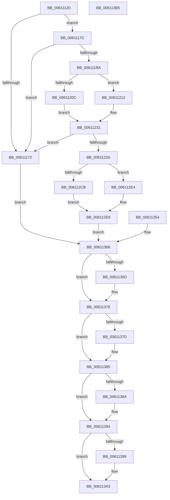

# SmRecordDecompressionFailureDumpPayload

- RVA: `0x00611120`–`0x006113B6` (길이 `662` bytes)
- VA: `0x0000000140611120`
- 실행 섹션: `.text`
- PDB 이름 있음: `예`; PDB Function 태그: `아니요`
- unwind 정보 RVA: `0x000D2034`
- 디코드: `175`개 명령, `662/662` bytes 표시
- 미해석 바이트: `0` (있으면 어셈블리에 `.byte`로 보존)

> 이 문서는 커널 이미지의 기계어와 PDB 기호를 분석해 생성했습니다. 4번과 5번은 함수 원형과 자료형을 바이너리 사용 방식에서 추정한 C 해석이며 원본 소스 복구 결과는 아닙니다.

## 1. Dependencies

- 직접 호출 지점: **14**; 고유 호출 대상: **10**
- 직접 호출자로 확인된 함수: **1**
- RIP 상대 이미지 참조: **4**

### Outgoing calls
- `0x00611160` → [SmAllocEx](../34/SmAllocEx_function_0034C794.md) (function, `0x0034C794`)
- `0x006111A8` → [SmAllocEx](../34/SmAllocEx_function_0034C794.md) (function, `0x0034C794`)
- `0x006111FA` → [MmProbeAndLockPages](../23/MmProbeAndLockPages_function_0023B990.md) (function, `0x0023B990`)
- `0x00611229` → [MmMapLockedPagesSpecifyCache](../31/MmMapLockedPagesSpecifyCache_function_00318800.md) (function, `0x00318800`)
- `0x00611294` → [MmGetPhysicalAddress](../23/MmGetPhysicalAddress_function_0023A500.md) (function, `0x0023A500`)
- `0x006112D8` → [MmGetPhysicalAddress](../23/MmGetPhysicalAddress_function_0023A500.md) (function, `0x0023A500`)
- `0x006112F4` → [MmGetPhysicalAddress](../23/MmGetPhysicalAddress_function_0023A500.md) (function, `0x0023A500`)
- `0x0061130E` → [memcpy](../6C/memcpy_function_006C6840.md) (function, `0x006C6840`)
- `0x0061131A` → [ExAcquireSpinLockExclusive](../24/ExAcquireSpinLockExclusive_function_00248690.md) (function, `0x00248690`)
- `0x00611348` → [ExReleaseSpinLockExclusive](../2C/ExReleaseSpinLockExclusive_function_002C0EF0.md) (function, `0x002C0EF0`)
- `0x00611373` → [MmUnmapLockedPages](../24/MmUnmapLockedPages_function_00246E60.md) (function, `0x00246E60`)
- `0x00611380` → [MmUnlockPages](../29/MmUnlockPages_function_0029EEE0.md) (function, `0x0029EEE0`)
- `0x0061138F` → [ExFreePoolWithTag](../../poolcode/B8/ExFreePoolWithTag_function_00B82870.md) (function, `0x00B82870`)
- `0x0061139E` → [ExFreePoolWithTag](../../poolcode/B8/ExFreePoolWithTag_function_00B82870.md) (function, `0x00B82870`)

### Direct callers
- [ST_STORE&lt;SM_TRAITS&gt;::StDmHandleDecompressionFailure](../60/ST_STORE_SM_TRAITS_StDmHandleDecompressionFailure_function_0060DA74.md) at `0x0060DD8C`

### Static image references
- `0x00611313` → RVA `0x00E28904` (`.data`; read)
- `0x0061131F` → RVA `0x00E28938` (`.data`; read)
- `0x00611326` → RVA `0x00E28938` (`.data`; write)
- `0x00611338` → RVA `0x00E28940` (`.data`; write)

## 2. Other-region calls and transfers

- 다른 실행 섹션으로 향하는 call: **2**
  - `0x0061138F` → [ExFreePoolWithTag](../../poolcode/B8/ExFreePoolWithTag_function_00B82870.md) (`.text` → `POOLCODE`)
  - `0x0061139E` → [ExFreePoolWithTag](../../poolcode/B8/ExFreePoolWithTag_function_00B82870.md) (`.text` → `POOLCODE`)
- 별도 외부 분기/꼬리 이동을 확인하지 못했습니다.

## 3. Assembly (complete function range)

```asm
00611120  44 89 4C 24 20                  mov dword ptr [rsp + 0x20], r9d
00611125  44 89 44 24 18                  mov dword ptr [rsp + 0x18], r8d
0061112A  89 54 24 10                     mov dword ptr [rsp + 0x10], edx
0061112E  53                              push rbx
0061112F  56                              push rsi
00611130  57                              push rdi
00611131  41 54                           push r12
00611133  41 55                           push r13
00611135  41 56                           push r14
00611137  41 57                           push r15
00611139  48 83 EC 60                     sub rsp, 0x60
0061113D  8B C2                           mov eax, edx
0061113F  4C 8B E9                        mov r13, rcx
00611142  33 F6                           xor esi, esi
00611144  8B FE                           mov edi, esi
00611146  44 8B FE                        mov r15d, esi
00611149  44 8B E6                        mov r12d, esi
0061114C  8B DA                           mov ebx, edx
0061114E  48 89 5C 24 40                  mov qword ptr [rsp + 0x40], rbx
00611153  48 8D 48 38                     lea rcx, [rax + 0x38]
00611157  41 83 C8 FF                     or r8d, 0xffffffff
0061115B  BA 73 6D 62 50                  mov edx, 0x50626d73
00611160  E8 2F B6 D3 FF                  call 0x14034c794
00611165  4C 8B F0                        mov r14, rax
00611168  48 89 44 24 50                  mov qword ptr [rsp + 0x50], rax
0061116D  48 85 C0                        test rax, rax
00611170  75 0A                           jne 0x14061117c
00611172  BB 9A 00 00 C0                  mov ebx, 0xc000009a
00611177  E9 EC 01 00 00                  jmp 0x140611368
0061117C  41 8B C5                        mov eax, r13d
0061117F  48 89 44 24 38                  mov qword ptr [rsp + 0x38], rax
00611184  25 FF 0F 00 00                  and eax, 0xfff
00611189  48 81 C3 FF 0F 00 00            add rbx, 0xfff
00611190  48 03 D8                        add rbx, rax
00611193  48 C1 EB 0C                     shr rbx, 0xc
00611197  48 8D 0C DD 30 00 00 00         lea rcx, [rbx*8 + 0x30]
0061119F  41 83 C8 FF                     or r8d, 0xffffffff
006111A3  BA 73 6D 42 50                  mov edx, 0x50426d73
006111A8  E8 E7 B5 D3 FF                  call 0x14034c794
006111AD  48 8B F8                        mov rdi, rax
006111B0  48 89 44 24 48                  mov qword ptr [rsp + 0x48], rax
006111B5  48 85 C0                        test rax, rax
006111B8  74 B8                           je 0x140611172
006111BA  48 89 30                        mov qword ptr [rax], rsi
006111BD  66 83 C3 06                     add bx, 6
006111C1  66 C1 E3 03                     shl bx, 3
006111C5  66 89 58 08                     mov word ptr [rax + 8], bx
006111C9  66 89 70 0A                     mov word ptr [rax + 0xa], si
006111CD  49 81 E5 00 F0 FF FF            and r13, 0xfffffffffffff000
006111D4  4C 89 68 20                     mov qword ptr [rax + 0x20], r13
006111D8  4C 8B 6C 24 38                  mov r13, qword ptr [rsp + 0x38]
006111DD  41 8B C5                        mov eax, r13d
006111E0  25 FF 0F 00 00                  and eax, 0xfff
006111E5  89 47 2C                        mov dword ptr [rdi + 0x2c], eax
006111E8  8B 9C 24 A8 00 00 00            mov ebx, dword ptr [rsp + 0xa8]
006111EF  89 5F 28                        mov dword ptr [rdi + 0x28], ebx
006111F2  45 33 C0                        xor r8d, r8d
006111F5  33 D2                           xor edx, edx
006111F7  48 8B CF                        mov rcx, rdi
006111FA  E8 91 A7 C2 FF                  call 0x14023b990
006111FF  90                              nop
00611200  41 BC 01 00 00 00               mov r12d, 1
00611206  F6 47 0A 05                     test byte ptr [rdi + 0xa], 5
0061120A  74 06                           je 0x140611212
0061120C  4C 8B 7F 18                     mov r15, qword ptr [rdi + 0x18]
00611210  EB 1F                           jmp 0x140611231
00611212  C7 44 24 28 20 00 00 40         mov dword ptr [rsp + 0x28], 0x40000020
0061121A  89 74 24 20                     mov dword ptr [rsp + 0x20], esi
0061121E  45 33 C9                        xor r9d, r9d
00611221  45 8B C4                        mov r8d, r12d
00611224  33 D2                           xor edx, edx
00611226  48 8B CF                        mov rcx, rdi
00611229  E8 D2 75 D0 FF                  call 0x140318800
0061122E  4C 8B F8                        mov r15, rax
00611231  4D 85 FF                        test r15, r15
00611234  0F 84 38 FF FF FF               je 0x140611172
0061123A  49 89 76 20                     mov qword ptr [r14 + 0x20], rsi
0061123E  49 89 76 28                     mov qword ptr [r14 + 0x28], rsi
00611242  49 89 76 30                     mov qword ptr [r14 + 0x30], rsi
00611246  49 89 76 38                     mov qword ptr [r14 + 0x38], rsi
0061124A  41 C7 06 03 00 01 00            mov dword ptr [r14], 0x10003
00611251  8B 84 24 B0 00 00 00            mov eax, dword ptr [rsp + 0xb0]
00611258  41 89 46 04                     mov dword ptr [r14 + 4], eax
0061125C  8B 84 24 B8 00 00 00            mov eax, dword ptr [rsp + 0xb8]
00611263  41 89 46 08                     mov dword ptr [r14 + 8], eax
00611267  41 89 5E 0C                     mov dword ptr [r14 + 0xc], ebx
0061126B  8B 84 24 C0 00 00 00            mov eax, dword ptr [rsp + 0xc0]
00611272  41 89 46 10                     mov dword ptr [r14 + 0x10], eax
00611276  8B 9C 24 D0 00 00 00            mov ebx, dword ptr [rsp + 0xd0]
0061127D  8B CB                           mov ecx, ebx
0061127F  41 2B CD                        sub ecx, r13d
00611282  41 89 4E 14                     mov dword ptr [r14 + 0x14], ecx
00611286  8B 84 24 C8 00 00 00            mov eax, dword ptr [rsp + 0xc8]
0061128D  49 89 46 18                     mov qword ptr [r14 + 0x18], rax
00611291  49 03 CF                        add rcx, r15
00611294  E8 67 92 C2 FF                  call 0x14023a500
00611299  48 99                           cqo
0061129B  41 BD 00 10 00 00               mov r13d, 0x1000
006112A1  49 F7 FD                        idiv r13
006112A4  49 89 46 20                     mov qword ptr [r14 + 0x20], rax
006112A8  81 E3 FF 0F 00 00               and ebx, 0xfff
006112AE  8B 94 24 B0 00 00 00            mov edx, dword ptr [rsp + 0xb0]
006112B5  48 8D 8A FF 0F 00 00            lea rcx, [rdx + 0xfff]
006112BC  48 03 CB                        add rcx, rbx
006112BF  48 81 E1 00 F0 FF FF            and rcx, 0xfffffffffffff000
006112C6  49 3B CD                        cmp rcx, r13
006112C9  74 19                           je 0x1406112e4
006112CB  8D 42 FF                        lea eax, [rdx - 1]
006112CE  41 8B 4E 14                     mov ecx, dword ptr [r14 + 0x14]
006112D2  49 03 C7                        add rax, r15
006112D5  48 03 C8                        add rcx, rax
006112D8  E8 23 92 C2 FF                  call 0x14023a500
006112DD  48 99                           cqo
006112DF  49 F7 FD                        idiv r13
006112E2  EB 04                           jmp 0x1406112e8
006112E4  48 83 C8 FF                     or rax, 0xffffffffffffffff
006112E8  49 89 46 28                     mov qword ptr [r14 + 0x28], rax
006112EC  48 8B 8C 24 D8 00 00 00         mov rcx, qword ptr [rsp + 0xd8]
006112F4  E8 07 92 C2 FF                  call 0x14023a500
006112F9  48 99                           cqo
006112FB  49 F7 FD                        idiv r13
006112FE  49 89 46 30                     mov qword ptr [r14 + 0x30], rax
00611302  49 8D 4E 38                     lea rcx, [r14 + 0x38]
00611306  4C 8B 44 24 40                  mov r8, qword ptr [rsp + 0x40]
0061130B  49 8B D7                        mov rdx, r15
0061130E  E8 2D 55 0B 00                  call 0x1406c6840
00611313  48 8D 0D EA 75 81 00            lea rcx, [rip + 0x8175ea]
0061131A  E8 71 73 C3 FF                  call 0x140248690
0061131F  48 8B 1D 12 76 81 00            mov rbx, qword ptr [rip + 0x817612]
00611326  4C 89 35 0B 76 81 00            mov qword ptr [rip + 0x81760b], r14
0061132D  48 8B 94 24 E0 00 00 00         mov rdx, qword ptr [rsp + 0xe0]
00611335  44 8B 02                        mov r8d, dword ptr [rdx]
00611338  44 89 05 01 76 81 00            mov dword ptr [rip + 0x817601], r8d
0061133F  8A D0                           mov dl, al
00611341  48 8D 0D BC 75 81 00            lea rcx, [rip + 0x8175bc]
00611348  E8 A3 FB CA FF                  call 0x1402c0ef0
0061134D  4C 8B F3                        mov r14, rbx
00611350  8B DE                           mov ebx, esi
00611352  EB 14                           jmp 0x140611368
00611354  8B D8                           mov ebx, eax
00611356  33 F6                           xor esi, esi
00611358  48 8B 7C 24 48                  mov rdi, qword ptr [rsp + 0x48]
0061135D  4C 8B 74 24 50                  mov r14, qword ptr [rsp + 0x50]
00611362  44 8B FE                        mov r15d, esi
00611365  44 8B E6                        mov r12d, esi
00611368  4D 85 FF                        test r15, r15
0061136B  74 0B                           je 0x140611378
0061136D  48 8B D7                        mov rdx, rdi
00611370  49 8B CF                        mov rcx, r15
00611373  E8 E8 5A C3 FF                  call 0x140246e60
00611378  45 85 E4                        test r12d, r12d
0061137B  74 08                           je 0x140611385
0061137D  48 8B CF                        mov rcx, rdi
00611380  E8 5B DB C8 FF                  call 0x14029eee0
00611385  48 85 FF                        test rdi, rdi
00611388  74 0A                           je 0x140611394
0061138A  33 D2                           xor edx, edx
0061138C  48 8B CF                        mov rcx, rdi
0061138F  E8 DC 14 57 00                  call 0x140b82870
00611394  4D 85 F6                        test r14, r14
00611397  74 0A                           je 0x1406113a3
00611399  33 D2                           xor edx, edx
0061139B  49 8B CE                        mov rcx, r14
0061139E  E8 CD 14 57 00                  call 0x140b82870
006113A3  8B C3                           mov eax, ebx
006113A5  48 83 C4 60                     add rsp, 0x60
006113A9  41 5F                           pop r15
006113AB  41 5E                           pop r14
006113AD  41 5D                           pop r13
006113AF  41 5C                           pop r12
006113B1  5F                              pop rdi
006113B2  5E                              pop rsi
006113B3  5B                              pop rbx
006113B4  C3                              ret
006113B5  CC                              int3
```

## 4. C-style interpretation (structured pseudocode)

```c
__int64 __fastcall SmRecordDecompressionFailureDumpPayload(__int64 a1, int a2, int a3, int a4, unsigned int a5, unsigned int a6, unsigned int a7, __int64 a8, __int64 a9)
{
    __int64 result;
    __int64 v_r13;
    __int64 v_rbx;
    __int64 v_rsi;
    __int64 v_rsp;
    unsigned __int64 v_stack_m48;
    unsigned __int64 v_stack_m50;
    unsigned __int64 v_stack_m58;
    unsigned __int64 v_stack_m60;
    unsigned int v_stack_m70;
    unsigned int v_stack_m78;
    unsigned int v_stack_p10;
    unsigned int v_stack_p18;
    unsigned int v_stack_p20;

    v_stack_p20 = a4;
    v_stack_p18 = a3;
    v_stack_p10 = a2;
    v_rsp = (v_rsp) - (96);
    v_rsi = 0;
    v_stack_m58 = (unsigned int)(a2);
    a3 = (unsigned int)((a3) | (0xFFFFFFFFULL));
    result = SmAllocEx((unsigned int)(a2) + 56, (unsigned int)(0x50626D73ULL), a3, a4);
    v_stack_m48 = result;
    if (result != 0) goto loc_0061117C;
loc_00611172:
    goto loc_00611368;
loc_0061117C:
    v_stack_m60 = (unsigned int)((unsigned int)(a1));
    result = (unsigned int)(((unsigned int)((unsigned int)(a1))) & (0xFFFULL));
    v_rbx = ((unsigned int)(0xC000009AULL)) + (0xFFFULL);
    v_rbx = (v_rbx) + (result);
    v_rbx = (v_rbx) >> (12);
    a3 = (unsigned int)((a3) | (0xFFFFFFFFULL));
    result = SmAllocEx(v_rbx * 8 + 48, (unsigned int)(0x50426D73ULL), a3, a4);
    v_stack_m50 = result;
    if (result == 0) goto loc_00611172;
    *(unsigned __int64 *)(result) = 0;
    v_rbx = (unsigned __int16)((v_rbx) + (6));
    v_rbx = (unsigned __int16)((v_rbx) << (3));
    *(unsigned __int16 *)(result + 8) = (unsigned __int16)(v_rbx);
    *(unsigned __int16 *)(result + 10) = 0;
    v_r13 = (a1) & (0xFFFFFFFFFFFFF000ULL);
    *(unsigned __int64 *)(result + 32) = v_r13;
    result = (unsigned int)(((unsigned int)((unsigned int)(v_stack_m60))) & (0xFFFULL));
    *(unsigned int *)(result + 44) = (unsigned int)(result);
    *(unsigned int *)(result + 40) = (unsigned int)((unsigned int)(v_stack_p10));
    a3 = 0;
    a2 = 0;
    result = MmProbeAndLockPages(result, a2, a3, a4);
    if (((*(unsigned __int8 *)(result + 10)) & (5)) == 0) goto loc_00611212;
    goto loc_00611231;
loc_00611212:
    v_stack_m70 = 0x40000020ULL;
    v_stack_m78 = 0;
    a4 = 0;
    a2 = 0;
    result = MmMapLockedPagesSpecifyCache(result, a2, 1, a4);
loc_00611231:
    if (result == 0) goto loc_00611172;
    *(unsigned __int64 *)(result + 32) = 0;
    *(unsigned __int64 *)(result + 40) = 0;
    *(unsigned __int64 *)(result + 48) = 0;
    *(unsigned __int64 *)(result + 56) = 0;
    *(unsigned int *)(result) = 0x10003ULL;
    *(unsigned int *)(result + 4) = (unsigned int)((unsigned int)(v_stack_p18));
    *(unsigned int *)(result + 8) = (unsigned int)((unsigned int)(v_stack_p20));
    *(unsigned int *)(result + 12) = (unsigned int)((unsigned int)(v_stack_p10));
    *(unsigned int *)(result + 16) = (unsigned int)((unsigned int)(a5));
    a1 = (unsigned int)(((unsigned int)((unsigned int)((unsigned int)(a7)))) - ((unsigned int)(v_stack_m60)));
    *(unsigned int *)(result + 20) = (unsigned int)(a1);
    *(unsigned __int64 *)(result + 24) = (unsigned int)(a6);
    a1 = (a1) + (result);
    result = MmGetPhysicalAddress(a1, a2, 1, a4);
    *(unsigned __int64 *)(result + 32) = result;
    v_rbx = (unsigned int)(((unsigned int)(a7)) & (0xFFFULL));
    a1 = ((unsigned int)(v_stack_p18) + 4095) + (v_rbx);
    a1 = (a1) & (0xFFFFFFFFFFFFF000ULL);
    if (a1 == ((unsigned int)(0x1000ULL))) goto loc_006112E4;
    result = ((unsigned int)(v_stack_p18) - 1) + (result);
    a1 = ((unsigned int)(*(unsigned int *)(result + 20))) + (result);
    result = MmGetPhysicalAddress(a1, (unsigned int)(v_stack_p18), 1, a4);
    goto loc_006112E8;
loc_006112E4:
    result = (result) | (-1);
loc_006112E8:
    *(unsigned __int64 *)(result + 40) = result;
    result = MmGetPhysicalAddress(a8, (unsigned int)(v_stack_p18), 1, a4);
    *(unsigned __int64 *)(result + 48) = result;
    result = memcpy(result + 56, result, v_stack_m58, a4);
    result = ExAcquireSpinLockExclusive(v_rip + 8484330, result, v_stack_m58, a4);
    *(unsigned __int64 *)(v_rip + 8484363) = result;
    *(unsigned int *)(v_rip + 8484353) = (unsigned int)((unsigned int)(*(unsigned int *)(a9)));
    result = ExReleaseSpinLockExclusive(v_rip + 8484284, (unsigned __int8)(result), (unsigned int)(*(unsigned int *)(a9)), a4);
    goto loc_00611368;
loc_00611368:
    if (result != 0) {
        a2 = result;
        a1 = result;
        result = MmUnmapLockedPages(a1, a2, (unsigned int)(*(unsigned int *)(a9)), a4);
    }
    if (1 != 0) {
        a1 = result;
        result = MmUnlockPages(a1, a2, (unsigned int)(*(unsigned int *)(a9)), a4);
    }
    if (result != 0) {
        a2 = 0;
        a1 = result;
        result = ExFreePoolWithTag(a1, a2, (unsigned int)(*(unsigned int *)(a9)), a4);
    }
    if (*(unsigned __int64 *)(v_rip + 8484370) != 0) {
        a2 = 0;
        a1 = *(unsigned __int64 *)(v_rip + 8484370);
        result = ExFreePoolWithTag(a1, a2, (unsigned int)(*(unsigned int *)(a9)), a4);
    }
    v_rsp = (v_rsp) + (96);
    return 0;
}
```

## 5. (Beta) C Style

```c
int64_t SmRecordDecompressionFailureDumpPayload(int64_t Arg1, void *Arg2, int32_t Arg3, int32_t Arg4, uint32_t Arg5, uint32_t Arg6, uint32_t Arg7, int64_t Arg8, void *Arg9)
{
    uint8_t *arg2 = (uint8_t *)Arg2;
    uint8_t *arg9 = (uint8_t *)Arg9;

    int64_t result;
    int64_t local_r13;
    int64_t local_rbx;
    int64_t local_rsi;
    int64_t local_rsp;
    uint64_t v_stack_m48;
    uint64_t v_stack_m50;
    uint64_t v_stack_m58;
    uint64_t v_stack_m60;
    uint32_t v_stack_m70;
    uint32_t v_stack_m78;
    uint32_t v_stack_p10;
    uint32_t v_stack_p18;
    uint32_t v_stack_p20;

    v_stack_p20 = Arg4;
    v_stack_p18 = Arg3;
    v_stack_p10 = Arg2;
    local_rsp = (local_rsp) - (96);
    local_rsi = 0;
    v_stack_m58 = (uint32_t)(Arg2);
    Arg3 = (uint32_t)((Arg3) | (0xFFFFFFFFULL));
    result = SmAllocEx((uint32_t)(Arg2) + 56, (uint32_t)(0x50626D73ULL), Arg3, Arg4);
    v_stack_m48 = result;
    if (result != 0) goto loc_0061117C;
loc_00611172:
    goto loc_00611368;
loc_0061117C:
    v_stack_m60 = (uint32_t)((uint32_t)(Arg1));
    result = (uint32_t)(((uint32_t)((uint32_t)(Arg1))) & (0xFFFULL));
    local_rbx = ((uint32_t)(0xC000009AULL)) + (0xFFFULL);
    local_rbx = (local_rbx) + (result);
    local_rbx = (local_rbx) >> (12);
    Arg3 = (uint32_t)((Arg3) | (0xFFFFFFFFULL));
    result = SmAllocEx(local_rbx * 8 + 48, (uint32_t)(0x50426D73ULL), Arg3, Arg4);
    v_stack_m50 = result;
    if (result == 0) goto loc_00611172;
    *(uint64_t *)(result) = 0;
    local_rbx = (uint16_t)((local_rbx) + (6));
    local_rbx = (uint16_t)((local_rbx) << (3));
    *(uint16_t *)(result + 0x8) = (uint16_t)(local_rbx);
    *(uint16_t *)(result + 0xA) = 0;
    local_r13 = (Arg1) & (0xFFFFFFFFFFFFF000ULL);
    *(uint64_t *)(result + 0x20) = local_r13;
    result = (uint32_t)(((uint32_t)((uint32_t)(v_stack_m60))) & (0xFFFULL));
    *(uint32_t *)(result + 0x2C) = (uint32_t)(result);
    *(uint32_t *)(result + 0x28) = (uint32_t)((uint32_t)(v_stack_p10));
    Arg3 = 0;
    Arg2 = 0;
    result = MmProbeAndLockPages(result, Arg2, Arg3, Arg4);
    if (((*(uint8_t *)(result + 0xA)) & (5)) == 0) goto loc_00611212;
    goto loc_00611231;
loc_00611212:
    v_stack_m70 = 0x40000020ULL;
    v_stack_m78 = 0;
    Arg4 = 0;
    Arg2 = 0;
    result = MmMapLockedPagesSpecifyCache(result, Arg2, 1, Arg4);
loc_00611231:
    if (result == 0) goto loc_00611172;
    *(uint64_t *)(result + 0x20) = 0;
    *(uint64_t *)(result + 0x28) = 0;
    *(uint64_t *)(result + 0x30) = 0;
    *(uint64_t *)(result + 0x38) = 0;
    *(uint32_t *)(result) = 0x10003ULL;
    *(uint32_t *)(result + 0x4) = (uint32_t)((uint32_t)(v_stack_p18));
    *(uint32_t *)(result + 0x8) = (uint32_t)((uint32_t)(v_stack_p20));
    *(uint32_t *)(result + 0xC) = (uint32_t)((uint32_t)(v_stack_p10));
    *(uint32_t *)(result + 0x10) = (uint32_t)((uint32_t)(Arg5));
    Arg1 = (uint32_t)(((uint32_t)((uint32_t)((uint32_t)(Arg7)))) - ((uint32_t)(v_stack_m60)));
    *(uint32_t *)(result + 0x14) = (uint32_t)(Arg1);
    *(uint64_t *)(result + 0x18) = (uint32_t)(Arg6);
    Arg1 = (Arg1) + (result);
    result = MmGetPhysicalAddress(Arg1, Arg2, 1, Arg4);
    *(uint64_t *)(result + 0x20) = result;
    local_rbx = (uint32_t)(((uint32_t)(Arg7)) & (0xFFFULL));
    Arg1 = ((uint32_t)(v_stack_p18) + 4095) + (local_rbx);
    Arg1 = (Arg1) & (0xFFFFFFFFFFFFF000ULL);
    if (Arg1 == ((uint32_t)(0x1000ULL))) goto loc_006112E4;
    result = ((uint32_t)(v_stack_p18) - 1) + (result);
    Arg1 = ((uint32_t)(*(uint32_t *)(result + 0x14))) + (result);
    result = MmGetPhysicalAddress(Arg1, (uint32_t)(v_stack_p18), 1, Arg4);
    goto loc_006112E8;
loc_006112E4:
    result = (result) | (-1);
loc_006112E8:
    *(uint64_t *)(result + 0x28) = result;
    result = MmGetPhysicalAddress(Arg8, (uint32_t)(v_stack_p18), 1, Arg4);
    *(uint64_t *)(result + 0x30) = result;
    result = memcpy(result + 56, result, v_stack_m58, Arg4);
    result = ExAcquireSpinLockExclusive(v_rip + 8484330, result, v_stack_m58, Arg4);
    *(uint64_t *)(v_rip + 0x81760B) = result;
    *(uint32_t *)(v_rip + 0x817601) = (uint32_t)((uint32_t)(*(uint32_t *)(arg9)));
    result = ExReleaseSpinLockExclusive(v_rip + 8484284, (uint8_t)(result), (uint32_t)(*(uint32_t *)(arg9)), Arg4);
    goto loc_00611368;
loc_00611368:
    if (result != 0) {
        Arg2 = result;
        Arg1 = result;
        result = MmUnmapLockedPages(Arg1, Arg2, (uint32_t)(*(uint32_t *)(arg9)), Arg4);
    }
    if (1 != 0) {
        Arg1 = result;
        result = MmUnlockPages(Arg1, Arg2, (uint32_t)(*(uint32_t *)(arg9)), Arg4);
    }
    if (result != 0) {
        Arg2 = 0;
        Arg1 = result;
        result = ExFreePoolWithTag(Arg1, Arg2, (uint32_t)(*(uint32_t *)(arg9)), Arg4);
    }
    if (*(uint64_t *)(v_rip + 0x817612) != 0) {
        Arg2 = 0;
        Arg1 = *(uint64_t *)(v_rip + 0x817612);
        result = ExFreePoolWithTag(Arg1, Arg2, (uint32_t)(*(uint32_t *)(arg9)), Arg4);
    }
    local_rsp = (local_rsp) + (96);
    return 0;
}
```

### 관측된 메모리 오프셋

구조체 형식이 확인되지 않은 접근은 인자 기준의 오프셋으로만 기록했습니다.

| 기준 인자 | 오프셋 표현 | 폭 (bit) | 접근 |
|---|---:|---:|---|
| `Arg2` | `+ 0x38` | `64` | `R` |
| `Arg9` | `+ 0x0` | `32` | `R` |

## 6. Execution-region graph

[열기: 2D/3D 그래프와 함수 탐색 컨트롤 패널](../../../control-panel.html?section=text&rva=0x00611120&view=graph)

- 2D 그래프는 위에서 아래로 흐르고, 3D 그래프는 빈 공간을 드래그해 회전합니다. Shift+드래그는 이동, 휠은 확대·축소, 함수 노드 선택은 대상 보고서 이동입니다.

### Static fallback


