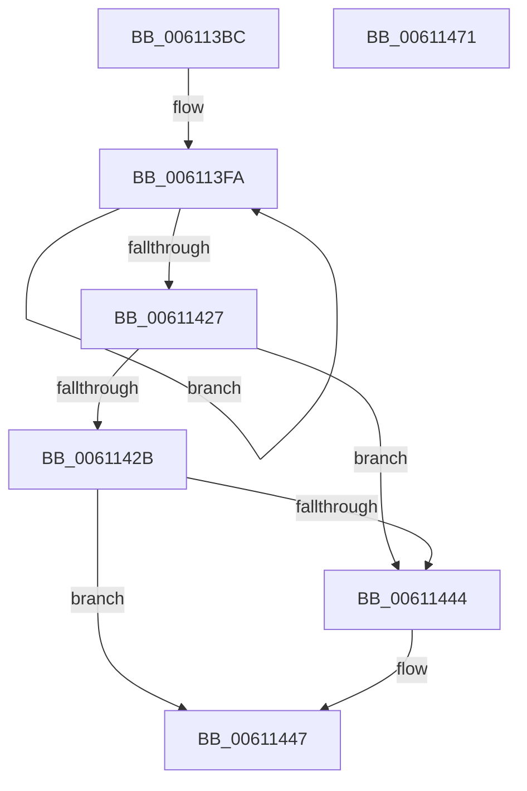

# SmStoreCompletePendingCompress

- RVA: `0x006113BC`–`0x00611472` (길이 `182` bytes)
- VA: `0x00000001406113BC`
- 실행 섹션: `.text`
- PDB 이름 있음: `예`; PDB Function 태그: `아니요`
- unwind 정보 RVA: `0x000BC81C`
- 디코드: `62`개 명령, `182/182` bytes 표시
- 미해석 바이트: `0` (있으면 어셈블리에 `.byte`로 보존)

> 이 문서는 커널 이미지의 기계어와 PDB 기호를 분석해 생성했습니다. 4번과 5번은 함수 원형과 자료형을 바이너리 사용 방식에서 추정한 C 해석이며 원본 소스 복구 결과는 아닙니다.

## 1. Dependencies

- 직접 호출 지점: **2**; 고유 호출 대상: **2**
- 직접 호출자로 확인된 함수: **1**
- RIP 상대 이미지 참조: **0**

### Outgoing calls
- `0x0061140F` → [SmHwAcceleratorWaitForRequest](SmHwAcceleratorWaitForRequest_function_00611A7C.md) (function, `0x00611A7C`)
- `0x00611439` → [SmStoreCompressCompleteCompressedChunks](SmStoreCompressCompleteCompressedChunks_function_00610A78.md) (function, `0x00610A78`)

### Direct callers
- [SMKM_STORE_MGR&lt;SM_TRAITS&gt;::SmCompressCtxCompletePendingEntry](../4A/SMKM_STORE_MGR_SM_TRAITS_SmCompressCtxCompletePendingEntry_function_004A59F8.md) at `0x004A5A79`

### Static image references
- 디코드된 RIP-relative 메모리 참조가 없습니다.

## 2. Other-region calls and transfers

- 다른 실행 섹션으로 향하는 call: **0**
- 별도 외부 분기/꼬리 이동을 확인하지 못했습니다.

## 3. Assembly (complete function range)

```asm
006113BC  48 8B C4                        mov rax, rsp
006113BF  48 89 58 08                     mov qword ptr [rax + 8], rbx
006113C3  48 89 68 18                     mov qword ptr [rax + 0x18], rbp
006113C7  48 89 70 20                     mov qword ptr [rax + 0x20], rsi
006113CB  57                              push rdi
006113CC  41 54                           push r12
006113CE  41 55                           push r13
006113D0  41 56                           push r14
006113D2  41 57                           push r15
006113D4  48 83 EC 40                     sub rsp, 0x40
006113D8  83 60 10 00                     and dword ptr [rax + 0x10], 0
006113DC  4C 8D 70 C8                     lea r14, [rax - 0x38]
006113E0  33 F6                           xor esi, esi
006113E2  4D 8B F9                        mov r15, r9
006113E5  83 FA 02                        cmp edx, 2
006113E8  4D 8B E8                        mov r13, r8
006113EB  4C 8B E1                        mov r12, rcx
006113EE  40 0F 94 C6                     sete sil
006113F2  33 FF                           xor edi, edi
006113F4  FF C6                           inc esi
006113F6  33 DB                           xor ebx, ebx
006113F8  33 ED                           xor ebp, ebp
006113FA  48 8D 44 24 78                  lea rax, [rsp + 0x78]
006113FF  4D 8B CE                        mov r9, r14
00611402  45 33 C0                        xor r8d, r8d
00611405  48 89 44 24 20                  mov qword ptr [rsp + 0x20], rax
0061140A  8B D5                           mov edx, ebp
0061140C  49 8B CD                        mov rcx, r13
0061140F  E8 68 06 00 00                  call 0x140611a7c
00611414  85 C0                           test eax, eax
00611416  0F 48 D8                        cmovs ebx, eax
00611419  03 7C 24 78                     add edi, dword ptr [rsp + 0x78]
0061141D  FF C5                           inc ebp
0061141F  49 83 C6 04                     add r14, 4
00611423  3B EE                           cmp ebp, esi
00611425  72 D3                           jb 0x1406113fa
00611427  85 DB                           test ebx, ebx
00611429  78 19                           js 0x140611444
0061142B  4D 8B CF                        mov r9, r15
0061142E  48 8D 54 24 30                  lea rdx, [rsp + 0x30]
00611433  44 8B C6                        mov r8d, esi
00611436  49 8B CC                        mov rcx, r12
00611439  E8 3A F6 FF FF                  call 0x140610a78
0061143E  8B D8                           mov ebx, eax
00611440  85 C0                           test eax, eax
00611442  79 03                           jns 0x140611447
00611444  83 CF FF                        or edi, 0xffffffff
00611447  48 8B 84 24 90 00 00 00         mov rax, qword ptr [rsp + 0x90]
0061144F  4C 8D 5C 24 40                  lea r11, [rsp + 0x40]
00611454  89 38                           mov dword ptr [rax], edi
00611456  8B C3                           mov eax, ebx
00611458  49 8B 5B 30                     mov rbx, qword ptr [r11 + 0x30]
0061145C  49 8B 6B 40                     mov rbp, qword ptr [r11 + 0x40]
00611460  49 8B 73 48                     mov rsi, qword ptr [r11 + 0x48]
00611464  49 8B E3                        mov rsp, r11
00611467  41 5F                           pop r15
00611469  41 5E                           pop r14
0061146B  41 5D                           pop r13
0061146D  41 5C                           pop r12
0061146F  5F                              pop rdi
00611470  C3                              ret
00611471  CC                              int3
```

## 4. C-style interpretation (structured pseudocode)

```c
__int64 __fastcall SmStoreCompletePendingCompress(__int64 a1, int a2, __int64 a3, __int64 a4, __int64 a5)
{
    __int64 result;
    __int64 v_r14;
    __int64 v_rbp;
    __int64 v_rbx;
    __int64 v_rdi;
    __int64 v_rsi;
    __int64 v_rsp;
    unsigned __int64 v_stack_m28;
    unsigned __int64 v_stack_m38;
    unsigned __int64 v_stack_m48;
    unsigned __int64 v_stack_p10;

    *(unsigned __int64 *)(v_rsp + 8) = v_rbx;
    *(unsigned __int64 *)(v_rsp + 24) = v_rbp;
    *(unsigned __int64 *)(v_rsp + 32) = v_rsi;
    v_rsp = (v_rsp) - (64);
    v_rsi = 0;
    v_rsi = (a2 == 2) ? 1 : 0;
    v_rdi = 0;
    v_rsi = (unsigned int)((v_rsi) + 1);
    v_rbx = 0;
    v_rbp = 0;
loc_006113FA:
    a3 = 0;
    v_stack_m48 = v_stack_p10;
    result = SmHwAcceleratorWaitForRequest(0, 0, a3, v_rsp - 56);
    if (sign_flag) { v_rbx = (unsigned int)(result); }
    v_rdi = (unsigned int)((v_rdi) + (v_stack_p10));
    v_rbp = (unsigned int)((v_rbp) + 1);
    v_r14 = (v_rsp - 56) + (4);
    if (((unsigned int)(v_rbp)) < ((unsigned int)(v_rsi))) goto loc_006113FA;
    if (sign_flag) goto loc_00611444;
    result = SmStoreCompressCompleteCompressedChunks(a1, v_stack_m38, (unsigned int)((unsigned int)(v_rsi)), a4);
    if (sign_flag) {
        v_rdi = (unsigned int)((v_rdi) | (0xFFFFFFFFULL));
    }
    *(unsigned int *)(a5) = (unsigned int)(v_rdi);
    return (unsigned int)((unsigned int)((unsigned int)((unsigned int)(result))));
}
```

## 5. (Beta) C Style

```c
int64_t SmStoreCompletePendingCompress(int64_t Arg1, int32_t Arg2, int64_t Arg3, int64_t Arg4, void *Arg5)
{
    uint8_t *arg5 = (uint8_t *)Arg5;

    int64_t result;
    int64_t local_r14;
    int64_t local_rbp;
    int64_t local_rbx;
    int64_t local_rdi;
    int64_t local_rsi;
    int64_t local_rsp;
    uint64_t v_stack_m28;
    uint64_t v_stack_m38;
    uint64_t v_stack_m48;
    uint64_t v_stack_p10;

    *(uint64_t *)(local_rsp + 0x8) = local_rbx;
    *(uint64_t *)(local_rsp + 0x18) = local_rbp;
    *(uint64_t *)(local_rsp + 0x20) = local_rsi;
    local_rsp = (local_rsp) - (64);
    local_rsi = 0;
    local_rsi = (Arg2 == 2) ? 1 : 0;
    local_rdi = 0;
    local_rsi = (uint32_t)((local_rsi) + 1);
    local_rbx = 0;
    local_rbp = 0;
loc_006113FA:
    Arg3 = 0;
    v_stack_m48 = v_stack_p10;
    result = SmHwAcceleratorWaitForRequest(0, 0, Arg3, local_rsp - 56);
    if (sign_flag) { local_rbx = (uint32_t)(result); }
    local_rdi = (uint32_t)((local_rdi) + (v_stack_p10));
    local_rbp = (uint32_t)((local_rbp) + 1);
    local_r14 = (local_rsp - 56) + (4);
    if (((uint32_t)(local_rbp)) < ((uint32_t)(local_rsi))) goto loc_006113FA;
    if (sign_flag) goto loc_00611444;
    result = SmStoreCompressCompleteCompressedChunks(Arg1, v_stack_m38, (uint32_t)((uint32_t)(local_rsi)), Arg4);
    if (sign_flag) {
        local_rdi = (uint32_t)((local_rdi) | (0xFFFFFFFFULL));
    }
    *(uint32_t *)(arg5) = (uint32_t)(local_rdi);
    return (uint32_t)((uint32_t)((uint32_t)((uint32_t)(result))));
}
```

### 관측된 메모리 오프셋

구조체 형식이 확인되지 않은 접근은 인자 기준의 오프셋으로만 기록했습니다.

| 기준 인자 | 오프셋 표현 | 폭 (bit) | 접근 |
|---|---:|---:|---|
| `Arg5` | `+ 0x0` | `32` | `W` |

## 6. Execution-region graph

[열기: 2D/3D 그래프와 함수 탐색 컨트롤 패널](../../../control-panel.html?section=text&rva=0x006113BC&view=graph)

- 2D 그래프는 위에서 아래로 흐르고, 3D 그래프는 빈 공간을 드래그해 회전합니다. Shift+드래그는 이동, 휠은 확대·축소, 함수 노드 선택은 대상 보고서 이동입니다.

### Static fallback


