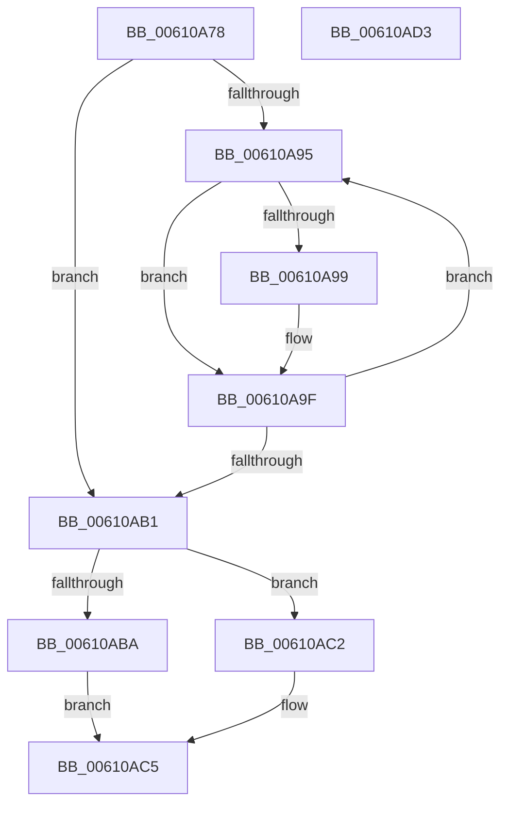

# SmStoreCompressCompleteCompressedChunks

- RVA: `0x00610A78`–`0x00610AD4` (길이 `92` bytes)
- VA: `0x0000000140610A78`
- 실행 섹션: `.text`
- PDB 이름 있음: `예`; PDB Function 태그: `아니요`
- unwind 정보 RVA: `0x000950EC`
- 디코드: `28`개 명령, `92/92` bytes 표시
- 미해석 바이트: `0` (있으면 어셈블리에 `.byte`로 보존)

> 이 문서는 커널 이미지의 기계어와 PDB 기호를 분석해 생성했습니다. 4번과 5번은 함수 원형과 자료형을 바이너리 사용 방식에서 추정한 C 해석이며 원본 소스 복구 결과는 아닙니다.

## 1. Dependencies

- 직접 호출 지점: **0**; 고유 호출 대상: **0**
- 직접 호출자로 확인된 함수: **2**
- RIP 상대 이미지 참조: **0**

### Outgoing calls
- 직접 디코드된 call 명령이 없습니다.

### Direct callers
- [SmStoreCompletePendingCompress](SmStoreCompletePendingCompress_function_006113BC.md) at `0x00611439`
- [sub_006D904C](../6D/Unknown_function_006D904C.md) at `0x006D911F`

### Static image references
- 디코드된 RIP-relative 메모리 참조가 없습니다.

## 2. Other-region calls and transfers

- 다른 실행 섹션으로 향하는 call: **0**
- 별도 외부 분기/꼬리 이동을 확인하지 못했습니다.

## 3. Assembly (complete function range)

```asm
00610A78  48 89 5C 24 08                  mov qword ptr [rsp + 8], rbx
00610A7D  48 89 7C 24 10                  mov qword ptr [rsp + 0x10], rdi
00610A82  45 33 DB                        xor r11d, r11d
00610A85  41 8D 78 FF                     lea edi, [r8 - 1]
00610A89  44 8D 14 3F                     lea r10d, [rdi + rdi]
00610A8D  41 8B DB                        mov ebx, r11d
00610A90  45 85 C0                        test r8d, r8d
00610A93  74 1C                           je 0x140610ab1
00610A95  3B DF                           cmp ebx, edi
00610A97  74 06                           je 0x140610a9f
00610A99  0F B7 02                        movzx eax, word ptr [rdx]
00610A9C  66 89 01                        mov word ptr [rcx], ax
00610A9F  44 03 12                        add r10d, dword ptr [rdx]
00610AA2  FF C3                           inc ebx
00610AA4  48 83 C2 04                     add rdx, 4
00610AA8  48 83 C1 02                     add rcx, 2
00610AAC  41 3B D8                        cmp ebx, r8d
00610AAF  72 E4                           jb 0x140610a95
00610AB1  41 81 FA 80 0F 00 00            cmp r10d, 0xf80
00610AB8  72 08                           jb 0x140610ac2
00610ABA  41 BB 23 00 00 C0               mov r11d, 0xc0000023
00610AC0  EB 03                           jmp 0x140610ac5
00610AC2  45 89 11                        mov dword ptr [r9], r10d
00610AC5  48 8B 5C 24 08                  mov rbx, qword ptr [rsp + 8]
00610ACA  41 8B C3                        mov eax, r11d
00610ACD  48 8B 7C 24 10                  mov rdi, qword ptr [rsp + 0x10]
00610AD2  C3                              ret
00610AD3  CC                              int3
```

## 4. C-style interpretation (structured pseudocode)

```c
__int64 __fastcall SmStoreCompressCompleteCompressedChunks(__int64 a1, __int64 a2, __int64 a3, __int64 a4)
{
    __int64 result;
    __int64 v_r10;
    __int64 v_r11;
    __int64 v_rbx;
    unsigned __int64 v_stack_p10;
    unsigned __int64 v_stack_p8;

    v_stack_p8 = v_rbx;
    v_stack_p10 = v_rdi;
    v_r11 = 0;
    if ((unsigned int)(a3) == 0) goto loc_00610AB1;
loc_00610A95:
    if (0 != ((unsigned int)(a3 - 1))) {
        result = *(unsigned __int16 *)(a2);
        *(unsigned __int16 *)(a1) = (unsigned __int16)(result);
    }
    v_r10 = (unsigned int)((a3 - 1 + a3 - 1 * 1) + (*(unsigned int *)(a2)));
    v_rbx = (unsigned int)((0) + 1);
    a2 = (a2) + (4);
    a1 = (a1) + (2);
    if (((unsigned int)(v_rbx)) < ((unsigned int)(a3))) goto loc_00610A95;
loc_00610AB1:
    if (((unsigned int)(v_r10)) < 0xF80ULL) goto loc_00610AC2;
    goto loc_00610AC5;
loc_00610AC2:
    *(unsigned int *)(a4) = (unsigned int)(v_r10);
loc_00610AC5:
    return (unsigned int)((unsigned int)((unsigned int)(0xC0000023ULL)));
}
```

## 5. (Beta) C Style

```c
int64_t SmStoreCompressCompleteCompressedChunks(void *Arg1, void *Arg2, void *Arg3, void *Arg4)
{
    uint8_t *arg1 = (uint8_t *)Arg1;
    uint8_t *arg2 = (uint8_t *)Arg2;
    uint8_t *arg3 = (uint8_t *)Arg3;
    uint8_t *arg4 = (uint8_t *)Arg4;

    int64_t result;
    int64_t local_r10;
    int64_t local_r11;
    int64_t local_rbx;
    uint64_t v_stack_p10;
    uint64_t v_stack_p8;

    v_stack_p8 = local_rbx;
    v_stack_p10 = local_rdi;
    local_r11 = 0;
    if ((uint32_t)(Arg3) == 0) goto loc_00610AB1;
loc_00610A95:
    if (0 != ((uint32_t)(Arg3 - 1))) {
        result = *(uint16_t *)(arg2);
        *(uint16_t *)(arg1) = (uint16_t)(result);
    }
    local_r10 = (uint32_t)((Arg3 - 1 + Arg3 - 1 * 1) + (*(uint32_t *)(arg2)));
    local_rbx = (uint32_t)((0) + 1);
    Arg2 = (Arg2) + (4);
    Arg1 = (Arg1) + (2);
    if (((uint32_t)(local_rbx)) < ((uint32_t)(Arg3))) goto loc_00610A95;
loc_00610AB1:
    if (((uint32_t)(local_r10)) < 0xF80ULL) goto loc_00610AC2;
    goto loc_00610AC5;
loc_00610AC2:
    *(uint32_t *)(arg4) = (uint32_t)(local_r10);
loc_00610AC5:
    return (uint32_t)((uint32_t)((uint32_t)(0xC0000023ULL)));
}
```

### 관측된 메모리 오프셋

구조체 형식이 확인되지 않은 접근은 인자 기준의 오프셋으로만 기록했습니다.

| 기준 인자 | 오프셋 표현 | 폭 (bit) | 접근 |
|---|---:|---:|---|
| `Arg1` | `+ 0x0` | `16` | `W` |
| `Arg2` | `+ 0x0` | `16` | `R` |
| `Arg2` | `+ 0x0` | `32` | `R` |
| `Arg3` | `- 0x1` | `32` | `R` |
| `Arg3` | `+ 0x0 + rdi*1` | `32` | `R` |
| `Arg4` | `+ 0x0` | `32` | `W` |

## 6. Execution-region graph

[열기: 2D/3D 그래프와 함수 탐색 컨트롤 패널](../../../control-panel.html?section=text&rva=0x00610A78&view=graph)

- 2D 그래프는 위에서 아래로 흐르고, 3D 그래프는 빈 공간을 드래그해 회전합니다. Shift+드래그는 이동, 휠은 확대·축소, 함수 노드 선택은 대상 보고서 이동입니다.

### Static fallback


