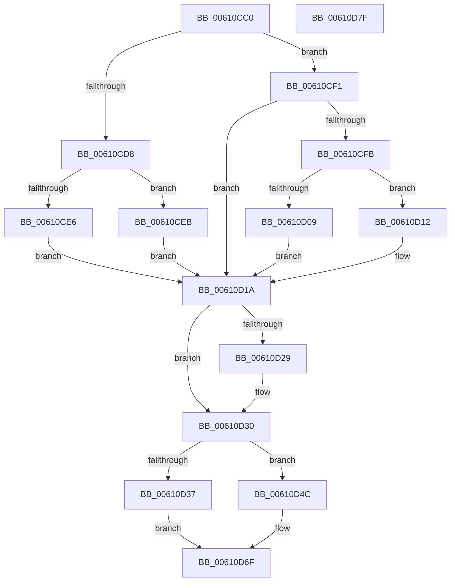

# SmpDeviceIoCompletion

- RVA: `0x00610CC0`–`0x00610D80` (길이 `192` bytes)
- VA: `0x0000000140610CC0`
- 실행 섹션: `.text`
- PDB 이름 있음: `예`; PDB Function 태그: `아니요`
- unwind 정보 RVA: `0x0005CAAC`
- 디코드: `52`개 명령, `192/192` bytes 표시
- 미해석 바이트: `0` (있으면 어셈블리에 `.byte`로 보존)

> 이 문서는 커널 이미지의 기계어와 PDB 기호를 분석해 생성했습니다. 4번과 5번은 함수 원형과 자료형을 바이너리 사용 방식에서 추정한 C 해석이며 원본 소스 복구 결과는 아닙니다.

## 1. Dependencies

- 직접 호출 지점: **4**; 고유 호출 대상: **4**
- 직접 호출자로 확인된 함수: **0**
- RIP 상대 이미지 참조: **0**

### Outgoing calls
- `0x00610D1D` → [IoFreeIrp](../24/IoFreeIrp_function_0024DF70.md) (function, `0x0024DF70`)
- `0x00610D45` → [KeSetEvent](../33/KeSetEvent_function_0033F310.md) (function, `0x0033F310`)
- `0x00610D58` → [SmWorkItemQueue](../31/SmWorkItemQueue_function_0031799C.md) (function, `0x0031799C`)
- `0x00610D6A` → [SmKmStoreDereference](../20/SmKmStoreDereference_function_00206574.md) (function, `0x00206574`)

### Direct callers
- 이 함수 시작 RVA로 연결되는 직접 call은 확인되지 않았습니다. 간접 호출은 완전히 역산할 수 없습니다.

### Static image references
- 디코드된 RIP-relative 메모리 참조가 없습니다.

## 2. Other-region calls and transfers

- 다른 실행 섹션으로 향하는 call: **0**
- 별도 외부 분기/꼬리 이동을 확인하지 못했습니다.

## 3. Assembly (complete function range)

```asm
00610CC0  48 89 5C 24 08                  mov qword ptr [rsp + 8], rbx
00610CC5  57                              push rdi
00610CC6  48 83 EC 20                     sub rsp, 0x20
00610CCA  8B 42 30                        mov eax, dword ptr [rdx + 0x30]
00610CCD  49 8B D8                        mov rbx, r8
00610CD0  49 8B 78 28                     mov rdi, qword ptr [r8 + 0x28]
00610CD4  85 C0                           test eax, eax
00610CD6  79 19                           jns 0x140610cf1
00610CD8  41 83 48 1C 01                  or dword ptr [r8 + 0x1c], 1
00610CDD  49 8B 48 10                     mov rcx, qword ptr [r8 + 0x10]
00610CE1  48 85 C9                        test rcx, rcx
00610CE4  74 05                           je 0x140610ceb
00610CE6  89 41 04                        mov dword ptr [rcx + 4], eax
00610CE9  EB 2F                           jmp 0x140610d1a
00610CEB  41 89 40 08                     mov dword ptr [r8 + 8], eax
00610CEF  EB 29                           jmp 0x140610d1a
00610CF1  41 8B 40 20                     mov eax, dword ptr [r8 + 0x20]
00610CF5  48 39 42 38                     cmp qword ptr [rdx + 0x38], rax
00610CF9  73 1F                           jae 0x140610d1a
00610CFB  41 83 48 1C 01                  or dword ptr [r8 + 0x1c], 1
00610D00  49 8B 40 10                     mov rax, qword ptr [r8 + 0x10]
00610D04  48 85 C0                        test rax, rax
00610D07  74 09                           je 0x140610d12
00610D09  C7 40 04 85 01 00 C0            mov dword ptr [rax + 4], 0xc0000185
00610D10  EB 08                           jmp 0x140610d1a
00610D12  41 C7 40 08 85 01 00 C0         mov dword ptr [r8 + 8], 0xc0000185
00610D1A  48 8B CA                        mov rcx, rdx
00610D1D  E8 4E D2 C3 FF                  call 0x14024df70
00610D22  48 83 7B 10 00                  cmp qword ptr [rbx + 0x10], 0
00610D27  74 07                           je 0x140610d30
00610D29  F0 FF 8F 08 1B 00 00            lock dec dword ptr [rdi + 0x1b08]
00610D30  8B 43 1C                        mov eax, dword ptr [rbx + 0x1c]
00610D33  A8 04                           test al, 4
00610D35  74 15                           je 0x140610d4c
00610D37  45 33 C0                        xor r8d, r8d
00610D3A  48 8D 8F 40 1B 00 00            lea rcx, [rdi + 0x1b40]
00610D41  41 8D 50 01                     lea edx, [r8 + 1]
00610D45  E8 C6 E5 D2 FF                  call 0x14033f310
00610D4A  EB 23                           jmp 0x140610d6f
00610D4C  41 B8 01 00 00 00               mov r8d, 1
00610D52  48 8B D3                        mov rdx, rbx
00610D55  48 8B CF                        mov rcx, rdi
00610D58  E8 3F 6C D0 FF                  call 0x14031799c
00610D5D  8B 97 90 1A 00 00               mov edx, dword ptr [rdi + 0x1a90]
00610D63  48 8B 8F 90 1D 00 00            mov rcx, qword ptr [rdi + 0x1d90]
00610D6A  E8 05 58 BF FF                  call 0x140206574
00610D6F  48 8B 5C 24 30                  mov rbx, qword ptr [rsp + 0x30]
00610D74  B8 16 00 00 C0                  mov eax, 0xc0000016
00610D79  48 83 C4 20                     add rsp, 0x20
00610D7D  5F                              pop rdi
00610D7E  C3                              ret
00610D7F  CC                              int3
```

## 4. C-style interpretation (structured pseudocode)

```c
__int64 __fastcall SmpDeviceIoCompletion(__int64 a1, __int64 a2, __int64 a3)
{
    __int64 result;
    __int64 v_rsp;
    unsigned __int64 v_stack_p8;

    v_stack_p8 = v_rbx;
    v_rsp = (v_rsp) - (32);
    if (!sign_flag) goto loc_00610CF1;
    if (*(unsigned __int64 *)(a3 + 16) == 0) goto loc_00610CEB;
    *(unsigned int *)(*(unsigned __int64 *)(a3 + 16) + 4) = (unsigned int)((unsigned int)(*(unsigned int *)(a2 + 48)));
    goto loc_00610D1A;
loc_00610CEB:
    *(unsigned int *)(a3 + 8) = (unsigned int)((unsigned int)(*(unsigned int *)(a2 + 48)));
    goto loc_00610D1A;
loc_00610CF1:
    if ((*(unsigned __int64 *)(a2 + 56)) >= ((unsigned int)(*(unsigned int *)(a3 + 32)))) goto loc_00610D1A;
    if (*(unsigned __int64 *)(a3 + 16) == 0) goto loc_00610D12;
    *(unsigned int *)(*(unsigned __int64 *)(a3 + 16) + 4) = 0xC0000185ULL;
    goto loc_00610D1A;
loc_00610D12:
    *(unsigned int *)(a3 + 8) = 0xC0000185ULL;
loc_00610D1A:
    result = IoFreeIrp(a2, a2, a3, a4);
    if ((*(unsigned __int64 *)(a3 + 16)) != 0) {
    }
    if ((((unsigned __int8)((unsigned int)(*(unsigned int *)(a3 + 28)))) & (4)) == 0) goto loc_00610D4C;
    a3 = 0;
    result = KeSetEvent(*(unsigned __int64 *)(a3 + 40) + 6976, a3 + 1, a3, a4);
    goto loc_00610D6F;
loc_00610D4C:
    result = SmWorkItemQueue(*(unsigned __int64 *)(a3 + 40), 0, 1, a4);
    result = SmKmStoreDereference(*(unsigned __int64 *)(*(unsigned __int64 *)(a3 + 40) + 7568), (unsigned int)(*(unsigned int *)(*(unsigned __int64 *)(a3 + 40) + 6800)), 1, a4);
loc_00610D6F:
    v_rsp = (v_rsp) + (32);
    return (unsigned int)(0xC0000016ULL);
}
```

## 5. (Beta) C Style

```c
int64_t SmpDeviceIoCompletion(int64_t Arg1, void *Arg2, void *Arg3)
{
    uint8_t *arg2 = (uint8_t *)Arg2;
    uint8_t *arg3 = (uint8_t *)Arg3;

    int64_t result;
    int64_t local_rsp;
    uint64_t v_stack_p8;

    v_stack_p8 = local_rbx;
    local_rsp = (local_rsp) - (32);
    if (!sign_flag) goto loc_00610CF1;
    if (*(uint64_t *)(arg3 + 0x10) == 0) goto loc_00610CEB;
    *(uint32_t *)(*(uint64_t *)(arg3 + 0x10) + 0x4) = (uint32_t)((uint32_t)(*(uint32_t *)(arg2 + 0x30)));
    goto loc_00610D1A;
loc_00610CEB:
    *(uint32_t *)(arg3 + 0x8) = (uint32_t)((uint32_t)(*(uint32_t *)(arg2 + 0x30)));
    goto loc_00610D1A;
loc_00610CF1:
    if ((*(uint64_t *)(arg2 + 0x38)) >= ((uint32_t)(*(uint32_t *)(arg3 + 0x20)))) goto loc_00610D1A;
    if (*(uint64_t *)(arg3 + 0x10) == 0) goto loc_00610D12;
    *(uint32_t *)(*(uint64_t *)(arg3 + 0x10) + 0x4) = 0xC0000185ULL;
    goto loc_00610D1A;
loc_00610D12:
    *(uint32_t *)(arg3 + 0x8) = 0xC0000185ULL;
loc_00610D1A:
    result = IoFreeIrp(Arg2, Arg2, Arg3, a4);
    if ((*(uint64_t *)(arg3 + 0x10)) != 0) {
    }
    if ((((uint8_t)((uint32_t)(*(uint32_t *)(arg3 + 0x1C)))) & (4)) == 0) goto loc_00610D4C;
    Arg3 = 0;
    result = KeSetEvent(*(uint64_t *)(arg3 + 0x28) + 6976, Arg3 + 1, Arg3, a4);
    goto loc_00610D6F;
loc_00610D4C:
    result = SmWorkItemQueue(*(uint64_t *)(arg3 + 0x28), 0, 1, a4);
    result = SmKmStoreDereference(*(uint64_t *)(*(uint64_t *)(arg3 + 0x28) + 0x1D90), (uint32_t)(*(uint32_t *)(*(uint64_t *)(arg3 + 0x28) + 0x1A90)), 1, a4);
loc_00610D6F:
    local_rsp = (local_rsp) + (32);
    return (uint32_t)(0xC0000016ULL);
}
```

### 관측된 메모리 오프셋

구조체 형식이 확인되지 않은 접근은 인자 기준의 오프셋으로만 기록했습니다.

| 기준 인자 | 오프셋 표현 | 폭 (bit) | 접근 |
|---|---:|---:|---|
| `Arg2` | `+ 0x30` | `32` | `R` |
| `Arg2` | `+ 0x38` | `64` | `R` |
| `Arg3` | `+ 0x8` | `32` | `W` |
| `Arg3` | `+ 0x10` | `64` | `R` |
| `Arg3` | `+ 0x1C` | `32` | `R` |
| `Arg3` | `+ 0x1C` | `32` | `R/W` |
| `Arg3` | `+ 0x20` | `32` | `R` |
| `Arg3` | `+ 0x28` | `64` | `R` |

## 6. Execution-region graph

[열기: 2D/3D 그래프와 함수 탐색 컨트롤 패널](../../../control-panel.html?section=text&rva=0x00610CC0&view=graph)

- 2D 그래프는 위에서 아래로 흐르고, 3D 그래프는 빈 공간을 드래그해 회전합니다. Shift+드래그는 이동, 휠은 확대·축소, 함수 노드 선택은 대상 보고서 이동입니다.

### Static fallback


