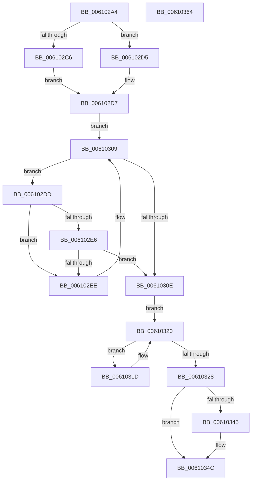

# SmpFpWaitForResource

- RVA: `0x006102A4`–`0x00610365` (길이 `193` bytes)
- VA: `0x00000001406102A4`
- 실행 섹션: `.text`
- PDB 이름 있음: `예`; PDB Function 태그: `아니요`
- unwind 정보 RVA: `0x00066400`
- 디코드: `57`개 명령, `193/193` bytes 표시
- 미해석 바이트: `0` (있으면 어셈블리에 `.byte`로 보존)

> 이 문서는 커널 이미지의 기계어와 PDB 기호를 분석해 생성했습니다. 4번과 5번은 함수 원형과 자료형을 바이너리 사용 방식에서 추정한 C 해석이며 원본 소스 복구 결과는 아닙니다.

## 1. Dependencies

- 직접 호출 지점: **3**; 고유 호출 대상: **3**
- 직접 호출자로 확인된 함수: **1**
- RIP 상대 이미지 참조: **0**

### Outgoing calls
- `0x00610300` → [KeWaitForSingleObject](../20/KeWaitForSingleObject_function_0020E6B0.md) (function, `0x0020E6B0`)
- `0x00610311` → [ExAcquireSpinLockExclusive](../24/ExAcquireSpinLockExclusive_function_00248690.md) (function, `0x00248690`)
- `0x0061033C` → [ExReleaseSpinLockExclusive](../2C/ExReleaseSpinLockExclusive_function_002C0EF0.md) (function, `0x002C0EF0`)

### Direct callers
- [SmFpAllocate](../31/SmFpAllocate_function_00317D10.md) at `0x00317E12`

### Static image references
- 디코드된 RIP-relative 메모리 참조가 없습니다.

## 2. Other-region calls and transfers

- 다른 실행 섹션으로 향하는 call: **0**
- 별도 외부 분기/꼬리 이동을 확인하지 못했습니다.

## 3. Assembly (complete function range)

```asm
006102A4  48 89 5C 24 08                  mov qword ptr [rsp + 8], rbx
006102A9  48 89 6C 24 10                  mov qword ptr [rsp + 0x10], rbp
006102AE  48 89 74 24 18                  mov qword ptr [rsp + 0x18], rsi
006102B3  57                              push rdi
006102B4  48 83 EC 30                     sub rsp, 0x30
006102B8  48 63 EA                        movsxd rbp, edx
006102BB  49 8B F8                        mov rdi, r8
006102BE  48 8B D9                        mov rbx, rcx
006102C1  4D 85 C0                        test r8, r8
006102C4  75 0F                           jne 0x1406102d5
006102C6  65 48 8B 3C 25 88 01 00 00      mov rdi, qword ptr gs:[0x188]
006102CF  41 8D 70 01                     lea esi, [r8 + 1]
006102D3  EB 02                           jmp 0x1406102d7
006102D5  33 F6                           xor esi, esi
006102D7  48 8B 41 70                     mov rax, qword ptr [rcx + 0x70]
006102DB  EB 2C                           jmp 0x140610309
006102DD  48 8B 43 70                     mov rax, qword ptr [rbx + 0x70]
006102E1  48 85 C0                        test rax, rax
006102E4  75 08                           jne 0x1406102ee
006102E6  F0 48 0F B1 7B 70               lock cmpxchg qword ptr [rbx + 0x70], rdi
006102EC  74 20                           je 0x14061030e
006102EE  48 83 64 24 20 00               and qword ptr [rsp + 0x20], 0
006102F4  48 8D 4B 08                     lea rcx, [rbx + 8]
006102F8  45 33 C9                        xor r9d, r9d
006102FB  45 33 C0                        xor r8d, r8d
006102FE  33 D2                           xor edx, edx
00610300  E8 AB E3 BF FF                  call 0x14020e6b0
00610305  48 8B 43 70                     mov rax, qword ptr [rbx + 0x70]
00610309  48 3B F8                        cmp rdi, rax
0061030C  75 CF                           jne 0x1406102dd
0061030E  48 8B CB                        mov rcx, rbx
00610311  E8 7A 83 C3 FF                  call 0x140248690
00610316  48 8B 54 EB 28                  mov rdx, qword ptr [rbx + rbp*8 + 0x28]
0061031B  EB 03                           jmp 0x140610320
0061031D  48 8B 12                        mov rdx, qword ptr [rdx]
00610320  8B 4A 08                        mov ecx, dword ptr [rdx + 8]
00610323  F6 C1 01                        test cl, 1
00610326  75 F5                           jne 0x14061031d
00610328  48 8B 7A 08                     mov rdi, qword ptr [rdx + 8]
0061032C  48 8B CB                        mov rcx, rbx
0061032F  83 4A 08 01                     or dword ptr [rdx + 8], 1
00610333  8A D0                           mov dl, al
00610335  FE 44 1D 58                     inc byte ptr [rbp + rbx + 0x58]
00610339  FE 43 5E                        inc byte ptr [rbx + 0x5e]
0061033C  E8 AF 0B CB FF                  call 0x1402c0ef0
00610341  85 F6                           test esi, esi
00610343  74 07                           je 0x14061034c
00610345  48 8B CF                        mov rcx, rdi
00610348  48 87 4B 70                     xchg qword ptr [rbx + 0x70], rcx
0061034C  48 8B 5C 24 40                  mov rbx, qword ptr [rsp + 0x40]
00610351  48 8B C7                        mov rax, rdi
00610354  48 8B 6C 24 48                  mov rbp, qword ptr [rsp + 0x48]
00610359  48 8B 74 24 50                  mov rsi, qword ptr [rsp + 0x50]
0061035E  48 83 C4 30                     add rsp, 0x30
00610362  5F                              pop rdi
00610363  C3                              ret
00610364  CC                              int3
```

## 4. C-style interpretation (structured pseudocode)

```c
__int64 __fastcall SmpFpWaitForResource(__int64 a1, int a2, __int64 a3, int a4)
{
    __int64 result;
    __int64 v_rsi;
    __int64 v_rsp;
    unsigned __int64 v_stack_m18;
    unsigned __int64 v_stack_p10;
    unsigned __int64 v_stack_p18;
    unsigned __int64 v_stack_p8;

    v_stack_p8 = v_rbx;
    v_stack_p10 = v_rbp;
    v_stack_p18 = v_rsi;
    v_rsp = (v_rsp) - (48);
    if (a3 != 0) goto loc_006102D5;
    goto loc_006102D7;
loc_006102D5:
    v_rsi = 0;
loc_006102D7:
    goto loc_00610309;
loc_006102DD:
    if (*(unsigned __int64 *)(a1 + 112) != 0) goto loc_006102EE;
    if (*(unsigned __int64 *)(a1 + 112) == 0) goto loc_0061030E;
loc_006102EE:
    a4 = 0;
    a3 = 0;
    a2 = 0;
    result = KeWaitForSingleObject(a1 + 8, a2, a3, a4);
loc_00610309:
    if ((*(unsigned __int64 *)(gs_base + (0 + 392))) != (*(unsigned __int64 *)(a1 + 112))) goto loc_006102DD;
loc_0061030E:
    result = ExAcquireSpinLockExclusive(a1, a2, a3, a4);
    goto loc_00610320;
loc_0061031D:
loc_00610320:
    if ((((unsigned __int8)((unsigned int)(*(unsigned int *)(*(unsigned __int64 *)(*(unsigned __int64 *)(a1 + (int)(a2) * 8 + 40)) + 8)))) & (1)) != 0) goto loc_0061031D;
    result = ExReleaseSpinLockExclusive(a1, (unsigned __int8)(result), a3, a4);
    if (0 != 0) {
        a1 = *(unsigned __int64 *)(*(unsigned __int64 *)(*(unsigned __int64 *)(a1 + (int)(a2) * 8 + 40)) + 8);
    }
    v_rsp = (v_rsp) + (48);
    return *(unsigned __int64 *)(*(unsigned __int64 *)(*(unsigned __int64 *)(a1 + (int)(a2) * 8 + 40)) + 8);
}
```

## 5. (Beta) C Style

```c
int64_t SmpFpWaitForResource(void *Arg1, void *Arg2, int64_t Arg3, int32_t Arg4)
{
    uint8_t *arg1 = (uint8_t *)Arg1;
    uint8_t *arg2 = (uint8_t *)Arg2;

    int64_t result;
    int64_t local_rsi;
    int64_t local_rsp;
    uint64_t v_stack_m18;
    uint64_t v_stack_p10;
    uint64_t v_stack_p18;
    uint64_t v_stack_p8;

    v_stack_p8 = local_rbx;
    v_stack_p10 = local_rbp;
    v_stack_p18 = local_rsi;
    local_rsp = (local_rsp) - (48);
    if (Arg3 != 0) goto loc_006102D5;
    goto loc_006102D7;
loc_006102D5:
    local_rsi = 0;
loc_006102D7:
    goto loc_00610309;
loc_006102DD:
    if (*(uint64_t *)(arg1 + 0x70) != 0) goto loc_006102EE;
    if (*(uint64_t *)(arg1 + 0x70) == 0) goto loc_0061030E;
loc_006102EE:
    Arg4 = 0;
    Arg3 = 0;
    Arg2 = 0;
    result = KeWaitForSingleObject(Arg1 + 8, Arg2, Arg3, Arg4);
loc_00610309:
    if ((*(uint64_t *)(gs_base + (0 + 0x188))) != (*(uint64_t *)(arg1 + 0x70))) goto loc_006102DD;
loc_0061030E:
    result = ExAcquireSpinLockExclusive(Arg1, Arg2, Arg3, Arg4);
    goto loc_00610320;
loc_0061031D:
loc_00610320:
    if ((((uint8_t)((uint32_t)(*(uint32_t *)(*(uint64_t *)(*(uint64_t *)(arg1 + (int32_t)(arg2) * 8 + 0x28)) + 0x8)))) & (1)) != 0) goto loc_0061031D;
    result = ExReleaseSpinLockExclusive(Arg1, (uint8_t)(result), Arg3, Arg4);
    if (0 != 0) {
        Arg1 = *(uint64_t *)(*(uint64_t *)(*(uint64_t *)(arg1 + (int32_t)(arg2) * 8 + 0x28)) + 0x8);
    }
    local_rsp = (local_rsp) + (48);
    return *(uint64_t *)(*(uint64_t *)(*(uint64_t *)(arg1 + (int32_t)(arg2) * 8 + 0x28)) + 0x8);
}
```

### 관측된 메모리 오프셋

구조체 형식이 확인되지 않은 접근은 인자 기준의 오프셋으로만 기록했습니다.

| 기준 인자 | 오프셋 표현 | 폭 (bit) | 접근 |
|---|---:|---:|---|
| `Arg1` | `+ 0x8` | `64` | `R` |
| `Arg1` | `+ 0x28 + rbp*8` | `64` | `R` |
| `Arg1` | `+ 0x5E` | `8` | `R/W` |
| `Arg1` | `+ 0x70` | `64` | `R` |
| `Arg1` | `+ 0x70` | `64` | `R/W` |
| `Arg2` | `+ 0x58 + rbx*1` | `8` | `R/W` |

## 6. Execution-region graph

[열기: 2D/3D 그래프와 함수 탐색 컨트롤 패널](../../../control-panel.html?section=text&rva=0x006102A4&view=graph)

- 2D 그래프는 위에서 아래로 흐르고, 3D 그래프는 빈 공간을 드래그해 회전합니다. Shift+드래그는 이동, 휠은 확대·축소, 함수 노드 선택은 대상 보고서 이동입니다.

### Static fallback


