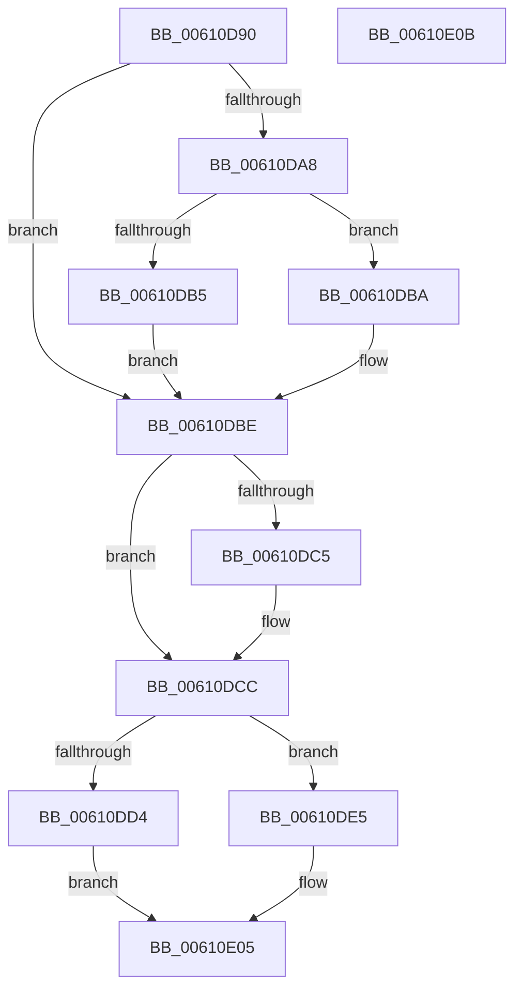

# SmpIoCompletionApc

- RVA: `0x00610D90`–`0x00610E0C` (길이 `124` bytes)
- VA: `0x0000000140610D90`
- 실행 섹션: `.text`
- PDB 이름 있음: `예`; PDB Function 태그: `아니요`
- unwind 정보 RVA: `0x0005CF00`
- 디코드: `36`개 명령, `124/124` bytes 표시
- 미해석 바이트: `0` (있으면 어셈블리에 `.byte`로 보존)

> 이 문서는 커널 이미지의 기계어와 PDB 기호를 분석해 생성했습니다. 4번과 5번은 함수 원형과 자료형을 바이너리 사용 방식에서 추정한 C 해석이며 원본 소스 복구 결과는 아닙니다.

## 1. Dependencies

- 직접 호출 지점: **3**; 고유 호출 대상: **3**
- 직접 호출자로 확인된 함수: **0**
- RIP 상대 이미지 참조: **0**

### Outgoing calls
- `0x00610DDE` → [KeSetEvent](../33/KeSetEvent_function_0033F310.md) (function, `0x0033F310`)
- `0x00610DEE` → [SmWorkItemQueue](../31/SmWorkItemQueue_function_0031799C.md) (function, `0x0031799C`)
- `0x00610E00` → [SmKmStoreDereference](../20/SmKmStoreDereference_function_00206574.md) (function, `0x00206574`)

### Direct callers
- 이 함수 시작 RVA로 연결되는 직접 call은 확인되지 않았습니다. 간접 호출은 완전히 역산할 수 없습니다.

### Static image references
- 디코드된 RIP-relative 메모리 참조가 없습니다.

## 2. Other-region calls and transfers

- 다른 실행 섹션으로 향하는 call: **0**
- 별도 외부 분기/꼬리 이동을 확인하지 못했습니다.

## 3. Assembly (complete function range)

```asm
00610D90  40 53                           push rbx
00610D92  48 83 EC 20                     sub rsp, 0x20
00610D96  8B 02                           mov eax, dword ptr [rdx]
00610D98  4C 8D 4A E0                     lea r9, [rdx - 0x20]
00610D9C  48 8B D9                        mov rbx, rcx
00610D9F  BA 01 00 00 00                  mov edx, 1
00610DA4  85 C0                           test eax, eax
00610DA6  79 16                           jns 0x140610dbe
00610DA8  41 09 51 1C                     or dword ptr [r9 + 0x1c], edx
00610DAC  49 8B 49 10                     mov rcx, qword ptr [r9 + 0x10]
00610DB0  48 85 C9                        test rcx, rcx
00610DB3  74 05                           je 0x140610dba
00610DB5  89 41 04                        mov dword ptr [rcx + 4], eax
00610DB8  EB 04                           jmp 0x140610dbe
00610DBA  41 89 41 08                     mov dword ptr [r9 + 8], eax
00610DBE  49 83 79 10 00                  cmp qword ptr [r9 + 0x10], 0
00610DC3  74 07                           je 0x140610dcc
00610DC5  F0 FF 8B 08 1B 00 00            lock dec dword ptr [rbx + 0x1b08]
00610DCC  41 8B 41 1C                     mov eax, dword ptr [r9 + 0x1c]
00610DD0  A8 04                           test al, 4
00610DD2  74 11                           je 0x140610de5
00610DD4  48 8D 8B 40 1B 00 00            lea rcx, [rbx + 0x1b40]
00610DDB  45 33 C0                        xor r8d, r8d
00610DDE  E8 2D E5 D2 FF                  call 0x14033f310
00610DE3  EB 20                           jmp 0x140610e05
00610DE5  44 8B C2                        mov r8d, edx
00610DE8  48 8B CB                        mov rcx, rbx
00610DEB  49 8B D1                        mov rdx, r9
00610DEE  E8 A9 6B D0 FF                  call 0x14031799c
00610DF3  8B 93 90 1A 00 00               mov edx, dword ptr [rbx + 0x1a90]
00610DF9  48 8B 8B 90 1D 00 00            mov rcx, qword ptr [rbx + 0x1d90]
00610E00  E8 6F 57 BF FF                  call 0x140206574
00610E05  48 83 C4 20                     add rsp, 0x20
00610E09  5B                              pop rbx
00610E0A  C3                              ret
00610E0B  CC                              int3
```

## 4. C-style interpretation (structured pseudocode)

```c
__int64 __fastcall SmpIoCompletionApc(__int64 a1, __int64 a2, int a3)
{
    __int64 result;
    __int64 v_rsp;

    v_rsp = (v_rsp) - (32);
    if (!sign_flag) goto loc_00610DBE;
    if (*(unsigned __int64 *)(a2 - 32 + 16) == 0) goto loc_00610DBA;
    *(unsigned int *)(*(unsigned __int64 *)(a2 - 32 + 16) + 4) = (unsigned int)((unsigned int)(*(unsigned int *)(a2)));
    goto loc_00610DBE;
loc_00610DBA:
    *(unsigned int *)(a2 - 32 + 8) = (unsigned int)((unsigned int)(*(unsigned int *)(a2)));
loc_00610DBE:
    if ((*(unsigned __int64 *)(a2 - 32 + 16)) != 0) {
    }
    if ((((unsigned __int8)((unsigned int)(*(unsigned int *)(a2 - 32 + 28)))) & (4)) == 0) goto loc_00610DE5;
    a3 = 0;
    result = KeSetEvent(a1 + 6976, 1, a3, a2 - 32);
    goto loc_00610E05;
loc_00610DE5:
    result = SmWorkItemQueue(a1, a2 - 32, 1, a2 - 32);
    result = SmKmStoreDereference(*(unsigned __int64 *)(a1 + 7568), (unsigned int)(*(unsigned int *)(a1 + 6800)), 1, a2 - 32);
loc_00610E05:
    v_rsp = (v_rsp) + (32);
    return result;
}
```

## 5. (Beta) C Style

```c
int64_t SmpIoCompletionApc(void *Arg1, void *Arg2, int32_t Arg3)
{
    uint8_t *arg1 = (uint8_t *)Arg1;
    uint8_t *arg2 = (uint8_t *)Arg2;

    int64_t result;
    int64_t local_rsp;

    local_rsp = (local_rsp) - (32);
    if (!sign_flag) goto loc_00610DBE;
    if (*(uint64_t *)(arg2 - 0x20 + 0x10) == 0) goto loc_00610DBA;
    *(uint32_t *)(*(uint64_t *)(arg2 - 0x20 + 0x10) + 0x4) = (uint32_t)((uint32_t)(*(uint32_t *)(arg2)));
    goto loc_00610DBE;
loc_00610DBA:
    *(uint32_t *)(arg2 - 0x20 + 0x8) = (uint32_t)((uint32_t)(*(uint32_t *)(arg2)));
loc_00610DBE:
    if ((*(uint64_t *)(arg2 - 0x20 + 0x10)) != 0) {
    }
    if ((((uint8_t)((uint32_t)(*(uint32_t *)(arg2 - 0x20 + 0x1C)))) & (4)) == 0) goto loc_00610DE5;
    Arg3 = 0;
    result = KeSetEvent(Arg1 + 6976, 1, Arg3, Arg2 - 32);
    goto loc_00610E05;
loc_00610DE5:
    result = SmWorkItemQueue(Arg1, Arg2 - 32, 1, Arg2 - 32);
    result = SmKmStoreDereference(*(uint64_t *)(arg1 + 0x1D90), (uint32_t)(*(uint32_t *)(arg1 + 0x1A90)), 1, Arg2 - 32);
loc_00610E05:
    local_rsp = (local_rsp) + (32);
    return result;
}
```

### 관측된 메모리 오프셋

구조체 형식이 확인되지 않은 접근은 인자 기준의 오프셋으로만 기록했습니다.

| 기준 인자 | 오프셋 표현 | 폭 (bit) | 접근 |
|---|---:|---:|---|
| `Arg1` | `+ 0x1A90` | `32` | `R` |
| `Arg1` | `+ 0x1B08` | `32` | `R/W` |
| `Arg1` | `+ 0x1B40` | `64` | `R` |
| `Arg1` | `+ 0x1D90` | `64` | `R` |
| `Arg2` | `- 0x20` | `64` | `R` |
| `Arg2` | `+ 0x0` | `32` | `R` |
| `Arg2` | `+ 0x8` | `32` | `W` |
| `Arg2` | `+ 0x10` | `64` | `R` |
| `Arg2` | `+ 0x1C` | `32` | `R` |
| `Arg2` | `+ 0x1C` | `32` | `R/W` |

## 6. Execution-region graph

[열기: 2D/3D 그래프와 함수 탐색 컨트롤 패널](../../../control-panel.html?section=text&rva=0x00610D90&view=graph)

- 2D 그래프는 위에서 아래로 흐르고, 3D 그래프는 빈 공간을 드래그해 회전합니다. Shift+드래그는 이동, 휠은 확대·축소, 함수 노드 선택은 대상 보고서 이동입니다.

### Static fallback


