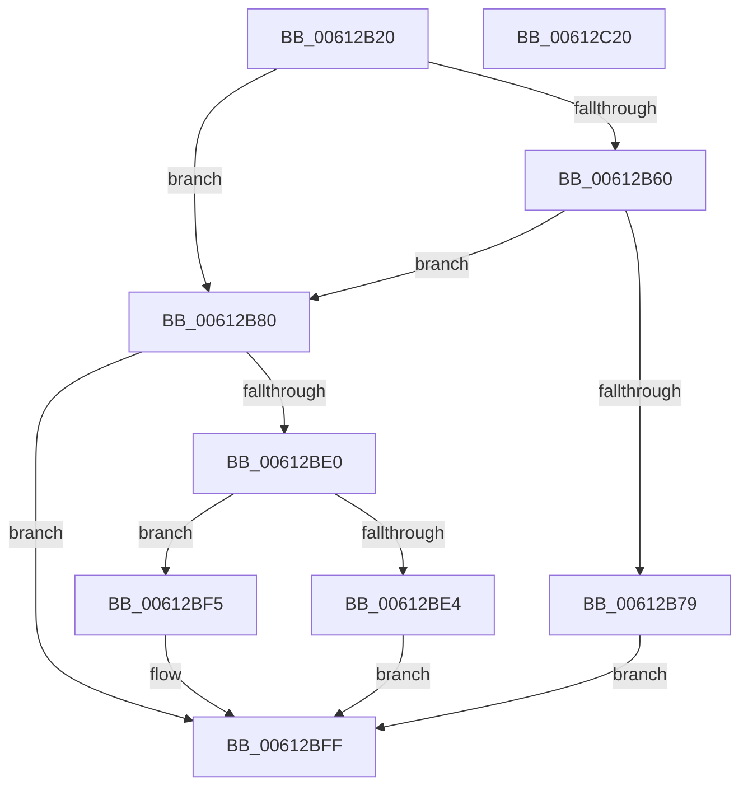

# VfAllocateDomainCommonBuffer

- RVA: `0x00612B20`–`0x00612C21` (길이 `257` bytes)
- VA: `0x0000000140612B20`
- 실행 섹션: `.text`
- PDB 이름 있음: `예`; PDB Function 태그: `아니요`
- unwind 정보 RVA: `0x0007FF48`
- 디코드: `71`개 명령, `257/257` bytes 표시
- 미해석 바이트: `0` (있으면 어셈블리에 `.byte`로 보존)

> 이 문서는 커널 이미지의 기계어와 PDB 기호를 분석해 생성했습니다. 4번과 5번은 함수 원형과 자료형을 바이너리 사용 방식에서 추정한 C 해석이며 원본 소스 복구 결과는 아닙니다.

## 1. Dependencies

- 직접 호출 지점: **6**; 고유 호출 대상: **6**
- 직접 호출자로 확인된 함수: **0**
- RIP 상대 이미지 참조: **0**

### Outgoing calls
- `0x00612B4B` → [ViGetRealDmaAdapter](../../pagevrfy/B9/ViGetRealDmaAdapter_function_00B990DC.md) (function, `0x00B990DC`)
- `0x00612B56` → [ViGetAdapterInformation](../../pagevrfy/B9/ViGetAdapterInformation_function_00B98E70.md) (function, `0x00B98E70`)
- `0x00612B6C` → [ExAllocatePool2](../../poolcode/B8/ExAllocatePool2_function_00B820F0.md) (function, `0x00B820F0`)
- `0x00612BD4` → [guard_dispatch_icall](../6B/guard_dispatch_icall_function_006BAAD0.md) (function, `0x006BAAD0`)
- `0x00612BEE` → [ViHalTrackDomainCommonBuffer](../../pagevrfy/B9/ViHalTrackDomainCommonBuffer_function_00B99300.md) (function, `0x00B99300`)
- `0x00612BFA` → [ExFreePoolWithTag](../../poolcode/B8/ExFreePoolWithTag_function_00B82870.md) (function, `0x00B82870`)

### Direct callers
- 이 함수 시작 RVA로 연결되는 직접 call은 확인되지 않았습니다. 간접 호출은 완전히 역산할 수 없습니다.

### Static image references
- 디코드된 RIP-relative 메모리 참조가 없습니다.

## 2. Other-region calls and transfers

- 다른 실행 섹션으로 향하는 call: **5**
  - `0x00612B4B` → [ViGetRealDmaAdapter](../../pagevrfy/B9/ViGetRealDmaAdapter_function_00B990DC.md) (`.text` → `PAGEVRFY`)
  - `0x00612B56` → [ViGetAdapterInformation](../../pagevrfy/B9/ViGetAdapterInformation_function_00B98E70.md) (`.text` → `PAGEVRFY`)
  - `0x00612B6C` → [ExAllocatePool2](../../poolcode/B8/ExAllocatePool2_function_00B820F0.md) (`.text` → `POOLCODE`)
  - `0x00612BEE` → [ViHalTrackDomainCommonBuffer](../../pagevrfy/B9/ViHalTrackDomainCommonBuffer_function_00B99300.md) (`.text` → `PAGEVRFY`)
  - `0x00612BFA` → [ExFreePoolWithTag](../../poolcode/B8/ExFreePoolWithTag_function_00B82870.md) (`.text` → `POOLCODE`)
- 별도 외부 분기/꼬리 이동을 확인하지 못했습니다.

## 3. Assembly (complete function range)

```asm
00612B20  48 8B C4                        mov rax, rsp
00612B23  48 89 58 08                     mov qword ptr [rax + 8], rbx
00612B27  48 89 68 10                     mov qword ptr [rax + 0x10], rbp
00612B2B  48 89 70 18                     mov qword ptr [rax + 0x18], rsi
00612B2F  48 89 78 20                     mov qword ptr [rax + 0x20], rdi
00612B33  41 54                           push r12
00612B35  41 56                           push r14
00612B37  41 57                           push r15
00612B39  48 83 EC 50                     sub rsp, 0x50
00612B3D  45 8B F1                        mov r14d, r9d
00612B40  4D 8B F8                        mov r15, r8
00612B43  4C 8B E2                        mov r12, rdx
00612B46  48 8B D9                        mov rbx, rcx
00612B49  33 FF                           xor edi, edi
00612B4B  E8 8C 65 58 00                  call 0x140b990dc
00612B50  48 8B CB                        mov rcx, rbx
00612B53  48 8B E8                        mov rbp, rax
00612B56  E8 15 63 58 00                  call 0x140b98e70
00612B5B  48 85 C0                        test rax, rax
00612B5E  74 20                           je 0x140612b80
00612B60  8D 57 18                        lea edx, [rdi + 0x18]
00612B63  41 B8 48 61 6C 56               mov r8d, 0x566c6148
00612B69  8D 4F 40                        lea ecx, [rdi + 0x40]
00612B6C  E8 7F F5 56 00                  call 0x140b820f0
00612B71  48 8B F8                        mov rdi, rax
00612B74  48 85 C0                        test rax, rax
00612B77  75 07                           jne 0x140612b80
00612B79  BB 9A 00 00 C0                  mov ebx, 0xc000009a
00612B7E  EB 7F                           jmp 0x140612bff
00612B80  48 8B 8C 24 B0 00 00 00         mov rcx, qword ptr [rsp + 0xb0]
00612B88  45 8B CE                        mov r9d, r14d
00612B8B  48 8B 45 08                     mov rax, qword ptr [rbp + 8]
00612B8F  4D 8B C7                        mov r8, r15
00612B92  48 8B B4 24 A8 00 00 00         mov rsi, qword ptr [rsp + 0xa8]
00612B9A  49 8B D4                        mov rdx, r12
00612B9D  48 89 4C 24 40                  mov qword ptr [rsp + 0x40], rcx
00612BA2  8B 8C 24 A0 00 00 00            mov ecx, dword ptr [rsp + 0xa0]
00612BA9  48 8B 80 E8 00 00 00            mov rax, qword ptr [rax + 0xe8]
00612BB0  48 89 74 24 38                  mov qword ptr [rsp + 0x38], rsi
00612BB5  89 4C 24 30                     mov dword ptr [rsp + 0x30], ecx
00612BB9  48 8B 8C 24 98 00 00 00         mov rcx, qword ptr [rsp + 0x98]
00612BC1  48 89 4C 24 28                  mov qword ptr [rsp + 0x28], rcx
00612BC6  8B 8C 24 90 00 00 00            mov ecx, dword ptr [rsp + 0x90]
00612BCD  89 4C 24 20                     mov dword ptr [rsp + 0x20], ecx
00612BD1  48 8B CD                        mov rcx, rbp
00612BD4  E8 F7 7E 0A 00                  call 0x1406baad0
00612BD9  8B D8                           mov ebx, eax
00612BDB  48 85 FF                        test rdi, rdi
00612BDE  74 1F                           je 0x140612bff
00612BE0  85 C0                           test eax, eax
00612BE2  78 11                           js 0x140612bf5
00612BE4  48 8B 0E                        mov rcx, qword ptr [rsi]
00612BE7  48 89 4F 10                     mov qword ptr [rdi + 0x10], rcx
00612BEB  48 8B CF                        mov rcx, rdi
00612BEE  E8 0D 67 58 00                  call 0x140b99300
00612BF3  EB 0A                           jmp 0x140612bff
00612BF5  33 D2                           xor edx, edx
00612BF7  48 8B CF                        mov rcx, rdi
00612BFA  E8 71 FC 56 00                  call 0x140b82870
00612BFF  4C 8D 5C 24 50                  lea r11, [rsp + 0x50]
00612C04  8B C3                           mov eax, ebx
00612C06  49 8B 5B 20                     mov rbx, qword ptr [r11 + 0x20]
00612C0A  49 8B 6B 28                     mov rbp, qword ptr [r11 + 0x28]
00612C0E  49 8B 73 30                     mov rsi, qword ptr [r11 + 0x30]
00612C12  49 8B 7B 38                     mov rdi, qword ptr [r11 + 0x38]
00612C16  49 8B E3                        mov rsp, r11
00612C19  41 5F                           pop r15
00612C1B  41 5E                           pop r14
00612C1D  41 5C                           pop r12
00612C1F  C3                              ret
00612C20  CC                              int3
```

## 4. C-style interpretation (structured pseudocode)

```c
__int64 __fastcall VfAllocateDomainCommonBuffer(__int64 a1, __int64 a2, __int64 a3, int a4, unsigned int a5, __int64 a6, unsigned int a7, __int64 a8, __int64 a9)
{
    __int64 result;
    __int64 v_rdi;
    __int64 v_rsp;
    unsigned __int64 v_stack_m18;
    unsigned __int64 v_stack_m28;
    unsigned __int64 v_stack_m30;
    unsigned int v_stack_m38;
    unsigned __int64 v_stack_m40;
    unsigned int v_stack_m48;

    *(unsigned __int64 *)(v_rsp + 8) = v_rbx;
    *(unsigned __int64 *)(v_rsp + 16) = v_rbp;
    *(unsigned __int64 *)(v_rsp + 24) = v_rsi;
    *(unsigned __int64 *)(v_rsp + 32) = v_rdi;
    v_rsp = (v_rsp) - (80);
    v_rdi = 0;
    result = ViGetRealDmaAdapter(a1, a2, a3, a4);
    result = ViGetAdapterInformation(a1, a2, a3, a4);
    if (result == 0) goto loc_00612B80;
    result = ExAllocatePool2(v_rdi + 64, v_rdi + 24, (unsigned int)(0x566C6148ULL), a4);
    if (result != 0) goto loc_00612B80;
    goto loc_00612BFF;
loc_00612B80:
    v_stack_m28 = a9;
    v_stack_m30 = a8;
    v_stack_m38 = (unsigned int)((unsigned int)(a7));
    v_stack_m40 = a6;
    v_stack_m48 = (unsigned int)((unsigned int)(a5));
    result = guard_dispatch_icall(result, a2, a3, (unsigned int)((unsigned int)((unsigned int)(a4))));
    if (result == 0) goto loc_00612BFF;
    if (sign_flag) goto loc_00612BF5;
    *(unsigned __int64 *)(result + 16) = *(unsigned __int64 *)(a8);
    result = ViHalTrackDomainCommonBuffer(result, a2, a3, (unsigned int)((unsigned int)((unsigned int)(a4))));
    goto loc_00612BFF;
loc_00612BF5:
    a2 = 0;
    result = ExFreePoolWithTag(result, a2, a3, (unsigned int)((unsigned int)((unsigned int)(a4))));
loc_00612BFF:
    return (unsigned int)((unsigned int)((unsigned int)((unsigned int)(result))));
}
```

## 5. (Beta) C Style

```c
int64_t VfAllocateDomainCommonBuffer(int64_t Arg1, int64_t Arg2, int64_t Arg3, int32_t Arg4, uint32_t Arg5, int64_t Arg6, uint32_t Arg7, void *Arg8, int64_t Arg9)
{
    uint8_t *arg8 = (uint8_t *)Arg8;

    int64_t result;
    int64_t local_rdi;
    int64_t local_rsp;
    uint64_t v_stack_m18;
    uint64_t v_stack_m28;
    uint64_t v_stack_m30;
    uint32_t v_stack_m38;
    uint64_t v_stack_m40;
    uint32_t v_stack_m48;

    *(uint64_t *)(local_rsp + 0x8) = local_rbx;
    *(uint64_t *)(local_rsp + 0x10) = local_rbp;
    *(uint64_t *)(local_rsp + 0x18) = local_rsi;
    *(uint64_t *)(local_rsp + 0x20) = local_rdi;
    local_rsp = (local_rsp) - (80);
    local_rdi = 0;
    result = ViGetRealDmaAdapter(Arg1, Arg2, Arg3, Arg4);
    result = ViGetAdapterInformation(Arg1, Arg2, Arg3, Arg4);
    if (result == 0) goto loc_00612B80;
    result = ExAllocatePool2(local_rdi + 64, local_rdi + 24, (uint32_t)(0x566C6148ULL), Arg4);
    if (result != 0) goto loc_00612B80;
    goto loc_00612BFF;
loc_00612B80:
    v_stack_m28 = Arg9;
    v_stack_m30 = Arg8;
    v_stack_m38 = (uint32_t)((uint32_t)(Arg7));
    v_stack_m40 = Arg6;
    v_stack_m48 = (uint32_t)((uint32_t)(Arg5));
    result = guard_dispatch_icall(result, Arg2, Arg3, (uint32_t)((uint32_t)((uint32_t)(Arg4))));
    if (result == 0) goto loc_00612BFF;
    if (sign_flag) goto loc_00612BF5;
    *(uint64_t *)(result + 0x10) = *(uint64_t *)(arg8);
    result = ViHalTrackDomainCommonBuffer(result, Arg2, Arg3, (uint32_t)((uint32_t)((uint32_t)(Arg4))));
    goto loc_00612BFF;
loc_00612BF5:
    Arg2 = 0;
    result = ExFreePoolWithTag(result, Arg2, Arg3, (uint32_t)((uint32_t)((uint32_t)(Arg4))));
loc_00612BFF:
    return (uint32_t)((uint32_t)((uint32_t)((uint32_t)(result))));
}
```

### 관측된 메모리 오프셋

구조체 형식이 확인되지 않은 접근은 인자 기준의 오프셋으로만 기록했습니다.

| 기준 인자 | 오프셋 표현 | 폭 (bit) | 접근 |
|---|---:|---:|---|
| `Arg8` | `+ 0x0` | `64` | `R` |

## 6. Execution-region graph

[열기: 2D/3D 그래프와 함수 탐색 컨트롤 패널](../../../control-panel.html?section=text&rva=0x00612B20&view=graph)

- 2D 그래프는 위에서 아래로 흐르고, 3D 그래프는 빈 공간을 드래그해 회전합니다. Shift+드래그는 이동, 휠은 확대·축소, 함수 노드 선택은 대상 보고서 이동입니다.

### Static fallback


