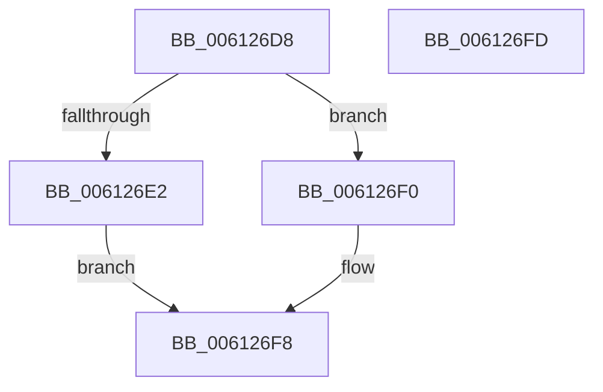

# VfAvlFreeNodeNoLock

- RVA: `0x006126D8`–`0x006126FE` (길이 `38` bytes)
- VA: `0x00000001406126D8`
- 실행 섹션: `.text`
- PDB 이름 있음: `예`; PDB Function 태그: `아니요`
- unwind 정보 RVA: `0x0005C788`
- 디코드: `11`개 명령, `38/38` bytes 표시
- 미해석 바이트: `0` (있으면 어셈블리에 `.byte`로 보존)

> 이 문서는 커널 이미지의 기계어와 PDB 기호를 분석해 생성했습니다. 4번과 5번은 함수 원형과 자료형을 바이너리 사용 방식에서 추정한 C 해석이며 원본 소스 복구 결과는 아닙니다.

## 1. Dependencies

- 직접 호출 지점: **2**; 고유 호출 대상: **2**
- 직접 호출자로 확인된 함수: **8**
- RIP 상대 이미지 참조: **1**

### Outgoing calls
- `0x006126E9` → [ExFreeToNPagedLookasideList](../38/ExFreeToNPagedLookasideList_function_0038D9D0.md) (function, `0x0038D9D0`)
- `0x006126F3` → [VfUtilFreePoolCheckIRQL](../4C/VfUtilFreePoolCheckIRQL_function_004C65D0.md) (function, `0x004C65D0`)

### Direct callers
- [sub_006EAE30](../6E/Unknown_function_006EAE30.md) at `0x006EAE3A`
- [ViDevObjRemove](../../pagevrfy/BA/ViDevObjRemove_function_00BA248C.md) at `0x00BA255A`
- [ViRemLockDeleteFirstTreeNode](../../pagevrfy/BA/ViRemLockDeleteFirstTreeNode_function_00BA28F4.md) at `0x00BA2976`
- [VfLookasideAdd](../../pagevrfy/BA/VfLookasideAdd_function_00BAFE34.md) at `0x00BAFF2E`
- [VfLookasideDelete](../../pagevrfy/BA/VfLookasideDelete_function_00BAFF58.md) at `0x00BB0027`
- [VfDeleteResource](../../pagevrfy/BB/VfDeleteResource_function_00BB187C.md) at `0x00BB1955`
- [VfTrackResource](../../pagevrfy/BB/VfTrackResource_function_00BB19A0.md) at `0x00BB1A9F`
- [VfCheckForResource](../../pagevrfy/BB/VfCheckForResource_function_00BB71C8.md) at `0x00BB72B6`

### Static image references
- `0x006126E2` → RVA `0x00E28A00` (`.data`; read)

## 2. Other-region calls and transfers

- 다른 실행 섹션으로 향하는 call: **0**
- 별도 외부 분기/꼬리 이동을 확인하지 못했습니다.

## 3. Assembly (complete function range)

```asm
006126D8  48 83 EC 28                     sub rsp, 0x28
006126DC  83 79 1C 01                     cmp dword ptr [rcx + 0x1c], 1
006126E0  75 0E                           jne 0x1406126f0
006126E2  48 8D 0D 17 63 81 00            lea rcx, [rip + 0x816317]
006126E9  E8 E2 B2 D7 FF                  call 0x14038d9d0
006126EE  EB 08                           jmp 0x1406126f8
006126F0  48 8B CA                        mov rcx, rdx
006126F3  E8 D8 3E EB FF                  call 0x1404c65d0
006126F8  48 83 C4 28                     add rsp, 0x28
006126FC  C3                              ret
006126FD  CC                              int3
```

## 4. C-style interpretation (structured pseudocode)

```c
__int64 __fastcall VfAvlFreeNodeNoLock(__int64 a1, __int64 a2)
{
    __int64 result;
    __int64 v_rsp;

    v_rsp = (v_rsp) - (40);
    if ((*(unsigned int *)(a1 + 28)) != 1) goto loc_006126F0;
    result = ExFreeToNPagedLookasideList(v_rip + 8479511, a2, a3, a4);
    goto loc_006126F8;
loc_006126F0:
    result = VfUtilFreePoolCheckIRQL(a2, a2, a3, a4);
loc_006126F8:
    v_rsp = (v_rsp) + (40);
    return result;
}
```

## 5. (Beta) C Style

```c
int64_t VfAvlFreeNodeNoLock(void *Arg1, int64_t Arg2)
{
    uint8_t *arg1 = (uint8_t *)Arg1;

    int64_t result;
    int64_t local_rsp;

    local_rsp = (local_rsp) - (40);
    if ((*(uint32_t *)(arg1 + 0x1C)) != 1) goto loc_006126F0;
    result = ExFreeToNPagedLookasideList(v_rip + 8479511, Arg2, a3, a4);
    goto loc_006126F8;
loc_006126F0:
    result = VfUtilFreePoolCheckIRQL(Arg2, Arg2, a3, a4);
loc_006126F8:
    local_rsp = (local_rsp) + (40);
    return result;
}
```

### 관측된 메모리 오프셋

구조체 형식이 확인되지 않은 접근은 인자 기준의 오프셋으로만 기록했습니다.

| 기준 인자 | 오프셋 표현 | 폭 (bit) | 접근 |
|---|---:|---:|---|
| `Arg1` | `+ 0x1C` | `32` | `R` |

## 6. Execution-region graph

[열기: 2D/3D 그래프와 함수 탐색 컨트롤 패널](../../../control-panel.html?section=text&rva=0x006126D8&view=graph)

- 2D 그래프는 위에서 아래로 흐르고, 3D 그래프는 빈 공간을 드래그해 회전합니다. Shift+드래그는 이동, 휠은 확대·축소, 함수 노드 선택은 대상 보고서 이동입니다.

### Static fallback


