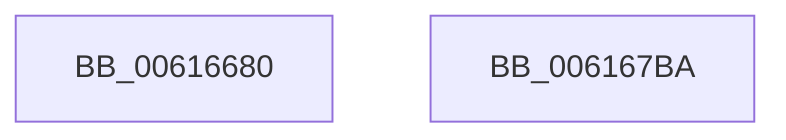

# VfBelow4gbPluginEntry

- RVA: `0x00616680`–`0x006167BB` (길이 `315` bytes)
- VA: `0x0000000140616680`
- 실행 섹션: `.text`
- PDB 이름 있음: `예`; PDB Function 태그: `아니요`
- unwind 정보 RVA: `0x00073684`
- 디코드: `61`개 명령, `315/315` bytes 표시
- 미해석 바이트: `0` (있으면 어셈블리에 `.byte`로 보존)

> 이 문서는 커널 이미지의 기계어와 PDB 기호를 분석해 생성했습니다. 4번과 5번은 함수 원형과 자료형을 바이너리 사용 방식에서 추정한 C 해석이며 원본 소스 복구 결과는 아닙니다.

## 1. Dependencies

- 직접 호출 지점: **2**; 고유 호출 대상: **2**
- 직접 호출자로 확인된 함수: **0**
- RIP 상대 이미지 참조: **13**

### Outgoing calls
- `0x006167A0` → [DifRegisterPlugin](DifRegisterPlugin_function_0061ABE0.md) (function, `0x0061ABE0`)
- `0x006167AC` → [_security_check_cookie](../6A/_security_check_cookie_function_006AC640.md) (function, `0x006AC640`)

### Direct callers
- 이 함수 시작 RVA로 연결되는 직접 call은 확인되지 않았습니다. 간접 호출은 완전히 역산할 수 없습니다.

### Static image references
- `0x0061668E` → RVA `0x00E0A740` (`.data`; read)
- `0x006166A6` → RVA `0x006CE510` (` ?? ::FNODOBFM::`string'`; read)
- `0x006166B7` → RVA `0x00BAC1E0` (`Below4gb_MmAllocateContiguousMemory_Entry`; read)
- `0x006166C3` → RVA `0x006CE440` (` ?? ::FNODOBFM::`string'`; read)
- `0x006166CF` → RVA `0x00BAC190` (`Below4gb_MmAllocateContiguousMemorySpecifyCacheNode_Entry`; read)
- `0x006166DB` → RVA `0x006CE4B0` (` ?? ::FNODOBFM::`string'`; read)
- `0x006166F3` → RVA `0x006CE490` (` ?? ::FNODOBFM::`string'`; read)
- `0x00616709` → RVA `0x006CE570` (` ?? ::FNODOBFM::`string'`; read)
- `0x00616714` → RVA `0x00BAC2D0` (`Below4gb_MmAllocatePagesForMdl_Entry`; read)
- `0x0061671F` → RVA `0x006CE550` (` ?? ::FNODOBFM::`string'`; read)
- `0x0061672A` → RVA `0x00BAC280` (`Below4gb_MmAllocatePagesForMdlEx_Entry`; read)
- `0x00616735` → RVA `0x006CE5B0` (` ?? ::FNODOBFM::`string'`; read)
- `0x00616740` → RVA `0x00BAC230` (`Below4gb_MmAllocateNodePagesForMdlEx_Entry`; read)

## 2. Other-region calls and transfers

- 다른 실행 섹션으로 향하는 call: **0**
- 별도 외부 분기/꼬리 이동을 확인하지 못했습니다.

## 3. Assembly (complete function range)

```asm
00616680  40 55                           push rbp
00616682  48 8D 6C 24 F0                  lea rbp, [rsp - 0x10]
00616687  48 81 EC 10 01 00 00            sub rsp, 0x110
0061668E  48 8B 05 AB 40 7F 00            mov rax, qword ptr [rip + 0x7f40ab]
00616695  48 33 C4                        xor rax, rsp
00616698  48 89 45 00                     mov qword ptr [rbp], rax
0061669C  33 C9                           xor ecx, ecx
0061669E  C7 44 24 28 EE 00 00 00         mov dword ptr [rsp + 0x28], 0xee
006166A6  48 8D 05 63 7E 0B 00            lea rax, [rip + 0xb7e63]
006166AD  48 89 4C 24 38                  mov qword ptr [rsp + 0x38], rcx
006166B2  48 89 44 24 20                  mov qword ptr [rsp + 0x20], rax
006166B7  48 8D 05 22 5B 59 00            lea rax, [rip + 0x595b22]
006166BE  48 89 44 24 30                  mov qword ptr [rsp + 0x30], rax
006166C3  48 8D 05 76 7D 0B 00            lea rax, [rip + 0xb7d76]
006166CA  48 89 44 24 40                  mov qword ptr [rsp + 0x40], rax
006166CF  48 8D 05 BA 5A 59 00            lea rax, [rip + 0x595aba]
006166D6  48 89 44 24 50                  mov qword ptr [rsp + 0x50], rax
006166DB  48 8D 05 CE 7D 0B 00            lea rax, [rip + 0xb7dce]
006166E2  48 89 44 24 60                  mov qword ptr [rsp + 0x60], rax
006166E7  48 8D 05 A2 5A 59 00            lea rax, [rip + 0x595aa2]
006166EE  48 89 44 24 70                  mov qword ptr [rsp + 0x70], rax
006166F3  48 8D 05 96 7D 0B 00            lea rax, [rip + 0xb7d96]
006166FA  48 89 45 80                     mov qword ptr [rbp - 0x80], rax
006166FE  48 8D 05 8B 5A 59 00            lea rax, [rip + 0x595a8b]
00616705  48 89 45 90                     mov qword ptr [rbp - 0x70], rax
00616709  48 8D 05 60 7E 0B 00            lea rax, [rip + 0xb7e60]
00616710  48 89 45 A0                     mov qword ptr [rbp - 0x60], rax
00616714  48 8D 05 B5 5B 59 00            lea rax, [rip + 0x595bb5]
0061671B  48 89 45 B0                     mov qword ptr [rbp - 0x50], rax
0061671F  48 8D 05 2A 7E 0B 00            lea rax, [rip + 0xb7e2a]
00616726  48 89 45 C0                     mov qword ptr [rbp - 0x40], rax
0061672A  48 8D 05 4F 5B 59 00            lea rax, [rip + 0x595b4f]
00616731  48 89 45 D0                     mov qword ptr [rbp - 0x30], rax
00616735  48 8D 05 74 7E 0B 00            lea rax, [rip + 0xb7e74]
0061673C  48 89 45 E0                     mov qword ptr [rbp - 0x20], rax
00616740  48 8D 05 E9 5A 59 00            lea rax, [rip + 0x595ae9]
00616747  48 89 45 F0                     mov qword ptr [rbp - 0x10], rax
0061674B  C7 44 24 48 EC 00 00 00         mov dword ptr [rsp + 0x48], 0xec
00616753  48 89 4C 24 58                  mov qword ptr [rsp + 0x58], rcx
00616758  C7 44 24 68 EB 00 00 00         mov dword ptr [rsp + 0x68], 0xeb
00616760  48 89 4C 24 78                  mov qword ptr [rsp + 0x78], rcx
00616765  C7 45 88 EA 00 00 00            mov dword ptr [rbp - 0x78], 0xea
0061676C  48 89 4D 98                     mov qword ptr [rbp - 0x68], rcx
00616770  C7 45 A8 E6 00 00 00            mov dword ptr [rbp - 0x58], 0xe6
00616777  48 89 4D B8                     mov qword ptr [rbp - 0x48], rcx
0061677B  C7 45 C8 E5 00 00 00            mov dword ptr [rbp - 0x38], 0xe5
00616782  48 89 4D D8                     mov qword ptr [rbp - 0x28], rcx
00616786  C7 45 E8 E8 00 00 00            mov dword ptr [rbp - 0x18], 0xe8
0061678D  48 89 4D F8                     mov qword ptr [rbp - 8], rcx
00616791  8D 51 07                        lea edx, [rcx + 7]
00616794  45 33 C9                        xor r9d, r9d
00616797  44 8D 41 1A                     lea r8d, [rcx + 0x1a]
0061679B  48 8D 4C 24 20                  lea rcx, [rsp + 0x20]
006167A0  E8 3B 44 00 00                  call 0x14061abe0
006167A5  48 8B 4D 00                     mov rcx, qword ptr [rbp]
006167A9  48 33 CC                        xor rcx, rsp
006167AC  E8 8F 5E 09 00                  call 0x1406ac640
006167B1  48 81 C4 10 01 00 00            add rsp, 0x110
006167B8  5D                              pop rbp
006167B9  C3                              ret
006167BA  CC                              int3
```

## 4. C-style interpretation (structured pseudocode)

```c
__int64 __fastcall VfBelow4gbPluginEntry(int a1, __int64 a2, __int64 a3, int a4)
{
    __int64 result;
    __int64 v_rsp;
    unsigned __int64 v_stack_m18;
    unsigned __int64 v_stack_m20;
    unsigned __int64 v_stack_m28;
    unsigned int v_stack_m30;
    unsigned __int64 v_stack_m38;
    unsigned __int64 v_stack_m40;
    unsigned __int64 v_stack_m48;
    unsigned int v_stack_m50;
    unsigned __int64 v_stack_m58;
    unsigned __int64 v_stack_m60;
    unsigned __int64 v_stack_m68;
    unsigned int v_stack_m70;
    unsigned __int64 v_stack_m78;
    unsigned __int64 v_stack_m80;
    unsigned __int64 v_stack_m88;
    unsigned int v_stack_m90;
    unsigned __int64 v_stack_m98;
    unsigned __int64 v_stack_mA0;
    unsigned __int64 v_stack_mA8;
    unsigned int v_stack_mB0;
    unsigned __int64 v_stack_mB8;
    unsigned __int64 v_stack_mC0;
    unsigned __int64 v_stack_mC8;
    unsigned int v_stack_mD0;
    unsigned __int64 v_stack_mD8;
    unsigned __int64 v_stack_mE0;
    unsigned __int64 v_stack_mE8;
    unsigned int v_stack_mF0;
    unsigned __int64 v_stack_mF8;

    v_rsp = (v_rsp) - (272);
    result = (*(unsigned __int64 *)(v_rip + 8339627)) ^ (v_rsp);
    v_stack_m18 = result;
    a1 = 0;
    v_stack_mF0 = 238;
    v_stack_mE0 = 0;
    v_stack_mF8 = v_rip + 753251;
    v_stack_mE8 = v_rip + 5856034;
    v_stack_mD8 = v_rip + 753014;
    v_stack_mC8 = v_rip + 5855930;
    v_stack_mB8 = v_rip + 753102;
    v_stack_mA8 = v_rip + 5855906;
    v_stack_m98 = v_rip + 753046;
    v_stack_m88 = v_rip + 5855883;
    v_stack_m78 = v_rip + 753248;
    v_stack_m68 = v_rip + 5856181;
    v_stack_m58 = v_rip + 753194;
    v_stack_m48 = v_rip + 5856079;
    v_stack_m38 = v_rip + 753268;
    v_stack_m28 = v_rip + 5855977;
    v_stack_mD0 = 236;
    v_stack_mC0 = 0;
    v_stack_mB0 = 235;
    v_stack_mA0 = 0;
    v_stack_m90 = 234;
    v_stack_m80 = 0;
    v_stack_m70 = 230;
    v_stack_m60 = 0;
    v_stack_m50 = 229;
    v_stack_m40 = 0;
    v_stack_m30 = 232;
    v_stack_m20 = 0;
    a4 = 0;
    result = DifRegisterPlugin(v_stack_mF8, a1 + 7, a1 + 26, a4);
    a1 = (v_stack_m18) ^ (v_rsp);
    result = _security_check_cookie(a1, a1 + 7, a1 + 26, a4);
    v_rsp = (v_rsp) + (272);
    return result;
}
```

## 5. (Beta) C Style

```c
int64_t VfBelow4gbPluginEntry(int32_t Arg1, int64_t Arg2, int64_t Arg3, int32_t Arg4)
{
    int64_t result;
    int64_t local_rsp;
    uint64_t v_stack_m18;
    uint64_t v_stack_m20;
    uint64_t v_stack_m28;
    uint32_t v_stack_m30;
    uint64_t v_stack_m38;
    uint64_t v_stack_m40;
    uint64_t v_stack_m48;
    uint32_t v_stack_m50;
    uint64_t v_stack_m58;
    uint64_t v_stack_m60;
    uint64_t v_stack_m68;
    uint32_t v_stack_m70;
    uint64_t v_stack_m78;
    uint64_t v_stack_m80;
    uint64_t v_stack_m88;
    uint32_t v_stack_m90;
    uint64_t v_stack_m98;
    uint64_t v_stack_mA0;
    uint64_t v_stack_mA8;
    uint32_t v_stack_mB0;
    uint64_t v_stack_mB8;
    uint64_t v_stack_mC0;
    uint64_t v_stack_mC8;
    uint32_t v_stack_mD0;
    uint64_t v_stack_mD8;
    uint64_t v_stack_mE0;
    uint64_t v_stack_mE8;
    uint32_t v_stack_mF0;
    uint64_t v_stack_mF8;

    local_rsp = (local_rsp) - (272);
    result = (*(uint64_t *)(v_rip + 0x7F40AB)) ^ (local_rsp);
    v_stack_m18 = result;
    Arg1 = 0;
    v_stack_mF0 = 238;
    v_stack_mE0 = 0;
    v_stack_mF8 = v_rip + 753251;
    v_stack_mE8 = v_rip + 5856034;
    v_stack_mD8 = v_rip + 753014;
    v_stack_mC8 = v_rip + 5855930;
    v_stack_mB8 = v_rip + 753102;
    v_stack_mA8 = v_rip + 5855906;
    v_stack_m98 = v_rip + 753046;
    v_stack_m88 = v_rip + 5855883;
    v_stack_m78 = v_rip + 753248;
    v_stack_m68 = v_rip + 5856181;
    v_stack_m58 = v_rip + 753194;
    v_stack_m48 = v_rip + 5856079;
    v_stack_m38 = v_rip + 753268;
    v_stack_m28 = v_rip + 5855977;
    v_stack_mD0 = 236;
    v_stack_mC0 = 0;
    v_stack_mB0 = 235;
    v_stack_mA0 = 0;
    v_stack_m90 = 234;
    v_stack_m80 = 0;
    v_stack_m70 = 230;
    v_stack_m60 = 0;
    v_stack_m50 = 229;
    v_stack_m40 = 0;
    v_stack_m30 = 232;
    v_stack_m20 = 0;
    Arg4 = 0;
    result = DifRegisterPlugin(v_stack_mF8, Arg1 + 7, Arg1 + 26, Arg4);
    Arg1 = (v_stack_m18) ^ (local_rsp);
    result = _security_check_cookie(Arg1, Arg1 + 7, Arg1 + 26, Arg4);
    local_rsp = (local_rsp) + (272);
    return result;
}
```

## 6. Execution-region graph

[열기: 2D/3D 그래프와 함수 탐색 컨트롤 패널](../../../control-panel.html?section=text&rva=0x00616680&view=graph)

- 2D 그래프는 위에서 아래로 흐르고, 3D 그래프는 빈 공간을 드래그해 회전합니다. Shift+드래그는 이동, 휠은 확대·축소, 함수 노드 선택은 대상 보고서 이동입니다.

### Static fallback


