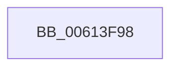

# VfBugCheckNoStackUsage

- RVA: `0x00613F98`–`0x00613FC9` (길이 `49` bytes)
- VA: `0x0000000140613F98`
- 실행 섹션: `.text`
- PDB 이름 있음: `예`; PDB Function 태그: `아니요`
- unwind 정보 RVA: `0x000622F0`
- 디코드: `9`개 명령, `49/49` bytes 표시
- 미해석 바이트: `0` (있으면 어셈블리에 `.byte`로 보존)

> 이 문서는 커널 이미지의 기계어와 PDB 기호를 분석해 생성했습니다. 4번과 5번은 함수 원형과 자료형을 바이너리 사용 방식에서 추정한 C 해석이며 원본 소스 복구 결과는 아닙니다.

## 1. Dependencies

- 직접 호출 지점: **1**; 고유 호출 대상: **1**
- 직접 호출자로 확인된 함수: **4**
- RIP 상대 이미지 참조: **5**

### Outgoing calls
- `0x00613FC3` → [KeBugCheckEx](../4F/KeBugCheckEx_function_004FD660.md) (function, `0x004FD660`)

### Direct callers
- [IovpCallDriverWithStackBuffer](../../pagevrfy/B9/IovpCallDriverWithStackBuffer_function_00B92940.md) at `0x00B92A05`
- [IovpCallDriverWithStackBuffer](../../pagevrfy/B9/IovpCallDriverWithStackBuffer_function_00B92940.md) at `0x00B92A77`
- [VfAfterCallDriver](../../pagevrfy/B9/VfAfterCallDriver_function_00B9DA84.md) at `0x00B9DB61`
- [VfAfterCallDriver](../../pagevrfy/B9/VfAfterCallDriver_function_00B9DA84.md) at `0x00B9DBE9`
- [VfBeforeCallDriver](../../pagevrfy/B9/VfBeforeCallDriver_function_00B9DC58.md) at `0x00B9DCF9`
- [sub_00BBC34E](../../pagevrfy/BB/Unknown_function_00BBC34E.md) at `0x00BBC436`
- [sub_00BBC34E](../../pagevrfy/BB/Unknown_function_00BBC34E.md) at `0x00BBC4B9`

### Static image references
- `0x00613F9C` → RVA `0x00FFDA50` (`PAGEVRFD`; read)
- `0x00613FA3` → RVA `0x00FFDA48` (`PAGEVRFD`; read)
- `0x00613FAA` → RVA `0x00FFDA40` (`PAGEVRFD`; read)
- `0x00613FB1` → RVA `0x00FFDA38` (`PAGEVRFD`; read)
- `0x00613FB8` → RVA `0x00FFDA30` (`PAGEVRFD`; read)

## 2. Other-region calls and transfers

- 다른 실행 섹션으로 향하는 call: **0**
- 별도 외부 분기/꼬리 이동을 확인하지 못했습니다.

## 3. Assembly (complete function range)

```asm
00613F98  48 83 EC 38                     sub rsp, 0x38
00613F9C  48 8B 05 AD 9A 9E 00            mov rax, qword ptr [rip + 0x9e9aad]
00613FA3  4C 8B 0D 9E 9A 9E 00            mov r9, qword ptr [rip + 0x9e9a9e]
00613FAA  4C 8B 05 8F 9A 9E 00            mov r8, qword ptr [rip + 0x9e9a8f]
00613FB1  48 8B 15 80 9A 9E 00            mov rdx, qword ptr [rip + 0x9e9a80]
00613FB8  8B 0D 72 9A 9E 00               mov ecx, dword ptr [rip + 0x9e9a72]
00613FBE  48 89 44 24 20                  mov qword ptr [rsp + 0x20], rax
00613FC3  E8 98 96 EE FF                  call 0x1404fd660
00613FC8  CC                              int3
```

## 4. C-style interpretation (structured pseudocode)

```c
__int64 __fastcall VfBugCheckNoStackUsage(void)
{
    __int64 result;
    __int64 v_rsp;
    unsigned __int64 v_stack_m18;

    v_rsp = (v_rsp) - (56);
    v_stack_m18 = *(unsigned __int64 *)(v_rip + 10394285);
    result = KeBugCheckEx((unsigned int)(*(unsigned int *)(v_rip + 10394226)), *(unsigned __int64 *)(v_rip + 10394240), *(unsigned __int64 *)(v_rip + 10394255), *(unsigned __int64 *)(v_rip + 10394270));
    return result;
}
```

## 5. (Beta) C Style

```c
void VfBugCheckNoStackUsage(void)
{
    int64_t result;
    int64_t local_rsp;
    uint64_t v_stack_m18;

    local_rsp = (local_rsp) - (56);
    v_stack_m18 = *(uint64_t *)(v_rip + 0x9E9AAD);
    result = KeBugCheckEx((uint32_t)(*(uint32_t *)(v_rip + 0x9E9A72)), *(uint64_t *)(v_rip + 0x9E9A80), *(uint64_t *)(v_rip + 0x9E9A8F), *(uint64_t *)(v_rip + 0x9E9A9E));
    return result;
}
```

## 6. Execution-region graph

[열기: 2D/3D 그래프와 함수 탐색 컨트롤 패널](../../../control-panel.html?section=text&rva=0x00613F98&view=graph)

- 2D 그래프는 위에서 아래로 흐르고, 3D 그래프는 빈 공간을 드래그해 회전합니다. Shift+드래그는 이동, 휠은 확대·축소, 함수 노드 선택은 대상 보고서 이동입니다.

### Static fallback


