# VfClearVerifierSettings

- RVA: `0x00611DB0`–`0x006121BA` (길이 `1,034` bytes)
- VA: `0x0000000140611DB0`
- 실행 섹션: `.text`
- PDB 이름 있음: `예`; PDB Function 태그: `아니요`
- unwind 정보 RVA: `0x00099740`
- 디코드: `262`개 명령, `1,034/1,034` bytes 표시
- 미해석 바이트: `0` (있으면 어셈블리에 `.byte`로 보존)

> 이 문서는 커널 이미지의 기계어와 PDB 기호를 분석해 생성했습니다. 4번과 5번은 함수 원형과 자료형을 바이너리 사용 방식에서 추정한 C 해석이며 원본 소스 복구 결과는 아닙니다.

## 1. Dependencies

- 직접 호출 지점: **47**; 고유 호출 대상: **7**
- 직접 호출자로 확인된 함수: **2**
- RIP 상대 이미지 참조: **37**

### Outgoing calls
- `0x00611E3D` → [ZwOpenKey](../6A/ZwOpenKey_function_006AD310.md) (function, `0x006AD310`)
- `0x00611E55` → [RtlInitUnicodeString](../42/RtlInitUnicodeString_function_0042A780.md) (function, `0x0042A780`)
- `0x00611E79` → [ZwSetValueKey](../6A/ZwSetValueKey_function_006ADCD0.md) (function, `0x006ADCD0`)
- `0x00611E91` → [RtlInitUnicodeString](../42/RtlInitUnicodeString_function_0042A780.md) (function, `0x0042A780`)
- `0x00611E9E` → [ZwDeleteValueKey](../6A/ZwDeleteValueKey_function_006AECB0.md) (function, `0x006AECB0`)
- `0x00611EC1` → [VfUtilDbgPrint](VfUtilDbgPrint_function_006122AC.md) (function, `0x006122AC`)
- `0x00611ED1` → [RtlInitUnicodeString](../42/RtlInitUnicodeString_function_0042A780.md) (function, `0x0042A780`)
- `0x00611EDE` → [ZwDeleteValueKey](../6A/ZwDeleteValueKey_function_006AECB0.md) (function, `0x006AECB0`)
- `0x00611EF7` → [VfUtilDbgPrint](VfUtilDbgPrint_function_006122AC.md) (function, `0x006122AC`)
- `0x00611F07` → [RtlInitUnicodeString](../42/RtlInitUnicodeString_function_0042A780.md) (function, `0x0042A780`)
- `0x00611F14` → [ZwDeleteValueKey](../6A/ZwDeleteValueKey_function_006AECB0.md) (function, `0x006AECB0`)
- `0x00611F2D` → [VfUtilDbgPrint](VfUtilDbgPrint_function_006122AC.md) (function, `0x006122AC`)
- `0x00611F3D` → [RtlInitUnicodeString](../42/RtlInitUnicodeString_function_0042A780.md) (function, `0x0042A780`)
- `0x00611F4A` → [ZwDeleteValueKey](../6A/ZwDeleteValueKey_function_006AECB0.md) (function, `0x006AECB0`)
- `0x00611F63` → [VfUtilDbgPrint](VfUtilDbgPrint_function_006122AC.md) (function, `0x006122AC`)
- `0x00611F7C` → [RtlInitUnicodeString](../42/RtlInitUnicodeString_function_0042A780.md) (function, `0x0042A780`)
- `0x00611F89` → [ZwDeleteValueKey](../6A/ZwDeleteValueKey_function_006AECB0.md) (function, `0x006AECB0`)
- `0x00611FA2` → [VfUtilDbgPrint](VfUtilDbgPrint_function_006122AC.md) (function, `0x006122AC`)
- `0x00611FB2` → [RtlInitUnicodeString](../42/RtlInitUnicodeString_function_0042A780.md) (function, `0x0042A780`)
- `0x00611FBF` → [ZwDeleteValueKey](../6A/ZwDeleteValueKey_function_006AECB0.md) (function, `0x006AECB0`)
- `0x00611FD8` → [VfUtilDbgPrint](VfUtilDbgPrint_function_006122AC.md) (function, `0x006122AC`)
- `0x00611FE8` → [RtlInitUnicodeString](../42/RtlInitUnicodeString_function_0042A780.md) (function, `0x0042A780`)
- `0x00611FF5` → [ZwDeleteValueKey](../6A/ZwDeleteValueKey_function_006AECB0.md) (function, `0x006AECB0`)
- `0x0061200E` → [VfUtilDbgPrint](VfUtilDbgPrint_function_006122AC.md) (function, `0x006122AC`)
- `0x00612027` → [RtlInitUnicodeString](../42/RtlInitUnicodeString_function_0042A780.md) (function, `0x0042A780`)
- `0x00612034` → [ZwDeleteValueKey](../6A/ZwDeleteValueKey_function_006AECB0.md) (function, `0x006AECB0`)
- `0x0061204D` → [VfUtilDbgPrint](VfUtilDbgPrint_function_006122AC.md) (function, `0x006122AC`)
- `0x0061205D` → [RtlInitUnicodeString](../42/RtlInitUnicodeString_function_0042A780.md) (function, `0x0042A780`)
- `0x0061206A` → [ZwDeleteValueKey](../6A/ZwDeleteValueKey_function_006AECB0.md) (function, `0x006AECB0`)
- `0x00612083` → [VfUtilDbgPrint](VfUtilDbgPrint_function_006122AC.md) (function, `0x006122AC`)
- `0x00612093` → [RtlInitUnicodeString](../42/RtlInitUnicodeString_function_0042A780.md) (function, `0x0042A780`)
- `0x006120A0` → [ZwDeleteValueKey](../6A/ZwDeleteValueKey_function_006AECB0.md) (function, `0x006AECB0`)
- `0x006120B9` → [VfUtilDbgPrint](VfUtilDbgPrint_function_006122AC.md) (function, `0x006122AC`)
- `0x006120C9` → [RtlInitUnicodeString](../42/RtlInitUnicodeString_function_0042A780.md) (function, `0x0042A780`)
- `0x006120D6` → [ZwDeleteValueKey](../6A/ZwDeleteValueKey_function_006AECB0.md) (function, `0x006AECB0`)
- `0x006120EF` → [VfUtilDbgPrint](VfUtilDbgPrint_function_006122AC.md) (function, `0x006122AC`)
- `0x006120FF` → [RtlInitUnicodeString](../42/RtlInitUnicodeString_function_0042A780.md) (function, `0x0042A780`)
- `0x0061210C` → [ZwDeleteValueKey](../6A/ZwDeleteValueKey_function_006AECB0.md) (function, `0x006AECB0`)
- `0x00612125` → [VfUtilDbgPrint](VfUtilDbgPrint_function_006122AC.md) (function, `0x006122AC`)
- `0x00612135` → [RtlInitUnicodeString](../42/RtlInitUnicodeString_function_0042A780.md) (function, `0x0042A780`)
- `0x00612142` → [ZwDeleteValueKey](../6A/ZwDeleteValueKey_function_006AECB0.md) (function, `0x006AECB0`)
- `0x0061215B` → [VfUtilDbgPrint](VfUtilDbgPrint_function_006122AC.md) (function, `0x006122AC`)
- `0x00612164` → [ZwFlushKey](../6A/ZwFlushKey_function_006AEF10.md) (function, `0x006AEF10`)
- `0x00612179` → [VfUtilDbgPrint](VfUtilDbgPrint_function_006122AC.md) (function, `0x006122AC`)
- `0x00612189` → [VfUtilDbgPrint](VfUtilDbgPrint_function_006122AC.md) (function, `0x006122AC`)
- `0x00612192` → [ZwClose](../6A/ZwClose_function_006AD2B0.md) (function, `0x006AD2B0`)
- `0x006121A2` → [VfUtilDbgPrint](VfUtilDbgPrint_function_006122AC.md) (function, `0x006122AC`)

### Direct callers
- [VfNotifyVerifierOfEvent](../../pagevrfy/B9/VfNotifyVerifierOfEvent_function_00B92E90.md) at `0x00B92F05`
- [Phase1InitializationIoReady](../../init/C7/Phase1InitializationIoReady_function_00C70458.md) at `0x00C70776`

### Static image references
- `0x00611DD5` → RVA `0x00F04980` (`.data`; read)
- `0x00611DF8` → RVA `0x00EEFB6C` (`.data`; read)
- `0x00611DFF` → RVA `0x00FD9FB8` (`PAGEDATA`; read)
- `0x00611E0D` → RVA `0x00E09000` (`.data`; read)
- `0x00611E4A` → RVA `0x006CDBA0` (` ?? ::FNODOBFM::`string'`; read)
- `0x00611E86` → RVA `0x006CDAF0` (` ?? ::FNODOBFM::`string'`; read)
- `0x00611EBA` → RVA `0x006CDA90` (` ?? ::FNODOBFM::`string'`; read)
- `0x00611EC6` → RVA `0x006CDB70` (` ?? ::FNODOBFM::`string'`; read)
- `0x00611EF0` → RVA `0x006CDB20` (` ?? ::FNODOBFM::`string'`; read)
- `0x00611EFC` → RVA `0x006CD9E0` (` ?? ::FNODOBFM::`string'`; read)
- `0x00611F26` → RVA `0x006CD990` (` ?? ::FNODOBFM::`string'`; read)
- `0x00611F32` → RVA `0x006CDA60` (` ?? ::FNODOBFM::`string'`; read)
- `0x00611F5C` → RVA `0x006CDA00` (` ?? ::FNODOBFM::`string'`; read)
- `0x00611F68` → RVA `0x00F049F0` (`.data`; read)
- `0x00611F71` → RVA `0x006CDFA0` (` ?? ::FNODOBFM::`string'`; read)
- `0x00611F9B` → RVA `0x006CDF40` (` ?? ::FNODOBFM::`string'`; read)
- `0x00611FA7` → RVA `0x006CE030` (` ?? ::FNODOBFM::`string'`; read)
- `0x00611FD1` → RVA `0x006CDFD0` (` ?? ::FNODOBFM::`string'`; read)
- `0x00611FDD` → RVA `0x006CDE80` (` ?? ::FNODOBFM::`string'`; read)
- `0x00612007` → RVA `0x006CDE20` (` ?? ::FNODOBFM::`string'`; read)
- `0x00612013` → RVA `0x01008158` (`INITDATA`; read)
- `0x0061201C` → RVA `0x006CDF10` (` ?? ::FNODOBFM::`string'`; read)
- `0x00612046` → RVA `0x006CDEB0` (` ?? ::FNODOBFM::`string'`; read)
- `0x00612052` → RVA `0x006CDD40` (` ?? ::FNODOBFM::`string'`; read)
- `0x0061207C` → RVA `0x006CDCE0` (` ?? ::FNODOBFM::`string'`; read)
- `0x00612088` → RVA `0x006CDDE0` (` ?? ::FNODOBFM::`string'`; read)
- `0x006120B2` → RVA `0x006CDD80` (` ?? ::FNODOBFM::`string'`; read)
- `0x006120BE` → RVA `0x006CDC20` (` ?? ::FNODOBFM::`string'`; read)
- `0x006120E8` → RVA `0x006CDBC0` (` ?? ::FNODOBFM::`string'`; read)
- `0x006120F4` → RVA `0x006CDCB0` (` ?? ::FNODOBFM::`string'`; read)
- `0x0061211E` → RVA `0x006CDC50` (` ?? ::FNODOBFM::`string'`; read)
- `0x0061212A` → RVA `0x006CE140` (` ?? ::FNODOBFM::`string'`; read)
- `0x00612154` → RVA `0x006CE0E0` (` ?? ::FNODOBFM::`string'`; read)
- `0x00612169` → RVA `0x00F04350` (`.data`; read)
- `0x00612172` → RVA `0x006CE1E0` (` ?? ::FNODOBFM::`string'`; read)
- `0x00612182` → RVA `0x006CE170` (` ?? ::FNODOBFM::`string'`; read)
- `0x0061219B` → RVA `0x006CE070` (` ?? ::FNODOBFM::`string'`; read)

## 2. Other-region calls and transfers

- 다른 실행 섹션으로 향하는 call: **0**
- 별도 외부 분기/꼬리 이동을 확인하지 못했습니다.

## 3. Assembly (complete function range)

```asm
00611DB0  48 89 5C 24 18                  mov qword ptr [rsp + 0x18], rbx
00611DB5  48 89 7C 24 20                  mov qword ptr [rsp + 0x20], rdi
00611DBA  55                              push rbp
00611DBB  48 8B EC                        mov rbp, rsp
00611DBE  48 83 EC 70                     sub rsp, 0x70
00611DC2  48 83 65 18 00                  and qword ptr [rbp + 0x18], 0
00611DC7  33 C0                           xor eax, eax
00611DC9  21 45 EC                        and dword ptr [rbp - 0x14], eax
00611DCC  0F 57 C0                        xorps xmm0, xmm0
00611DCF  89 45 D4                        mov dword ptr [rbp - 0x2c], eax
00611DD2  21 45 D4                        and dword ptr [rbp - 0x2c], eax
00611DD5  8B 05 A5 2B 8F 00               mov eax, dword ptr [rip + 0x8f2ba5]
00611DDB  0F 11 45 C0                     movups xmmword ptr [rbp - 0x40], xmm0
00611DDF  A8 20                           test al, 0x20
00611DE1  74 05                           je 0x140611de8
00611DE3  83 E0 CF                        and eax, 0xffffffcf
00611DE6  EB 10                           jmp 0x140611df8
00611DE8  0F BA E0 0A                     bt eax, 0xa
00611DEC  73 07                           jae 0x140611df5
00611DEE  25 C7 FB FF FF                  and eax, 0xfffffbc7
00611DF3  EB 03                           jmp 0x140611df8
00611DF5  83 E0 E7                        and eax, 0xffffffe7
00611DF8  83 3D 6D DD 8D 00 00            cmp dword ptr [rip + 0x8ddd6d], 0
00611DFF  48 8D 0D B2 81 9C 00            lea rcx, [rip + 0x9c81b2]
00611E06  89 45 10                        mov dword ptr [rbp + 0x10], eax
00611E09  4C 8D 45 D0                     lea r8, [rbp - 0x30]
00611E0D  48 8D 05 EC 71 7F 00            lea rax, [rip + 0x7f71ec]
00611E14  C7 45 D0 30 00 00 00            mov dword ptr [rbp - 0x30], 0x30
00611E1B  48 0F 44 C1                     cmove rax, rcx
00611E1F  C7 45 E8 40 02 00 00            mov dword ptr [rbp - 0x18], 0x240
00611E26  48 83 65 D8 00                  and qword ptr [rbp - 0x28], 0
00611E2B  48 8D 4D 18                     lea rcx, [rbp + 0x18]
00611E2F  BA 3F 00 0F 00                  mov edx, 0xf003f
00611E34  48 89 45 E0                     mov qword ptr [rbp - 0x20], rax
00611E38  F3 0F 7F 45 F0                  movdqu xmmword ptr [rbp - 0x10], xmm0
00611E3D  E8 CE B4 09 00                  call 0x1406ad310
00611E42  85 C0                           test eax, eax
00611E44  0F 88 4F 03 00 00               js 0x140612199
00611E4A  48 8D 15 4F BD 0B 00            lea rdx, [rip + 0xbbd4f]
00611E51  48 8D 4D C0                     lea rcx, [rbp - 0x40]
00611E55  E8 26 89 E1 FF                  call 0x14042a780
00611E5A  48 8B 4D 18                     mov rcx, qword ptr [rbp + 0x18]
00611E5E  48 8D 45 10                     lea rax, [rbp + 0x10]
00611E62  41 B9 04 00 00 00               mov r9d, 4
00611E68  48 8D 55 C0                     lea rdx, [rbp - 0x40]
00611E6C  44 89 4C 24 28                  mov dword ptr [rsp + 0x28], r9d
00611E71  45 33 C0                        xor r8d, r8d
00611E74  48 89 44 24 20                  mov qword ptr [rsp + 0x20], rax
00611E79  E8 52 BE 09 00                  call 0x1406adcd0
00611E7E  85 C0                           test eax, eax
00611E80  0F 88 FA 02 00 00               js 0x140612180
00611E86  48 8D 15 63 BC 0B 00            lea rdx, [rip + 0xbbc63]
00611E8D  48 8D 4D C0                     lea rcx, [rbp - 0x40]
00611E91  E8 EA 88 E1 FF                  call 0x14042a780
00611E96  48 8B 4D 18                     mov rcx, qword ptr [rbp + 0x18]
00611E9A  48 8D 55 C0                     lea rdx, [rbp - 0x40]
00611E9E  E8 0D CE 09 00                  call 0x1406aecb0
00611EA3  BF 00 00 00 80                  mov edi, 0x80000000
00611EA8  BB 34 00 00 C0                  mov ebx, 0xc0000034
00611EAD  8D 0C 38                        lea ecx, [rax + rdi]
00611EB0  85 CF                           test edi, ecx
00611EB2  75 12                           jne 0x140611ec6
00611EB4  3B C3                           cmp eax, ebx
00611EB6  74 0E                           je 0x140611ec6
00611EB8  8B D0                           mov edx, eax
00611EBA  48 8D 0D CF BB 0B 00            lea rcx, [rip + 0xbbbcf]
00611EC1  E8 E6 03 00 00                  call 0x1406122ac
00611EC6  48 8D 15 A3 BC 0B 00            lea rdx, [rip + 0xbbca3]
00611ECD  48 8D 4D C0                     lea rcx, [rbp - 0x40]
00611ED1  E8 AA 88 E1 FF                  call 0x14042a780
00611ED6  48 8B 4D 18                     mov rcx, qword ptr [rbp + 0x18]
00611EDA  48 8D 55 C0                     lea rdx, [rbp - 0x40]
00611EDE  E8 CD CD 09 00                  call 0x1406aecb0
00611EE3  8D 0C 38                        lea ecx, [rax + rdi]
00611EE6  85 CF                           test edi, ecx
00611EE8  75 12                           jne 0x140611efc
00611EEA  3B C3                           cmp eax, ebx
00611EEC  74 0E                           je 0x140611efc
00611EEE  8B D0                           mov edx, eax
00611EF0  48 8D 0D 29 BC 0B 00            lea rcx, [rip + 0xbbc29]
00611EF7  E8 B0 03 00 00                  call 0x1406122ac
00611EFC  48 8D 15 DD BA 0B 00            lea rdx, [rip + 0xbbadd]
00611F03  48 8D 4D C0                     lea rcx, [rbp - 0x40]
00611F07  E8 74 88 E1 FF                  call 0x14042a780
00611F0C  48 8B 4D 18                     mov rcx, qword ptr [rbp + 0x18]
00611F10  48 8D 55 C0                     lea rdx, [rbp - 0x40]
00611F14  E8 97 CD 09 00                  call 0x1406aecb0
00611F19  8D 0C 38                        lea ecx, [rax + rdi]
00611F1C  85 CF                           test edi, ecx
00611F1E  75 12                           jne 0x140611f32
00611F20  3B C3                           cmp eax, ebx
00611F22  74 0E                           je 0x140611f32
00611F24  8B D0                           mov edx, eax
00611F26  48 8D 0D 63 BA 0B 00            lea rcx, [rip + 0xbba63]
00611F2D  E8 7A 03 00 00                  call 0x1406122ac
00611F32  48 8D 15 27 BB 0B 00            lea rdx, [rip + 0xbbb27]
00611F39  48 8D 4D C0                     lea rcx, [rbp - 0x40]
00611F3D  E8 3E 88 E1 FF                  call 0x14042a780
00611F42  48 8B 4D 18                     mov rcx, qword ptr [rbp + 0x18]
00611F46  48 8D 55 C0                     lea rdx, [rbp - 0x40]
00611F4A  E8 61 CD 09 00                  call 0x1406aecb0
00611F4F  8D 0C 38                        lea ecx, [rax + rdi]
00611F52  85 CF                           test edi, ecx
00611F54  75 12                           jne 0x140611f68
00611F56  3B C3                           cmp eax, ebx
00611F58  74 0E                           je 0x140611f68
00611F5A  8B D0                           mov edx, eax
00611F5C  48 8D 0D 9D BA 0B 00            lea rcx, [rip + 0xbba9d]
00611F63  E8 44 03 00 00                  call 0x1406122ac
00611F68  83 3D 81 2A 8F 00 00            cmp dword ptr [rip + 0x8f2a81], 0
00611F6F  74 36                           je 0x140611fa7
00611F71  48 8D 15 28 C0 0B 00            lea rdx, [rip + 0xbc028]
00611F78  48 8D 4D C0                     lea rcx, [rbp - 0x40]
00611F7C  E8 FF 87 E1 FF                  call 0x14042a780
00611F81  48 8B 4D 18                     mov rcx, qword ptr [rbp + 0x18]
00611F85  48 8D 55 C0                     lea rdx, [rbp - 0x40]
00611F89  E8 22 CD 09 00                  call 0x1406aecb0
00611F8E  8D 0C 38                        lea ecx, [rax + rdi]
00611F91  85 CF                           test edi, ecx
00611F93  75 12                           jne 0x140611fa7
00611F95  3B C3                           cmp eax, ebx
00611F97  74 0E                           je 0x140611fa7
00611F99  8B D0                           mov edx, eax
00611F9B  48 8D 0D 9E BF 0B 00            lea rcx, [rip + 0xbbf9e]
00611FA2  E8 05 03 00 00                  call 0x1406122ac
00611FA7  48 8D 15 82 C0 0B 00            lea rdx, [rip + 0xbc082]
00611FAE  48 8D 4D C0                     lea rcx, [rbp - 0x40]
00611FB2  E8 C9 87 E1 FF                  call 0x14042a780
00611FB7  48 8B 4D 18                     mov rcx, qword ptr [rbp + 0x18]
00611FBB  48 8D 55 C0                     lea rdx, [rbp - 0x40]
00611FBF  E8 EC CC 09 00                  call 0x1406aecb0
00611FC4  8D 0C 38                        lea ecx, [rax + rdi]
00611FC7  85 CF                           test edi, ecx
00611FC9  75 12                           jne 0x140611fdd
00611FCB  3B C3                           cmp eax, ebx
00611FCD  74 0E                           je 0x140611fdd
00611FCF  8B D0                           mov edx, eax
00611FD1  48 8D 0D F8 BF 0B 00            lea rcx, [rip + 0xbbff8]
00611FD8  E8 CF 02 00 00                  call 0x1406122ac
00611FDD  48 8D 15 9C BE 0B 00            lea rdx, [rip + 0xbbe9c]
00611FE4  48 8D 4D C0                     lea rcx, [rbp - 0x40]
00611FE8  E8 93 87 E1 FF                  call 0x14042a780
00611FED  48 8B 4D 18                     mov rcx, qword ptr [rbp + 0x18]
00611FF1  48 8D 55 C0                     lea rdx, [rbp - 0x40]
00611FF5  E8 B6 CC 09 00                  call 0x1406aecb0
00611FFA  8D 0C 38                        lea ecx, [rax + rdi]
00611FFD  85 CF                           test edi, ecx
00611FFF  75 12                           jne 0x140612013
00612001  3B C3                           cmp eax, ebx
00612003  74 0E                           je 0x140612013
00612005  8B D0                           mov edx, eax
00612007  48 8D 0D 12 BE 0B 00            lea rcx, [rip + 0xbbe12]
0061200E  E8 99 02 00 00                  call 0x1406122ac
00612013  83 3D 3E 61 9F 00 FF            cmp dword ptr [rip + 0x9f613e], -1
0061201A  74 36                           je 0x140612052
0061201C  48 8D 15 ED BE 0B 00            lea rdx, [rip + 0xbbeed]
00612023  48 8D 4D C0                     lea rcx, [rbp - 0x40]
00612027  E8 54 87 E1 FF                  call 0x14042a780
0061202C  48 8B 4D 18                     mov rcx, qword ptr [rbp + 0x18]
00612030  48 8D 55 C0                     lea rdx, [rbp - 0x40]
00612034  E8 77 CC 09 00                  call 0x1406aecb0
00612039  8D 0C 38                        lea ecx, [rax + rdi]
0061203C  85 CF                           test edi, ecx
0061203E  75 12                           jne 0x140612052
00612040  3B C3                           cmp eax, ebx
00612042  74 0E                           je 0x140612052
00612044  8B D0                           mov edx, eax
00612046  48 8D 0D 63 BE 0B 00            lea rcx, [rip + 0xbbe63]
0061204D  E8 5A 02 00 00                  call 0x1406122ac
00612052  48 8D 15 E7 BC 0B 00            lea rdx, [rip + 0xbbce7]
00612059  48 8D 4D C0                     lea rcx, [rbp - 0x40]
0061205D  E8 1E 87 E1 FF                  call 0x14042a780
00612062  48 8B 4D 18                     mov rcx, qword ptr [rbp + 0x18]
00612066  48 8D 55 C0                     lea rdx, [rbp - 0x40]
0061206A  E8 41 CC 09 00                  call 0x1406aecb0
0061206F  8D 0C 38                        lea ecx, [rax + rdi]
00612072  85 CF                           test edi, ecx
00612074  75 12                           jne 0x140612088
00612076  3B C3                           cmp eax, ebx
00612078  74 0E                           je 0x140612088
0061207A  8B D0                           mov edx, eax
0061207C  48 8D 0D 5D BC 0B 00            lea rcx, [rip + 0xbbc5d]
00612083  E8 24 02 00 00                  call 0x1406122ac
00612088  48 8D 15 51 BD 0B 00            lea rdx, [rip + 0xbbd51]
0061208F  48 8D 4D C0                     lea rcx, [rbp - 0x40]
00612093  E8 E8 86 E1 FF                  call 0x14042a780
00612098  48 8B 4D 18                     mov rcx, qword ptr [rbp + 0x18]
0061209C  48 8D 55 C0                     lea rdx, [rbp - 0x40]
006120A0  E8 0B CC 09 00                  call 0x1406aecb0
006120A5  8D 0C 38                        lea ecx, [rax + rdi]
006120A8  85 CF                           test edi, ecx
006120AA  75 12                           jne 0x1406120be
006120AC  3B C3                           cmp eax, ebx
006120AE  74 0E                           je 0x1406120be
006120B0  8B D0                           mov edx, eax
006120B2  48 8D 0D C7 BC 0B 00            lea rcx, [rip + 0xbbcc7]
006120B9  E8 EE 01 00 00                  call 0x1406122ac
006120BE  48 8D 15 5B BB 0B 00            lea rdx, [rip + 0xbbb5b]
006120C5  48 8D 4D C0                     lea rcx, [rbp - 0x40]
006120C9  E8 B2 86 E1 FF                  call 0x14042a780
006120CE  48 8B 4D 18                     mov rcx, qword ptr [rbp + 0x18]
006120D2  48 8D 55 C0                     lea rdx, [rbp - 0x40]
006120D6  E8 D5 CB 09 00                  call 0x1406aecb0
006120DB  8D 0C 38                        lea ecx, [rax + rdi]
006120DE  85 CF                           test edi, ecx
006120E0  75 12                           jne 0x1406120f4
006120E2  3B C3                           cmp eax, ebx
006120E4  74 0E                           je 0x1406120f4
006120E6  8B D0                           mov edx, eax
006120E8  48 8D 0D D1 BA 0B 00            lea rcx, [rip + 0xbbad1]
006120EF  E8 B8 01 00 00                  call 0x1406122ac
006120F4  48 8D 15 B5 BB 0B 00            lea rdx, [rip + 0xbbbb5]
006120FB  48 8D 4D C0                     lea rcx, [rbp - 0x40]
006120FF  E8 7C 86 E1 FF                  call 0x14042a780
00612104  48 8B 4D 18                     mov rcx, qword ptr [rbp + 0x18]
00612108  48 8D 55 C0                     lea rdx, [rbp - 0x40]
0061210C  E8 9F CB 09 00                  call 0x1406aecb0
00612111  8D 0C 38                        lea ecx, [rax + rdi]
00612114  85 CF                           test edi, ecx
00612116  75 12                           jne 0x14061212a
00612118  3B C3                           cmp eax, ebx
0061211A  74 0E                           je 0x14061212a
0061211C  8B D0                           mov edx, eax
0061211E  48 8D 0D 2B BB 0B 00            lea rcx, [rip + 0xbbb2b]
00612125  E8 82 01 00 00                  call 0x1406122ac
0061212A  48 8D 15 0F C0 0B 00            lea rdx, [rip + 0xbc00f]
00612131  48 8D 4D C0                     lea rcx, [rbp - 0x40]
00612135  E8 46 86 E1 FF                  call 0x14042a780
0061213A  48 8B 4D 18                     mov rcx, qword ptr [rbp + 0x18]
0061213E  48 8D 55 C0                     lea rdx, [rbp - 0x40]
00612142  E8 69 CB 09 00                  call 0x1406aecb0
00612147  8D 0C 38                        lea ecx, [rax + rdi]
0061214A  85 CF                           test edi, ecx
0061214C  75 12                           jne 0x140612160
0061214E  3B C3                           cmp eax, ebx
00612150  74 0E                           je 0x140612160
00612152  8B D0                           mov edx, eax
00612154  48 8D 0D 85 BF 0B 00            lea rcx, [rip + 0xbbf85]
0061215B  E8 4C 01 00 00                  call 0x1406122ac
00612160  48 8B 4D 18                     mov rcx, qword ptr [rbp + 0x18]
00612164  E8 A7 CD 09 00                  call 0x1406aef10
00612169  83 3D E0 21 8F 00 00            cmp dword ptr [rip + 0x8f21e0], 0
00612170  74 1C                           je 0x14061218e
00612172  48 8D 0D 67 C0 0B 00            lea rcx, [rip + 0xbc067]
00612179  E8 2E 01 00 00                  call 0x1406122ac
0061217E  EB 0E                           jmp 0x14061218e
00612180  8B D0                           mov edx, eax
00612182  48 8D 0D E7 BF 0B 00            lea rcx, [rip + 0xbbfe7]
00612189  E8 1E 01 00 00                  call 0x1406122ac
0061218E  48 8B 4D 18                     mov rcx, qword ptr [rbp + 0x18]
00612192  E8 19 B1 09 00                  call 0x1406ad2b0
00612197  EB 0E                           jmp 0x1406121a7
00612199  8B D0                           mov edx, eax
0061219B  48 8D 0D CE BE 0B 00            lea rcx, [rip + 0xbbece]
006121A2  E8 05 01 00 00                  call 0x1406122ac
006121A7  4C 8D 5C 24 70                  lea r11, [rsp + 0x70]
006121AC  49 8B 5B 20                     mov rbx, qword ptr [r11 + 0x20]
006121B0  49 8B 7B 28                     mov rdi, qword ptr [r11 + 0x28]
006121B4  49 8B E3                        mov rsp, r11
006121B7  5D                              pop rbp
006121B8  C3                              ret
006121B9  CC                              int3
```

## 4. C-style interpretation (structured pseudocode)

```c
__int64 __fastcall VfClearVerifierSettings(void)
{
    __int64 result;
    __int64 v_rsp;
    unsigned __int64 v_stack_m18;
    unsigned int v_stack_m1C;
    unsigned int v_stack_m20;
    unsigned __int64 v_stack_m28;
    unsigned __int64 v_stack_m30;
    unsigned int v_stack_m34;
    unsigned __int64 v_stack_m38;
    unsigned __int64 v_stack_m48;
    unsigned int v_stack_m50;
    unsigned __int64 v_stack_m58;
    unsigned __int64 v_stack_m8;
    unsigned __int64 v_stack_p10;
    unsigned __int64 v_stack_p18;
    unsigned __int64 v_stack_p20;
    unsigned int v_stack_p8;

    v_stack_p18 = v_rbx;
    v_stack_p20 = v_rdi;
    v_rsp = (v_rsp) - (112);
    result = 0;
    v_stack_m34 = 0;
    v_stack_m48 = v_xmm0;
    if ((((unsigned __int8)((unsigned int)(*(unsigned int *)(v_rip + 9382821)))) & (32)) == 0) goto loc_00611DE8;
    result = (unsigned int)(((unsigned int)(*(unsigned int *)(v_rip + 9382821))) & (0xFFFFFFCFULL));
    goto loc_00611DF8;
loc_00611DE8:
    if (condition_is_above_or_equal) goto loc_00611DF5;
    result = (unsigned int)((result) & (0xFFFFFBC7ULL));
    goto loc_00611DF8;
loc_00611DF5:
    result = (unsigned int)((result) & (0xFFFFFFE7ULL));
loc_00611DF8:
    v_stack_p8 = (unsigned int)(result);
    v_stack_m38 = 48;
    result = v_rip + 8352236;
    if ((*(unsigned int *)(v_rip + 9297261)) == 0) { result = v_rip + 10256818; }
    v_stack_m20 = 576;
    v_stack_m28 = result;
    v_stack_m18 = v_xmm0;
    result = ZwOpenKey(v_stack_p10, (unsigned int)(0xF003FULL), v_stack_m38, a4);
    if (sign_flag) goto loc_00612199;
    result = RtlInitUnicodeString(v_stack_m48, v_rip + 769359, v_stack_m38, a4);
    v_stack_m50 = 4;
    a3 = 0;
    v_stack_m58 = v_stack_p8;
    result = ZwSetValueKey(v_stack_p10, v_stack_m48, a3, 4);
    if (sign_flag) goto loc_00612180;
    result = RtlInitUnicodeString(v_stack_m48, v_rip + 769123, a3, 4);
    result = ZwDeleteValueKey(v_stack_p10, v_stack_m48, a3, 4);
    if ((((unsigned int)((unsigned int)(0x80000000ULL))) & ((unsigned int)(result + (unsigned int)(0x80000000ULL) * 1))) != 0) goto loc_00611EC6;
    if (((unsigned int)(result)) != ((unsigned int)((unsigned int)(0xC0000034ULL)))) {
        a2 = (unsigned int)(result);
        a1 = v_rip + 768975;
        result = VfUtilDbgPrint(a1, a2, a3, 4);
    }
    result = RtlInitUnicodeString(v_stack_m48, v_rip + 769187, a3, 4);
    result = ZwDeleteValueKey(v_stack_p10, v_stack_m48, a3, 4);
    if ((((unsigned int)((unsigned int)(0x80000000ULL))) & ((unsigned int)(result + (unsigned int)(0x80000000ULL) * 1))) != 0) goto loc_00611EFC;
    if (((unsigned int)(result)) != ((unsigned int)((unsigned int)(0xC0000034ULL)))) {
        a2 = (unsigned int)(result);
        a1 = v_rip + 769065;
        result = VfUtilDbgPrint(a1, a2, a3, 4);
    }
    result = RtlInitUnicodeString(v_stack_m48, v_rip + 768733, a3, 4);
    result = ZwDeleteValueKey(v_stack_p10, v_stack_m48, a3, 4);
    if ((((unsigned int)((unsigned int)(0x80000000ULL))) & ((unsigned int)(result + (unsigned int)(0x80000000ULL) * 1))) != 0) goto loc_00611F32;
    if (((unsigned int)(result)) != ((unsigned int)((unsigned int)(0xC0000034ULL)))) {
        a2 = (unsigned int)(result);
        a1 = v_rip + 768611;
        result = VfUtilDbgPrint(a1, a2, a3, 4);
    }
    result = RtlInitUnicodeString(v_stack_m48, v_rip + 768807, a3, 4);
    result = ZwDeleteValueKey(v_stack_p10, v_stack_m48, a3, 4);
    if ((((unsigned int)((unsigned int)(0x80000000ULL))) & ((unsigned int)(result + (unsigned int)(0x80000000ULL) * 1))) != 0) goto loc_00611F68;
    if (((unsigned int)(result)) != ((unsigned int)((unsigned int)(0xC0000034ULL)))) {
        a2 = (unsigned int)(result);
        a1 = v_rip + 768669;
        result = VfUtilDbgPrint(a1, a2, a3, 4);
    }
    if ((*(unsigned int *)(v_rip + 9382529)) == 0) goto loc_00611FA7;
    result = RtlInitUnicodeString(v_stack_m48, v_rip + 770088, a3, 4);
    result = ZwDeleteValueKey(v_stack_p10, v_stack_m48, a3, 4);
    if ((((unsigned int)((unsigned int)(0x80000000ULL))) & ((unsigned int)(result + (unsigned int)(0x80000000ULL) * 1))) != 0) goto loc_00611FA7;
    if (((unsigned int)(result)) != ((unsigned int)((unsigned int)(0xC0000034ULL)))) {
        a2 = (unsigned int)(result);
        a1 = v_rip + 769950;
        result = VfUtilDbgPrint(a1, a2, a3, 4);
    }
    result = RtlInitUnicodeString(v_stack_m48, v_rip + 770178, a3, 4);
    result = ZwDeleteValueKey(v_stack_p10, v_stack_m48, a3, 4);
    if ((((unsigned int)((unsigned int)(0x80000000ULL))) & ((unsigned int)(result + (unsigned int)(0x80000000ULL) * 1))) != 0) goto loc_00611FDD;
    if (((unsigned int)(result)) != ((unsigned int)((unsigned int)(0xC0000034ULL)))) {
        a2 = (unsigned int)(result);
        a1 = v_rip + 770040;
        result = VfUtilDbgPrint(a1, a2, a3, 4);
    }
    result = RtlInitUnicodeString(v_stack_m48, v_rip + 769692, a3, 4);
    result = ZwDeleteValueKey(v_stack_p10, v_stack_m48, a3, 4);
    if ((((unsigned int)((unsigned int)(0x80000000ULL))) & ((unsigned int)(result + (unsigned int)(0x80000000ULL) * 1))) != 0) goto loc_00612013;
    if (((unsigned int)(result)) != ((unsigned int)((unsigned int)(0xC0000034ULL)))) {
        a2 = (unsigned int)(result);
        a1 = v_rip + 769554;
        result = VfUtilDbgPrint(a1, a2, a3, 4);
    }
    if ((*(unsigned int *)(v_rip + 10445118)) == -1) goto loc_00612052;
    result = RtlInitUnicodeString(v_stack_m48, v_rip + 769773, a3, 4);
    result = ZwDeleteValueKey(v_stack_p10, v_stack_m48, a3, 4);
    if ((((unsigned int)((unsigned int)(0x80000000ULL))) & ((unsigned int)(result + (unsigned int)(0x80000000ULL) * 1))) != 0) goto loc_00612052;
    if (((unsigned int)(result)) != ((unsigned int)((unsigned int)(0xC0000034ULL)))) {
        a2 = (unsigned int)(result);
        a1 = v_rip + 769635;
        result = VfUtilDbgPrint(a1, a2, a3, 4);
    }
    result = RtlInitUnicodeString(v_stack_m48, v_rip + 769255, a3, 4);
    result = ZwDeleteValueKey(v_stack_p10, v_stack_m48, a3, 4);
    if ((((unsigned int)((unsigned int)(0x80000000ULL))) & ((unsigned int)(result + (unsigned int)(0x80000000ULL) * 1))) != 0) goto loc_00612088;
    if (((unsigned int)(result)) != ((unsigned int)((unsigned int)(0xC0000034ULL)))) {
        a2 = (unsigned int)(result);
        a1 = v_rip + 769117;
        result = VfUtilDbgPrint(a1, a2, a3, 4);
    }
    result = RtlInitUnicodeString(v_stack_m48, v_rip + 769361, a3, 4);
    result = ZwDeleteValueKey(v_stack_p10, v_stack_m48, a3, 4);
    if ((((unsigned int)((unsigned int)(0x80000000ULL))) & ((unsigned int)(result + (unsigned int)(0x80000000ULL) * 1))) != 0) goto loc_006120BE;
    if (((unsigned int)(result)) != ((unsigned int)((unsigned int)(0xC0000034ULL)))) {
        a2 = (unsigned int)(result);
        a1 = v_rip + 769223;
        result = VfUtilDbgPrint(a1, a2, a3, 4);
    }
    result = RtlInitUnicodeString(v_stack_m48, v_rip + 768859, a3, 4);
    result = ZwDeleteValueKey(v_stack_p10, v_stack_m48, a3, 4);
    if ((((unsigned int)((unsigned int)(0x80000000ULL))) & ((unsigned int)(result + (unsigned int)(0x80000000ULL) * 1))) != 0) goto loc_006120F4;
    if (((unsigned int)(result)) != ((unsigned int)((unsigned int)(0xC0000034ULL)))) {
        a2 = (unsigned int)(result);
        a1 = v_rip + 768721;
        result = VfUtilDbgPrint(a1, a2, a3, 4);
    }
    result = RtlInitUnicodeString(v_stack_m48, v_rip + 768949, a3, 4);
    result = ZwDeleteValueKey(v_stack_p10, v_stack_m48, a3, 4);
    if ((((unsigned int)((unsigned int)(0x80000000ULL))) & ((unsigned int)(result + (unsigned int)(0x80000000ULL) * 1))) != 0) goto loc_0061212A;
    if (((unsigned int)(result)) != ((unsigned int)((unsigned int)(0xC0000034ULL)))) {
        a2 = (unsigned int)(result);
        a1 = v_rip + 768811;
        result = VfUtilDbgPrint(a1, a2, a3, 4);
    }
    result = RtlInitUnicodeString(v_stack_m48, v_rip + 770063, a3, 4);
    result = ZwDeleteValueKey(v_stack_p10, v_stack_m48, a3, 4);
    if ((((unsigned int)((unsigned int)(0x80000000ULL))) & ((unsigned int)(result + (unsigned int)(0x80000000ULL) * 1))) != 0) goto loc_00612160;
    if (((unsigned int)(result)) != ((unsigned int)((unsigned int)(0xC0000034ULL)))) {
        a2 = (unsigned int)(result);
        a1 = v_rip + 769925;
        result = VfUtilDbgPrint(a1, a2, a3, 4);
    }
    result = ZwFlushKey(v_stack_p10, a2, a3, 4);
    if ((*(unsigned int *)(v_rip + 9380320)) == 0) goto loc_0061218E;
    result = VfUtilDbgPrint(v_rip + 770151, a2, a3, 4);
    goto loc_0061218E;
loc_00612180:
    result = VfUtilDbgPrint(v_rip + 770023, (unsigned int)((unsigned int)(result)), a3, 4);
loc_0061218E:
    result = ZwClose(v_stack_p10, (unsigned int)((unsigned int)(result)), a3, 4);
    goto loc_006121A7;
loc_00612199:
    result = VfUtilDbgPrint(v_rip + 769742, (unsigned int)((unsigned int)(result)), a3, 4);
loc_006121A7:
    return result;
}
```

## 5. (Beta) C Style

```c
void VfClearVerifierSettings(void)
{
    int64_t result;
    int64_t local_rsp;
    uint64_t v_stack_m18;
    uint32_t v_stack_m1C;
    uint32_t v_stack_m20;
    uint64_t v_stack_m28;
    uint64_t v_stack_m30;
    uint32_t v_stack_m34;
    uint64_t v_stack_m38;
    uint64_t v_stack_m48;
    uint32_t v_stack_m50;
    uint64_t v_stack_m58;
    uint64_t v_stack_m8;
    uint64_t v_stack_p10;
    uint64_t v_stack_p18;
    uint64_t v_stack_p20;
    uint32_t v_stack_p8;

    v_stack_p18 = local_rbx;
    v_stack_p20 = local_rdi;
    local_rsp = (local_rsp) - (112);
    result = 0;
    v_stack_m34 = 0;
    v_stack_m48 = v_xmm0;
    if ((((uint8_t)((uint32_t)(*(uint32_t *)(v_rip + 0x8F2BA5)))) & (32)) == 0) goto loc_00611DE8;
    result = (uint32_t)(((uint32_t)(*(uint32_t *)(v_rip + 0x8F2BA5))) & (0xFFFFFFCFULL));
    goto loc_00611DF8;
loc_00611DE8:
    if (condition_is_above_or_equal) goto loc_00611DF5;
    result = (uint32_t)((result) & (0xFFFFFBC7ULL));
    goto loc_00611DF8;
loc_00611DF5:
    result = (uint32_t)((result) & (0xFFFFFFE7ULL));
loc_00611DF8:
    v_stack_p8 = (uint32_t)(result);
    v_stack_m38 = 48;
    result = v_rip + 8352236;
    if ((*(uint32_t *)(v_rip + 0x8DDD6D)) == 0) { result = v_rip + 10256818; }
    v_stack_m20 = 576;
    v_stack_m28 = result;
    v_stack_m18 = v_xmm0;
    result = ZwOpenKey(v_stack_p10, (uint32_t)(0xF003FULL), v_stack_m38, a4);
    if (sign_flag) goto loc_00612199;
    result = RtlInitUnicodeString(v_stack_m48, v_rip + 769359, v_stack_m38, a4);
    v_stack_m50 = 4;
    a3 = 0;
    v_stack_m58 = v_stack_p8;
    result = ZwSetValueKey(v_stack_p10, v_stack_m48, a3, 4);
    if (sign_flag) goto loc_00612180;
    result = RtlInitUnicodeString(v_stack_m48, v_rip + 769123, a3, 4);
    result = ZwDeleteValueKey(v_stack_p10, v_stack_m48, a3, 4);
    if ((((uint32_t)((uint32_t)(0x80000000ULL))) & ((uint32_t)(result + (uint32_t)(0x80000000ULL) * 1))) != 0) goto loc_00611EC6;
    if (((uint32_t)(result)) != ((uint32_t)((uint32_t)(0xC0000034ULL)))) {
        a2 = (uint32_t)(result);
        a1 = v_rip + 768975;
        result = VfUtilDbgPrint(a1, a2, a3, 4);
    }
    result = RtlInitUnicodeString(v_stack_m48, v_rip + 769187, a3, 4);
    result = ZwDeleteValueKey(v_stack_p10, v_stack_m48, a3, 4);
    if ((((uint32_t)((uint32_t)(0x80000000ULL))) & ((uint32_t)(result + (uint32_t)(0x80000000ULL) * 1))) != 0) goto loc_00611EFC;
    if (((uint32_t)(result)) != ((uint32_t)((uint32_t)(0xC0000034ULL)))) {
        a2 = (uint32_t)(result);
        a1 = v_rip + 769065;
        result = VfUtilDbgPrint(a1, a2, a3, 4);
    }
    result = RtlInitUnicodeString(v_stack_m48, v_rip + 768733, a3, 4);
    result = ZwDeleteValueKey(v_stack_p10, v_stack_m48, a3, 4);
    if ((((uint32_t)((uint32_t)(0x80000000ULL))) & ((uint32_t)(result + (uint32_t)(0x80000000ULL) * 1))) != 0) goto loc_00611F32;
    if (((uint32_t)(result)) != ((uint32_t)((uint32_t)(0xC0000034ULL)))) {
        a2 = (uint32_t)(result);
        a1 = v_rip + 768611;
        result = VfUtilDbgPrint(a1, a2, a3, 4);
    }
    result = RtlInitUnicodeString(v_stack_m48, v_rip + 768807, a3, 4);
    result = ZwDeleteValueKey(v_stack_p10, v_stack_m48, a3, 4);
    if ((((uint32_t)((uint32_t)(0x80000000ULL))) & ((uint32_t)(result + (uint32_t)(0x80000000ULL) * 1))) != 0) goto loc_00611F68;
    if (((uint32_t)(result)) != ((uint32_t)((uint32_t)(0xC0000034ULL)))) {
        a2 = (uint32_t)(result);
        a1 = v_rip + 768669;
        result = VfUtilDbgPrint(a1, a2, a3, 4);
    }
    if ((*(uint32_t *)(v_rip + 0x8F2A81)) == 0) goto loc_00611FA7;
    result = RtlInitUnicodeString(v_stack_m48, v_rip + 770088, a3, 4);
    result = ZwDeleteValueKey(v_stack_p10, v_stack_m48, a3, 4);
    if ((((uint32_t)((uint32_t)(0x80000000ULL))) & ((uint32_t)(result + (uint32_t)(0x80000000ULL) * 1))) != 0) goto loc_00611FA7;
    if (((uint32_t)(result)) != ((uint32_t)((uint32_t)(0xC0000034ULL)))) {
        a2 = (uint32_t)(result);
        a1 = v_rip + 769950;
        result = VfUtilDbgPrint(a1, a2, a3, 4);
    }
    result = RtlInitUnicodeString(v_stack_m48, v_rip + 770178, a3, 4);
    result = ZwDeleteValueKey(v_stack_p10, v_stack_m48, a3, 4);
    if ((((uint32_t)((uint32_t)(0x80000000ULL))) & ((uint32_t)(result + (uint32_t)(0x80000000ULL) * 1))) != 0) goto loc_00611FDD;
    if (((uint32_t)(result)) != ((uint32_t)((uint32_t)(0xC0000034ULL)))) {
        a2 = (uint32_t)(result);
        a1 = v_rip + 770040;
        result = VfUtilDbgPrint(a1, a2, a3, 4);
    }
    result = RtlInitUnicodeString(v_stack_m48, v_rip + 769692, a3, 4);
    result = ZwDeleteValueKey(v_stack_p10, v_stack_m48, a3, 4);
    if ((((uint32_t)((uint32_t)(0x80000000ULL))) & ((uint32_t)(result + (uint32_t)(0x80000000ULL) * 1))) != 0) goto loc_00612013;
    if (((uint32_t)(result)) != ((uint32_t)((uint32_t)(0xC0000034ULL)))) {
        a2 = (uint32_t)(result);
        a1 = v_rip + 769554;
        result = VfUtilDbgPrint(a1, a2, a3, 4);
    }
    if ((*(uint32_t *)(v_rip + 0x9F613E)) == -1) goto loc_00612052;
    result = RtlInitUnicodeString(v_stack_m48, v_rip + 769773, a3, 4);
    result = ZwDeleteValueKey(v_stack_p10, v_stack_m48, a3, 4);
    if ((((uint32_t)((uint32_t)(0x80000000ULL))) & ((uint32_t)(result + (uint32_t)(0x80000000ULL) * 1))) != 0) goto loc_00612052;
    if (((uint32_t)(result)) != ((uint32_t)((uint32_t)(0xC0000034ULL)))) {
        a2 = (uint32_t)(result);
        a1 = v_rip + 769635;
        result = VfUtilDbgPrint(a1, a2, a3, 4);
    }
    result = RtlInitUnicodeString(v_stack_m48, v_rip + 769255, a3, 4);
    result = ZwDeleteValueKey(v_stack_p10, v_stack_m48, a3, 4);
    if ((((uint32_t)((uint32_t)(0x80000000ULL))) & ((uint32_t)(result + (uint32_t)(0x80000000ULL) * 1))) != 0) goto loc_00612088;
    if (((uint32_t)(result)) != ((uint32_t)((uint32_t)(0xC0000034ULL)))) {
        a2 = (uint32_t)(result);
        a1 = v_rip + 769117;
        result = VfUtilDbgPrint(a1, a2, a3, 4);
    }
    result = RtlInitUnicodeString(v_stack_m48, v_rip + 769361, a3, 4);
    result = ZwDeleteValueKey(v_stack_p10, v_stack_m48, a3, 4);
    if ((((uint32_t)((uint32_t)(0x80000000ULL))) & ((uint32_t)(result + (uint32_t)(0x80000000ULL) * 1))) != 0) goto loc_006120BE;
    if (((uint32_t)(result)) != ((uint32_t)((uint32_t)(0xC0000034ULL)))) {
        a2 = (uint32_t)(result);
        a1 = v_rip + 769223;
        result = VfUtilDbgPrint(a1, a2, a3, 4);
    }
    result = RtlInitUnicodeString(v_stack_m48, v_rip + 768859, a3, 4);
    result = ZwDeleteValueKey(v_stack_p10, v_stack_m48, a3, 4);
    if ((((uint32_t)((uint32_t)(0x80000000ULL))) & ((uint32_t)(result + (uint32_t)(0x80000000ULL) * 1))) != 0) goto loc_006120F4;
    if (((uint32_t)(result)) != ((uint32_t)((uint32_t)(0xC0000034ULL)))) {
        a2 = (uint32_t)(result);
        a1 = v_rip + 768721;
        result = VfUtilDbgPrint(a1, a2, a3, 4);
    }
    result = RtlInitUnicodeString(v_stack_m48, v_rip + 768949, a3, 4);
    result = ZwDeleteValueKey(v_stack_p10, v_stack_m48, a3, 4);
    if ((((uint32_t)((uint32_t)(0x80000000ULL))) & ((uint32_t)(result + (uint32_t)(0x80000000ULL) * 1))) != 0) goto loc_0061212A;
    if (((uint32_t)(result)) != ((uint32_t)((uint32_t)(0xC0000034ULL)))) {
        a2 = (uint32_t)(result);
        a1 = v_rip + 768811;
        result = VfUtilDbgPrint(a1, a2, a3, 4);
    }
    result = RtlInitUnicodeString(v_stack_m48, v_rip + 770063, a3, 4);
    result = ZwDeleteValueKey(v_stack_p10, v_stack_m48, a3, 4);
    if ((((uint32_t)((uint32_t)(0x80000000ULL))) & ((uint32_t)(result + (uint32_t)(0x80000000ULL) * 1))) != 0) goto loc_00612160;
    if (((uint32_t)(result)) != ((uint32_t)((uint32_t)(0xC0000034ULL)))) {
        a2 = (uint32_t)(result);
        a1 = v_rip + 769925;
        result = VfUtilDbgPrint(a1, a2, a3, 4);
    }
    result = ZwFlushKey(v_stack_p10, a2, a3, 4);
    if ((*(uint32_t *)(v_rip + 0x8F21E0)) == 0) goto loc_0061218E;
    result = VfUtilDbgPrint(v_rip + 770151, a2, a3, 4);
    goto loc_0061218E;
loc_00612180:
    result = VfUtilDbgPrint(v_rip + 770023, (uint32_t)((uint32_t)(result)), a3, 4);
loc_0061218E:
    result = ZwClose(v_stack_p10, (uint32_t)((uint32_t)(result)), a3, 4);
    goto loc_006121A7;
loc_00612199:
    result = VfUtilDbgPrint(v_rip + 769742, (uint32_t)((uint32_t)(result)), a3, 4);
loc_006121A7:
    return result;
}
```

## 6. Execution-region graph

[열기: 2D/3D 그래프와 함수 탐색 컨트롤 패널](../../../control-panel.html?section=text&rva=0x00611DB0&view=graph)

- 2D 그래프는 위에서 아래로 흐르고, 3D 그래프는 빈 공간을 드래그해 회전합니다. Shift+드래그는 이동, 휠은 확대·축소, 함수 노드 선택은 대상 보고서 이동입니다.

### Static fallback

```mermaid
flowchart TD
  bb_00611DB0[BB_00611DB0]
  bb_00611DE3[BB_00611DE3]
  bb_00611DE8[BB_00611DE8]
  bb_00611DEE[BB_00611DEE]
  bb_00611DF5[BB_00611DF5]
  bb_00611DF8[BB_00611DF8]
  bb_00611E4A[BB_00611E4A]
  bb_00611E86[BB_00611E86]
  bb_00611EB4[BB_00611EB4]
  bb_00611EB8[BB_00611EB8]
  bb_00611EC6[BB_00611EC6]
  bb_00611EEA[BB_00611EEA]
  bb_00611EEE[BB_00611EEE]
  bb_00611EFC[BB_00611EFC]
  bb_00611F20[BB_00611F20]
  bb_00611F24[BB_00611F24]
  bb_00611F32[BB_00611F32]
  bb_00611F56[BB_00611F56]
  bb_00611F5A[BB_00611F5A]
  bb_00611F68[BB_00611F68]
  bb_00611F71[BB_00611F71]
  bb_00611F95[BB_00611F95]
  bb_00611F99[BB_00611F99]
  bb_00611FA7[BB_00611FA7]
  bb_00611FCB[BB_00611FCB]
  bb_00611FCF[BB_00611FCF]
  bb_00611FDD[BB_00611FDD]
  bb_00612001[BB_00612001]
  bb_00612005[BB_00612005]
  bb_00612013[BB_00612013]
  bb_0061201C[BB_0061201C]
  bb_00612040[BB_00612040]
  bb_00612044[BB_00612044]
  bb_00612052[BB_00612052]
  bb_00612076[BB_00612076]
  bb_0061207A[BB_0061207A]
  bb_00612088[BB_00612088]
  bb_006120AC[BB_006120AC]
  bb_006120B0[BB_006120B0]
  bb_006120BE[BB_006120BE]
  bb_006120E2[BB_006120E2]
  bb_006120E6[BB_006120E6]
  bb_006120F4[BB_006120F4]
  bb_00612118[BB_00612118]
  bb_0061211C[BB_0061211C]
  bb_0061212A[BB_0061212A]
  bb_0061214E[BB_0061214E]
  bb_00612152[BB_00612152]
  bb_00612160[BB_00612160]
  bb_00612172[BB_00612172]
  bb_00612180[BB_00612180]
  bb_0061218E[BB_0061218E]
  bb_00612199[BB_00612199]
  bb_006121A7[BB_006121A7]
  bb_006121B9[BB_006121B9]
  bb_00611DB0 -->|branch| bb_00611DE8
  bb_00611DB0 -->|fallthrough| bb_00611DE3
  bb_00611DE3 -->|branch| bb_00611DF8
  bb_00611DE8 -->|branch| bb_00611DF5
  bb_00611DE8 -->|fallthrough| bb_00611DEE
  bb_00611DEE -->|branch| bb_00611DF8
  bb_00611DF5 -->|flow| bb_00611DF8
  bb_00611DF8 -->|branch| bb_00612199
  bb_00611DF8 -->|fallthrough| bb_00611E4A
  bb_00611E4A -->|branch| bb_00612180
  bb_00611E4A -->|fallthrough| bb_00611E86
  bb_00611E86 -->|branch| bb_00611EC6
  bb_00611E86 -->|fallthrough| bb_00611EB4
  bb_00611EB4 -->|branch| bb_00611EC6
  bb_00611EB4 -->|fallthrough| bb_00611EB8
  bb_00611EB8 -->|flow| bb_00611EC6
  bb_00611EC6 -->|branch| bb_00611EFC
  bb_00611EC6 -->|fallthrough| bb_00611EEA
  bb_00611EEA -->|branch| bb_00611EFC
  bb_00611EEA -->|fallthrough| bb_00611EEE
  bb_00611EEE -->|flow| bb_00611EFC
  bb_00611EFC -->|branch| bb_00611F32
  bb_00611EFC -->|fallthrough| bb_00611F20
  bb_00611F20 -->|branch| bb_00611F32
  bb_00611F20 -->|fallthrough| bb_00611F24
  bb_00611F24 -->|flow| bb_00611F32
  bb_00611F32 -->|branch| bb_00611F68
  bb_00611F32 -->|fallthrough| bb_00611F56
  bb_00611F56 -->|branch| bb_00611F68
  bb_00611F56 -->|fallthrough| bb_00611F5A
  bb_00611F5A -->|flow| bb_00611F68
  bb_00611F68 -->|branch| bb_00611FA7
  bb_00611F68 -->|fallthrough| bb_00611F71
  bb_00611F71 -->|branch| bb_00611FA7
  bb_00611F71 -->|fallthrough| bb_00611F95
  bb_00611F95 -->|branch| bb_00611FA7
  bb_00611F95 -->|fallthrough| bb_00611F99
  bb_00611F99 -->|flow| bb_00611FA7
  bb_00611FA7 -->|branch| bb_00611FDD
  bb_00611FA7 -->|fallthrough| bb_00611FCB
  bb_00611FCB -->|branch| bb_00611FDD
  bb_00611FCB -->|fallthrough| bb_00611FCF
  bb_00611FCF -->|flow| bb_00611FDD
  bb_00611FDD -->|branch| bb_00612013
  bb_00611FDD -->|fallthrough| bb_00612001
  bb_00612001 -->|branch| bb_00612013
  bb_00612001 -->|fallthrough| bb_00612005
  bb_00612005 -->|flow| bb_00612013
  bb_00612013 -->|branch| bb_00612052
  bb_00612013 -->|fallthrough| bb_0061201C
  bb_0061201C -->|branch| bb_00612052
  bb_0061201C -->|fallthrough| bb_00612040
  bb_00612040 -->|branch| bb_00612052
  bb_00612040 -->|fallthrough| bb_00612044
  bb_00612044 -->|flow| bb_00612052
  bb_00612052 -->|branch| bb_00612088
  bb_00612052 -->|fallthrough| bb_00612076
  bb_00612076 -->|branch| bb_00612088
  bb_00612076 -->|fallthrough| bb_0061207A
  bb_0061207A -->|flow| bb_00612088
  bb_00612088 -->|branch| bb_006120BE
  bb_00612088 -->|fallthrough| bb_006120AC
  bb_006120AC -->|branch| bb_006120BE
  bb_006120AC -->|fallthrough| bb_006120B0
  bb_006120B0 -->|flow| bb_006120BE
  bb_006120BE -->|branch| bb_006120F4
  bb_006120BE -->|fallthrough| bb_006120E2
  bb_006120E2 -->|branch| bb_006120F4
  bb_006120E2 -->|fallthrough| bb_006120E6
  bb_006120E6 -->|flow| bb_006120F4
  bb_006120F4 -->|branch| bb_0061212A
  bb_006120F4 -->|fallthrough| bb_00612118
  bb_00612118 -->|branch| bb_0061212A
  bb_00612118 -->|fallthrough| bb_0061211C
  bb_0061211C -->|flow| bb_0061212A
  bb_0061212A -->|branch| bb_00612160
  bb_0061212A -->|fallthrough| bb_0061214E
  bb_0061214E -->|branch| bb_00612160
  bb_0061214E -->|fallthrough| bb_00612152
  bb_00612152 -->|flow| bb_00612160
  bb_00612160 -->|branch| bb_0061218E
  bb_00612160 -->|fallthrough| bb_00612172
  bb_00612172 -->|branch| bb_0061218E
  bb_00612180 -->|flow| bb_0061218E
  bb_0061218E -->|branch| bb_006121A7
  bb_00612199 -->|flow| bb_006121A7
```


