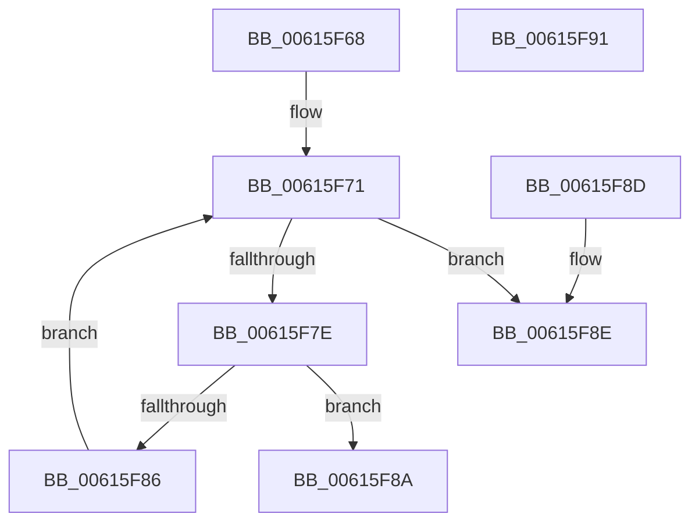

# VfDifCallbackReplacementRequested

- RVA: `0x00615F68`–`0x00615F92` (길이 `42` bytes)
- VA: `0x0000000140615F68`
- 실행 섹션: `.text`
- PDB 이름 있음: `예`; PDB Function 태그: `아니요`
- unwind 정보 RVA: `0x000DB714`
- 디코드: `17`개 명령, `42/42` bytes 표시
- 미해석 바이트: `0` (있으면 어셈블리에 `.byte`로 보존)

> 이 문서는 커널 이미지의 기계어와 PDB 기호를 분석해 생성했습니다. 4번과 5번은 함수 원형과 자료형을 바이너리 사용 방식에서 추정한 C 해석이며 원본 소스 복구 결과는 아닙니다.

## 1. Dependencies

- 직접 호출 지점: **0**; 고유 호출 대상: **0**
- 직접 호출자로 확인된 함수: **1**
- RIP 상대 이미지 참조: **1**

### Outgoing calls
- 직접 디코드된 call 명령이 없습니다.

### Direct callers
- [VfSuspectApplyDifVolatileVerification](../../pagevrfy/BA/VfSuspectApplyDifVolatileVerification_function_00BAA558.md) at `0x00BAA5B5`

### Static image references
- `0x00615F6A` → RVA `0x00FF4210` (`PAGEVRFD`; read)

## 2. Other-region calls and transfers

- 다른 실행 섹션으로 향하는 call: **0**
- 별도 외부 분기/꼬리 이동을 확인하지 못했습니다.

## 3. Assembly (complete function range)

```asm
00615F68  33 C9                           xor ecx, ecx
00615F6A  48 8D 15 9F E2 9D 00            lea rdx, [rip + 0x9de29f]
00615F71  8B C1                           mov eax, ecx
00615F73  48 C1 E0 05                     shl rax, 5
00615F77  48 83 3C 10 00                  cmp qword ptr [rax + rdx], 0
00615F7C  74 10                           je 0x140615f8e
00615F7E  8B 44 10 08                     mov eax, dword ptr [rax + rdx + 8]
00615F82  A8 01                           test al, 1
00615F84  75 04                           jne 0x140615f8a
00615F86  FF C1                           inc ecx
00615F88  EB E7                           jmp 0x140615f71
00615F8A  B0 01                           mov al, 1
00615F8C  C3                              ret
00615F8D  CC                              int3
00615F8E  32 C0                           xor al, al
00615F90  C3                              ret
00615F91  CC                              int3
```

## 4. C-style interpretation (structured pseudocode)

```c
__int64 __fastcall VfDifCallbackReplacementRequested(int a1)
{
    __int64 result;

    a1 = 0;
loc_00615F71:
    result = (0) << (5);
    if ((*(unsigned __int64 *)(result + v_rip + 10347167 * 1)) == 0) goto loc_00615F8E;
    if ((((unsigned __int8)((unsigned int)(*(unsigned int *)(result + v_rip + 10347167 * 1 + 8)))) & (1)) != 0) goto loc_00615F8A;
    a1 = (unsigned int)((a1) + 1);
    goto loc_00615F71;
loc_00615F8A:
    return 1;
loc_00615F8E:
    result = 0;
    return result;
}
```

## 5. (Beta) C Style

```c
int64_t VfDifCallbackReplacementRequested(int32_t Arg1)
{
    int64_t result;

    Arg1 = 0;
loc_00615F71:
    result = (0) << (5);
    if ((*(uint64_t *)(result + v_rip + 0x9DE29F * 1)) == 0) goto loc_00615F8E;
    if ((((uint8_t)((uint32_t)(*(uint32_t *)(result + v_rip + 0x9DE29F * 1 + 0x8)))) & (1)) != 0) goto loc_00615F8A;
    Arg1 = (uint32_t)((Arg1) + 1);
    goto loc_00615F71;
loc_00615F8A:
    return 1;
loc_00615F8E:
    result = 0;
    return result;
}
```

## 6. Execution-region graph

[열기: 2D/3D 그래프와 함수 탐색 컨트롤 패널](../../../control-panel.html?section=text&rva=0x00615F68&view=graph)

- 2D 그래프는 위에서 아래로 흐르고, 3D 그래프는 빈 공간을 드래그해 회전합니다. Shift+드래그는 이동, 휠은 확대·축소, 함수 노드 선택은 대상 보고서 이동입니다.

### Static fallback


