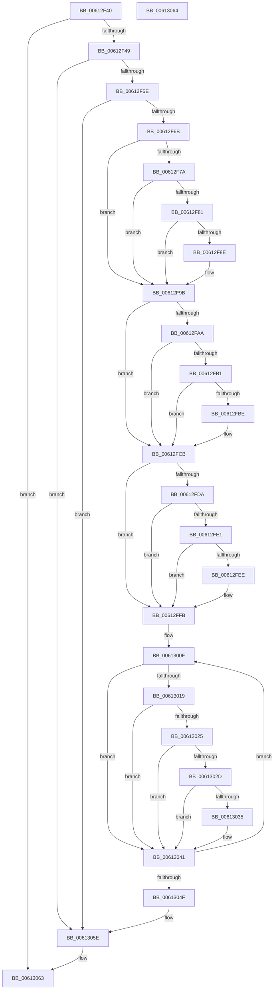

# VfDifRecoverIoCallbacks

- RVA: `0x00612F40`–`0x00613065` (길이 `293` bytes)
- VA: `0x0000000140612F40`
- 실행 섹션: `.text`
- PDB 이름 있음: `예`; PDB Function 태그: `아니요`
- unwind 정보 RVA: `0x000BDAD8`
- 디코드: `81`개 명령, `293/293` bytes 표시
- 미해석 바이트: `0` (있으면 어셈블리에 `.byte`로 보존)

> 이 문서는 커널 이미지의 기계어와 PDB 기호를 분석해 생성했습니다. 4번과 5번은 함수 원형과 자료형을 바이너리 사용 방식에서 추정한 C 해석이며 원본 소스 복구 결과는 아닙니다.

## 1. Dependencies

- 직접 호출 지점: **4**; 고유 호출 대상: **2**
- 직접 호출자로 확인된 함수: **1**
- RIP 상대 이미지 참조: **5**

### Outgoing calls
- `0x00612F70` → [ViDifFindIoCallbackContext](../../pagevrfy/B9/ViDifFindIoCallbackContext_function_00B9A8B4.md) (function, `0x00B9A8B4`)
- `0x00612FA0` → [ViDifFindIoCallbackContext](../../pagevrfy/B9/ViDifFindIoCallbackContext_function_00B9A8B4.md) (function, `0x00B9A8B4`)
- `0x00612FD0` → [ViDifFindIoCallbackContext](../../pagevrfy/B9/ViDifFindIoCallbackContext_function_00B9A8B4.md) (function, `0x00B9A8B4`)
- `0x00613054` → [ExFreePoolWithTag](../../poolcode/B8/ExFreePoolWithTag_function_00B82870.md) (function, `0x00B82870`)

### Direct callers
- [VfTargetRecoverIoCallbacks](VfTargetRecoverIoCallbacks_function_006131F0.md) at `0x0061323E`

### Static image references
- `0x00612F81` → RVA `0x00F042F8` (`.data`; read)
- `0x00612FB1` → RVA `0x00F04300` (`.data`; read)
- `0x00612FE1` → RVA `0x00F042D0` (`.data`; read)
- `0x00612FFB` → RVA `0x00FF4220` (`PAGEVRFD`; read)
- `0x00613019` → RVA `0x0029B590` (`IopInvalidDeviceRequest`; read)

## 2. Other-region calls and transfers

- 다른 실행 섹션으로 향하는 call: **4**
  - `0x00612F70` → [ViDifFindIoCallbackContext](../../pagevrfy/B9/ViDifFindIoCallbackContext_function_00B9A8B4.md) (`.text` → `PAGEVRFY`)
  - `0x00612FA0` → [ViDifFindIoCallbackContext](../../pagevrfy/B9/ViDifFindIoCallbackContext_function_00B9A8B4.md) (`.text` → `PAGEVRFY`)
  - `0x00612FD0` → [ViDifFindIoCallbackContext](../../pagevrfy/B9/ViDifFindIoCallbackContext_function_00B9A8B4.md) (`.text` → `PAGEVRFY`)
  - `0x00613054` → [ExFreePoolWithTag](../../poolcode/B8/ExFreePoolWithTag_function_00B82870.md) (`.text` → `POOLCODE`)
- 별도 외부 분기/꼬리 이동을 확인하지 못했습니다.

## 3. Assembly (complete function range)

```asm
00612F40  48 85 C9                        test rcx, rcx
00612F43  0F 84 1A 01 00 00               je 0x140613063
00612F49  53                              push rbx
00612F4A  48 83 EC 20                     sub rsp, 0x20
00612F4E  48 8B 59 30                     mov rbx, qword ptr [rcx + 0x30]
00612F52  48 8B D1                        mov rdx, rcx
00612F55  48 85 DB                        test rbx, rbx
00612F58  0F 84 00 01 00 00               je 0x14061305e
00612F5E  4C 8B 43 40                     mov r8, qword ptr [rbx + 0x40]
00612F62  4D 85 C0                        test r8, r8
00612F65  0F 84 F3 00 00 00               je 0x14061305e
00612F6B  B9 1D 00 00 10                  mov ecx, 0x1000001d
00612F70  E8 3F 79 58 00                  call 0x140b9a8b4
00612F75  48 85 C0                        test rax, rax
00612F78  74 21                           je 0x140612f9b
00612F7A  8B 40 08                        mov eax, dword ptr [rax + 8]
00612F7D  A8 01                           test al, 1
00612F7F  74 1A                           je 0x140612f9b
00612F81  48 8B 05 70 13 8F 00            mov rax, qword ptr [rip + 0x8f1370]
00612F88  48 39 42 60                     cmp qword ptr [rdx + 0x60], rax
00612F8C  75 0D                           jne 0x140612f9b
00612F8E  49 8B 40 08                     mov rax, qword ptr [r8 + 8]
00612F92  48 89 42 60                     mov qword ptr [rdx + 0x60], rax
00612F96  49 83 60 08 00                  and qword ptr [r8 + 8], 0
00612F9B  B9 1F 00 00 10                  mov ecx, 0x1000001f
00612FA0  E8 0F 79 58 00                  call 0x140b9a8b4
00612FA5  48 85 C0                        test rax, rax
00612FA8  74 21                           je 0x140612fcb
00612FAA  8B 40 08                        mov eax, dword ptr [rax + 8]
00612FAD  A8 01                           test al, 1
00612FAF  74 1A                           je 0x140612fcb
00612FB1  48 8B 05 48 13 8F 00            mov rax, qword ptr [rip + 0x8f1348]
00612FB8  48 39 42 68                     cmp qword ptr [rdx + 0x68], rax
00612FBC  75 0D                           jne 0x140612fcb
00612FBE  49 8B 40 10                     mov rax, qword ptr [r8 + 0x10]
00612FC2  48 89 42 68                     mov qword ptr [rdx + 0x68], rax
00612FC6  49 83 60 10 00                  and qword ptr [r8 + 0x10], 0
00612FCB  B9 1E 00 00 10                  mov ecx, 0x1000001e
00612FD0  E8 DF 78 58 00                  call 0x140b9a8b4
00612FD5  48 85 C0                        test rax, rax
00612FD8  74 21                           je 0x140612ffb
00612FDA  8B 40 08                        mov eax, dword ptr [rax + 8]
00612FDD  A8 01                           test al, 1
00612FDF  74 1A                           je 0x140612ffb
00612FE1  48 8B 05 E8 12 8F 00            mov rax, qword ptr [rip + 0x8f12e8]
00612FE8  48 39 43 08                     cmp qword ptr [rbx + 8], rax
00612FEC  74 0D                           je 0x140612ffb
00612FEE  49 8B 40 18                     mov rax, qword ptr [r8 + 0x18]
00612FF2  48 89 43 08                     mov qword ptr [rbx + 8], rax
00612FF6  49 83 60 18 00                  and qword ptr [r8 + 0x18], 0
00612FFB  4C 8D 0D 1E 12 9E 00            lea r9, [rip + 0x9e121e]
00613002  49 2B D0                        sub rdx, r8
00613005  49 8D 48 20                     lea rcx, [r8 + 0x20]
00613009  41 BB 1C 00 00 00               mov r11d, 0x1c
0061300F  4C 8B 54 0A 50                  mov r10, qword ptr [rdx + rcx + 0x50]
00613014  4D 85 D2                        test r10, r10
00613017  74 28                           je 0x140613041
00613019  48 8D 05 70 85 C8 FF            lea rax, [rip - 0x377a90]
00613020  4C 3B D0                        cmp r10, rax
00613023  74 1C                           je 0x140613041
00613025  41 8B 41 F8                     mov eax, dword ptr [r9 - 8]
00613029  A8 01                           test al, 1
0061302B  74 14                           je 0x140613041
0061302D  49 8B 01                        mov rax, qword ptr [r9]
00613030  4C 3B 10                        cmp r10, qword ptr [rax]
00613033  75 0C                           jne 0x140613041
00613035  48 8B 01                        mov rax, qword ptr [rcx]
00613038  48 89 44 0A 50                  mov qword ptr [rdx + rcx + 0x50], rax
0061303D  48 83 21 00                     and qword ptr [rcx], 0
00613041  48 83 C1 08                     add rcx, 8
00613045  49 83 C1 20                     add r9, 0x20
00613049  49 83 EB 01                     sub r11, 1
0061304D  75 C0                           jne 0x14061300f
0061304F  33 D2                           xor edx, edx
00613051  49 8B C8                        mov rcx, r8
00613054  E8 17 F8 56 00                  call 0x140b82870
00613059  48 83 63 40 00                  and qword ptr [rbx + 0x40], 0
0061305E  48 83 C4 20                     add rsp, 0x20
00613062  5B                              pop rbx
00613063  C3                              ret
00613064  CC                              int3
```

## 4. C-style interpretation (structured pseudocode)

```c
__int64 __fastcall VfDifRecoverIoCallbacks(__int64 a1)
{
    __int64 result;
    __int64 v_r11;
    __int64 v_rsp;

    if (a1 == 0) goto loc_00613063;
    v_rsp = (v_rsp) - (32);
    if (*(unsigned __int64 *)(a1 + 48) == 0) goto loc_0061305E;
    if (*(unsigned __int64 *)(*(unsigned __int64 *)(a1 + 48) + 64) == 0) goto loc_0061305E;
    result = ViDifFindIoCallbackContext((unsigned int)(0x1000001DULL), a1, *(unsigned __int64 *)(*(unsigned __int64 *)(a1 + 48) + 64), a4);
    if (result == 0) goto loc_00612F9B;
    if ((((unsigned __int8)((unsigned int)(*(unsigned int *)(result + 8)))) & (1)) == 0) goto loc_00612F9B;
    result = *(unsigned __int64 *)(v_rip + 9376624);
    if ((*(unsigned __int64 *)(a1 + 96)) == (*(unsigned __int64 *)(v_rip + 9376624))) {
        result = *(unsigned __int64 *)(*(unsigned __int64 *)(*(unsigned __int64 *)(a1 + 48) + 64) + 8);
        *(unsigned __int64 *)(a1 + 96) = result;
    }
    result = ViDifFindIoCallbackContext((unsigned int)(0x1000001FULL), a1, *(unsigned __int64 *)(*(unsigned __int64 *)(a1 + 48) + 64), a4);
    if (result == 0) goto loc_00612FCB;
    if ((((unsigned __int8)((unsigned int)(*(unsigned int *)(result + 8)))) & (1)) == 0) goto loc_00612FCB;
    result = *(unsigned __int64 *)(v_rip + 9376584);
    if ((*(unsigned __int64 *)(a1 + 104)) == (*(unsigned __int64 *)(v_rip + 9376584))) {
        result = *(unsigned __int64 *)(*(unsigned __int64 *)(*(unsigned __int64 *)(a1 + 48) + 64) + 16);
        *(unsigned __int64 *)(a1 + 104) = result;
    }
    result = ViDifFindIoCallbackContext((unsigned int)(0x1000001EULL), a1, *(unsigned __int64 *)(*(unsigned __int64 *)(a1 + 48) + 64), a4);
    if (result == 0) goto loc_00612FFB;
    if ((((unsigned __int8)((unsigned int)(*(unsigned int *)(result + 8)))) & (1)) == 0) goto loc_00612FFB;
    result = *(unsigned __int64 *)(v_rip + 9376488);
    if ((*(unsigned __int64 *)(*(unsigned __int64 *)(a1 + 48) + 8)) != (*(unsigned __int64 *)(v_rip + 9376488))) {
        result = *(unsigned __int64 *)(*(unsigned __int64 *)(*(unsigned __int64 *)(a1 + 48) + 64) + 24);
        *(unsigned __int64 *)(*(unsigned __int64 *)(a1 + 48) + 8) = result;
    }
    a2 = (a1) - (*(unsigned __int64 *)(*(unsigned __int64 *)(a1 + 48) + 64));
loc_0061300F:
    if (*(unsigned __int64 *)(a2 + *(unsigned __int64 *)(*(unsigned __int64 *)(a1 + 48) + 64) + 32 * 1 + 80) == 0) goto loc_00613041;
    if ((*(unsigned __int64 *)(a2 + *(unsigned __int64 *)(*(unsigned __int64 *)(a1 + 48) + 64) + 32 * 1 + 80)) == (v_rip - 3635856)) goto loc_00613041;
    if ((((unsigned __int8)((unsigned int)(*(unsigned int *)(v_rip + 10359326 - 8)))) & (1)) == 0) goto loc_00613041;
    result = *(unsigned __int64 *)(v_rip + 10359326);
    if ((*(unsigned __int64 *)(a2 + *(unsigned __int64 *)(*(unsigned __int64 *)(a1 + 48) + 64) + 32 * 1 + 80)) == (*(unsigned __int64 *)(*(unsigned __int64 *)(v_rip + 10359326)))) {
        result = *(unsigned __int64 *)(*(unsigned __int64 *)(*(unsigned __int64 *)(a1 + 48) + 64) + 32);
        *(unsigned __int64 *)(a2 + *(unsigned __int64 *)(*(unsigned __int64 *)(a1 + 48) + 64) + 32 * 1 + 80) = result;
    }
    a1 = (*(unsigned __int64 *)(*(unsigned __int64 *)(a1 + 48) + 64) + 32) + (8);
    a4 = (v_rip + 10359326) + (32);
    v_r11 = (28) - (1);
    if (condition_is_not_equal) goto loc_0061300F;
    a2 = 0;
    result = ExFreePoolWithTag(*(unsigned __int64 *)(*(unsigned __int64 *)(a1 + 48) + 64), a2, *(unsigned __int64 *)(*(unsigned __int64 *)(a1 + 48) + 64), a4);
loc_0061305E:
    v_rsp = (v_rsp) + (32);
loc_00613063:
    return result;
}
```

## 5. (Beta) C Style

```c
int64_t VfDifRecoverIoCallbacks(int64_t Arg1)
{
    int64_t result;
    int64_t local_r11;
    int64_t local_rsp;

    if (Arg1 == 0) goto loc_00613063;
    local_rsp = (local_rsp) - (32);
    if (*(uint64_t *)(Arg1 + 0x30) == 0) goto loc_0061305E;
    if (*(uint64_t *)(*(uint64_t *)(Arg1 + 0x30) + 0x40) == 0) goto loc_0061305E;
    result = ViDifFindIoCallbackContext((uint32_t)(0x1000001DULL), Arg1, *(uint64_t *)(*(uint64_t *)(Arg1 + 0x30) + 0x40), a4);
    if (result == 0) goto loc_00612F9B;
    if ((((uint8_t)((uint32_t)(*(uint32_t *)(result + 0x8)))) & (1)) == 0) goto loc_00612F9B;
    result = *(uint64_t *)(v_rip + 0x8F1370);
    if ((*(uint64_t *)(Arg1 + 0x60)) == (*(uint64_t *)(v_rip + 0x8F1370))) {
        result = *(uint64_t *)(*(uint64_t *)(*(uint64_t *)(Arg1 + 0x30) + 0x40) + 0x8);
        *(uint64_t *)(Arg1 + 0x60) = result;
    }
    result = ViDifFindIoCallbackContext((uint32_t)(0x1000001FULL), Arg1, *(uint64_t *)(*(uint64_t *)(Arg1 + 0x30) + 0x40), a4);
    if (result == 0) goto loc_00612FCB;
    if ((((uint8_t)((uint32_t)(*(uint32_t *)(result + 0x8)))) & (1)) == 0) goto loc_00612FCB;
    result = *(uint64_t *)(v_rip + 0x8F1348);
    if ((*(uint64_t *)(Arg1 + 0x68)) == (*(uint64_t *)(v_rip + 0x8F1348))) {
        result = *(uint64_t *)(*(uint64_t *)(*(uint64_t *)(Arg1 + 0x30) + 0x40) + 0x10);
        *(uint64_t *)(Arg1 + 0x68) = result;
    }
    result = ViDifFindIoCallbackContext((uint32_t)(0x1000001EULL), Arg1, *(uint64_t *)(*(uint64_t *)(Arg1 + 0x30) + 0x40), a4);
    if (result == 0) goto loc_00612FFB;
    if ((((uint8_t)((uint32_t)(*(uint32_t *)(result + 0x8)))) & (1)) == 0) goto loc_00612FFB;
    result = *(uint64_t *)(v_rip + 0x8F12E8);
    if ((*(uint64_t *)(*(uint64_t *)(Arg1 + 0x30) + 0x8)) != (*(uint64_t *)(v_rip + 0x8F12E8))) {
        result = *(uint64_t *)(*(uint64_t *)(*(uint64_t *)(Arg1 + 0x30) + 0x40) + 0x18);
        *(uint64_t *)(*(uint64_t *)(Arg1 + 0x30) + 0x8) = result;
    }
    a2 = (Arg1) - (*(uint64_t *)(*(uint64_t *)(Arg1 + 0x30) + 0x40));
loc_0061300F:
    if (*(uint64_t *)(a2 + *(uint64_t *)(*(uint64_t *)(Arg1 + 0x30) + 0x40) + 0x20 * 1 + 0x50) == 0) goto loc_00613041;
    if ((*(uint64_t *)(a2 + *(uint64_t *)(*(uint64_t *)(Arg1 + 0x30) + 0x40) + 0x20 * 1 + 0x50)) == (v_rip - 3635856)) goto loc_00613041;
    if ((((uint8_t)((uint32_t)(*(uint32_t *)(v_rip + 0x9E121E - 0x8)))) & (1)) == 0) goto loc_00613041;
    result = *(uint64_t *)(v_rip + 0x9E121E);
    if ((*(uint64_t *)(a2 + *(uint64_t *)(*(uint64_t *)(Arg1 + 0x30) + 0x40) + 0x20 * 1 + 0x50)) == (*(uint64_t *)(*(uint64_t *)(v_rip + 0x9E121E)))) {
        result = *(uint64_t *)(*(uint64_t *)(*(uint64_t *)(Arg1 + 0x30) + 0x40) + 0x20);
        *(uint64_t *)(a2 + *(uint64_t *)(*(uint64_t *)(Arg1 + 0x30) + 0x40) + 0x20 * 1 + 0x50) = result;
    }
    Arg1 = (*(uint64_t *)(*(uint64_t *)(Arg1 + 0x30) + 0x40) + 32) + (8);
    a4 = (v_rip + 10359326) + (32);
    local_r11 = (28) - (1);
    if (condition_is_not_equal) goto loc_0061300F;
    a2 = 0;
    result = ExFreePoolWithTag(*(uint64_t *)(*(uint64_t *)(Arg1 + 0x30) + 0x40), a2, *(uint64_t *)(*(uint64_t *)(Arg1 + 0x30) + 0x40), a4);
loc_0061305E:
    local_rsp = (local_rsp) + (32);
loc_00613063:
    return result;
}
```

## 6. Execution-region graph

[열기: 2D/3D 그래프와 함수 탐색 컨트롤 패널](../../../control-panel.html?section=text&rva=0x00612F40&view=graph)

- 2D 그래프는 위에서 아래로 흐르고, 3D 그래프는 빈 공간을 드래그해 회전합니다. Shift+드래그는 이동, 휠은 확대·축소, 함수 노드 선택은 대상 보고서 이동입니다.

### Static fallback


