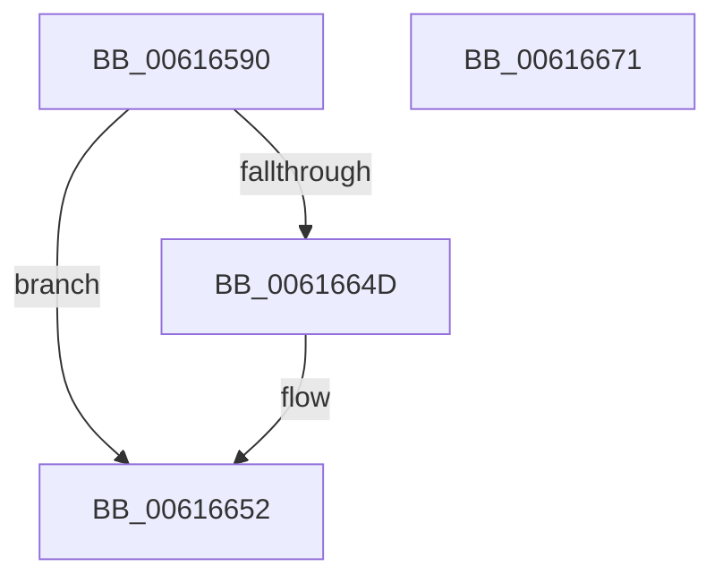

# VfDmaPluginEntry

- RVA: `0x00616590`–`0x00616672` (길이 `226` bytes)
- VA: `0x0000000140616590`
- 실행 섹션: `.text`
- PDB 이름 있음: `예`; PDB Function 태그: `아니요`
- unwind 정보 RVA: `0x000C87FC`
- 디코드: `47`개 명령, `226/226` bytes 표시
- 미해석 바이트: `0` (있으면 어셈블리에 `.byte`로 보존)

> 이 문서는 커널 이미지의 기계어와 PDB 기호를 분석해 생성했습니다. 4번과 5번은 함수 원형과 자료형을 바이너리 사용 방식에서 추정한 C 해석이며 원본 소스 복구 결과는 아닙니다.

## 1. Dependencies

- 직접 호출 지점: **3**; 고유 호출 대상: **3**
- 직접 호출자로 확인된 함수: **0**
- RIP 상대 이미지 참조: **8**

### Outgoing calls
- `0x00616642` → [DifRegisterPlugin](DifRegisterPlugin_function_0061ABE0.md) (function, `0x0061ABE0`)
- `0x0061664D` → [ViDmaInit](../../pagevrfy/BA/ViDmaInit_function_00BAC018.md) (function, `0x00BAC018`)
- `0x0061665B` → [_security_check_cookie](../6A/_security_check_cookie_function_006AC640.md) (function, `0x006AC640`)

### Direct callers
- 이 함수 시작 RVA로 연결되는 직접 call은 확인되지 않았습니다. 간접 호출은 완전히 역산할 수 없습니다.

### Static image references
- `0x006165A2` → RVA `0x00E0A740` (`.data`; read)
- `0x006165B5` → RVA `0x00BAC110` (`ViDmaUninit`; read)
- `0x006165C1` → RVA `0x00F03F80` (`.data`; read)
- `0x006165F3` → RVA `0x00F03F88` (`.data`; write)
- `0x006165FA` → RVA `0x006CF670` (` ?? ::FNODOBFM::`string'`; read)
- `0x00616605` → RVA `0x006CF630` (` ?? ::FNODOBFM::`string'`; read)
- `0x00616610` → RVA `0x006CF610` (` ?? ::FNODOBFM::`string'`; read)
- `0x0061661B` → RVA `0x006CF660` (` ?? ::FNODOBFM::`string'`; read)

## 2. Other-region calls and transfers

- 다른 실행 섹션으로 향하는 call: **1**
  - `0x0061664D` → [ViDmaInit](../../pagevrfy/BA/ViDmaInit_function_00BAC018.md) (`.text` → `PAGEVRFY`)
- 별도 외부 분기/꼬리 이동을 확인하지 못했습니다.

## 3. Assembly (complete function range)

```asm
00616590  48 89 5C 24 08                  mov qword ptr [rsp + 8], rbx
00616595  55                              push rbp
00616596  48 8D 6C 24 A9                  lea rbp, [rsp - 0x57]
0061659B  48 81 EC B0 00 00 00            sub rsp, 0xb0
006165A2  48 8B 05 97 41 7F 00            mov rax, qword ptr [rip + 0x7f4197]
006165A9  48 33 C4                        xor rax, rsp
006165AC  48 89 45 47                     mov qword ptr [rbp + 0x47], rax
006165B0  48 83 65 D7 00                  and qword ptr [rbp - 0x29], 0
006165B5  48 8D 05 54 5B 59 00            lea rax, [rip + 0x595b54]
006165BC  48 83 65 DF 00                  and qword ptr [rbp - 0x21], 0
006165C1  4C 8D 0D B8 D9 8E 00            lea r9, [rip + 0x8ed9b8]
006165C8  48 83 65 F7 00                  and qword ptr [rbp - 9], 0
006165CD  48 8D 4D C7                     lea rcx, [rbp - 0x39]
006165D1  48 83 65 FF 00                  and qword ptr [rbp - 1], 0
006165D6  BA 04 00 00 00                  mov edx, 4
006165DB  48 83 65 17 00                  and qword ptr [rbp + 0x17], 0
006165E0  48 83 65 1F 00                  and qword ptr [rbp + 0x1f], 0
006165E5  48 83 65 37 00                  and qword ptr [rbp + 0x37], 0
006165EA  48 83 65 3F 00                  and qword ptr [rbp + 0x3f], 0
006165EF  44 8D 42 03                     lea r8d, [rdx + 3]
006165F3  48 89 05 8E D9 8E 00            mov qword ptr [rip + 0x8ed98e], rax
006165FA  48 8D 05 6F 90 0B 00            lea rax, [rip + 0xb906f]
00616601  48 89 45 C7                     mov qword ptr [rbp - 0x39], rax
00616605  48 8D 05 24 90 0B 00            lea rax, [rip + 0xb9024]
0061660C  48 89 45 E7                     mov qword ptr [rbp - 0x19], rax
00616610  48 8D 05 F9 8F 0B 00            lea rax, [rip + 0xb8ff9]
00616617  48 89 45 07                     mov qword ptr [rbp + 7], rax
0061661B  48 8D 05 3E 90 0B 00            lea rax, [rip + 0xb903e]
00616622  48 89 45 27                     mov qword ptr [rbp + 0x27], rax
00616626  C7 45 CF 76 01 00 00            mov dword ptr [rbp - 0x31], 0x176
0061662D  C7 45 EF 75 01 00 00            mov dword ptr [rbp - 0x11], 0x175
00616634  C7 45 0F 74 01 00 00            mov dword ptr [rbp + 0xf], 0x174
0061663B  C7 45 2F 4E 01 00 00            mov dword ptr [rbp + 0x2f], 0x14e
00616642  E8 99 45 00 00                  call 0x14061abe0
00616647  8B D8                           mov ebx, eax
00616649  85 C0                           test eax, eax
0061664B  78 05                           js 0x140616652
0061664D  E8 C6 59 59 00                  call 0x140bac018
00616652  8B C3                           mov eax, ebx
00616654  48 8B 4D 47                     mov rcx, qword ptr [rbp + 0x47]
00616658  48 33 CC                        xor rcx, rsp
0061665B  E8 E0 5F 09 00                  call 0x1406ac640
00616660  48 8B 9C 24 C0 00 00 00         mov rbx, qword ptr [rsp + 0xc0]
00616668  48 81 C4 B0 00 00 00            add rsp, 0xb0
0061666F  5D                              pop rbp
00616670  C3                              ret
00616671  CC                              int3
```

## 4. C-style interpretation (structured pseudocode)

```c
__int64 __fastcall VfDmaPluginEntry(void)
{
    __int64 result;
    __int64 v_rsp;
    unsigned __int64 v_stack_m18;
    unsigned __int64 v_stack_m20;
    unsigned __int64 v_stack_m28;
    unsigned int v_stack_m30;
    unsigned __int64 v_stack_m38;
    unsigned __int64 v_stack_m40;
    unsigned __int64 v_stack_m48;
    unsigned int v_stack_m50;
    unsigned __int64 v_stack_m58;
    unsigned __int64 v_stack_m5F;
    unsigned __int64 v_stack_m60;
    unsigned __int64 v_stack_m68;
    unsigned int v_stack_m70;
    unsigned __int64 v_stack_m78;
    unsigned __int64 v_stack_m80;
    unsigned __int64 v_stack_m88;
    unsigned int v_stack_m90;
    unsigned __int64 v_stack_m98;
    unsigned __int64 v_stack_p8;

    v_stack_p8 = v_rbx;
    v_rsp = (v_rsp) - (176);
    result = (*(unsigned __int64 *)(v_rip + 8339863)) ^ (v_rsp);
    v_stack_m18 = result;
    *(unsigned __int64 *)(v_rip + 9361806) = v_rip + 5856084;
    v_stack_m98 = v_rip + 757871;
    v_stack_m78 = v_rip + 757796;
    v_stack_m58 = v_rip + 757753;
    v_stack_m38 = v_rip + 757822;
    v_stack_m90 = 374;
    v_stack_m70 = 373;
    v_stack_m50 = 372;
    v_stack_m30 = 334;
    result = DifRegisterPlugin(v_stack_m98, 4, 4 + 3, v_rip + 9361848);
    if (!(sign_flag)) {
        result = ViDmaInit(v_stack_m98, 4, 4 + 3, v_rip + 9361848);
    }
    a1 = (v_stack_m18) ^ (v_rsp);
    result = _security_check_cookie(a1, 4, 4 + 3, v_rip + 9361848);
    v_rsp = (v_rsp) + (176);
    return result;
}
```

## 5. (Beta) C Style

```c
void VfDmaPluginEntry(void)
{
    int64_t result;
    int64_t local_rsp;
    uint64_t v_stack_m18;
    uint64_t v_stack_m20;
    uint64_t v_stack_m28;
    uint32_t v_stack_m30;
    uint64_t v_stack_m38;
    uint64_t v_stack_m40;
    uint64_t v_stack_m48;
    uint32_t v_stack_m50;
    uint64_t v_stack_m58;
    uint64_t v_stack_m5F;
    uint64_t v_stack_m60;
    uint64_t v_stack_m68;
    uint32_t v_stack_m70;
    uint64_t v_stack_m78;
    uint64_t v_stack_m80;
    uint64_t v_stack_m88;
    uint32_t v_stack_m90;
    uint64_t v_stack_m98;
    uint64_t v_stack_p8;

    v_stack_p8 = local_rbx;
    local_rsp = (local_rsp) - (176);
    result = (*(uint64_t *)(v_rip + 0x7F4197)) ^ (local_rsp);
    v_stack_m18 = result;
    *(uint64_t *)(v_rip + 0x8ED98E) = v_rip + 5856084;
    v_stack_m98 = v_rip + 757871;
    v_stack_m78 = v_rip + 757796;
    v_stack_m58 = v_rip + 757753;
    v_stack_m38 = v_rip + 757822;
    v_stack_m90 = 374;
    v_stack_m70 = 373;
    v_stack_m50 = 372;
    v_stack_m30 = 334;
    result = DifRegisterPlugin(v_stack_m98, 4, 4 + 3, v_rip + 9361848);
    if (!(sign_flag)) {
        result = ViDmaInit(v_stack_m98, 4, 4 + 3, v_rip + 9361848);
    }
    a1 = (v_stack_m18) ^ (local_rsp);
    result = _security_check_cookie(a1, 4, 4 + 3, v_rip + 9361848);
    local_rsp = (local_rsp) + (176);
    return result;
}
```

## 6. Execution-region graph

[열기: 2D/3D 그래프와 함수 탐색 컨트롤 패널](../../../control-panel.html?section=text&rva=0x00616590&view=graph)

- 2D 그래프는 위에서 아래로 흐르고, 3D 그래프는 빈 공간을 드래그해 회전합니다. Shift+드래그는 이동, 휠은 확대·축소, 함수 노드 선택은 대상 보고서 이동입니다.

### Static fallback


