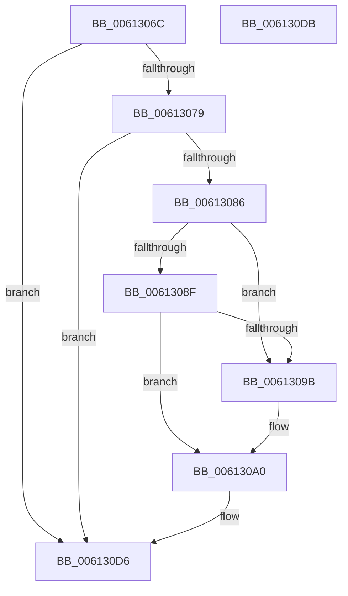

# VfDriverProcessUnload

- RVA: `0x0061306C`–`0x006130DC` (길이 `112` bytes)
- VA: `0x000000014061306C`
- 실행 섹션: `.text`
- PDB 이름 있음: `예`; PDB Function 태그: `아니요`
- unwind 정보 RVA: `0x0005C788`
- 디코드: `21`개 명령, `112/112` bytes 표시
- 미해석 바이트: `0` (있으면 어셈블리에 `.byte`로 보존)

> 이 문서는 커널 이미지의 기계어와 PDB 기호를 분석해 생성했습니다. 4번과 5번은 함수 원형과 자료형을 바이너리 사용 방식에서 추정한 C 해석이며 원본 소스 복구 결과는 아닙니다.

## 1. Dependencies

- 직접 호출 지점: **1**; 고유 호출 대상: **1**
- 직접 호출자로 확인된 함수: **1**
- RIP 상대 이미지 참조: **11**

### Outgoing calls
- `0x0061309B` → [VfDriverRemoveAllDifVerification](VfDriverRemoveAllDifVerification_function_006130E4.md) (function, `0x006130E4`)

### Direct callers
- [sub_00B2C55E](../../page/B2/Unknown_function_00B2C55E.md) at `0x00B2C562`

### Static image references
- `0x00613070` → RVA `0x00FFDA18` (`PAGEVRFD`; read)
- `0x00613079` → RVA `0x00F04370` (`.data`; read)
- `0x00613086` → RVA `0x00F048B8` (`.data`; read)
- `0x0061308F` → RVA `0x00F04980` (`.data`; read)
- `0x006130A0` → RVA `0x00FFDAD0` (`PAGEVRFD`; read/write)
- `0x006130A8` → RVA `0x00FFDAD8` (`PAGEVRFD`; read/write)
- `0x006130B0` → RVA `0x00FFDBB0` (`PAGEVRFD`; read/write)
- `0x006130B8` → RVA `0x00FFDA10` (`PAGEVRFD`; read/write)
- `0x006130C0` → RVA `0x00F04370` (`.data`; read/write)
- `0x006130C8` → RVA `0x00F04378` (`.data`; read/write)
- `0x006130CF` → RVA `0x00FFDA18` (`PAGEVRFD`; read/write)

## 2. Other-region calls and transfers

- 다른 실행 섹션으로 향하는 call: **0**
- 별도 외부 분기/꼬리 이동을 확인하지 못했습니다.

## 3. Assembly (complete function range)

```asm
0061306C  48 83 EC 28                     sub rsp, 0x28
00613070  83 3D A1 A9 9E 00 00            cmp dword ptr [rip + 0x9ea9a1], 0
00613077  74 5D                           je 0x1406130d6
00613079  48 8B 05 F0 12 8F 00            mov rax, qword ptr [rip + 0x8f12f0]
00613080  48 39 41 18                     cmp qword ptr [rcx + 0x18], rax
00613084  75 50                           jne 0x1406130d6
00613086  80 3D 2B 18 8F 00 00            cmp byte ptr [rip + 0x8f182b], 0
0061308D  75 0C                           jne 0x14061309b
0061308F  F7 05 E7 18 8F 00 00 08 00 00   test dword ptr [rip + 0x8f18e7], 0x800
00613099  74 05                           je 0x1406130a0
0061309B  E8 44 00 00 00                  call 0x1406130e4
006130A0  48 83 25 28 AA 9E 00 00         and qword ptr [rip + 0x9eaa28], 0
006130A8  48 83 25 28 AA 9E 00 00         and qword ptr [rip + 0x9eaa28], 0
006130B0  48 83 25 F8 AA 9E 00 00         and qword ptr [rip + 0x9eaaf8], 0
006130B8  48 83 25 50 A9 9E 00 00         and qword ptr [rip + 0x9ea950], 0
006130C0  48 83 25 A8 12 8F 00 00         and qword ptr [rip + 0x8f12a8], 0
006130C8  83 25 A9 12 8F 00 00            and dword ptr [rip + 0x8f12a9], 0
006130CF  83 25 42 A9 9E 00 00            and dword ptr [rip + 0x9ea942], 0
006130D6  48 83 C4 28                     add rsp, 0x28
006130DA  C3                              ret
006130DB  CC                              int3
```

## 4. C-style interpretation (structured pseudocode)

```c
__int64 __fastcall VfDriverProcessUnload(__int64 a1)
{
    __int64 result;
    __int64 v_rsp;

    v_rsp = (v_rsp) - (40);
    if ((*(unsigned int *)(v_rip + 10398113)) == 0) goto loc_006130D6;
    if ((*(unsigned __int64 *)(a1 + 24)) != (*(unsigned __int64 *)(v_rip + 9376496))) goto loc_006130D6;
    if ((*(unsigned __int8 *)(v_rip + 9377835)) != 0) goto loc_0061309B;
    result = *(unsigned __int64 *)(v_rip + 9376496);
    if (((*(unsigned int *)(v_rip + 9378023)) & (0x800ULL)) != 0) {
        result = VfDriverRemoveAllDifVerification(a1, a2, a3, a4);
    }
loc_006130D6:
    v_rsp = (v_rsp) + (40);
    return result;
}
```

## 5. (Beta) C Style

```c
int64_t VfDriverProcessUnload(void *Arg1)
{
    uint8_t *arg1 = (uint8_t *)Arg1;

    int64_t result;
    int64_t local_rsp;

    local_rsp = (local_rsp) - (40);
    if ((*(uint32_t *)(v_rip + 0x9EA9A1)) == 0) goto loc_006130D6;
    if ((*(uint64_t *)(arg1 + 0x18)) != (*(uint64_t *)(v_rip + 0x8F12F0))) goto loc_006130D6;
    if ((*(uint8_t *)(v_rip + 0x8F182B)) != 0) goto loc_0061309B;
    result = *(uint64_t *)(v_rip + 0x8F12F0);
    if (((*(uint32_t *)(v_rip + 0x8F18E7)) & (0x800ULL)) != 0) {
        result = VfDriverRemoveAllDifVerification(Arg1, a2, a3, a4);
    }
loc_006130D6:
    local_rsp = (local_rsp) + (40);
    return result;
}
```

### 관측된 메모리 오프셋

구조체 형식이 확인되지 않은 접근은 인자 기준의 오프셋으로만 기록했습니다.

| 기준 인자 | 오프셋 표현 | 폭 (bit) | 접근 |
|---|---:|---:|---|
| `Arg1` | `+ 0x18` | `64` | `R` |

## 6. Execution-region graph

[열기: 2D/3D 그래프와 함수 탐색 컨트롤 패널](../../../control-panel.html?section=text&rva=0x0061306C&view=graph)

- 2D 그래프는 위에서 아래로 흐르고, 3D 그래프는 빈 공간을 드래그해 회전합니다. Shift+드래그는 이동, 휠은 확대·축소, 함수 노드 선택은 대상 보고서 이동입니다.

### Static fallback


