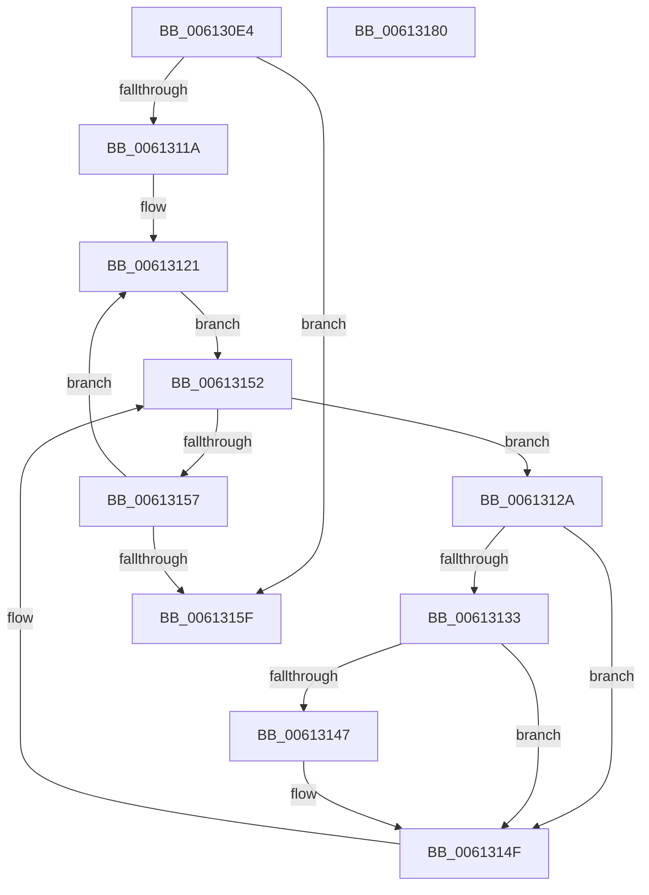

# VfDriverRemoveAllDifVerification

- RVA: `0x006130E4`–`0x00613181` (길이 `157` bytes)
- VA: `0x00000001406130E4`
- 실행 섹션: `.text`
- PDB 이름 있음: `예`; PDB Function 태그: `아니요`
- unwind 정보 RVA: `0x0005C954`
- 디코드: `41`개 명령, `157/157` bytes 표시
- 미해석 바이트: `0` (있으면 어셈블리에 `.byte`로 보존)

> 이 문서는 커널 이미지의 기계어와 PDB 기호를 분석해 생성했습니다. 4번과 5번은 함수 원형과 자료형을 바이너리 사용 방식에서 추정한 C 해석이며 원본 소스 복구 결과는 아닙니다.

## 1. Dependencies

- 직접 호출 지점: **6**; 고유 호출 대상: **6**
- 직접 호출자로 확인된 함수: **1**
- RIP 상대 이미지 참조: **2**

### Outgoing calls
- `0x006130F8` → [VfDriverLock](../../pagevrfy/B9/VfDriverLock_function_00B9A4A4.md) (function, `0x00B9A4A4`)
- `0x00613102` → [MiAcquireLoadLock](../2A/MiAcquireLoadLock_function_002A3950.md) (function, `0x002A3950`)
- `0x0061313E` → [RtlEqualUnicodeString](../../page/93/RtlEqualUnicodeString_function_00932A20.md) (function, `0x00932A20`)
- `0x0061314A` → [VfSuspectRemoveDifVolatileVerification](../../pagevrfy/BA/VfSuspectRemoveDifVolatileVerification_function_00BAB128.md) (function, `0x00BAB128`)
- `0x00613161` → [MmReleaseLoadLock](../4D/MmReleaseLoadLock_function_004D36D0.md) (function, `0x004D36D0`)
- `0x00613166` → [VfDriverUnlock](../../pagevrfy/B9/VfDriverUnlock_function_00B9A62C.md) (function, `0x00B9A62C`)

### Direct callers
- [VfDriverProcessUnload](VfDriverProcessUnload_function_0061306C.md) at `0x0061309B`

### Static image references
- `0x00613107` → RVA `0x00F049E0` (`.data`; read)
- `0x0061311A` → RVA `0x00EF54C0` (`.data`; read)

## 2. Other-region calls and transfers

- 다른 실행 섹션으로 향하는 call: **4**
  - `0x006130F8` → [VfDriverLock](../../pagevrfy/B9/VfDriverLock_function_00B9A4A4.md) (`.text` → `PAGEVRFY`)
  - `0x0061313E` → [RtlEqualUnicodeString](../../page/93/RtlEqualUnicodeString_function_00932A20.md) (`.text` → `PAGE`)
  - `0x0061314A` → [VfSuspectRemoveDifVolatileVerification](../../pagevrfy/BA/VfSuspectRemoveDifVolatileVerification_function_00BAB128.md) (`.text` → `PAGEVRFY`)
  - `0x00613166` → [VfDriverUnlock](../../pagevrfy/B9/VfDriverUnlock_function_00B9A62C.md) (`.text` → `PAGEVRFY`)
- 별도 외부 분기/꼬리 이동을 확인하지 못했습니다.

## 3. Assembly (complete function range)

```asm
006130E4  48 89 5C 24 08                  mov qword ptr [rsp + 8], rbx
006130E9  48 89 6C 24 10                  mov qword ptr [rsp + 0x10], rbp
006130EE  48 89 74 24 18                  mov qword ptr [rsp + 0x18], rsi
006130F3  57                              push rdi
006130F4  48 83 EC 20                     sub rsp, 0x20
006130F8  E8 A7 73 58 00                  call 0x140b9a4a4
006130FD  B9 01 00 00 00                  mov ecx, 1
00613102  E8 49 08 C9 FF                  call 0x1402a3950
00613107  48 8B 3D D2 18 8F 00            mov rdi, qword ptr [rip + 0x8f18d2]
0061310E  48 8D 2D CB 18 8F 00            lea rbp, [rip + 0x8f18cb]
00613115  48 3B FD                        cmp rdi, rbp
00613118  74 45                           je 0x14061315f
0061311A  48 8D 35 9F 23 8E 00            lea rsi, [rip + 0x8e239f]
00613121  48 8B 1D 98 23 8E 00            mov rbx, qword ptr [rip + 0x8e2398]
00613128  EB 28                           jmp 0x140613152
0061312A  F7 43 68 00 00 00 02            test dword ptr [rbx + 0x68], 0x2000000
00613131  74 1C                           je 0x14061314f
00613133  48 8D 53 58                     lea rdx, [rbx + 0x58]
00613137  41 B0 01                        mov r8b, 1
0061313A  48 8D 4F 28                     lea rcx, [rdi + 0x28]
0061313E  E8 DD F8 31 00                  call 0x140932a20
00613143  84 C0                           test al, al
00613145  74 08                           je 0x14061314f
00613147  48 8B CB                        mov rcx, rbx
0061314A  E8 D9 7F 59 00                  call 0x140bab128
0061314F  48 8B 1B                        mov rbx, qword ptr [rbx]
00613152  48 3B DE                        cmp rbx, rsi
00613155  75 D3                           jne 0x14061312a
00613157  48 8B 3F                        mov rdi, qword ptr [rdi]
0061315A  48 3B FD                        cmp rdi, rbp
0061315D  75 C2                           jne 0x140613121
0061315F  33 C9                           xor ecx, ecx
00613161  E8 6A 05 EC FF                  call 0x1404d36d0
00613166  E8 C1 74 58 00                  call 0x140b9a62c
0061316B  48 8B 5C 24 30                  mov rbx, qword ptr [rsp + 0x30]
00613170  48 8B 6C 24 38                  mov rbp, qword ptr [rsp + 0x38]
00613175  48 8B 74 24 40                  mov rsi, qword ptr [rsp + 0x40]
0061317A  48 83 C4 20                     add rsp, 0x20
0061317E  5F                              pop rdi
0061317F  C3                              ret
00613180  CC                              int3
```

## 4. C-style interpretation (structured pseudocode)

```c
__int64 __fastcall VfDriverRemoveAllDifVerification(void)
{
    __int64 result;
    __int64 v_rsp;
    unsigned __int64 v_stack_p10;
    unsigned __int64 v_stack_p18;
    unsigned __int64 v_stack_p8;

    v_stack_p8 = v_rbx;
    v_stack_p10 = v_rbp;
    v_stack_p18 = v_rsi;
    v_rsp = (v_rsp) - (32);
    result = VfDriverLock(a1, a2, a3, a4);
    result = MiAcquireLoadLock(1, a2, a3, a4);
    if ((*(unsigned __int64 *)(v_rip + 9378002)) == (v_rip + 9377995)) goto loc_0061315F;
loc_00613121:
    goto loc_00613152;
loc_0061312A:
    if (((*(unsigned int *)(*(unsigned __int64 *)(v_rip + 9315224) + 104)) & (0x2000000ULL)) == 0) goto loc_0061314F;
    result = RtlEqualUnicodeString(*(unsigned __int64 *)(v_rip + 9378002) + 40, *(unsigned __int64 *)(v_rip + 9315224) + 88, 1, a4);
    if ((unsigned __int8)(result) != 0) {
        a1 = *(unsigned __int64 *)(v_rip + 9315224);
        result = VfSuspectRemoveDifVolatileVerification(a1, *(unsigned __int64 *)(v_rip + 9315224) + 88, 1, a4);
    }
loc_00613152:
    if ((*(unsigned __int64 *)(*(unsigned __int64 *)(v_rip + 9315224))) != (v_rip + 9315231)) goto loc_0061312A;
    if ((*(unsigned __int64 *)(*(unsigned __int64 *)(v_rip + 9378002))) != (v_rip + 9377995)) goto loc_00613121;
loc_0061315F:
    a1 = 0;
    result = MmReleaseLoadLock(a1, *(unsigned __int64 *)(v_rip + 9315224) + 88, 1, a4);
    result = VfDriverUnlock(a1, *(unsigned __int64 *)(v_rip + 9315224) + 88, 1, a4);
    v_rsp = (v_rsp) + (32);
    return result;
}
```

## 5. (Beta) C Style

```c
void VfDriverRemoveAllDifVerification(void)
{
    int64_t result;
    int64_t local_rsp;
    uint64_t v_stack_p10;
    uint64_t v_stack_p18;
    uint64_t v_stack_p8;

    v_stack_p8 = local_rbx;
    v_stack_p10 = local_rbp;
    v_stack_p18 = local_rsi;
    local_rsp = (local_rsp) - (32);
    result = VfDriverLock(a1, a2, a3, a4);
    result = MiAcquireLoadLock(1, a2, a3, a4);
    if ((*(uint64_t *)(v_rip + 0x8F18D2)) == (v_rip + 9377995)) goto loc_0061315F;
loc_00613121:
    goto loc_00613152;
loc_0061312A:
    if (((*(uint32_t *)(*(uint64_t *)(v_rip + 0x8E2398) + 0x68)) & (0x2000000ULL)) == 0) goto loc_0061314F;
    result = RtlEqualUnicodeString(*(uint64_t *)(v_rip + 0x8F18D2) + 40, *(uint64_t *)(v_rip + 0x8E2398) + 88, 1, a4);
    if ((uint8_t)(result) != 0) {
        a1 = *(uint64_t *)(v_rip + 0x8E2398);
        result = VfSuspectRemoveDifVolatileVerification(a1, *(uint64_t *)(v_rip + 0x8E2398) + 88, 1, a4);
    }
loc_00613152:
    if ((*(uint64_t *)(*(uint64_t *)(v_rip + 0x8E2398))) != (v_rip + 9315231)) goto loc_0061312A;
    if ((*(uint64_t *)(*(uint64_t *)(v_rip + 0x8F18D2))) != (v_rip + 9377995)) goto loc_00613121;
loc_0061315F:
    a1 = 0;
    result = MmReleaseLoadLock(a1, *(uint64_t *)(v_rip + 0x8E2398) + 88, 1, a4);
    result = VfDriverUnlock(a1, *(uint64_t *)(v_rip + 0x8E2398) + 88, 1, a4);
    local_rsp = (local_rsp) + (32);
    return result;
}
```

## 6. Execution-region graph

[열기: 2D/3D 그래프와 함수 탐색 컨트롤 패널](../../../control-panel.html?section=text&rva=0x006130E4&view=graph)

- 2D 그래프는 위에서 아래로 흐르고, 3D 그래프는 빈 공간을 드래그해 회전합니다. Shift+드래그는 이동, 휠은 확대·축소, 함수 노드 선택은 대상 보고서 이동입니다.

### Static fallback


