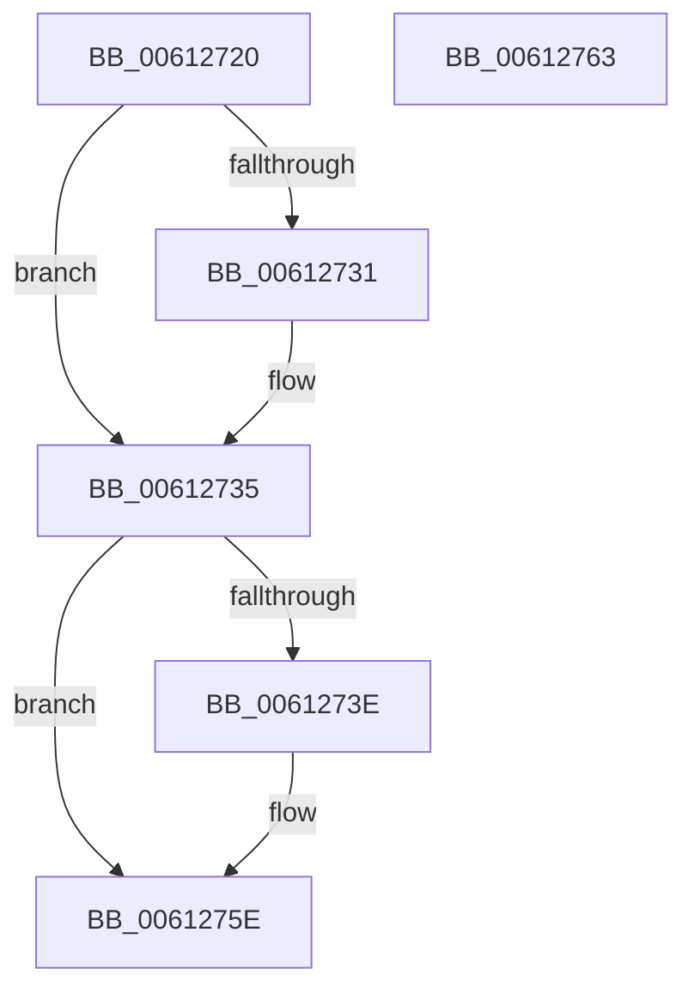

# VfFailDriver

- RVA: `0x00612720`–`0x00612764` (길이 `68` bytes)
- VA: `0x0000000140612720`
- 실행 섹션: `.text`
- PDB 이름 있음: `예`; PDB Function 태그: `아니요`
- unwind 정보 RVA: `0x00063458`
- 디코드: `17`개 명령, `68/68` bytes 표시
- 미해석 바이트: `0` (있으면 어셈블리에 `.byte`로 보존)

> 이 문서는 커널 이미지의 기계어와 PDB 기호를 분석해 생성했습니다. 4번과 5번은 함수 원형과 자료형을 바이너리 사용 방식에서 추정한 C 해석이며 원본 소스 복구 결과는 아닙니다.

## 1. Dependencies

- 직접 호출 지점: **1**; 고유 호출 대상: **1**
- 직접 호출자로 확인된 함수: **0**
- RIP 상대 이미지 참조: **1**

### Outgoing calls
- `0x00612759` → [CarReportRuleViolationFromNt](../../pagevrfy/B9/CarReportRuleViolationFromNt_function_00B9D904.md) (function, `0x00B9D904`)

### Direct callers
- 이 함수 시작 RVA로 연결되는 직접 call은 확인되지 않았습니다. 간접 호출은 완전히 역산할 수 없습니다.

### Static image references
- `0x00612735` → RVA `0x00F048D0` (`.data`; read)

## 2. Other-region calls and transfers

- 다른 실행 섹션으로 향하는 call: **1**
  - `0x00612759` → [CarReportRuleViolationFromNt](../../pagevrfy/B9/CarReportRuleViolationFromNt_function_00B9D904.md) (`.text` → `PAGEVRFY`)
- 별도 외부 분기/꼬리 이동을 확인하지 못했습니다.

## 3. Assembly (complete function range)

```asm
00612720  48 83 EC 48                     sub rsp, 0x48
00612724  48 8B 84 24 80 00 00 00         mov rax, qword ptr [rsp + 0x80]
0061272C  48 85 C0                        test rax, rax
0061272F  74 04                           je 0x140612735
00612731  48 8B 40 18                     mov rax, qword ptr [rax + 0x18]
00612735  83 3D 94 21 8F 00 00            cmp dword ptr [rip + 0x8f2194], 0
0061273C  74 20                           je 0x14061275e
0061273E  48 89 44 24 30                  mov qword ptr [rsp + 0x30], rax
00612743  45 33 C9                        xor r9d, r9d
00612746  C7 44 24 28 1E 00 00 00         mov dword ptr [rsp + 0x28], 0x1e
0061274E  45 33 C0                        xor r8d, r8d
00612751  48 83 64 24 20 00               and qword ptr [rsp + 0x20], 0
00612757  8B D2                           mov edx, edx
00612759  E8 A6 B1 58 00                  call 0x140b9d904
0061275E  48 83 C4 48                     add rsp, 0x48
00612762  C3                              ret
00612763  CC                              int3
```

## 4. C-style interpretation (structured pseudocode)

```c
__int64 __fastcall VfFailDriver(__int64 a1, int a2, int a3, int a4, __int64 a5, __int64 a6, __int64 a7)
{
    __int64 result;
    __int64 v_rsp;
    unsigned __int64 v_stack_m18;
    unsigned int v_stack_m20;
    unsigned __int64 v_stack_m28;

    v_rsp = (v_rsp) - (72);
    result = a7;
    if (a7 != 0) {
        result = *(unsigned __int64 *)(a7 + 24);
    }
    if ((*(unsigned int *)(v_rip + 9380244)) != 0) {
        v_stack_m18 = result;
        a4 = 0;
        v_stack_m20 = 30;
        a3 = 0;
        a2 = a2;
        result = CarReportRuleViolationFromNt(a1, a2, a3, a4);
    }
    v_rsp = (v_rsp) + (72);
    return result;
}
```

## 5. (Beta) C Style

```c
int64_t VfFailDriver(int64_t Arg1, int32_t Arg2, int32_t Arg3, int32_t Arg4, uint64_t Arg5, uint64_t Arg6, int64_t Arg7)
{
    int64_t result;
    int64_t local_rsp;
    uint64_t v_stack_m18;
    uint32_t v_stack_m20;
    uint64_t v_stack_m28;

    local_rsp = (local_rsp) - (72);
    result = Arg7;
    if (Arg7 != 0) {
        result = *(uint64_t *)(Arg7 + 0x18);
    }
    if ((*(uint32_t *)(v_rip + 0x8F2194)) != 0) {
        v_stack_m18 = result;
        Arg4 = 0;
        v_stack_m20 = 30;
        Arg3 = 0;
        Arg2 = Arg2;
        result = CarReportRuleViolationFromNt(Arg1, Arg2, Arg3, Arg4);
    }
    local_rsp = (local_rsp) + (72);
    return result;
}
```

## 6. Execution-region graph

[열기: 2D/3D 그래프와 함수 탐색 컨트롤 패널](../../../control-panel.html?section=text&rva=0x00612720&view=graph)

- 2D 그래프는 위에서 아래로 흐르고, 3D 그래프는 빈 공간을 드래그해 회전합니다. Shift+드래그는 이동, 휠은 확대·축소, 함수 노드 선택은 대상 보고서 이동입니다.

### Static fallback


