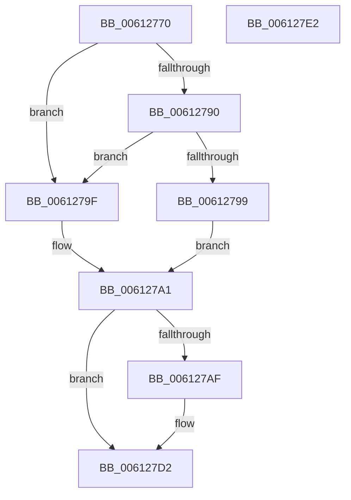

# VfFailSystemBIOS

- RVA: `0x00612770`–`0x006127E3` (길이 `115` bytes)
- VA: `0x0000000140612770`
- 실행 섹션: `.text`
- PDB 이름 있음: `예`; PDB Function 태그: `아니요`
- unwind 정보 RVA: `0x00086C28`
- 디코드: `34`개 명령, `115/115` bytes 표시
- 미해석 바이트: `0` (있으면 어셈블리에 `.byte`로 보존)

> 이 문서는 커널 이미지의 기계어와 PDB 기호를 분석해 생성했습니다. 4번과 5번은 함수 원형과 자료형을 바이너리 사용 방식에서 추정한 C 해석이며 원본 소스 복구 결과는 아닙니다.

## 1. Dependencies

- 직접 호출 지점: **2**; 고유 호출 대상: **2**
- 직접 호출자로 확인된 함수: **0**
- RIP 상대 이미지 참조: **0**

### Outgoing calls
- `0x006127A6` → [VfIsVerificationEnabled](../4B/VfIsVerificationEnabled_function_004B8810.md) (function, `0x004B8810`)
- `0x006127CD` → [CarReportRuleViolationFromNt](../../pagevrfy/B9/CarReportRuleViolationFromNt_function_00B9D904.md) (function, `0x00B9D904`)

### Direct callers
- 이 함수 시작 RVA로 연결되는 직접 call은 확인되지 않았습니다. 간접 호출은 완전히 역산할 수 없습니다.

### Static image references
- 디코드된 RIP-relative 메모리 참조가 없습니다.

## 2. Other-region calls and transfers

- 다른 실행 섹션으로 향하는 call: **1**
  - `0x006127CD` → [CarReportRuleViolationFromNt](../../pagevrfy/B9/CarReportRuleViolationFromNt_function_00B9D904.md) (`.text` → `PAGEVRFY`)
- 별도 외부 분기/꼬리 이동을 확인하지 못했습니다.

## 3. Assembly (complete function range)

```asm
00612770  48 89 5C 24 08                  mov qword ptr [rsp + 8], rbx
00612775  48 89 74 24 10                  mov qword ptr [rsp + 0x10], rsi
0061277A  57                              push rdi
0061277B  48 83 EC 40                     sub rsp, 0x40
0061277F  48 8B 84 24 80 00 00 00         mov rax, qword ptr [rsp + 0x80]
00612787  8B F1                           mov esi, ecx
00612789  8B FA                           mov edi, edx
0061278B  48 85 C0                        test rax, rax
0061278E  74 0F                           je 0x14061279f
00612790  48 8B 40 08                     mov rax, qword ptr [rax + 8]
00612794  48 85 C0                        test rax, rax
00612797  74 06                           je 0x14061279f
00612799  48 8B 58 18                     mov rbx, qword ptr [rax + 0x18]
0061279D  EB 02                           jmp 0x1406127a1
0061279F  33 DB                           xor ebx, ebx
006127A1  33 D2                           xor edx, edx
006127A3  8D 4A 02                        lea ecx, [rdx + 2]
006127A6  E8 65 60 EA FF                  call 0x1404b8810
006127AB  85 C0                           test eax, eax
006127AD  74 23                           je 0x1406127d2
006127AF  48 89 5C 24 30                  mov qword ptr [rsp + 0x30], rbx
006127B4  48 8B D7                        mov rdx, rdi
006127B7  C7 44 24 28 1E 00 00 00         mov dword ptr [rsp + 0x28], 0x1e
006127BF  45 33 C9                        xor r9d, r9d
006127C2  48 83 64 24 20 00               and qword ptr [rsp + 0x20], 0
006127C8  45 33 C0                        xor r8d, r8d
006127CB  8B CE                           mov ecx, esi
006127CD  E8 32 B1 58 00                  call 0x140b9d904
006127D2  48 8B 5C 24 50                  mov rbx, qword ptr [rsp + 0x50]
006127D7  48 8B 74 24 58                  mov rsi, qword ptr [rsp + 0x58]
006127DC  48 83 C4 40                     add rsp, 0x40
006127E0  5F                              pop rdi
006127E1  C3                              ret
006127E2  CC                              int3
```

## 4. C-style interpretation (structured pseudocode)

```c
__int64 __fastcall VfFailSystemBIOS(int a1, int a2, int a3, int a4, __int64 a5, __int64 a6, __int64 a7)
{
    __int64 result;
    __int64 v_rbx;
    __int64 v_rsp;
    unsigned __int64 v_stack_m18;
    unsigned int v_stack_m20;
    unsigned __int64 v_stack_m28;
    unsigned __int64 v_stack_p10;
    unsigned __int64 v_stack_p8;

    v_stack_p8 = v_rbx;
    v_stack_p10 = v_rsi;
    v_rsp = (v_rsp) - (64);
    if (a7 == 0) goto loc_0061279F;
    if (*(unsigned __int64 *)(a7 + 8) == 0) goto loc_0061279F;
    goto loc_006127A1;
loc_0061279F:
    v_rbx = 0;
loc_006127A1:
    a2 = 0;
    result = VfIsVerificationEnabled(a2 + 2, a2, a3, a4);
    if ((unsigned int)(result) != 0) {
        v_stack_m18 = 0;
        a2 = (unsigned int)(a2);
        v_stack_m20 = 30;
        a4 = 0;
        a3 = 0;
        a1 = (unsigned int)((unsigned int)(a1));
        result = CarReportRuleViolationFromNt(a1, a2, a3, a4);
    }
    v_rsp = (v_rsp) + (64);
    return result;
}
```

## 5. (Beta) C Style

```c
int64_t VfFailSystemBIOS(int32_t Arg1, int32_t Arg2, int32_t Arg3, int32_t Arg4, uint64_t Arg5, uint64_t Arg6, int64_t Arg7)
{
    int64_t result;
    int64_t local_rbx;
    int64_t local_rsp;
    uint64_t v_stack_m18;
    uint32_t v_stack_m20;
    uint64_t v_stack_m28;
    uint64_t v_stack_p10;
    uint64_t v_stack_p8;

    v_stack_p8 = local_rbx;
    v_stack_p10 = local_rsi;
    local_rsp = (local_rsp) - (64);
    if (Arg7 == 0) goto loc_0061279F;
    if (*(uint64_t *)(Arg7 + 0x8) == 0) goto loc_0061279F;
    goto loc_006127A1;
loc_0061279F:
    local_rbx = 0;
loc_006127A1:
    Arg2 = 0;
    result = VfIsVerificationEnabled(Arg2 + 2, Arg2, Arg3, Arg4);
    if ((uint32_t)(result) != 0) {
        v_stack_m18 = 0;
        Arg2 = (uint32_t)(Arg2);
        v_stack_m20 = 30;
        Arg4 = 0;
        Arg3 = 0;
        Arg1 = (uint32_t)((uint32_t)(Arg1));
        result = CarReportRuleViolationFromNt(Arg1, Arg2, Arg3, Arg4);
    }
    local_rsp = (local_rsp) + (64);
    return result;
}
```

## 6. Execution-region graph

[열기: 2D/3D 그래프와 함수 탐색 컨트롤 패널](../../../control-panel.html?section=text&rva=0x00612770&view=graph)

- 2D 그래프는 위에서 아래로 흐르고, 3D 그래프는 빈 공간을 드래그해 회전합니다. Shift+드래그는 이동, 휠은 확대·축소, 함수 노드 선택은 대상 보고서 이동입니다.

### Static fallback


