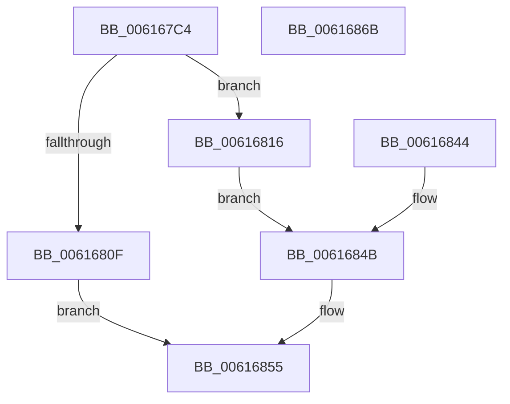

# VfGetVerifierInformation

- RVA: `0x006167C4`–`0x0061686C` (길이 `168` bytes)
- VA: `0x00000001406167C4`
- 실행 섹션: `.text`
- PDB 이름 있음: `예`; PDB Function 태그: `아니요`
- unwind 정보 RVA: `0x000D27AC`
- 디코드: `53`개 명령, `168/168` bytes 표시
- 미해석 바이트: `0` (있으면 어셈블리에 `.byte`로 보존)

> 이 문서는 커널 이미지의 기계어와 PDB 기호를 분석해 생성했습니다. 4번과 5번은 함수 원형과 자료형을 바이너리 사용 방식에서 추정한 C 해석이며 원본 소스 복구 결과는 아닙니다.

## 1. Dependencies

- 직접 호출 지점: **4**; 고유 호출 대상: **4**
- 직접 호출자로 확인된 함수: **1**
- RIP 상대 이미지 참조: **0**

### Outgoing calls
- `0x006167FD` → [ExAllocatePool2](../../poolcode/B8/ExAllocatePool2_function_00B820F0.md) (function, `0x00B820F0`)
- `0x00616825` → [VfSuspectDriversGetVerifierInformation](../../pagevrfy/BA/VfSuspectDriversGetVerifierInformation_function_00BAA884.md) (function, `0x00BAA884`)
- `0x0061683D` → [memcpy](../6C/memcpy_function_006C6840.md) (function, `0x006C6840`)
- `0x00616850` → [ExFreePoolWithTag](../../poolcode/B8/ExFreePoolWithTag_function_00B82870.md) (function, `0x00B82870`)

### Direct callers
- [ExpQuerySystemInformation](../../page/A5/ExpQuerySystemInformation_function_00A57858.md) at `0x00A588F6`

### Static image references
- 디코드된 RIP-relative 메모리 참조가 없습니다.

## 2. Other-region calls and transfers

- 다른 실행 섹션으로 향하는 call: **3**
  - `0x006167FD` → [ExAllocatePool2](../../poolcode/B8/ExAllocatePool2_function_00B820F0.md) (`.text` → `POOLCODE`)
  - `0x00616825` → [VfSuspectDriversGetVerifierInformation](../../pagevrfy/BA/VfSuspectDriversGetVerifierInformation_function_00BAA884.md) (`.text` → `PAGEVRFY`)
  - `0x00616850` → [ExFreePoolWithTag](../../poolcode/B8/ExFreePoolWithTag_function_00B82870.md) (`.text` → `POOLCODE`)
- 별도 외부 분기/꼬리 이동을 확인하지 못했습니다.

## 3. Assembly (complete function range)

```asm
006167C4  48 89 5C 24 08                  mov qword ptr [rsp + 8], rbx
006167C9  48 89 74 24 10                  mov qword ptr [rsp + 0x10], rsi
006167CE  57                              push rdi
006167CF  41 56                           push r14
006167D1  41 57                           push r15
006167D3  48 83 EC 30                     sub rsp, 0x30
006167D7  41 8B F9                        mov edi, r9d
006167DA  4D 8B F8                        mov r15, r8
006167DD  4C 8B F1                        mov r14, rcx
006167E0  41 83 20 00                     and dword ptr [r8], 0
006167E4  B8 00 00 A0 00                  mov eax, 0xa00000
006167E9  3B D0                           cmp edx, eax
006167EB  0F 46 C2                        cmovbe eax, edx
006167EE  8B F0                           mov esi, eax
006167F0  8B D0                           mov edx, eax
006167F2  B9 40 00 00 00                  mov ecx, 0x40
006167F7  41 B8 56 54 6D 70               mov r8d, 0x706d5456
006167FD  E8 EE B8 56 00                  call 0x140b820f0
00616802  48 8B D8                        mov rbx, rax
00616805  48 89 44 24 60                  mov qword ptr [rsp + 0x60], rax
0061680A  48 85 C0                        test rax, rax
0061680D  75 07                           jne 0x140616816
0061680F  BF 17 00 00 C0                  mov edi, 0xc0000017
00616814  EB 3F                           jmp 0x140616855
00616816  89 7C 24 20                     mov dword ptr [rsp + 0x20], edi
0061681A  4D 8B CE                        mov r9, r14
0061681D  4D 8B C7                        mov r8, r15
00616820  8B D6                           mov edx, esi
00616822  48 8B CB                        mov rcx, rbx
00616825  E8 5A 40 59 00                  call 0x140baa884
0061682A  8B F8                           mov edi, eax
0061682C  41 8B 07                        mov eax, dword ptr [r15]
0061682F  3B C6                           cmp eax, esi
00616831  0F 47 C6                        cmova eax, esi
00616834  44 8B C0                        mov r8d, eax
00616837  48 8B D3                        mov rdx, rbx
0061683A  49 8B CE                        mov rcx, r14
0061683D  E8 FE FF 0A 00                  call 0x1406c6840
00616842  EB 07                           jmp 0x14061684b
00616844  8B F8                           mov edi, eax
00616846  48 8B 5C 24 60                  mov rbx, qword ptr [rsp + 0x60]
0061684B  33 D2                           xor edx, edx
0061684D  48 8B CB                        mov rcx, rbx
00616850  E8 1B C0 56 00                  call 0x140b82870
00616855  8B C7                           mov eax, edi
00616857  48 8B 5C 24 50                  mov rbx, qword ptr [rsp + 0x50]
0061685C  48 8B 74 24 58                  mov rsi, qword ptr [rsp + 0x58]
00616861  48 83 C4 30                     add rsp, 0x30
00616865  41 5F                           pop r15
00616867  41 5E                           pop r14
00616869  5F                              pop rdi
0061686A  C3                              ret
0061686B  CC                              int3
```

## 4. C-style interpretation (structured pseudocode)

```c
__int64 __fastcall VfGetVerifierInformation(__int64 a1, int a2, __int64 a3, int a4)
{
    __int64 result;
    __int64 v_rsp;
    unsigned int v_stack_m28;
    unsigned __int64 v_stack_p10;
    unsigned __int64 v_stack_p18;
    unsigned __int64 v_stack_p8;

    v_stack_p8 = v_rbx;
    v_stack_p10 = v_rsi;
    v_rsp = (v_rsp) - (48);
    result = (unsigned int)(0xA00000ULL);
    if (a2 <= ((unsigned int)((unsigned int)(0xA00000ULL)))) { result = a2; }
    result = ExAllocatePool2(64, (unsigned int)((unsigned int)(result)), (unsigned int)(0x706D5456ULL), a4);
    v_stack_p18 = result;
    if (result != 0) goto loc_00616816;
    goto loc_00616855;
loc_00616816:
    v_stack_m28 = (unsigned int)((unsigned int)(0xC0000017ULL));
    result = VfSuspectDriversGetVerifierInformation(result, (unsigned int)((unsigned int)((unsigned int)((unsigned int)(result)))), a3, a1);
    result = (unsigned int)(*(unsigned int *)(a3));
    if (((unsigned int)((unsigned int)(*(unsigned int *)(a3)))) > ((unsigned int)((unsigned int)((unsigned int)(result))))) { result = (unsigned int)((unsigned int)((unsigned int)(result))); }
    result = memcpy(a1, result, (unsigned int)((unsigned int)(result)), a1);
    goto loc_0061684B;
loc_0061684B:
    a2 = 0;
    result = ExFreePoolWithTag(result, a2, (unsigned int)((unsigned int)(result)), a1);
loc_00616855:
    v_rsp = (v_rsp) + (48);
    return (unsigned int)((unsigned int)((unsigned int)((unsigned int)(result))));
}
```

## 5. (Beta) C Style

```c
int64_t VfGetVerifierInformation(int64_t Arg1, int32_t Arg2, void *Arg3, int32_t Arg4)
{
    uint8_t *arg3 = (uint8_t *)Arg3;

    int64_t result;
    int64_t local_rsp;
    uint32_t v_stack_m28;
    uint64_t v_stack_p10;
    uint64_t v_stack_p18;
    uint64_t v_stack_p8;

    v_stack_p8 = local_rbx;
    v_stack_p10 = local_rsi;
    local_rsp = (local_rsp) - (48);
    result = (uint32_t)(0xA00000ULL);
    if (Arg2 <= ((uint32_t)((uint32_t)(0xA00000ULL)))) { result = Arg2; }
    result = ExAllocatePool2(64, (uint32_t)((uint32_t)(result)), (uint32_t)(0x706D5456ULL), Arg4);
    v_stack_p18 = result;
    if (result != 0) goto loc_00616816;
    goto loc_00616855;
loc_00616816:
    v_stack_m28 = (uint32_t)((uint32_t)(0xC0000017ULL));
    result = VfSuspectDriversGetVerifierInformation(result, (uint32_t)((uint32_t)((uint32_t)((uint32_t)(result)))), Arg3, Arg1);
    result = (uint32_t)(*(uint32_t *)(arg3));
    if (((uint32_t)((uint32_t)(*(uint32_t *)(arg3)))) > ((uint32_t)((uint32_t)((uint32_t)(result))))) { result = (uint32_t)((uint32_t)((uint32_t)(result))); }
    result = memcpy(Arg1, result, (uint32_t)((uint32_t)(result)), Arg1);
    goto loc_0061684B;
loc_0061684B:
    Arg2 = 0;
    result = ExFreePoolWithTag(result, Arg2, (uint32_t)((uint32_t)(result)), Arg1);
loc_00616855:
    local_rsp = (local_rsp) + (48);
    return (uint32_t)((uint32_t)((uint32_t)((uint32_t)(result))));
}
```

### 관측된 메모리 오프셋

구조체 형식이 확인되지 않은 접근은 인자 기준의 오프셋으로만 기록했습니다.

| 기준 인자 | 오프셋 표현 | 폭 (bit) | 접근 |
|---|---:|---:|---|
| `Arg3` | `+ 0x0` | `32` | `R` |
| `Arg3` | `+ 0x0` | `32` | `R/W` |

## 6. Execution-region graph

[열기: 2D/3D 그래프와 함수 탐색 컨트롤 패널](../../../control-panel.html?section=text&rva=0x006167C4&view=graph)

- 2D 그래프는 위에서 아래로 흐르고, 3D 그래프는 빈 공간을 드래그해 회전합니다. Shift+드래그는 이동, 휠은 확대·축소, 함수 노드 선택은 대상 보고서 이동입니다.

### Static fallback


