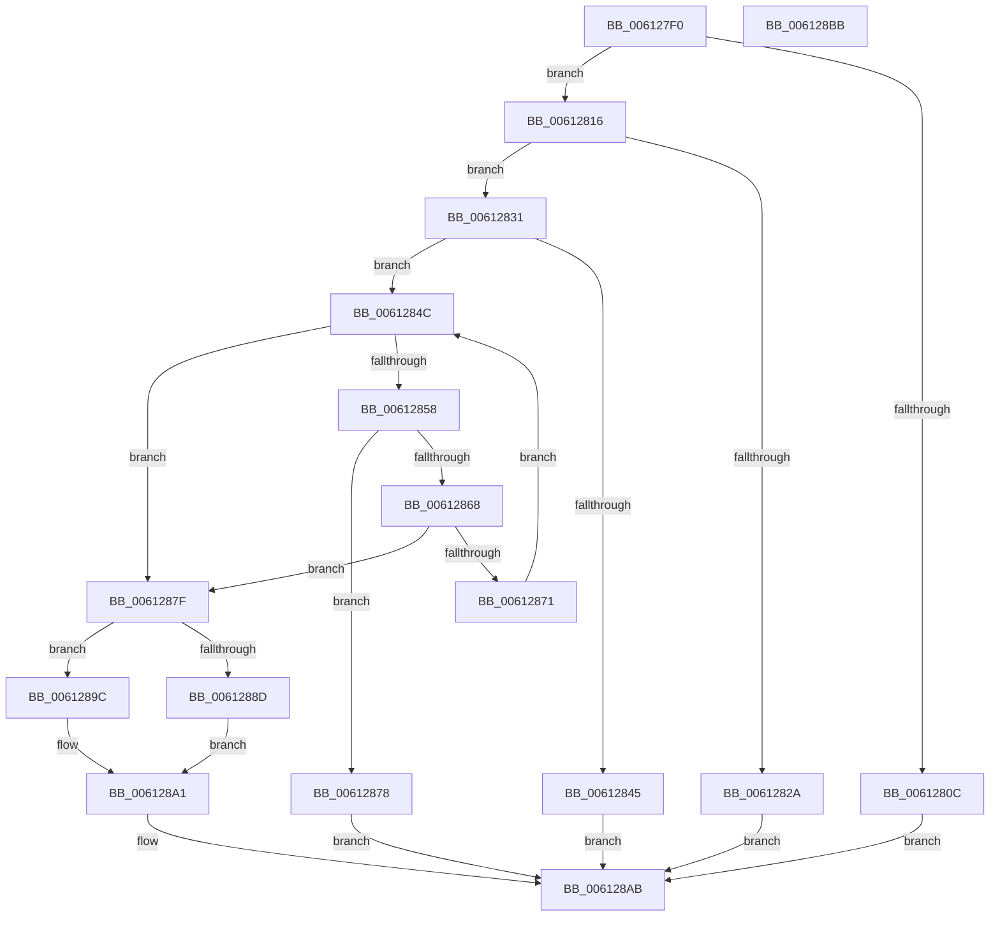

# VfInsertContext

- RVA: `0x006127F0`–`0x006128BC` (길이 `204` bytes)
- VA: `0x00000001406127F0`
- 실행 섹션: `.text`
- PDB 이름 있음: `예`; PDB Function 태그: `아니요`
- unwind 정보 RVA: `0x0008E1D0`
- 디코드: `60`개 명령, `204/204` bytes 표시
- 미해석 바이트: `0` (있으면 어셈블리에 `.byte`로 보존)

> 이 문서는 커널 이미지의 기계어와 PDB 기호를 분석해 생성했습니다. 4번과 5번은 함수 원형과 자료형을 바이너리 사용 방식에서 추정한 C 해석이며 원본 소스 복구 결과는 아닙니다.

## 1. Dependencies

- 직접 호출 지점: **6**; 고유 호출 대상: **6**
- 직접 호출자로 확인된 함수: **0**
- RIP 상대 이미지 참조: **1**

### Outgoing calls
- `0x00612821` → [ViIsContextIdValid](../../pagevrfy/B9/ViIsContextIdValid_function_00B94934.md) (function, `0x00B94934`)
- `0x00612838` → [ViGetContextPointer](../../pagevrfy/B9/ViGetContextPointer_function_00B948E8.md) (function, `0x00B948E8`)
- `0x0061284F` → [ViLockContextPointer](../../pagevrfy/B9/ViLockContextPointer_function_00B94954.md) (function, `0x00B94954`)
- `0x0061285B` → [ViAllocateContextTable](../../pagevrfy/B9/ViAllocateContextTable_function_00B9488C.md) (function, `0x00B9488C`)
- `0x00612871` → [ViFreeContextTable](../../pagevrfy/B9/ViFreeContextTable_function_00B948C8.md) (function, `0x00B948C8`)
- `0x006128A4` → [ViUnlockContextPointer](../../pagevrfy/B9/ViUnlockContextPointer_function_00B949FC.md) (function, `0x00B949FC`)

### Direct callers
- 이 함수 시작 RVA로 연결되는 직접 call은 확인되지 않았습니다. 간접 호출은 완전히 역산할 수 없습니다.

### Static image references
- `0x00612804` → RVA `0x00F04984` (`.data`; read)

## 2. Other-region calls and transfers

- 다른 실행 섹션으로 향하는 call: **6**
  - `0x00612821` → [ViIsContextIdValid](../../pagevrfy/B9/ViIsContextIdValid_function_00B94934.md) (`.text` → `PAGEVRFY`)
  - `0x00612838` → [ViGetContextPointer](../../pagevrfy/B9/ViGetContextPointer_function_00B948E8.md) (`.text` → `PAGEVRFY`)
  - `0x0061284F` → [ViLockContextPointer](../../pagevrfy/B9/ViLockContextPointer_function_00B94954.md) (`.text` → `PAGEVRFY`)
  - `0x0061285B` → [ViAllocateContextTable](../../pagevrfy/B9/ViAllocateContextTable_function_00B9488C.md) (`.text` → `PAGEVRFY`)
  - `0x00612871` → [ViFreeContextTable](../../pagevrfy/B9/ViFreeContextTable_function_00B948C8.md) (`.text` → `PAGEVRFY`)
  - `0x006128A4` → [ViUnlockContextPointer](../../pagevrfy/B9/ViUnlockContextPointer_function_00B949FC.md) (`.text` → `PAGEVRFY`)
- 별도 외부 분기/꼬리 이동을 확인하지 못했습니다.

## 3. Assembly (complete function range)

```asm
006127F0  48 89 5C 24 08                  mov qword ptr [rsp + 8], rbx
006127F5  48 89 74 24 18                  mov qword ptr [rsp + 0x18], rsi
006127FA  57                              push rdi
006127FB  48 83 EC 20                     sub rsp, 0x20
006127FF  33 DB                           xor ebx, ebx
00612801  48 8B F9                        mov rdi, rcx
00612804  39 1D 7A 21 8F 00               cmp dword ptr [rip + 0x8f217a], ebx
0061280A  75 0A                           jne 0x140612816
0061280C  B8 01 00 00 C0                  mov eax, 0xc0000001
00612811  E9 95 00 00 00                  jmp 0x1406128ab
00612816  44 0F B7 01                     movzx r8d, word ptr [rcx]
0061281A  0F B7 51 02                     movzx edx, word ptr [rcx + 2]
0061281E  41 8B C8                        mov ecx, r8d
00612821  E8 0E 21 58 00                  call 0x140b94934
00612826  84 C0                           test al, al
00612828  75 07                           jne 0x140612831
0061282A  B8 0D 00 00 C0                  mov eax, 0xc000000d
0061282F  EB 7A                           jmp 0x1406128ab
00612831  48 8B 4F 08                     mov rcx, qword ptr [rdi + 8]
00612835  41 8B D0                        mov edx, r8d
00612838  E8 AB 20 58 00                  call 0x140b948e8
0061283D  48 8B F0                        mov rsi, rax
00612840  48 85 C0                        test rax, rax
00612843  75 07                           jne 0x14061284c
00612845  B8 BB 00 00 C0                  mov eax, 0xc00000bb
0061284A  EB 5F                           jmp 0x1406128ab
0061284C  48 8B CE                        mov rcx, rsi
0061284F  E8 00 21 58 00                  call 0x140b94954
00612854  84 C0                           test al, al
00612856  75 27                           jne 0x14061287f
00612858  0F B7 0F                        movzx ecx, word ptr [rdi]
0061285B  E8 2C 20 58 00                  call 0x140b9488c
00612860  48 8B C8                        mov rcx, rax
00612863  48 85 C0                        test rax, rax
00612866  74 10                           je 0x140612878
00612868  33 C0                           xor eax, eax
0061286A  F0 48 0F B1 0E                  lock cmpxchg qword ptr [rsi], rcx
0061286F  74 0E                           je 0x14061287f
00612871  E8 52 20 58 00                  call 0x140b948c8
00612876  EB D4                           jmp 0x14061284c
00612878  B8 9A 00 00 C0                  mov eax, 0xc000009a
0061287D  EB 2C                           jmp 0x1406128ab
0061287F  48 8B 06                        mov rax, qword ptr [rsi]
00612882  0F B7 4F 02                     movzx ecx, word ptr [rdi + 2]
00612886  48 39 5C C8 08                  cmp qword ptr [rax + rcx*8 + 8], rbx
0061288B  75 0F                           jne 0x14061289c
0061288D  48 89 7C C8 08                  mov qword ptr [rax + rcx*8 + 8], rdi
00612892  F0 FF 40 04                     lock inc dword ptr [rax + 4]
00612896  F0 FF 47 04                     lock inc dword ptr [rdi + 4]
0061289A  EB 05                           jmp 0x1406128a1
0061289C  BB 2A 02 00 C0                  mov ebx, 0xc000022a
006128A1  48 8B CE                        mov rcx, rsi
006128A4  E8 53 21 58 00                  call 0x140b949fc
006128A9  8B C3                           mov eax, ebx
006128AB  48 8B 5C 24 30                  mov rbx, qword ptr [rsp + 0x30]
006128B0  48 8B 74 24 40                  mov rsi, qword ptr [rsp + 0x40]
006128B5  48 83 C4 20                     add rsp, 0x20
006128B9  5F                              pop rdi
006128BA  C3                              ret
006128BB  CC                              int3
```

## 4. C-style interpretation (structured pseudocode)

```c
__int64 __fastcall VfInsertContext(__int64 a1)
{
    __int64 result;
    __int64 v_rbx;
    __int64 v_rsp;
    unsigned __int64 v_stack_p18;
    unsigned __int64 v_stack_p8;

    v_stack_p8 = v_rbx;
    v_stack_p18 = v_rsi;
    v_rsp = (v_rsp) - (32);
    v_rbx = 0;
    if ((*(unsigned int *)(v_rip + 9380218)) != 0) goto loc_00612816;
    goto loc_006128AB;
loc_00612816:
    result = ViIsContextIdValid((unsigned int)((unsigned int)(*(unsigned __int16 *)(a1))), *(unsigned __int16 *)(a1 + 2), *(unsigned __int16 *)(a1), a4);
    if ((unsigned __int8)(result) != 0) goto loc_00612831;
    goto loc_006128AB;
loc_00612831:
    result = ViGetContextPointer(*(unsigned __int64 *)(a1 + 8), (unsigned int)((unsigned int)(*(unsigned __int16 *)(a1))), *(unsigned __int16 *)(a1), a4);
    if (result != 0) goto loc_0061284C;
    goto loc_006128AB;
loc_0061284C:
    result = ViLockContextPointer(result, (unsigned int)((unsigned int)(*(unsigned __int16 *)(a1))), *(unsigned __int16 *)(a1), a4);
    if ((unsigned __int8)(result) != 0) goto loc_0061287F;
    result = ViAllocateContextTable(*(unsigned __int16 *)(a1), (unsigned int)((unsigned int)(*(unsigned __int16 *)(a1))), *(unsigned __int16 *)(a1), a4);
    if (result == 0) goto loc_00612878;
    result = 0;
    if (condition_is_equal) goto loc_0061287F;
    result = ViFreeContextTable(result, (unsigned int)((unsigned int)(*(unsigned __int16 *)(a1))), *(unsigned __int16 *)(a1), a4);
    goto loc_0061284C;
loc_00612878:
    goto loc_006128AB;
loc_0061287F:
    if ((*(unsigned __int64 *)(*(unsigned __int64 *)(result) + *(unsigned __int16 *)(a1 + 2) * 8 + 8)) != 0) goto loc_0061289C;
    *(unsigned __int64 *)(*(unsigned __int64 *)(result) + *(unsigned __int16 *)(a1 + 2) * 8 + 8) = a1;
    goto loc_006128A1;
loc_0061289C:
loc_006128A1:
    result = ViUnlockContextPointer(result, (unsigned int)((unsigned int)(*(unsigned __int16 *)(a1))), *(unsigned __int16 *)(a1), a4);
loc_006128AB:
    v_rsp = (v_rsp) + (32);
    return (unsigned int)((unsigned int)((unsigned int)(0xC000022AULL)));
}
```

## 5. (Beta) C Style

```c
int64_t VfInsertContext(void *Arg1)
{
    uint8_t *arg1 = (uint8_t *)Arg1;

    int64_t result;
    int64_t local_rbx;
    int64_t local_rsp;
    uint64_t v_stack_p18;
    uint64_t v_stack_p8;

    v_stack_p8 = local_rbx;
    v_stack_p18 = local_rsi;
    local_rsp = (local_rsp) - (32);
    local_rbx = 0;
    if ((*(uint32_t *)(v_rip + 0x8F217A)) != 0) goto loc_00612816;
    goto loc_006128AB;
loc_00612816:
    result = ViIsContextIdValid((uint32_t)((uint32_t)(*(uint16_t *)(arg1))), *(uint16_t *)(arg1 + 0x2), *(uint16_t *)(arg1), a4);
    if ((uint8_t)(result) != 0) goto loc_00612831;
    goto loc_006128AB;
loc_00612831:
    result = ViGetContextPointer(*(uint64_t *)(arg1 + 0x8), (uint32_t)((uint32_t)(*(uint16_t *)(arg1))), *(uint16_t *)(arg1), a4);
    if (result != 0) goto loc_0061284C;
    goto loc_006128AB;
loc_0061284C:
    result = ViLockContextPointer(result, (uint32_t)((uint32_t)(*(uint16_t *)(arg1))), *(uint16_t *)(arg1), a4);
    if ((uint8_t)(result) != 0) goto loc_0061287F;
    result = ViAllocateContextTable(*(uint16_t *)(arg1), (uint32_t)((uint32_t)(*(uint16_t *)(arg1))), *(uint16_t *)(arg1), a4);
    if (result == 0) goto loc_00612878;
    result = 0;
    if (condition_is_equal) goto loc_0061287F;
    result = ViFreeContextTable(result, (uint32_t)((uint32_t)(*(uint16_t *)(arg1))), *(uint16_t *)(arg1), a4);
    goto loc_0061284C;
loc_00612878:
    goto loc_006128AB;
loc_0061287F:
    if ((*(uint64_t *)(*(uint64_t *)(result) + *(uint16_t *)(arg1 + 0x2) * 8 + 0x8)) != 0) goto loc_0061289C;
    *(void **)(*(uint64_t *)(result) + *(uint16_t *)(arg1 + 0x2) * 8 + 0x8) = Arg1;
    goto loc_006128A1;
loc_0061289C:
loc_006128A1:
    result = ViUnlockContextPointer(result, (uint32_t)((uint32_t)(*(uint16_t *)(arg1))), *(uint16_t *)(arg1), a4);
loc_006128AB:
    local_rsp = (local_rsp) + (32);
    return (uint32_t)((uint32_t)((uint32_t)(0xC000022AULL)));
}
```

### 관측된 메모리 오프셋

구조체 형식이 확인되지 않은 접근은 인자 기준의 오프셋으로만 기록했습니다.

| 기준 인자 | 오프셋 표현 | 폭 (bit) | 접근 |
|---|---:|---:|---|
| `Arg1` | `+ 0x0` | `16` | `R` |
| `Arg1` | `+ 0x2` | `16` | `R` |
| `Arg1` | `+ 0x4` | `32` | `R/W` |
| `Arg1` | `+ 0x8` | `64` | `R` |

## 6. Execution-region graph

[열기: 2D/3D 그래프와 함수 탐색 컨트롤 패널](../../../control-panel.html?section=text&rva=0x006127F0&view=graph)

- 2D 그래프는 위에서 아래로 흐르고, 3D 그래프는 빈 공간을 드래그해 회전합니다. Shift+드래그는 이동, 휠은 확대·축소, 함수 노드 선택은 대상 보고서 이동입니다.

### Static fallback


