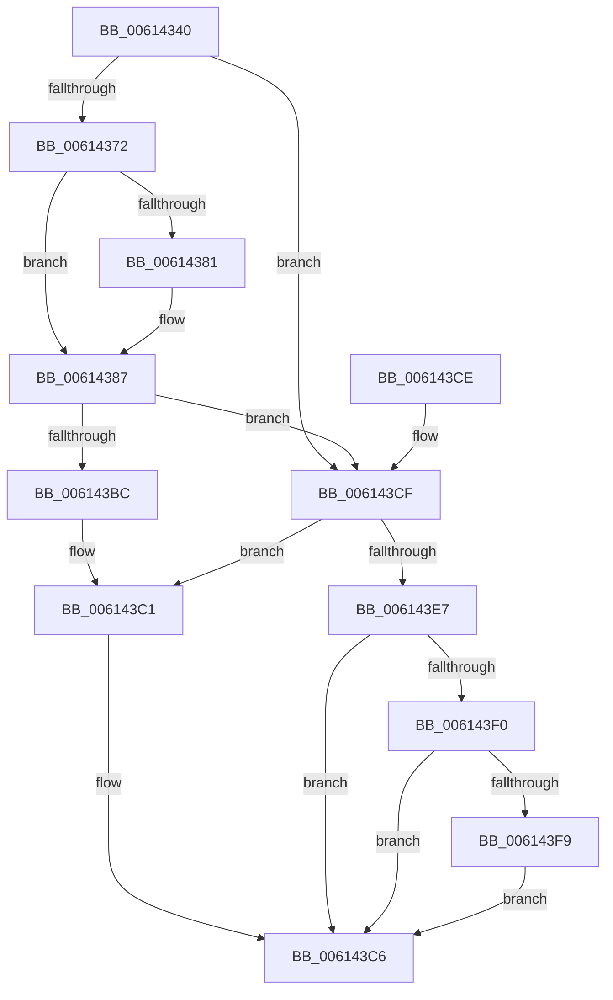

# VfIoPendingEntry

- RVA: `0x00614340`–`0x00614400` (길이 `192` bytes)
- VA: `0x0000000140614340`
- 실행 섹션: `.text`
- PDB 이름 있음: `예`; PDB Function 태그: `아니요`
- unwind 정보 RVA: `0x000D2508`
- 디코드: `47`개 명령, `192/192` bytes 표시
- 미해석 바이트: `0` (있으면 어셈블리에 `.byte`로 보존)

> 이 문서는 커널 이미지의 기계어와 PDB 기호를 분석해 생성했습니다. 4번과 5번은 함수 원형과 자료형을 바이너리 사용 방식에서 추정한 C 해석이며 원본 소스 복구 결과는 아닙니다.

## 1. Dependencies

- 직접 호출 지점: **5**; 고유 호출 대상: **5**
- 직접 호출자로 확인된 함수: **0**
- RIP 상대 이미지 참조: **8**

### Outgoing calls
- `0x00614363` → [PpvUtilInit](../../pagevrfy/B9/PpvUtilInit_function_00B92C38.md) (function, `0x00B92C38`)
- `0x006143AB` → [ExAllocatePool3](../../poolcode/B8/ExAllocatePool3_function_00B84270.md) (function, `0x00B84270`)
- `0x006143C1` → [VfIoPendingUnload](VfIoPendingUnload_function_00614410.md) (function, `0x00614410`)
- `0x006143DC` → [DifRegisterPlugin](DifRegisterPlugin_function_0061ABE0.md) (function, `0x0061ABE0`)
- `0x006143F9` → [VfPendingInitPhase1](../../pagevrfy/BA/VfPendingInitPhase1_function_00BA1AA4.md) (function, `0x00BA1AA4`)

### Direct callers
- 이 함수 시작 RVA로 연결되는 직접 call은 확인되지 않았습니다. 간접 호출은 완전히 역산할 수 없습니다.

### Static image references
- `0x0061434C` → RVA `0x00614410` (`VfIoPendingUnload`; read)
- `0x00614368` → RVA `0x00F04200` (`.data`; read)
- `0x00614372` → RVA `0x00E0EA0C` (`.data`; read)
- `0x00614381` → RVA `0x00E0EA0C` (`.data`; write)
- `0x0061438D` → RVA `0x00E681B0` (`.data`; read)
- `0x006143B0` → RVA `0x00F04200` (`.data`; write)
- `0x006143E7` → RVA `0x00FC41A0` (`.data`; read)
- `0x006143F0` → RVA `0x00F04208` (`.data`; read)

## 2. Other-region calls and transfers

- 다른 실행 섹션으로 향하는 call: **3**
  - `0x00614363` → [PpvUtilInit](../../pagevrfy/B9/PpvUtilInit_function_00B92C38.md) (`.text` → `PAGEVRFY`)
  - `0x006143AB` → [ExAllocatePool3](../../poolcode/B8/ExAllocatePool3_function_00B84270.md) (`.text` → `POOLCODE`)
  - `0x006143F9` → [VfPendingInitPhase1](../../pagevrfy/BA/VfPendingInitPhase1_function_00BA1AA4.md) (`.text` → `PAGEVRFY`)
- 별도 외부 분기/꼬리 이동을 확인하지 못했습니다.

## 3. Assembly (complete function range)

```asm
00614340  40 53                           push rbx
00614342  48 83 EC 50                     sub rsp, 0x50
00614346  48 83 64 24 30 00               and qword ptr [rsp + 0x30], 0
0061434C  48 8D 05 BD 00 00 00            lea rax, [rip + 0xbd]
00614353  0F 57 C0                        xorps xmm0, xmm0
00614356  48 89 44 24 38                  mov qword ptr [rsp + 0x38], rax
0061435B  B1 01                           mov cl, 1
0061435D  F3 0F 7F 44 24 40               movdqu xmmword ptr [rsp + 0x40], xmm0
00614363  E8 D0 E8 57 00                  call 0x140b92c38
00614368  48 83 3D 90 FE 8E 00 00         cmp qword ptr [rip + 0x8efe90], 0
00614370  75 5D                           jne 0x1406143cf
00614372  8B 05 94 A6 7F 00               mov eax, dword ptr [rip + 0x7fa694]
00614378  B9 00 00 10 00                  mov ecx, 0x100000
0061437D  3B C1                           cmp eax, ecx
0061437F  76 06                           jbe 0x140614387
00614381  89 0D 85 A6 7F 00               mov dword ptr [rip + 0x7fa685], ecx
00614387  8B 15 7F A6 7F 00               mov edx, dword ptr [rip + 0x7fa67f]
0061438D  4C 8D 0D 1C 3E 85 00            lea r9, [rip + 0x853e1c]
00614394  48 C1 E2 09                     shl rdx, 9
00614398  B9 40 00 00 00                  mov ecx, 0x40
0061439D  41 B8 56 66 46 50               mov r8d, 0x50466656
006143A3  C7 44 24 20 01 00 00 00         mov dword ptr [rsp + 0x20], 1
006143AB  E8 C0 FE 56 00                  call 0x140b84270
006143B0  48 89 05 49 FE 8E 00            mov qword ptr [rip + 0x8efe49], rax
006143B7  48 85 C0                        test rax, rax
006143BA  75 13                           jne 0x1406143cf
006143BC  BB 17 00 00 C0                  mov ebx, 0xc0000017
006143C1  E8 4A 00 00 00                  call 0x140614410
006143C6  8B C3                           mov eax, ebx
006143C8  48 83 C4 50                     add rsp, 0x50
006143CC  5B                              pop rbx
006143CD  C3                              ret
006143CE  CC                              int3
006143CF  33 D2                           xor edx, edx
006143D1  4C 8D 4C 24 30                  lea r9, [rsp + 0x30]
006143D6  33 C9                           xor ecx, ecx
006143D8  44 8D 42 09                     lea r8d, [rdx + 9]
006143DC  E8 FF 67 00 00                  call 0x14061abe0
006143E1  8B D8                           mov ebx, eax
006143E3  85 C0                           test eax, eax
006143E5  78 DA                           js 0x1406143c1
006143E7  83 3D B2 FD 9A 00 01            cmp dword ptr [rip + 0x9afdb2], 1
006143EE  76 D6                           jbe 0x1406143c6
006143F0  83 3D 11 FE 8E 00 00            cmp dword ptr [rip + 0x8efe11], 0
006143F7  75 CD                           jne 0x1406143c6
006143F9  E8 A6 D6 58 00                  call 0x140ba1aa4
006143FE  EB C6                           jmp 0x1406143c6
```

## 4. C-style interpretation (structured pseudocode)

```c
__int64 __fastcall VfIoPendingEntry(void)
{
    __int64 result;
    __int64 v_rsp;
    unsigned __int64 v_stack_m18;
    unsigned __int64 v_stack_m20;
    unsigned __int64 v_stack_m28;
    unsigned int v_stack_m38;
    unsigned __int64 v_stack_p30;

    v_rsp = (v_rsp) - (80);
    v_stack_m20 = v_rip + 189;
    v_stack_m18 = v_xmm0;
    result = PpvUtilInit(1, a2, a3, a4);
    if ((*(unsigned __int64 *)(v_rip + 9371280)) != 0) goto loc_006143CF;
    if (((unsigned int)((unsigned int)(*(unsigned int *)(v_rip + 8365716)))) >= = ((unsigned int)((unsigned int)(0x100000ULL)))) {
        *(unsigned int *)(v_rip + 8365701) = (unsigned int)((unsigned int)(0x100000ULL));
    }
    a2 = ((unsigned int)(*(unsigned int *)(v_rip + 8365695))) << (9);
    v_stack_m38 = 1;
    result = ExAllocatePool3(64, a2, (unsigned int)(0x50466656ULL), v_rip + 8732188);
    *(unsigned __int64 *)(v_rip + 9371209) = result;
    if (result != 0) goto loc_006143CF;
loc_006143C1:
    result = VfIoPendingUnload(64, a2, (unsigned int)(0x50466656ULL), v_rip + 8732188);
loc_006143C6:
    v_rsp = (v_rsp) + (80);
    return (unsigned int)((unsigned int)((unsigned int)(0xC0000017ULL)));
loc_006143CF:
    a2 = 0;
    a1 = 0;
    result = DifRegisterPlugin(a1, a2, a2 + 9, v_stack_p30);
    if (sign_flag) goto loc_006143C1;
    if ((*(unsigned int *)(v_rip + 10157490)) <= 1) goto loc_006143C6;
    if ((*(unsigned int *)(v_rip + 9371153)) != 0) goto loc_006143C6;
    result = VfPendingInitPhase1(a1, a2, a2 + 9, v_stack_p30);
    goto loc_006143C6;
}
```

## 5. (Beta) C Style

```c
void VfIoPendingEntry(void)
{
    int64_t result;
    int64_t local_rsp;
    uint64_t v_stack_m18;
    uint64_t v_stack_m20;
    uint64_t v_stack_m28;
    uint32_t v_stack_m38;
    uint64_t v_stack_p30;

    local_rsp = (local_rsp) - (80);
    v_stack_m20 = v_rip + 189;
    v_stack_m18 = v_xmm0;
    result = PpvUtilInit(1, a2, a3, a4);
    if ((*(uint64_t *)(v_rip + 0x8EFE90)) != 0) goto loc_006143CF;
    if (((uint32_t)((uint32_t)(*(uint32_t *)(v_rip + 0x7FA694)))) >= = ((uint32_t)((uint32_t)(0x100000ULL)))) {
        *(uint32_t *)(v_rip + 0x7FA685) = (uint32_t)((uint32_t)(0x100000ULL));
    }
    a2 = ((uint32_t)(*(uint32_t *)(v_rip + 0x7FA67F))) << (9);
    v_stack_m38 = 1;
    result = ExAllocatePool3(64, a2, (uint32_t)(0x50466656ULL), v_rip + 8732188);
    *(uint64_t *)(v_rip + 0x8EFE49) = result;
    if (result != 0) goto loc_006143CF;
loc_006143C1:
    result = VfIoPendingUnload(64, a2, (uint32_t)(0x50466656ULL), v_rip + 8732188);
loc_006143C6:
    local_rsp = (local_rsp) + (80);
    return (uint32_t)((uint32_t)((uint32_t)(0xC0000017ULL)));
loc_006143CF:
    a2 = 0;
    a1 = 0;
    result = DifRegisterPlugin(a1, a2, a2 + 9, v_stack_p30);
    if (sign_flag) goto loc_006143C1;
    if ((*(uint32_t *)(v_rip + 0x9AFDB2)) <= 1) goto loc_006143C6;
    if ((*(uint32_t *)(v_rip + 0x8EFE11)) != 0) goto loc_006143C6;
    result = VfPendingInitPhase1(a1, a2, a2 + 9, v_stack_p30);
    goto loc_006143C6;
}
```

## 6. Execution-region graph

[열기: 2D/3D 그래프와 함수 탐색 컨트롤 패널](../../../control-panel.html?section=text&rva=0x00614340&view=graph)

- 2D 그래프는 위에서 아래로 흐르고, 3D 그래프는 빈 공간을 드래그해 회전합니다. Shift+드래그는 이동, 휠은 확대·축소, 함수 노드 선택은 대상 보고서 이동입니다.

### Static fallback


