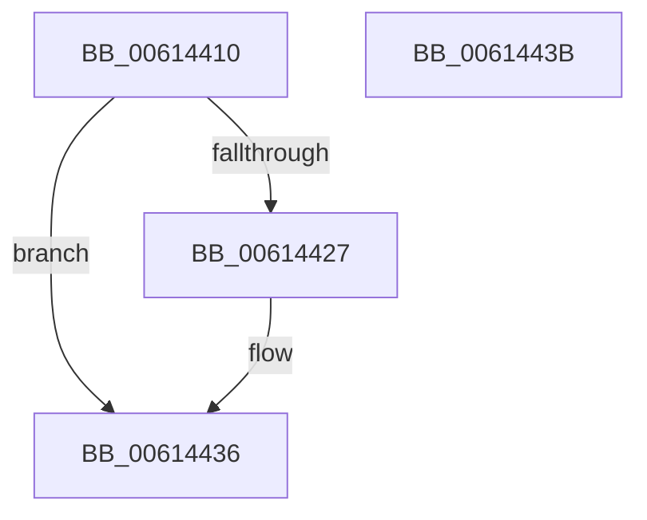

# VfIoPendingUnload

- RVA: `0x00614410`–`0x0061443C` (길이 `44` bytes)
- VA: `0x0000000140614410`
- 실행 섹션: `.text`
- PDB 이름 있음: `예`; PDB Function 태그: `아니요`
- unwind 정보 RVA: `0x0005C788`
- 디코드: `12`개 명령, `44/44` bytes 표시
- 미해석 바이트: `0` (있으면 어셈블리에 `.byte`로 보존)

> 이 문서는 커널 이미지의 기계어와 PDB 기호를 분석해 생성했습니다. 4번과 5번은 함수 원형과 자료형을 바이너리 사용 방식에서 추정한 C 해석이며 원본 소스 복구 결과는 아닙니다.

## 1. Dependencies

- 직접 호출 지점: **2**; 고유 호출 대상: **2**
- 직접 호출자로 확인된 함수: **1**
- RIP 상대 이미지 참조: **2**

### Outgoing calls
- `0x00614416` → [PpvUtilInit](../../pagevrfy/B9/PpvUtilInit_function_00B92C38.md) (function, `0x00B92C38`)
- `0x00614429` → [ExFreePoolWithTag](../../poolcode/B8/ExFreePoolWithTag_function_00B82870.md) (function, `0x00B82870`)

### Direct callers
- [VfIoPendingEntry](VfIoPendingEntry_function_00614340.md) at `0x006143C1`

### Static image references
- `0x0061441B` → RVA `0x00F04200` (`.data`; read)
- `0x0061442E` → RVA `0x00F04200` (`.data`; read/write)

## 2. Other-region calls and transfers

- 다른 실행 섹션으로 향하는 call: **2**
  - `0x00614416` → [PpvUtilInit](../../pagevrfy/B9/PpvUtilInit_function_00B92C38.md) (`.text` → `PAGEVRFY`)
  - `0x00614429` → [ExFreePoolWithTag](../../poolcode/B8/ExFreePoolWithTag_function_00B82870.md) (`.text` → `POOLCODE`)
- 별도 외부 분기/꼬리 이동을 확인하지 못했습니다.

## 3. Assembly (complete function range)

```asm
00614410  48 83 EC 28                     sub rsp, 0x28
00614414  33 C9                           xor ecx, ecx
00614416  E8 1D E8 57 00                  call 0x140b92c38
0061441B  48 8B 0D DE FD 8E 00            mov rcx, qword ptr [rip + 0x8efdde]
00614422  48 85 C9                        test rcx, rcx
00614425  74 0F                           je 0x140614436
00614427  33 D2                           xor edx, edx
00614429  E8 42 E4 56 00                  call 0x140b82870
0061442E  48 83 25 CA FD 8E 00 00         and qword ptr [rip + 0x8efdca], 0
00614436  48 83 C4 28                     add rsp, 0x28
0061443A  C3                              ret
0061443B  CC                              int3
```

## 4. C-style interpretation (structured pseudocode)

```c
__int64 __fastcall VfIoPendingUnload(int a1, int a2)
{
    __int64 result;
    __int64 v_rsp;

    v_rsp = (v_rsp) - (40);
    a1 = 0;
    result = PpvUtilInit(a1, a2, a3, a4);
    if (*(unsigned __int64 *)(v_rip + 9371102) != 0) {
        a2 = 0;
        result = ExFreePoolWithTag(*(unsigned __int64 *)(v_rip + 9371102), a2, a3, a4);
    }
    v_rsp = (v_rsp) + (40);
    return result;
}
```

## 5. (Beta) C Style

```c
int64_t VfIoPendingUnload(int32_t Arg1, int32_t Arg2)
{
    int64_t result;
    int64_t local_rsp;

    local_rsp = (local_rsp) - (40);
    Arg1 = 0;
    result = PpvUtilInit(Arg1, Arg2, a3, a4);
    if (*(uint64_t *)(v_rip + 0x8EFDDE) != 0) {
        Arg2 = 0;
        result = ExFreePoolWithTag(*(uint64_t *)(v_rip + 0x8EFDDE), Arg2, a3, a4);
    }
    local_rsp = (local_rsp) + (40);
    return result;
}
```

## 6. Execution-region graph

[열기: 2D/3D 그래프와 함수 탐색 컨트롤 패널](../../../control-panel.html?section=text&rva=0x00614410&view=graph)

- 2D 그래프는 위에서 아래로 흐르고, 3D 그래프는 빈 공간을 드래그해 회전합니다. Shift+드래그는 이동, 휠은 확대·축소, 함수 노드 선택은 대상 보고서 이동입니다.

### Static fallback


