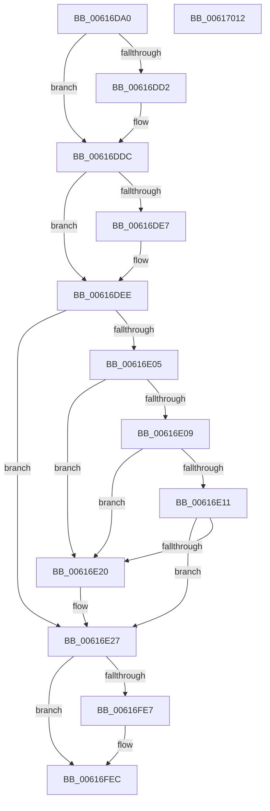

# VfIrqlPluginEntry

- RVA: `0x00616DA0`–`0x00617013` (길이 `627` bytes)
- VA: `0x0000000140616DA0`
- 실행 섹션: `.text`
- PDB 이름 있음: `예`; PDB Function 태그: `아니요`
- unwind 정보 RVA: `0x000D28D8`
- 디코드: `120`개 명령, `627/627` bytes 표시
- 미해석 바이트: `0` (있으면 어셈블리에 `.byte`로 보존)

> 이 문서는 커널 이미지의 기계어와 PDB 기호를 분석해 생성했습니다. 4번과 5번은 함수 원형과 자료형을 바이너리 사용 방식에서 추정한 C 해석이며 원본 소스 복구 결과는 아닙니다.

## 1. Dependencies

- 직접 호출 지점: **3**; 고유 호출 대상: **3**
- 직접 호출자로 확인된 함수: **0**
- RIP 상대 이미지 참조: **29**

### Outgoing calls
- `0x00616FDC` → [DifRegisterPlugin](DifRegisterPlugin_function_0061ABE0.md) (function, `0x0061ABE0`)
- `0x00616FE7` → [ViIrqlInit](../../pagevrfy/BA/ViIrqlInit_function_00BAD5C4.md) (function, `0x00BAD5C4`)
- `0x00616FF8` → [_security_check_cookie](../6A/_security_check_cookie_function_006AC640.md) (function, `0x006AC640`)

### Direct callers
- 이 함수 시작 RVA로 연결되는 직접 call은 확인되지 않았습니다. 간접 호출은 완전히 역산할 수 없습니다.

### Static image references
- `0x00616DBA` → RVA `0x00E0A740` (`.data`; read)
- `0x00616DD5` → RVA `0x00F03F60` (`.data`; write)
- `0x00616DDC` → RVA `0x00F04980` (`.data`; read)
- `0x00616DE7` → RVA `0x00F03F61` (`.data`; write)
- `0x00616DEE` → RVA `0x00F03F61` (`.data`; read)
- `0x00616DF5` → RVA `0x00EF5120` (`.data`; write)
- `0x00616DFC` → RVA `0x00F03F60` (`.data`; read)
- `0x00616E09` → RVA `0x00F04A04` (`.data`; read)
- `0x00616E11` → RVA `0x00F04ABC` (`.data`; read)
- `0x00616E27` → RVA `0x00BAD770` (`ViIrqlPluginUnload`; read)
- `0x00616E36` → RVA `0x00F03F48` (`.data`; write)
- `0x00616E3D` → RVA `0x00F03F40` (`.data`; read)
- `0x00616E44` → RVA `0x006CF730` (` ?? ::FNODOBFM::`string'`; read)
- `0x00616E5A` → RVA `0x00BAD580` (`ViIrqlExAcquireFastMutex_Exit`; read)
- `0x00616E73` → RVA `0x006CF710` (` ?? ::FNODOBFM::`string'`; read)
- `0x00616E84` → RVA `0x00BAD5A0` (`ViIrqlExTryToAcquireFastMutex_Exit`; read)
- `0x00616E90` → RVA `0x006CF770` (` ?? ::FNODOBFM::`string'`; read)
- `0x00616EA0` → RVA `0x006CF750` (` ?? ::FNODOBFM::`string'`; read)
- `0x00616EB3` → RVA `0x00BAD670` (`ViIrqlKeEnterCriticalRegion_Exit`; read)
- `0x00616EBE` → RVA `0x006CF6B0` (` ?? ::FNODOBFM::`string'`; read)
- `0x00616EC9` → RVA `0x00BAD690` (`ViIrqlKeLeaveCriticalRegion_Entry`; read)
- `0x00616ED4` → RVA `0x006CF690` (` ?? ::FNODOBFM::`string'`; read)
- `0x00616EDF` → RVA `0x006CF6F0` (` ?? ::FNODOBFM::`string'`; read)
- `0x00616EEA` → RVA `0x006CF6D0` (` ?? ::FNODOBFM::`string'`; read)
- `0x00616EF5` → RVA `0x006CF7E0` (` ?? ::FNODOBFM::`string'`; read)
- `0x00616F00` → RVA `0x006CF7B0` (` ?? ::FNODOBFM::`string'`; read)
- `0x00616F0B` → RVA `0x006CF830` (` ?? ::FNODOBFM::`string'`; read)
- `0x00616F16` → RVA `0x006CF800` (` ?? ::FNODOBFM::`string'`; read)
- `0x00616F24` → RVA `0x006CF790` (` ?? ::FNODOBFM::`string'`; read)

## 2. Other-region calls and transfers

- 다른 실행 섹션으로 향하는 call: **1**
  - `0x00616FE7` → [ViIrqlInit](../../pagevrfy/BA/ViIrqlInit_function_00BAD5C4.md) (`.text` → `PAGEVRFY`)
- 별도 외부 분기/꼬리 이동을 확인하지 못했습니다.

## 3. Assembly (complete function range)

```asm
00616DA0  48 89 5C 24 08                  mov qword ptr [rsp + 8], rbx
00616DA5  48 89 7C 24 10                  mov qword ptr [rsp + 0x10], rdi
00616DAA  55                              push rbp
00616DAB  48 8D AC 24 30 FF FF FF         lea rbp, [rsp - 0xd0]
00616DB3  48 81 EC D0 01 00 00            sub rsp, 0x1d0
00616DBA  48 8B 05 7F 39 7F 00            mov rax, qword ptr [rip + 0x7f397f]
00616DC1  48 33 C4                        xor rax, rsp
00616DC4  48 89 85 C0 00 00 00            mov qword ptr [rbp + 0xc0], rax
00616DCB  33 FF                           xor edi, edi
00616DCD  48 85 C9                        test rcx, rcx
00616DD0  74 0A                           je 0x140616ddc
00616DD2  0F B7 01                        movzx eax, word ptr [rcx]
00616DD5  66 89 05 84 D1 8E 00            mov word ptr [rip + 0x8ed184], ax
00616DDC  8B 05 9E DB 8E 00               mov eax, dword ptr [rip + 0x8edb9e]
00616DE2  83 E0 04                        and eax, 4
00616DE5  74 07                           je 0x140616dee
00616DE7  C6 05 73 D1 8E 00 01            mov byte ptr [rip + 0x8ed173], 1
00616DEE  40 38 3D 6C D1 8E 00            cmp byte ptr [rip + 0x8ed16c], dil
00616DF5  0F 94 05 24 E3 8D 00            sete byte ptr [rip + 0x8de324]
00616DFC  40 38 3D 5D D1 8E 00            cmp byte ptr [rip + 0x8ed15d], dil
00616E03  75 22                           jne 0x140616e27
00616E05  85 C0                           test eax, eax
00616E07  75 17                           jne 0x140616e20
00616E09  39 3D F5 DB 8E 00               cmp dword ptr [rip + 0x8edbf5], edi
00616E0F  77 0F                           ja 0x140616e20
00616E11  39 3D A5 DC 8E 00               cmp dword ptr [rip + 0x8edca5], edi
00616E17  C6 05 42 D1 8E 00 0A            mov byte ptr [rip + 0x8ed142], 0xa
00616E1E  74 07                           je 0x140616e27
00616E20  C6 05 39 D1 8E 00 05            mov byte ptr [rip + 0x8ed139], 5
00616E27  48 8D 05 42 69 59 00            lea rax, [rip + 0x596942]
00616E2E  C7 44 24 28 A9 01 00 00         mov dword ptr [rsp + 0x28], 0x1a9
00616E36  48 89 05 0B D1 8E 00            mov qword ptr [rip + 0x8ed10b], rax
00616E3D  4C 8D 0D FC D0 8E 00            lea r9, [rip + 0x8ed0fc]
00616E44  48 8D 05 E5 88 0B 00            lea rax, [rip + 0xb88e5]
00616E4B  48 89 7C 24 30                  mov qword ptr [rsp + 0x30], rdi
00616E50  48 89 44 24 20                  mov qword ptr [rsp + 0x20], rax
00616E55  48 8D 4C 24 20                  lea rcx, [rsp + 0x20]
00616E5A  48 8D 05 1F 67 59 00            lea rax, [rip + 0x59671f]
00616E61  C7 44 24 48 7F 01 00 00         mov dword ptr [rsp + 0x48], 0x17f
00616E69  48 89 44 24 38                  mov qword ptr [rsp + 0x38], rax
00616E6E  BA 0D 00 00 00                  mov edx, 0xd
00616E73  48 8D 05 96 88 0B 00            lea rax, [rip + 0xb8896]
00616E7A  48 89 7C 24 50                  mov qword ptr [rsp + 0x50], rdi
00616E7F  48 89 44 24 40                  mov qword ptr [rsp + 0x40], rax
00616E84  48 8D 05 15 67 59 00            lea rax, [rip + 0x596715]
00616E8B  48 89 44 24 58                  mov qword ptr [rsp + 0x58], rax
00616E90  48 8D 05 D9 88 0B 00            lea rax, [rip + 0xb88d9]
00616E97  48 89 44 24 60                  mov qword ptr [rsp + 0x60], rax
00616E9C  44 8D 42 F4                     lea r8d, [rdx - 0xc]
00616EA0  48 8D 05 A9 88 0B 00            lea rax, [rip + 0xb88a9]
00616EA7  C7 44 24 68 2A 01 00 00         mov dword ptr [rsp + 0x68], 0x12a
00616EAF  48 89 45 80                     mov qword ptr [rbp - 0x80], rax
00616EB3  48 8D 05 B6 67 59 00            lea rax, [rip + 0x5967b6]
00616EBA  48 89 45 98                     mov qword ptr [rbp - 0x68], rax
00616EBE  48 8D 05 EB 87 0B 00            lea rax, [rip + 0xb87eb]
00616EC5  48 89 45 A0                     mov qword ptr [rbp - 0x60], rax
00616EC9  48 8D 05 C0 67 59 00            lea rax, [rip + 0x5967c0]
00616ED0  48 89 45 B0                     mov qword ptr [rbp - 0x50], rax
00616ED4  48 8D 05 B5 87 0B 00            lea rax, [rip + 0xb87b5]
00616EDB  48 89 45 C0                     mov qword ptr [rbp - 0x40], rax
00616EDF  48 8D 05 0A 88 0B 00            lea rax, [rip + 0xb880a]
00616EE6  48 89 45 E0                     mov qword ptr [rbp - 0x20], rax
00616EEA  48 8D 05 DF 87 0B 00            lea rax, [rip + 0xb87df]
00616EF1  48 89 45 00                     mov qword ptr [rbp], rax
00616EF5  48 8D 05 E4 88 0B 00            lea rax, [rip + 0xb88e4]
00616EFC  48 89 45 20                     mov qword ptr [rbp + 0x20], rax
00616F00  48 8D 05 A9 88 0B 00            lea rax, [rip + 0xb88a9]
00616F07  48 89 45 40                     mov qword ptr [rbp + 0x40], rax
00616F0B  48 8D 05 1E 89 0B 00            lea rax, [rip + 0xb891e]
00616F12  48 89 45 60                     mov qword ptr [rbp + 0x60], rax
00616F16  48 8D 05 E3 88 0B 00            lea rax, [rip + 0xb88e3]
00616F1D  48 89 85 80 00 00 00            mov qword ptr [rbp + 0x80], rax
00616F24  48 8D 05 65 88 0B 00            lea rax, [rip + 0xb8865]
00616F2B  48 89 85 A0 00 00 00            mov qword ptr [rbp + 0xa0], rax
00616F32  48 89 7C 24 70                  mov qword ptr [rsp + 0x70], rdi
00616F37  48 89 7C 24 78                  mov qword ptr [rsp + 0x78], rdi
00616F3C  C7 45 88 1E 01 00 00            mov dword ptr [rbp - 0x78], 0x11e
00616F43  48 89 7D 90                     mov qword ptr [rbp - 0x70], rdi
00616F47  C7 45 A8 12 01 00 00            mov dword ptr [rbp - 0x58], 0x112
00616F4E  48 89 7D B8                     mov qword ptr [rbp - 0x48], rdi
00616F52  C7 45 C8 03 01 00 00            mov dword ptr [rbp - 0x38], 0x103
00616F59  48 89 7D D0                     mov qword ptr [rbp - 0x30], rdi
00616F5D  48 89 7D D8                     mov qword ptr [rbp - 0x28], rdi
00616F61  C7 45 E8 F4 00 00 00            mov dword ptr [rbp - 0x18], 0xf4
00616F68  48 89 7D F0                     mov qword ptr [rbp - 0x10], rdi
00616F6C  48 89 7D F8                     mov qword ptr [rbp - 8], rdi
00616F70  C7 45 08 23 01 00 00            mov dword ptr [rbp + 8], 0x123
00616F77  48 89 7D 10                     mov qword ptr [rbp + 0x10], rdi
00616F7B  48 89 7D 18                     mov qword ptr [rbp + 0x18], rdi
00616F7F  C7 45 28 02 01 00 00            mov dword ptr [rbp + 0x28], 0x102
00616F86  48 89 7D 30                     mov qword ptr [rbp + 0x30], rdi
00616F8A  48 89 7D 38                     mov qword ptr [rbp + 0x38], rdi
00616F8E  C7 45 48 27 01 00 00            mov dword ptr [rbp + 0x48], 0x127
00616F95  48 89 7D 50                     mov qword ptr [rbp + 0x50], rdi
00616F99  48 89 7D 58                     mov qword ptr [rbp + 0x58], rdi
00616F9D  C7 45 68 25 01 00 00            mov dword ptr [rbp + 0x68], 0x125
00616FA4  48 89 7D 70                     mov qword ptr [rbp + 0x70], rdi
00616FA8  48 89 7D 78                     mov qword ptr [rbp + 0x78], rdi
00616FAC  C7 85 88 00 00 00 F3 00 00 00   mov dword ptr [rbp + 0x88], 0xf3
00616FB6  48 89 BD 90 00 00 00            mov qword ptr [rbp + 0x90], rdi
00616FBD  48 89 BD 98 00 00 00            mov qword ptr [rbp + 0x98], rdi
00616FC4  C7 85 A8 00 00 00 F6 00 00 00   mov dword ptr [rbp + 0xa8], 0xf6
00616FCE  48 89 BD B0 00 00 00            mov qword ptr [rbp + 0xb0], rdi
00616FD5  48 89 BD B8 00 00 00            mov qword ptr [rbp + 0xb8], rdi
00616FDC  E8 FF 3B 00 00                  call 0x14061abe0
00616FE1  8B D8                           mov ebx, eax
00616FE3  85 C0                           test eax, eax
00616FE5  78 05                           js 0x140616fec
00616FE7  E8 D8 65 59 00                  call 0x140bad5c4
00616FEC  8B C3                           mov eax, ebx
00616FEE  48 8B 8D C0 00 00 00            mov rcx, qword ptr [rbp + 0xc0]
00616FF5  48 33 CC                        xor rcx, rsp
00616FF8  E8 43 56 09 00                  call 0x1406ac640
00616FFD  4C 8D 9C 24 D0 01 00 00         lea r11, [rsp + 0x1d0]
00617005  49 8B 5B 10                     mov rbx, qword ptr [r11 + 0x10]
00617009  49 8B 7B 18                     mov rdi, qword ptr [r11 + 0x18]
0061700D  49 8B E3                        mov rsp, r11
00617010  5D                              pop rbp
00617011  C3                              ret
00617012  CC                              int3
```

## 4. C-style interpretation (structured pseudocode)

```c
__int64 __fastcall VfIrqlPluginEntry(__int64 a1)
{
    __int64 result;
    __int64 v_rdi;
    __int64 v_rsp;
    unsigned __int64 v_stack_m100;
    unsigned __int64 v_stack_m108;
    unsigned int v_stack_m110;
    unsigned __int64 v_stack_m118;
    unsigned __int64 v_stack_m120;
    unsigned __int64 v_stack_m128;
    unsigned int v_stack_m130;
    unsigned __int64 v_stack_m138;
    unsigned __int64 v_stack_m140;
    unsigned __int64 v_stack_m148;
    unsigned int v_stack_m150;
    unsigned __int64 v_stack_m158;
    unsigned __int64 v_stack_m160;
    unsigned __int64 v_stack_m168;
    unsigned int v_stack_m170;
    unsigned __int64 v_stack_m178;
    unsigned __int64 v_stack_m18;
    unsigned __int64 v_stack_m180;
    unsigned __int64 v_stack_m188;
    unsigned int v_stack_m190;
    unsigned __int64 v_stack_m198;
    unsigned __int64 v_stack_m1A0;
    unsigned __int64 v_stack_m1A8;
    unsigned int v_stack_m1B0;
    unsigned __int64 v_stack_m1B8;
    unsigned __int64 v_stack_m20;
    unsigned __int64 v_stack_m28;
    unsigned int v_stack_m30;
    unsigned __int64 v_stack_m38;
    unsigned __int64 v_stack_m40;
    unsigned __int64 v_stack_m48;
    unsigned int v_stack_m50;
    unsigned __int64 v_stack_m58;
    unsigned __int64 v_stack_m60;
    unsigned __int64 v_stack_m68;
    unsigned int v_stack_m70;
    unsigned __int64 v_stack_m78;
    unsigned __int64 v_stack_m8;
    unsigned __int64 v_stack_m80;
    unsigned __int64 v_stack_m88;
    unsigned int v_stack_m90;
    unsigned __int64 v_stack_m98;
    unsigned __int64 v_stack_mA0;
    unsigned __int64 v_stack_mA8;
    unsigned int v_stack_mB0;
    unsigned __int64 v_stack_mB8;
    unsigned __int64 v_stack_mC0;
    unsigned __int64 v_stack_mC8;
    unsigned int v_stack_mD0;
    unsigned __int64 v_stack_mD8;
    unsigned __int64 v_stack_mE0;
    unsigned __int64 v_stack_mE8;
    unsigned int v_stack_mF0;
    unsigned __int64 v_stack_mF8;
    unsigned __int64 v_stack_p10;
    unsigned __int64 v_stack_p8;

    v_stack_p8 = v_rbx;
    v_stack_p10 = v_rdi;
    v_rsp = (v_rsp) - (464);
    result = (*(unsigned __int64 *)(v_rip + 8337791)) ^ (v_rsp);
    v_stack_m18 = result;
    v_rdi = 0;
    if (a1 != 0) {
        result = *(unsigned __int16 *)(a1);
        *(unsigned __int16 *)(v_rip + 9359748) = (unsigned __int16)(result);
    }
    result = (unsigned int)(((unsigned int)(*(unsigned int *)(v_rip + 9362334))) & (4));
    if (!(condition_is_equal)) {
        *(unsigned __int8 *)(v_rip + 9359731) = 1;
    }
    if ((*(unsigned __int8 *)(v_rip + 9359709)) != 0) goto loc_00616E27;
    if ((unsigned int)(result) != 0) goto loc_00616E20;
    if ((*(unsigned int *)(v_rip + 9362421)) > 0) goto loc_00616E20;
    *(unsigned __int8 *)(v_rip + 9359682) = 10;
    if ((*(unsigned int *)(v_rip + 9362597)) != 0) {
        *(unsigned __int8 *)(v_rip + 9359673) = 5;
    }
    v_stack_m1B0 = 425;
    *(unsigned __int64 *)(v_rip + 9359627) = v_rip + 5859650;
    v_stack_m1A8 = 0;
    v_stack_m1B8 = v_rip + 755941;
    v_stack_m190 = 383;
    v_stack_m1A0 = v_rip + 5859103;
    v_stack_m188 = 0;
    v_stack_m198 = v_rip + 755862;
    v_stack_m180 = v_rip + 5859093;
    v_stack_m178 = v_rip + 755929;
    v_stack_m170 = 298;
    v_stack_m158 = v_rip + 755881;
    v_stack_m140 = v_rip + 5859254;
    v_stack_m138 = v_rip + 755691;
    v_stack_m128 = v_rip + 5859264;
    v_stack_m118 = v_rip + 755637;
    v_stack_mF8 = v_rip + 755722;
    v_stack_mD8 = v_rip + 755679;
    v_stack_mB8 = v_rip + 755940;
    v_stack_m98 = v_rip + 755881;
    v_stack_m78 = v_rip + 755998;
    v_stack_m58 = v_rip + 755939;
    v_stack_m38 = v_rip + 755813;
    v_stack_m168 = 0;
    v_stack_m160 = 0;
    v_stack_m150 = 286;
    v_stack_m148 = 0;
    v_stack_m130 = 274;
    v_stack_m120 = 0;
    v_stack_m110 = 259;
    v_stack_m108 = 0;
    v_stack_m100 = 0;
    v_stack_mF0 = 244;
    v_stack_mE8 = 0;
    v_stack_mE0 = 0;
    v_stack_mD0 = 291;
    v_stack_mC8 = 0;
    v_stack_mC0 = 0;
    v_stack_mB0 = 258;
    v_stack_mA8 = 0;
    v_stack_mA0 = 0;
    v_stack_m90 = 295;
    v_stack_m88 = 0;
    v_stack_m80 = 0;
    v_stack_m70 = 293;
    v_stack_m68 = 0;
    v_stack_m60 = 0;
    v_stack_m50 = 243;
    v_stack_m48 = 0;
    v_stack_m40 = 0;
    v_stack_m30 = 246;
    v_stack_m28 = 0;
    v_stack_m20 = 0;
    result = DifRegisterPlugin(v_stack_m1B8, 13, 13 - 12, v_rip + 9359612);
    if (!(sign_flag)) {
        result = ViIrqlInit(v_stack_m1B8, 13, 13 - 12, v_rip + 9359612);
    }
    a1 = (v_stack_m18) ^ (v_rsp);
    result = _security_check_cookie(a1, 13, 13 - 12, v_rip + 9359612);
    return result;
}
```

## 5. (Beta) C Style

```c
int64_t VfIrqlPluginEntry(int64_t Arg1)
{
    int64_t result;
    int64_t local_rdi;
    int64_t local_rsp;
    uint64_t v_stack_m100;
    uint64_t v_stack_m108;
    uint32_t v_stack_m110;
    uint64_t v_stack_m118;
    uint64_t v_stack_m120;
    uint64_t v_stack_m128;
    uint32_t v_stack_m130;
    uint64_t v_stack_m138;
    uint64_t v_stack_m140;
    uint64_t v_stack_m148;
    uint32_t v_stack_m150;
    uint64_t v_stack_m158;
    uint64_t v_stack_m160;
    uint64_t v_stack_m168;
    uint32_t v_stack_m170;
    uint64_t v_stack_m178;
    uint64_t v_stack_m18;
    uint64_t v_stack_m180;
    uint64_t v_stack_m188;
    uint32_t v_stack_m190;
    uint64_t v_stack_m198;
    uint64_t v_stack_m1A0;
    uint64_t v_stack_m1A8;
    uint32_t v_stack_m1B0;
    uint64_t v_stack_m1B8;
    uint64_t v_stack_m20;
    uint64_t v_stack_m28;
    uint32_t v_stack_m30;
    uint64_t v_stack_m38;
    uint64_t v_stack_m40;
    uint64_t v_stack_m48;
    uint32_t v_stack_m50;
    uint64_t v_stack_m58;
    uint64_t v_stack_m60;
    uint64_t v_stack_m68;
    uint32_t v_stack_m70;
    uint64_t v_stack_m78;
    uint64_t v_stack_m8;
    uint64_t v_stack_m80;
    uint64_t v_stack_m88;
    uint32_t v_stack_m90;
    uint64_t v_stack_m98;
    uint64_t v_stack_mA0;
    uint64_t v_stack_mA8;
    uint32_t v_stack_mB0;
    uint64_t v_stack_mB8;
    uint64_t v_stack_mC0;
    uint64_t v_stack_mC8;
    uint32_t v_stack_mD0;
    uint64_t v_stack_mD8;
    uint64_t v_stack_mE0;
    uint64_t v_stack_mE8;
    uint32_t v_stack_mF0;
    uint64_t v_stack_mF8;
    uint64_t v_stack_p10;
    uint64_t v_stack_p8;

    v_stack_p8 = local_rbx;
    v_stack_p10 = local_rdi;
    local_rsp = (local_rsp) - (464);
    result = (*(uint64_t *)(v_rip + 0x7F397F)) ^ (local_rsp);
    v_stack_m18 = result;
    local_rdi = 0;
    if (Arg1 != 0) {
        result = *(uint16_t *)(Arg1);
        *(uint16_t *)(v_rip + 0x8ED184) = (uint16_t)(result);
    }
    result = (uint32_t)(((uint32_t)(*(uint32_t *)(v_rip + 0x8EDB9E))) & (4));
    if (!(condition_is_equal)) {
        *(uint8_t *)(v_rip + 0x8ED173) = 1;
    }
    if ((*(uint8_t *)(v_rip + 0x8ED15D)) != 0) goto loc_00616E27;
    if ((uint32_t)(result) != 0) goto loc_00616E20;
    if ((*(uint32_t *)(v_rip + 0x8EDBF5)) > 0) goto loc_00616E20;
    *(uint8_t *)(v_rip + 0x8ED142) = 10;
    if ((*(uint32_t *)(v_rip + 0x8EDCA5)) != 0) {
        *(uint8_t *)(v_rip + 0x8ED139) = 5;
    }
    v_stack_m1B0 = 425;
    *(uint64_t *)(v_rip + 0x8ED10B) = v_rip + 5859650;
    v_stack_m1A8 = 0;
    v_stack_m1B8 = v_rip + 755941;
    v_stack_m190 = 383;
    v_stack_m1A0 = v_rip + 5859103;
    v_stack_m188 = 0;
    v_stack_m198 = v_rip + 755862;
    v_stack_m180 = v_rip + 5859093;
    v_stack_m178 = v_rip + 755929;
    v_stack_m170 = 298;
    v_stack_m158 = v_rip + 755881;
    v_stack_m140 = v_rip + 5859254;
    v_stack_m138 = v_rip + 755691;
    v_stack_m128 = v_rip + 5859264;
    v_stack_m118 = v_rip + 755637;
    v_stack_mF8 = v_rip + 755722;
    v_stack_mD8 = v_rip + 755679;
    v_stack_mB8 = v_rip + 755940;
    v_stack_m98 = v_rip + 755881;
    v_stack_m78 = v_rip + 755998;
    v_stack_m58 = v_rip + 755939;
    v_stack_m38 = v_rip + 755813;
    v_stack_m168 = 0;
    v_stack_m160 = 0;
    v_stack_m150 = 286;
    v_stack_m148 = 0;
    v_stack_m130 = 274;
    v_stack_m120 = 0;
    v_stack_m110 = 259;
    v_stack_m108 = 0;
    v_stack_m100 = 0;
    v_stack_mF0 = 244;
    v_stack_mE8 = 0;
    v_stack_mE0 = 0;
    v_stack_mD0 = 291;
    v_stack_mC8 = 0;
    v_stack_mC0 = 0;
    v_stack_mB0 = 258;
    v_stack_mA8 = 0;
    v_stack_mA0 = 0;
    v_stack_m90 = 295;
    v_stack_m88 = 0;
    v_stack_m80 = 0;
    v_stack_m70 = 293;
    v_stack_m68 = 0;
    v_stack_m60 = 0;
    v_stack_m50 = 243;
    v_stack_m48 = 0;
    v_stack_m40 = 0;
    v_stack_m30 = 246;
    v_stack_m28 = 0;
    v_stack_m20 = 0;
    result = DifRegisterPlugin(v_stack_m1B8, 13, 13 - 12, v_rip + 9359612);
    if (!(sign_flag)) {
        result = ViIrqlInit(v_stack_m1B8, 13, 13 - 12, v_rip + 9359612);
    }
    Arg1 = (v_stack_m18) ^ (local_rsp);
    result = _security_check_cookie(Arg1, 13, 13 - 12, v_rip + 9359612);
    return result;
}
```

## 6. Execution-region graph

[열기: 2D/3D 그래프와 함수 탐색 컨트롤 패널](../../../control-panel.html?section=text&rva=0x00616DA0&view=graph)

- 2D 그래프는 위에서 아래로 흐르고, 3D 그래프는 빈 공간을 드래그해 회전합니다. Shift+드래그는 이동, 휠은 확대·축소, 함수 노드 선택은 대상 보고서 이동입니다.

### Static fallback


