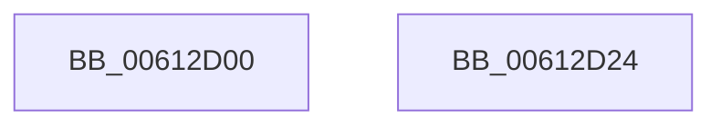

# VfLeaveDmaDomain

- RVA: `0x00612D00`–`0x00612D25` (길이 `37` bytes)
- VA: `0x0000000140612D00`
- 실행 섹션: `.text`
- PDB 이름 있음: `예`; PDB Function 태그: `아니요`
- unwind 정보 RVA: `0x0005C788`
- 디코드: `10`개 명령, `37/37` bytes 표시
- 미해석 바이트: `0` (있으면 어셈블리에 `.byte`로 보존)

> 이 문서는 커널 이미지의 기계어와 PDB 기호를 분석해 생성했습니다. 4번과 5번은 함수 원형과 자료형을 바이너리 사용 방식에서 추정한 C 해석이며 원본 소스 복구 결과는 아닙니다.

## 1. Dependencies

- 직접 호출 지점: **2**; 고유 호출 대상: **2**
- 직접 호출자로 확인된 함수: **0**
- RIP 상대 이미지 참조: **0**

### Outgoing calls
- `0x00612D04` → [ViGetRealDmaAdapter](../../pagevrfy/B9/ViGetRealDmaAdapter_function_00B990DC.md) (function, `0x00B990DC`)
- `0x00612D1A` → [guard_dispatch_icall](../6B/guard_dispatch_icall_function_006BAAD0.md) (function, `0x006BAAD0`)

### Direct callers
- 이 함수 시작 RVA로 연결되는 직접 call은 확인되지 않았습니다. 간접 호출은 완전히 역산할 수 없습니다.

### Static image references
- 디코드된 RIP-relative 메모리 참조가 없습니다.

## 2. Other-region calls and transfers

- 다른 실행 섹션으로 향하는 call: **1**
  - `0x00612D04` → [ViGetRealDmaAdapter](../../pagevrfy/B9/ViGetRealDmaAdapter_function_00B990DC.md) (`.text` → `PAGEVRFY`)
- 별도 외부 분기/꼬리 이동을 확인하지 못했습니다.

## 3. Assembly (complete function range)

```asm
00612D00  48 83 EC 28                     sub rsp, 0x28
00612D04  E8 D3 63 58 00                  call 0x140b990dc
00612D09  48 8B D0                        mov rdx, rax
00612D0C  48 8B 48 08                     mov rcx, qword ptr [rax + 8]
00612D10  48 8B 81 00 01 00 00            mov rax, qword ptr [rcx + 0x100]
00612D17  48 8B CA                        mov rcx, rdx
00612D1A  E8 B1 7D 0A 00                  call 0x1406baad0
00612D1F  48 83 C4 28                     add rsp, 0x28
00612D23  C3                              ret
00612D24  CC                              int3
```

## 4. C-style interpretation (structured pseudocode)

```c
__int64 __fastcall VfLeaveDmaDomain(void)
{
    __int64 result;
    __int64 v_rsp;

    v_rsp = (v_rsp) - (40);
    result = ViGetRealDmaAdapter(a1, a2, a3, a4);
    result = guard_dispatch_icall(result, result, a3, a4);
    v_rsp = (v_rsp) + (40);
    return result;
}
```

## 5. (Beta) C Style

```c
void VfLeaveDmaDomain(void)
{
    int64_t result;
    int64_t local_rsp;

    local_rsp = (local_rsp) - (40);
    result = ViGetRealDmaAdapter(a1, a2, a3, a4);
    result = guard_dispatch_icall(result, result, a3, a4);
    local_rsp = (local_rsp) + (40);
    return result;
}
```

## 6. Execution-region graph

[열기: 2D/3D 그래프와 함수 탐색 컨트롤 패널](../../../control-panel.html?section=text&rva=0x00612D00&view=graph)

- 2D 그래프는 위에서 아래로 흐르고, 3D 그래프는 빈 공간을 드래그해 회전합니다. Shift+드래그는 이동, 휠은 확대·축소, 함수 노드 선택은 대상 보고서 이동입니다.

### Static fallback


