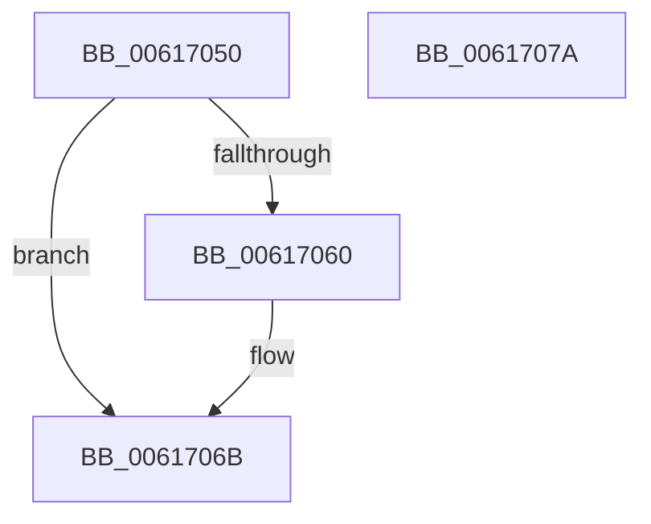

# VfMiscPluginUnload

- RVA: `0x00617050`–`0x0061707B` (길이 `43` bytes)
- VA: `0x0000000140617050`
- 실행 섹션: `.text`
- PDB 이름 있음: `예`; PDB Function 태그: `아니요`
- unwind 정보 RVA: `0x0005C788`
- 디코드: `9`개 명령, `43/43` bytes 표시
- 미해석 바이트: `0` (있으면 어셈블리에 `.byte`로 보존)

> 이 문서는 커널 이미지의 기계어와 PDB 기호를 분석해 생성했습니다. 4번과 5번은 함수 원형과 자료형을 바이너리 사용 방식에서 추정한 C 해석이며 원본 소스 복구 결과는 아닙니다.

## 1. Dependencies

- 직접 호출 지점: **2**; 고유 호출 대상: **2**
- 직접 호출자로 확인된 함수: **0**
- RIP 상대 이미지 참조: **2**

### Outgoing calls
- `0x0061706B` → [VfDeleteResourceTree](../../pagevrfy/BB/VfDeleteResourceTree_function_00BB1974.md) (function, `0x00BB1974`)
- `0x00617070` → [VfDeleteLookasideTree](../../pagevrfy/BA/VfDeleteLookasideTree_function_00BAFE08.md) (function, `0x00BAFE08`)

### Direct callers
- 이 함수 시작 RVA로 연결되는 직접 call은 확인되지 않았습니다. 간접 호출은 완전히 역산할 수 없습니다.

### Static image references
- `0x00617054` → RVA `0x00E681A0` (`.data`; read)
- `0x00617060` → RVA `0x00FC6BD0` (`ALMOSTRO`; read/write)

## 2. Other-region calls and transfers

- 다른 실행 섹션으로 향하는 call: **2**
  - `0x0061706B` → [VfDeleteResourceTree](../../pagevrfy/BB/VfDeleteResourceTree_function_00BB1974.md) (`.text` → `PAGEVRFY`)
  - `0x00617070` → [VfDeleteLookasideTree](../../pagevrfy/BA/VfDeleteLookasideTree_function_00BAFE08.md) (`.text` → `PAGEVRFY`)
- 별도 외부 분기/꼬리 이동을 확인하지 못했습니다.

## 3. Assembly (complete function range)

```asm
00617050  48 83 EC 28                     sub rsp, 0x28
00617054  F7 05 42 11 85 00 00 00 40 00   test dword ptr [rip + 0x851142], 0x400000
0061705E  75 0B                           jne 0x14061706b
00617060  F0 81 25 65 FB 9A 00 F9 FD FF FF  lock and dword ptr [rip + 0x9afb65], 0xfffffdf9
0061706B  E8 04 A9 59 00                  call 0x140bb1974
00617070  E8 93 8D 59 00                  call 0x140bafe08
00617075  48 83 C4 28                     add rsp, 0x28
00617079  C3                              ret
0061707A  CC                              int3
```

## 4. C-style interpretation (structured pseudocode)

```c
__int64 __fastcall VfMiscPluginUnload(void)
{
    __int64 result;
    __int64 v_rsp;

    v_rsp = (v_rsp) - (40);
    if (((*(unsigned int *)(v_rip + 8720706)) & (0x400000ULL)) == 0) {
    }
    result = VfDeleteResourceTree(a1, a2, a3, a4);
    result = VfDeleteLookasideTree(a1, a2, a3, a4);
    v_rsp = (v_rsp) + (40);
    return result;
}
```

## 5. (Beta) C Style

```c
void VfMiscPluginUnload(void)
{
    int64_t result;
    int64_t local_rsp;

    local_rsp = (local_rsp) - (40);
    if (((*(uint32_t *)(v_rip + 0x851142)) & (0x400000ULL)) == 0) {
    }
    result = VfDeleteResourceTree(a1, a2, a3, a4);
    result = VfDeleteLookasideTree(a1, a2, a3, a4);
    local_rsp = (local_rsp) + (40);
    return result;
}
```

## 6. Execution-region graph

[열기: 2D/3D 그래프와 함수 탐색 컨트롤 패널](../../../control-panel.html?section=text&rva=0x00617050&view=graph)

- 2D 그래프는 위에서 아래로 흐르고, 3D 그래프는 빈 공간을 드래그해 회전합니다. Shift+드래그는 이동, 휠은 확대·축소, 함수 노드 선택은 대상 보고서 이동입니다.

### Static fallback


