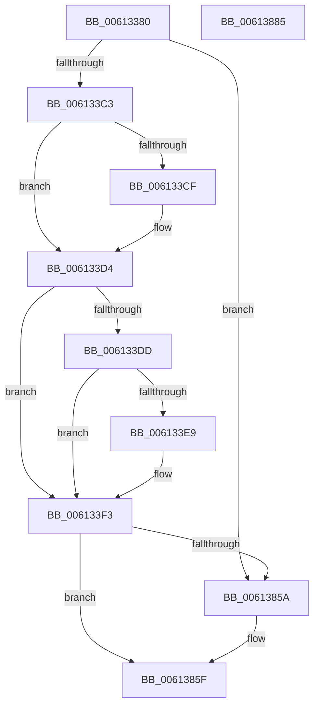

# VfPoolTrackingEntry

- RVA: `0x00613380`–`0x00613886` (길이 `1,286` bytes)
- VA: `0x0000000140613380`
- 실행 섹션: `.text`
- PDB 이름 있음: `예`; PDB Function 태그: `아니요`
- unwind 정보 RVA: `0x000D242C`
- 디코드: `204`개 명령, `1,286/1,286` bytes 표시
- 미해석 바이트: `0` (있으면 어셈블리에 `.byte`로 보존)

> 이 문서는 커널 이미지의 기계어와 PDB 기호를 분석해 생성했습니다. 4번과 5번은 함수 원형과 자료형을 바이너리 사용 방식에서 추정한 C 해석이며 원본 소스 복구 결과는 아닙니다.

## 1. Dependencies

- 직접 호출 지점: **5**; 고유 호출 대상: **5**
- 직접 호출자로 확인된 함수: **0**
- RIP 상대 이미지 참조: **50**

### Outgoing calls
- `0x006133B4` → [ViPtInitCircularPoolTrace](../../pagevrfy/B9/ViPtInitCircularPoolTrace_function_00B9C964.md) (function, `0x00B9C964`)
- `0x006133CF` → [ViPtInitAvlTrees](../../pagevrfy/B9/ViPtInitAvlTrees_function_00B9C8E0.md) (function, `0x00B9C8E0`)
- `0x0061384F` → [DifRegisterPlugin](DifRegisterPlugin_function_0061ABE0.md) (function, `0x0061ABE0`)
- `0x0061385A` → [ViPtPluginUnload](../../pagevrfy/B9/ViPtPluginUnload_function_00B9CA40.md) (function, `0x00B9CA40`)
- `0x0061386B` → [_security_check_cookie](../6A/_security_check_cookie_function_006AC640.md) (function, `0x006AC640`)

### Direct callers
- 이 함수 시작 RVA로 연결되는 직접 call은 확인되지 않았습니다. 간접 호출은 완전히 역산할 수 없습니다.

### Static image references
- `0x0061339A` → RVA `0x00E0A740` (`.data`; read)
- `0x006133AD` → RVA `0x00F04218` (`.data`; write)
- `0x006133C3` → RVA `0x00F04980` (`.data`; read)
- `0x006133D4` → RVA `0x00F048B8` (`.data`; read)
- `0x006133E9` → RVA `0x00FC6BBC` (`ALMOSTRO`; write)
- `0x006133F3` → RVA `0x00B9CA40` (`ViPtPluginUnload`; read)
- `0x00613402` → RVA `0x00F04228` (`.data`; write)
- `0x00613409` → RVA `0x006CE390` (` ?? ::FNODOBFM::`string'`; read)
- `0x00613415` → RVA `0x00B93F80` (`VfMiscIoConnectInterruptEx_Entry`; read)
- `0x00613421` → RVA `0x006CE3B0` (` ?? ::FNODOBFM::`string'`; read)
- `0x00613439` → RVA `0x006CE3A0` (` ?? ::FNODOBFM::`string'`; read)
- `0x00613451` → RVA `0x006CE330` (` ?? ::FNODOBFM::`string'`; read)
- `0x00613467` → RVA `0x006CE310` (` ?? ::FNODOBFM::`string'`; read)
- `0x0061347D` → RVA `0x006CE370` (` ?? ::FNODOBFM::`string'`; read)
- `0x00613493` → RVA `0x006CE350` (` ?? ::FNODOBFM::`string'`; read)
- `0x006134A9` → RVA `0x006CE2E0` (` ?? ::FNODOBFM::`string'`; read)
- `0x006134BF` → RVA `0x006CE2C0` (` ?? ::FNODOBFM::`string'`; read)
- `0x006134D5` → RVA `0x006CE300` (` ?? ::FNODOBFM::`string'`; read)
- `0x006134E0` → RVA `0x00B9C1C0` (`VfPtIoAllocateMdl_Exit`; read)
- `0x006134EB` → RVA `0x006CE2F0` (` ?? ::FNODOBFM::`string'`; read)
- `0x006134F6` → RVA `0x006CE570` (` ?? ::FNODOBFM::`string'`; read)
- `0x00613504` → RVA `0x00B9C410` (`VfPtMmAllocatePagesForMdl_Exit`; read)
- `0x00613512` → RVA `0x006CE550` (` ?? ::FNODOBFM::`string'`; read)
- `0x00613520` → RVA `0x00B9C3D0` (`VfPtMmAllocatePagesForMdlEx_Exit`; read)
- `0x0061352E` → RVA `0x006CE5B0` (` ?? ::FNODOBFM::`string'`; read)
- `0x006135D9` → RVA `0x00B9C350` (`VfPtMmAllocateNodePagesForMdlEx_Exit`; read)
- `0x006135F1` → RVA `0x006CE590` (` ?? ::FNODOBFM::`string'`; read)
- `0x006135FF` → RVA `0x00B9C390` (`VfPtMmAllocateNonCachedMemory_Exit`; read)
- `0x0061360D` → RVA `0x006CE500` (` ?? ::FNODOBFM::`string'`; read)
- `0x0061361B` → RVA `0x00B9C450` (`VfPtMmCreateMdl_Exit`; read)
- `0x00613629` → RVA `0x006CE4E0` (` ?? ::FNODOBFM::`string'`; read)
- `0x00613637` → RVA `0x006CE530` (` ?? ::FNODOBFM::`string'`; read)
- `0x00613645` → RVA `0x00B9C510` (`VfPtMmFreeNonCachedMemory_Entry`; read)
- `0x00613653` → RVA `0x006CE510` (` ?? ::FNODOBFM::`string'`; read)
- `0x00613661` → RVA `0x00B9C290` (`VfPtMmAllocateContiguousMemory_Exit`; read)
- `0x0061366F` → RVA `0x006CE470` (` ?? ::FNODOBFM::`string'`; read)
- `0x0061367D` → RVA `0x00B9C210` (`VfPtMmAllocateContiguousMemoryEx_Exit`; read)
- `0x0061368B` → RVA `0x006CE440` (` ?? ::FNODOBFM::`string'`; read)
- `0x00613699` → RVA `0x00B9C250` (`VfPtMmAllocateContiguousMemorySpecifyCacheNode_Exit`; read)
- `0x006136A7` → RVA `0x006CE4B0` (` ?? ::FNODOBFM::`string'`; read)
- `0x006136C3` → RVA `0x006CE490` (` ?? ::FNODOBFM::`string'`; read)
- `0x006136DF` → RVA `0x006CE3E0` (` ?? ::FNODOBFM::`string'`; read)
- `0x006136ED` → RVA `0x00B9C490` (`VfPtMmFreeContiguousMemory_Entry`; read)
- `0x006136FB` → RVA `0x006CE3C0` (` ?? ::FNODOBFM::`string'`; read)
- `0x00613709` → RVA `0x00B9C310` (`VfPtMmAllocateMappingAddress_Exit`; read)
- `0x00613717` → RVA `0x006CE420` (` ?? ::FNODOBFM::`string'`; read)
- `0x00613725` → RVA `0x00B9C2D0` (`VfPtMmAllocateMappingAddressEx_Exit`; read)
- `0x00613733` → RVA `0x006CE400` (` ?? ::FNODOBFM::`string'`; read)
- `0x00613741` → RVA `0x00B9C4D0` (`VfPtMmFreeMappingAddress_Entry`; read)
- `0x0061383F` → RVA `0x00F04220` (`.data`; read)

## 2. Other-region calls and transfers

- 다른 실행 섹션으로 향하는 call: **3**
  - `0x006133B4` → [ViPtInitCircularPoolTrace](../../pagevrfy/B9/ViPtInitCircularPoolTrace_function_00B9C964.md) (`.text` → `PAGEVRFY`)
  - `0x006133CF` → [ViPtInitAvlTrees](../../pagevrfy/B9/ViPtInitAvlTrees_function_00B9C8E0.md) (`.text` → `PAGEVRFY`)
  - `0x0061385A` → [ViPtPluginUnload](../../pagevrfy/B9/ViPtPluginUnload_function_00B9CA40.md) (`.text` → `PAGEVRFY`)
- 별도 외부 분기/꼬리 이동을 확인하지 못했습니다.

## 3. Assembly (complete function range)

```asm
00613380  48 89 5C 24 08                  mov qword ptr [rsp + 8], rbx
00613385  48 89 7C 24 10                  mov qword ptr [rsp + 0x10], rdi
0061338A  55                              push rbp
0061338B  48 8D AC 24 70 FD FF FF         lea rbp, [rsp - 0x290]
00613393  48 81 EC 90 03 00 00            sub rsp, 0x390
0061339A  48 8B 05 9F 73 7F 00            mov rax, qword ptr [rip + 0x7f739f]
006133A1  48 33 C4                        xor rax, rsp
006133A4  48 89 85 80 02 00 00            mov qword ptr [rbp + 0x280], rax
006133AB  33 FF                           xor edi, edi
006133AD  48 89 3D 64 0E 8F 00            mov qword ptr [rip + 0x8f0e64], rdi
006133B4  E8 AB 95 58 00                  call 0x140b9c964
006133B9  8B D8                           mov ebx, eax
006133BB  85 C0                           test eax, eax
006133BD  0F 88 97 04 00 00               js 0x14061385a
006133C3  F7 05 B3 15 8F 00 00 10 00 00   test dword ptr [rip + 0x8f15b3], 0x1000
006133CD  74 05                           je 0x1406133d4
006133CF  E8 0C 95 58 00                  call 0x140b9c8e0
006133D4  40 38 3D DD 14 8F 00            cmp byte ptr [rip + 0x8f14dd], dil
006133DB  75 16                           jne 0x1406133f3
006133DD  F7 05 99 15 8F 00 00 08 00 00   test dword ptr [rip + 0x8f1599], 0x800
006133E7  75 0A                           jne 0x1406133f3
006133E9  C7 05 C9 37 9B 00 01 00 00 00   mov dword ptr [rip + 0x9b37c9], 1
006133F3  48 8D 05 46 96 58 00            lea rax, [rip + 0x589646]
006133FA  C7 44 24 28 9D 01 00 00         mov dword ptr [rsp + 0x28], 0x19d
00613402  48 89 05 1F 0E 8F 00            mov qword ptr [rip + 0x8f0e1f], rax
00613409  48 8D 05 80 AF 0B 00            lea rax, [rip + 0xbaf80]
00613410  48 89 44 24 20                  mov qword ptr [rsp + 0x20], rax
00613415  48 8D 05 64 0B 58 00            lea rax, [rip + 0x580b64]
0061341C  48 89 44 24 30                  mov qword ptr [rsp + 0x30], rax
00613421  48 8D 05 88 AF 0B 00            lea rax, [rip + 0xbaf88]
00613428  48 89 44 24 40                  mov qword ptr [rsp + 0x40], rax
0061342D  48 8D 05 4C 0B 58 00            lea rax, [rip + 0x580b4c]
00613434  48 89 44 24 50                  mov qword ptr [rsp + 0x50], rax
00613439  48 8D 05 60 AF 0B 00            lea rax, [rip + 0xbaf60]
00613440  48 89 44 24 60                  mov qword ptr [rsp + 0x60], rax
00613445  48 8D 05 34 0B 58 00            lea rax, [rip + 0x580b34]
0061344C  48 89 44 24 78                  mov qword ptr [rsp + 0x78], rax
00613451  48 8D 05 D8 AE 0B 00            lea rax, [rip + 0xbaed8]
00613458  48 89 45 80                     mov qword ptr [rbp - 0x80], rax
0061345C  48 8D 05 1D 0B 58 00            lea rax, [rip + 0x580b1d]
00613463  48 89 45 90                     mov qword ptr [rbp - 0x70], rax
00613467  48 8D 05 A2 AE 0B 00            lea rax, [rip + 0xbaea2]
0061346E  48 89 45 A0                     mov qword ptr [rbp - 0x60], rax
00613472  48 8D 05 07 0B 58 00            lea rax, [rip + 0x580b07]
00613479  48 89 45 B0                     mov qword ptr [rbp - 0x50], rax
0061347D  48 8D 05 EC AE 0B 00            lea rax, [rip + 0xbaeec]
00613484  48 89 45 C0                     mov qword ptr [rbp - 0x40], rax
00613488  48 8D 05 F1 0A 58 00            lea rax, [rip + 0x580af1]
0061348F  48 89 45 D0                     mov qword ptr [rbp - 0x30], rax
00613493  48 8D 05 B6 AE 0B 00            lea rax, [rip + 0xbaeb6]
0061349A  48 89 45 E0                     mov qword ptr [rbp - 0x20], rax
0061349E  48 8D 05 DB 0A 58 00            lea rax, [rip + 0x580adb]
006134A5  48 89 45 F0                     mov qword ptr [rbp - 0x10], rax
006134A9  48 8D 05 30 AE 0B 00            lea rax, [rip + 0xbae30]
006134B0  48 89 45 00                     mov qword ptr [rbp], rax
006134B4  48 8D 05 C5 0A 58 00            lea rax, [rip + 0x580ac5]
006134BB  48 89 45 10                     mov qword ptr [rbp + 0x10], rax
006134BF  48 8D 05 FA AD 0B 00            lea rax, [rip + 0xbadfa]
006134C6  48 89 45 20                     mov qword ptr [rbp + 0x20], rax
006134CA  48 8D 05 AF 0A 58 00            lea rax, [rip + 0x580aaf]
006134D1  48 89 45 30                     mov qword ptr [rbp + 0x30], rax
006134D5  48 8D 05 24 AE 0B 00            lea rax, [rip + 0xbae24]
006134DC  48 89 45 40                     mov qword ptr [rbp + 0x40], rax
006134E0  48 8D 05 D9 8C 58 00            lea rax, [rip + 0x588cd9]
006134E7  48 89 45 58                     mov qword ptr [rbp + 0x58], rax
006134EB  48 8D 05 FE AD 0B 00            lea rax, [rip + 0xbadfe]
006134F2  48 89 45 60                     mov qword ptr [rbp + 0x60], rax
006134F6  48 8D 05 73 B0 0B 00            lea rax, [rip + 0xbb073]
006134FD  48 89 85 80 00 00 00            mov qword ptr [rbp + 0x80], rax
00613504  48 8D 05 05 8F 58 00            lea rax, [rip + 0x588f05]
0061350B  48 89 85 98 00 00 00            mov qword ptr [rbp + 0x98], rax
00613512  48 8D 05 37 B0 0B 00            lea rax, [rip + 0xbb037]
00613519  48 89 85 A0 00 00 00            mov qword ptr [rbp + 0xa0], rax
00613520  48 8D 05 A9 8E 58 00            lea rax, [rip + 0x588ea9]
00613527  48 89 85 B8 00 00 00            mov qword ptr [rbp + 0xb8], rax
0061352E  48 8D 05 7B B0 0B 00            lea rax, [rip + 0xbb07b]
00613535  48 89 85 C0 00 00 00            mov qword ptr [rbp + 0xc0], rax
0061353C  48 89 7C 24 38                  mov qword ptr [rsp + 0x38], rdi
00613541  C7 44 24 48 A3 01 00 00         mov dword ptr [rsp + 0x48], 0x1a3
00613549  48 89 7C 24 58                  mov qword ptr [rsp + 0x58], rdi
0061354E  C7 44 24 68 A2 01 00 00         mov dword ptr [rsp + 0x68], 0x1a2
00613556  48 89 7C 24 70                  mov qword ptr [rsp + 0x70], rdi
0061355B  C7 45 88 9E 01 00 00            mov dword ptr [rbp - 0x78], 0x19e
00613562  48 89 7D 98                     mov qword ptr [rbp - 0x68], rdi
00613566  C7 45 A8 9F 01 00 00            mov dword ptr [rbp - 0x58], 0x19f
0061356D  48 89 7D B8                     mov qword ptr [rbp - 0x48], rdi
00613571  C7 45 C8 A0 01 00 00            mov dword ptr [rbp - 0x38], 0x1a0
00613578  48 89 7D D8                     mov qword ptr [rbp - 0x28], rdi
0061357C  C7 45 E8 A1 01 00 00            mov dword ptr [rbp - 0x18], 0x1a1
00613583  48 89 7D F8                     mov qword ptr [rbp - 8], rdi
00613587  C7 45 08 91 01 00 00            mov dword ptr [rbp + 8], 0x191
0061358E  48 89 7D 18                     mov qword ptr [rbp + 0x18], rdi
00613592  C7 45 28 90 01 00 00            mov dword ptr [rbp + 0x28], 0x190
00613599  48 89 7D 38                     mov qword ptr [rbp + 0x38], rdi
0061359D  C7 45 48 6D 01 00 00            mov dword ptr [rbp + 0x48], 0x16d
006135A4  48 89 7D 50                     mov qword ptr [rbp + 0x50], rdi
006135A8  C7 45 68 53 01 00 00            mov dword ptr [rbp + 0x68], 0x153
006135AF  48 89 7D 70                     mov qword ptr [rbp + 0x70], rdi
006135B3  48 89 7D 78                     mov qword ptr [rbp + 0x78], rdi
006135B7  C7 85 88 00 00 00 E6 00 00 00   mov dword ptr [rbp + 0x88], 0xe6
006135C1  48 89 BD 90 00 00 00            mov qword ptr [rbp + 0x90], rdi
006135C8  C7 85 A8 00 00 00 E5 00 00 00   mov dword ptr [rbp + 0xa8], 0xe5
006135D2  48 89 BD B0 00 00 00            mov qword ptr [rbp + 0xb0], rdi
006135D9  48 8D 05 70 8D 58 00            lea rax, [rip + 0x588d70]
006135E0  C7 85 C8 00 00 00 E8 00 00 00   mov dword ptr [rbp + 0xc8], 0xe8
006135EA  48 89 85 D8 00 00 00            mov qword ptr [rbp + 0xd8], rax
006135F1  48 8D 05 98 AF 0B 00            lea rax, [rip + 0xbaf98]
006135F8  48 89 85 E0 00 00 00            mov qword ptr [rbp + 0xe0], rax
006135FF  48 8D 05 8A 8D 58 00            lea rax, [rip + 0x588d8a]
00613606  48 89 85 F8 00 00 00            mov qword ptr [rbp + 0xf8], rax
0061360D  48 8D 05 EC AE 0B 00            lea rax, [rip + 0xbaeec]
00613614  48 89 85 00 01 00 00            mov qword ptr [rbp + 0x100], rax
0061361B  48 8D 05 2E 8E 58 00            lea rax, [rip + 0x588e2e]
00613622  48 89 85 18 01 00 00            mov qword ptr [rbp + 0x118], rax
00613629  48 8D 05 B0 AE 0B 00            lea rax, [rip + 0xbaeb0]
00613630  48 89 85 20 01 00 00            mov qword ptr [rbp + 0x120], rax
00613637  48 8D 05 F2 AE 0B 00            lea rax, [rip + 0xbaef2]
0061363E  48 89 85 40 01 00 00            mov qword ptr [rbp + 0x140], rax
00613645  48 8D 05 C4 8E 58 00            lea rax, [rip + 0x588ec4]
0061364C  48 89 85 50 01 00 00            mov qword ptr [rbp + 0x150], rax
00613653  48 8D 05 B6 AE 0B 00            lea rax, [rip + 0xbaeb6]
0061365A  48 89 85 60 01 00 00            mov qword ptr [rbp + 0x160], rax
00613661  48 8D 05 28 8C 58 00            lea rax, [rip + 0x588c28]
00613668  48 89 85 78 01 00 00            mov qword ptr [rbp + 0x178], rax
0061366F  48 8D 05 FA AD 0B 00            lea rax, [rip + 0xbadfa]
00613676  48 89 85 80 01 00 00            mov qword ptr [rbp + 0x180], rax
0061367D  48 8D 05 8C 8B 58 00            lea rax, [rip + 0x588b8c]
00613684  48 89 85 98 01 00 00            mov qword ptr [rbp + 0x198], rax
0061368B  48 8D 05 AE AD 0B 00            lea rax, [rip + 0xbadae]
00613692  48 89 85 A0 01 00 00            mov qword ptr [rbp + 0x1a0], rax
00613699  48 8D 05 B0 8B 58 00            lea rax, [rip + 0x588bb0]
006136A0  48 89 85 B8 01 00 00            mov qword ptr [rbp + 0x1b8], rax
006136A7  48 8D 05 02 AE 0B 00            lea rax, [rip + 0xbae02]
006136AE  48 89 85 C0 01 00 00            mov qword ptr [rbp + 0x1c0], rax
006136B5  48 8D 05 94 8B 58 00            lea rax, [rip + 0x588b94]
006136BC  48 89 85 D8 01 00 00            mov qword ptr [rbp + 0x1d8], rax
006136C3  48 8D 05 C6 AD 0B 00            lea rax, [rip + 0xbadc6]
006136CA  48 89 85 E0 01 00 00            mov qword ptr [rbp + 0x1e0], rax
006136D1  48 8D 05 78 8B 58 00            lea rax, [rip + 0x588b78]
006136D8  48 89 85 F8 01 00 00            mov qword ptr [rbp + 0x1f8], rax
006136DF  48 8D 05 FA AC 0B 00            lea rax, [rip + 0xbacfa]
006136E6  48 89 85 00 02 00 00            mov qword ptr [rbp + 0x200], rax
006136ED  48 8D 05 9C 8D 58 00            lea rax, [rip + 0x588d9c]
006136F4  48 89 85 10 02 00 00            mov qword ptr [rbp + 0x210], rax
006136FB  48 8D 05 BE AC 0B 00            lea rax, [rip + 0xbacbe]
00613702  48 89 85 20 02 00 00            mov qword ptr [rbp + 0x220], rax
00613709  48 8D 05 00 8C 58 00            lea rax, [rip + 0x588c00]
00613710  48 89 85 38 02 00 00            mov qword ptr [rbp + 0x238], rax
00613717  48 8D 05 02 AD 0B 00            lea rax, [rip + 0xbad02]
0061371E  48 89 85 40 02 00 00            mov qword ptr [rbp + 0x240], rax
00613725  48 8D 05 A4 8B 58 00            lea rax, [rip + 0x588ba4]
0061372C  48 89 85 58 02 00 00            mov qword ptr [rbp + 0x258], rax
00613733  48 8D 05 C6 AC 0B 00            lea rax, [rip + 0xbacc6]
0061373A  48 89 85 60 02 00 00            mov qword ptr [rbp + 0x260], rax
00613741  48 8D 05 88 8D 58 00            lea rax, [rip + 0x588d88]
00613748  48 89 85 70 02 00 00            mov qword ptr [rbp + 0x270], rax
0061374F  48 89 BD D0 00 00 00            mov qword ptr [rbp + 0xd0], rdi
00613756  C7 85 E8 00 00 00 E7 00 00 00   mov dword ptr [rbp + 0xe8], 0xe7
00613760  48 89 BD F0 00 00 00            mov qword ptr [rbp + 0xf0], rdi
00613767  C7 85 08 01 00 00 E3 00 00 00   mov dword ptr [rbp + 0x108], 0xe3
00613771  48 89 BD 10 01 00 00            mov qword ptr [rbp + 0x110], rdi
00613778  C7 85 28 01 00 00 E0 00 00 00   mov dword ptr [rbp + 0x128], 0xe0
00613782  48 89 BD 30 01 00 00            mov qword ptr [rbp + 0x130], rdi
00613789  48 89 BD 38 01 00 00            mov qword ptr [rbp + 0x138], rdi
00613790  C7 85 48 01 00 00 E1 00 00 00   mov dword ptr [rbp + 0x148], 0xe1
0061379A  48 89 BD 58 01 00 00            mov qword ptr [rbp + 0x158], rdi
006137A1  C7 85 68 01 00 00 EE 00 00 00   mov dword ptr [rbp + 0x168], 0xee
006137AB  48 89 BD 70 01 00 00            mov qword ptr [rbp + 0x170], rdi
006137B2  C7 85 88 01 00 00 ED 00 00 00   mov dword ptr [rbp + 0x188], 0xed
006137BC  48 89 BD 90 01 00 00            mov qword ptr [rbp + 0x190], rdi
006137C3  C7 85 A8 01 00 00 EC 00 00 00   mov dword ptr [rbp + 0x1a8], 0xec
006137CD  48 89 BD B0 01 00 00            mov qword ptr [rbp + 0x1b0], rdi
006137D4  C7 85 C8 01 00 00 EB 00 00 00   mov dword ptr [rbp + 0x1c8], 0xeb
006137DE  48 89 BD D0 01 00 00            mov qword ptr [rbp + 0x1d0], rdi
006137E5  C7 85 E8 01 00 00 EA 00 00 00   mov dword ptr [rbp + 0x1e8], 0xea
006137EF  48 89 BD F0 01 00 00            mov qword ptr [rbp + 0x1f0], rdi
006137F6  C7 85 08 02 00 00 E2 00 00 00   mov dword ptr [rbp + 0x208], 0xe2
00613800  48 89 BD 18 02 00 00            mov qword ptr [rbp + 0x218], rdi
00613807  C7 85 28 02 00 00 E9 00 00 00   mov dword ptr [rbp + 0x228], 0xe9
00613811  48 89 BD 30 02 00 00            mov qword ptr [rbp + 0x230], rdi
00613818  C7 85 48 02 00 00 D1 01 00 00   mov dword ptr [rbp + 0x248], 0x1d1
00613822  48 89 BD 50 02 00 00            mov qword ptr [rbp + 0x250], rdi
00613829  C7 85 68 02 00 00 D2 01 00 00   mov dword ptr [rbp + 0x268], 0x1d2
00613833  48 89 BD 78 02 00 00            mov qword ptr [rbp + 0x278], rdi
0061383A  BA 1B 00 00 00                  mov edx, 0x1b
0061383F  4C 8D 0D DA 09 8F 00            lea r9, [rip + 0x8f09da]
00613846  48 8D 4C 24 20                  lea rcx, [rsp + 0x20]
0061384B  44 8D 42 E8                     lea r8d, [rdx - 0x18]
0061384F  E8 8C 73 00 00                  call 0x14061abe0
00613854  8B D8                           mov ebx, eax
00613856  85 C0                           test eax, eax
00613858  79 05                           jns 0x14061385f
0061385A  E8 E1 91 58 00                  call 0x140b9ca40
0061385F  8B C3                           mov eax, ebx
00613861  48 8B 8D 80 02 00 00            mov rcx, qword ptr [rbp + 0x280]
00613868  48 33 CC                        xor rcx, rsp
0061386B  E8 D0 8D 09 00                  call 0x1406ac640
00613870  4C 8D 9C 24 90 03 00 00         lea r11, [rsp + 0x390]
00613878  49 8B 5B 10                     mov rbx, qword ptr [r11 + 0x10]
0061387C  49 8B 7B 18                     mov rdi, qword ptr [r11 + 0x18]
00613880  49 8B E3                        mov rsp, r11
00613883  5D                              pop rbp
00613884  C3                              ret
00613885  CC                              int3
```

## 4. C-style interpretation (structured pseudocode)

```c
__int64 __fastcall VfPoolTrackingEntry(void)
{
    __int64 result;
    __int64 v_rdi;
    __int64 v_rsp;
    unsigned __int64 v_stack_m100;
    unsigned __int64 v_stack_m108;
    unsigned int v_stack_m110;
    unsigned __int64 v_stack_m118;
    unsigned __int64 v_stack_m120;
    unsigned __int64 v_stack_m128;
    unsigned int v_stack_m130;
    unsigned __int64 v_stack_m138;
    unsigned __int64 v_stack_m140;
    unsigned __int64 v_stack_m148;
    unsigned int v_stack_m150;
    unsigned __int64 v_stack_m158;
    unsigned __int64 v_stack_m160;
    unsigned __int64 v_stack_m168;
    unsigned int v_stack_m170;
    unsigned __int64 v_stack_m178;
    unsigned __int64 v_stack_m18;
    unsigned __int64 v_stack_m180;
    unsigned __int64 v_stack_m188;
    unsigned int v_stack_m190;
    unsigned __int64 v_stack_m198;
    unsigned __int64 v_stack_m1A0;
    unsigned __int64 v_stack_m1A8;
    unsigned int v_stack_m1B0;
    unsigned __int64 v_stack_m1B8;
    unsigned __int64 v_stack_m1C0;
    unsigned __int64 v_stack_m1C8;
    unsigned int v_stack_m1D0;
    unsigned __int64 v_stack_m1D8;
    unsigned __int64 v_stack_m1E0;
    unsigned __int64 v_stack_m1E8;
    unsigned int v_stack_m1F0;
    unsigned __int64 v_stack_m1F8;
    unsigned __int64 v_stack_m20;
    unsigned __int64 v_stack_m200;
    unsigned __int64 v_stack_m208;
    unsigned int v_stack_m210;
    unsigned __int64 v_stack_m218;
    unsigned __int64 v_stack_m220;
    unsigned __int64 v_stack_m228;
    unsigned int v_stack_m230;
    unsigned __int64 v_stack_m238;
    unsigned __int64 v_stack_m240;
    unsigned __int64 v_stack_m248;
    unsigned int v_stack_m250;
    unsigned __int64 v_stack_m258;
    unsigned __int64 v_stack_m260;
    unsigned __int64 v_stack_m268;
    unsigned int v_stack_m270;
    unsigned __int64 v_stack_m278;
    unsigned __int64 v_stack_m28;
    unsigned __int64 v_stack_m280;
    unsigned __int64 v_stack_m288;
    unsigned int v_stack_m290;
    unsigned __int64 v_stack_m298;
    unsigned __int64 v_stack_m2A0;
    unsigned __int64 v_stack_m2A8;
    unsigned int v_stack_m2B0;
    unsigned __int64 v_stack_m2B8;
    unsigned __int64 v_stack_m2C0;
    unsigned __int64 v_stack_m2C8;
    unsigned int v_stack_m2D0;
    unsigned __int64 v_stack_m2D8;
    unsigned __int64 v_stack_m2E0;
    unsigned __int64 v_stack_m2E8;
    unsigned int v_stack_m2F0;
    unsigned __int64 v_stack_m2F8;
    unsigned int v_stack_m30;
    unsigned __int64 v_stack_m300;
    unsigned __int64 v_stack_m308;
    unsigned int v_stack_m310;
    unsigned __int64 v_stack_m318;
    unsigned __int64 v_stack_m320;
    unsigned __int64 v_stack_m328;
    unsigned int v_stack_m330;
    unsigned __int64 v_stack_m338;
    unsigned __int64 v_stack_m340;
    unsigned __int64 v_stack_m348;
    unsigned int v_stack_m350;
    unsigned __int64 v_stack_m358;
    unsigned __int64 v_stack_m360;
    unsigned __int64 v_stack_m368;
    unsigned int v_stack_m370;
    unsigned __int64 v_stack_m378;
    unsigned __int64 v_stack_m38;
    unsigned __int64 v_stack_m40;
    unsigned __int64 v_stack_m48;
    unsigned int v_stack_m50;
    unsigned __int64 v_stack_m58;
    unsigned __int64 v_stack_m60;
    unsigned __int64 v_stack_m68;
    unsigned int v_stack_m70;
    unsigned __int64 v_stack_m78;
    unsigned __int64 v_stack_m8;
    unsigned __int64 v_stack_m80;
    unsigned __int64 v_stack_m88;
    unsigned int v_stack_m90;
    unsigned __int64 v_stack_m98;
    unsigned __int64 v_stack_mA0;
    unsigned __int64 v_stack_mA8;
    unsigned int v_stack_mB0;
    unsigned __int64 v_stack_mB8;
    unsigned __int64 v_stack_mC0;
    unsigned __int64 v_stack_mC8;
    unsigned int v_stack_mD0;
    unsigned __int64 v_stack_mD8;
    unsigned __int64 v_stack_mE0;
    unsigned __int64 v_stack_mE8;
    unsigned int v_stack_mF0;
    unsigned __int64 v_stack_mF8;
    unsigned __int64 v_stack_p10;
    unsigned __int64 v_stack_p8;

    v_stack_p8 = v_rbx;
    v_stack_p10 = v_rdi;
    v_rsp = (v_rsp) - (912);
    result = (*(unsigned __int64 *)(v_rip + 8352671)) ^ (v_rsp);
    v_stack_m18 = result;
    v_rdi = 0;
    *(unsigned __int64 *)(v_rip + 9375332) = 0;
    result = ViPtInitCircularPoolTrace(a1, a2, a3, a4);
    if (sign_flag) goto loc_0061385A;
    if (((*(unsigned int *)(v_rip + 9377203)) & (0x1000ULL)) != 0) {
        result = ViPtInitAvlTrees(a1, a2, a3, a4);
    }
    if ((*(unsigned __int8 *)(v_rip + 9376989)) != 0) goto loc_006133F3;
    if (((*(unsigned int *)(v_rip + 9377177)) & (0x800ULL)) == 0) {
        *(unsigned int *)(v_rip + 10172361) = 1;
    }
    v_stack_m370 = 413;
    *(unsigned __int64 *)(v_rip + 9375263) = v_rip + 5805638;
    v_stack_m378 = v_rip + 765824;
    v_stack_m368 = v_rip + 5770084;
    v_stack_m358 = v_rip + 765832;
    v_stack_m348 = v_rip + 5770060;
    v_stack_m338 = v_rip + 765792;
    v_stack_m320 = v_rip + 5770036;
    v_stack_m318 = v_rip + 765656;
    v_stack_m308 = v_rip + 5770013;
    v_stack_m2F8 = v_rip + 765602;
    v_stack_m2E8 = v_rip + 5769991;
    v_stack_m2D8 = v_rip + 765676;
    v_stack_m2C8 = v_rip + 5769969;
    v_stack_m2B8 = v_rip + 765622;
    v_stack_m2A8 = v_rip + 5769947;
    v_stack_m298 = v_rip + 765488;
    v_stack_m288 = v_rip + 5769925;
    v_stack_m278 = v_rip + 765434;
    v_stack_m268 = v_rip + 5769903;
    v_stack_m258 = v_rip + 765476;
    v_stack_m240 = v_rip + 5803225;
    v_stack_m238 = v_rip + 765438;
    v_stack_m218 = v_rip + 766067;
    v_stack_m200 = v_rip + 5803781;
    v_stack_m1F8 = v_rip + 766007;
    v_stack_m1E0 = v_rip + 5803689;
    v_stack_m1D8 = v_rip + 766075;
    v_stack_m360 = 0;
    v_stack_m350 = 419;
    v_stack_m340 = 0;
    v_stack_m330 = 418;
    v_stack_m328 = 0;
    v_stack_m310 = 414;
    v_stack_m300 = 0;
    v_stack_m2F0 = 415;
    v_stack_m2E0 = 0;
    v_stack_m2D0 = 416;
    v_stack_m2C0 = 0;
    v_stack_m2B0 = 417;
    v_stack_m2A0 = 0;
    v_stack_m290 = 401;
    v_stack_m280 = 0;
    v_stack_m270 = 400;
    v_stack_m260 = 0;
    v_stack_m250 = 365;
    v_stack_m248 = 0;
    v_stack_m230 = 339;
    v_stack_m228 = 0;
    v_stack_m220 = 0;
    v_stack_m210 = 230;
    v_stack_m208 = 0;
    v_stack_m1F0 = 229;
    v_stack_m1E8 = 0;
    v_stack_m1D0 = 232;
    v_stack_m1C0 = v_rip + 5803376;
    v_stack_m1B8 = v_rip + 765848;
    v_stack_m1A0 = v_rip + 5803402;
    v_stack_m198 = v_rip + 765676;
    v_stack_m180 = v_rip + 5803566;
    v_stack_m178 = v_rip + 765616;
    v_stack_m158 = v_rip + 765682;
    v_stack_m148 = v_rip + 5803716;
    v_stack_m138 = v_rip + 765622;
    v_stack_m120 = v_rip + 5803048;
    v_stack_m118 = v_rip + 765434;
    v_stack_m100 = v_rip + 5802892;
    v_stack_mF8 = v_rip + 765358;
    v_stack_mE0 = v_rip + 5802928;
    v_stack_mD8 = v_rip + 765442;
    v_stack_mC0 = v_rip + 5802900;
    v_stack_mB8 = v_rip + 765382;
    v_stack_mA0 = v_rip + 5802872;
    v_stack_m98 = v_rip + 765178;
    v_stack_m88 = v_rip + 5803420;
    v_stack_m78 = v_rip + 765118;
    v_stack_m60 = v_rip + 5803008;
    v_stack_m58 = v_rip + 765186;
    v_stack_m40 = v_rip + 5802916;
    v_stack_m38 = v_rip + 765126;
    v_stack_m28 = v_rip + 5803400;
    v_stack_m1C8 = 0;
    v_stack_m1B0 = 231;
    v_stack_m1A8 = 0;
    v_stack_m190 = 227;
    v_stack_m188 = 0;
    v_stack_m170 = 224;
    v_stack_m168 = 0;
    v_stack_m160 = 0;
    v_stack_m150 = 225;
    v_stack_m140 = 0;
    v_stack_m130 = 238;
    v_stack_m128 = 0;
    v_stack_m110 = 237;
    v_stack_m108 = 0;
    v_stack_mF0 = 236;
    v_stack_mE8 = 0;
    v_stack_mD0 = 235;
    v_stack_mC8 = 0;
    v_stack_mB0 = 234;
    v_stack_mA8 = 0;
    v_stack_m90 = 226;
    v_stack_m80 = 0;
    v_stack_m70 = 233;
    v_stack_m68 = 0;
    v_stack_m50 = 465;
    v_stack_m48 = 0;
    v_stack_m30 = 466;
    v_stack_m20 = 0;
    result = DifRegisterPlugin(v_stack_m378, 27, 27 - 24, v_rip + 9374170);
    if (sign_flag) {
        result = ViPtPluginUnload(v_stack_m378, 27, 27 - 24, v_rip + 9374170);
    }
    a1 = (v_stack_m18) ^ (v_rsp);
    result = _security_check_cookie(a1, 27, 27 - 24, v_rip + 9374170);
    return result;
}
```

## 5. (Beta) C Style

```c
void VfPoolTrackingEntry(void)
{
    int64_t result;
    int64_t local_rdi;
    int64_t local_rsp;
    uint64_t v_stack_m100;
    uint64_t v_stack_m108;
    uint32_t v_stack_m110;
    uint64_t v_stack_m118;
    uint64_t v_stack_m120;
    uint64_t v_stack_m128;
    uint32_t v_stack_m130;
    uint64_t v_stack_m138;
    uint64_t v_stack_m140;
    uint64_t v_stack_m148;
    uint32_t v_stack_m150;
    uint64_t v_stack_m158;
    uint64_t v_stack_m160;
    uint64_t v_stack_m168;
    uint32_t v_stack_m170;
    uint64_t v_stack_m178;
    uint64_t v_stack_m18;
    uint64_t v_stack_m180;
    uint64_t v_stack_m188;
    uint32_t v_stack_m190;
    uint64_t v_stack_m198;
    uint64_t v_stack_m1A0;
    uint64_t v_stack_m1A8;
    uint32_t v_stack_m1B0;
    uint64_t v_stack_m1B8;
    uint64_t v_stack_m1C0;
    uint64_t v_stack_m1C8;
    uint32_t v_stack_m1D0;
    uint64_t v_stack_m1D8;
    uint64_t v_stack_m1E0;
    uint64_t v_stack_m1E8;
    uint32_t v_stack_m1F0;
    uint64_t v_stack_m1F8;
    uint64_t v_stack_m20;
    uint64_t v_stack_m200;
    uint64_t v_stack_m208;
    uint32_t v_stack_m210;
    uint64_t v_stack_m218;
    uint64_t v_stack_m220;
    uint64_t v_stack_m228;
    uint32_t v_stack_m230;
    uint64_t v_stack_m238;
    uint64_t v_stack_m240;
    uint64_t v_stack_m248;
    uint32_t v_stack_m250;
    uint64_t v_stack_m258;
    uint64_t v_stack_m260;
    uint64_t v_stack_m268;
    uint32_t v_stack_m270;
    uint64_t v_stack_m278;
    uint64_t v_stack_m28;
    uint64_t v_stack_m280;
    uint64_t v_stack_m288;
    uint32_t v_stack_m290;
    uint64_t v_stack_m298;
    uint64_t v_stack_m2A0;
    uint64_t v_stack_m2A8;
    uint32_t v_stack_m2B0;
    uint64_t v_stack_m2B8;
    uint64_t v_stack_m2C0;
    uint64_t v_stack_m2C8;
    uint32_t v_stack_m2D0;
    uint64_t v_stack_m2D8;
    uint64_t v_stack_m2E0;
    uint64_t v_stack_m2E8;
    uint32_t v_stack_m2F0;
    uint64_t v_stack_m2F8;
    uint32_t v_stack_m30;
    uint64_t v_stack_m300;
    uint64_t v_stack_m308;
    uint32_t v_stack_m310;
    uint64_t v_stack_m318;
    uint64_t v_stack_m320;
    uint64_t v_stack_m328;
    uint32_t v_stack_m330;
    uint64_t v_stack_m338;
    uint64_t v_stack_m340;
    uint64_t v_stack_m348;
    uint32_t v_stack_m350;
    uint64_t v_stack_m358;
    uint64_t v_stack_m360;
    uint64_t v_stack_m368;
    uint32_t v_stack_m370;
    uint64_t v_stack_m378;
    uint64_t v_stack_m38;
    uint64_t v_stack_m40;
    uint64_t v_stack_m48;
    uint32_t v_stack_m50;
    uint64_t v_stack_m58;
    uint64_t v_stack_m60;
    uint64_t v_stack_m68;
    uint32_t v_stack_m70;
    uint64_t v_stack_m78;
    uint64_t v_stack_m8;
    uint64_t v_stack_m80;
    uint64_t v_stack_m88;
    uint32_t v_stack_m90;
    uint64_t v_stack_m98;
    uint64_t v_stack_mA0;
    uint64_t v_stack_mA8;
    uint32_t v_stack_mB0;
    uint64_t v_stack_mB8;
    uint64_t v_stack_mC0;
    uint64_t v_stack_mC8;
    uint32_t v_stack_mD0;
    uint64_t v_stack_mD8;
    uint64_t v_stack_mE0;
    uint64_t v_stack_mE8;
    uint32_t v_stack_mF0;
    uint64_t v_stack_mF8;
    uint64_t v_stack_p10;
    uint64_t v_stack_p8;

    v_stack_p8 = local_rbx;
    v_stack_p10 = local_rdi;
    local_rsp = (local_rsp) - (912);
    result = (*(uint64_t *)(v_rip + 0x7F739F)) ^ (local_rsp);
    v_stack_m18 = result;
    local_rdi = 0;
    *(uint64_t *)(v_rip + 0x8F0E64) = 0;
    result = ViPtInitCircularPoolTrace(a1, a2, a3, a4);
    if (sign_flag) goto loc_0061385A;
    if (((*(uint32_t *)(v_rip + 0x8F15B3)) & (0x1000ULL)) != 0) {
        result = ViPtInitAvlTrees(a1, a2, a3, a4);
    }
    if ((*(uint8_t *)(v_rip + 0x8F14DD)) != 0) goto loc_006133F3;
    if (((*(uint32_t *)(v_rip + 0x8F1599)) & (0x800ULL)) == 0) {
        *(uint32_t *)(v_rip + 0x9B37C9) = 1;
    }
    v_stack_m370 = 413;
    *(uint64_t *)(v_rip + 0x8F0E1F) = v_rip + 5805638;
    v_stack_m378 = v_rip + 765824;
    v_stack_m368 = v_rip + 5770084;
    v_stack_m358 = v_rip + 765832;
    v_stack_m348 = v_rip + 5770060;
    v_stack_m338 = v_rip + 765792;
    v_stack_m320 = v_rip + 5770036;
    v_stack_m318 = v_rip + 765656;
    v_stack_m308 = v_rip + 5770013;
    v_stack_m2F8 = v_rip + 765602;
    v_stack_m2E8 = v_rip + 5769991;
    v_stack_m2D8 = v_rip + 765676;
    v_stack_m2C8 = v_rip + 5769969;
    v_stack_m2B8 = v_rip + 765622;
    v_stack_m2A8 = v_rip + 5769947;
    v_stack_m298 = v_rip + 765488;
    v_stack_m288 = v_rip + 5769925;
    v_stack_m278 = v_rip + 765434;
    v_stack_m268 = v_rip + 5769903;
    v_stack_m258 = v_rip + 765476;
    v_stack_m240 = v_rip + 5803225;
    v_stack_m238 = v_rip + 765438;
    v_stack_m218 = v_rip + 766067;
    v_stack_m200 = v_rip + 5803781;
    v_stack_m1F8 = v_rip + 766007;
    v_stack_m1E0 = v_rip + 5803689;
    v_stack_m1D8 = v_rip + 766075;
    v_stack_m360 = 0;
    v_stack_m350 = 419;
    v_stack_m340 = 0;
    v_stack_m330 = 418;
    v_stack_m328 = 0;
    v_stack_m310 = 414;
    v_stack_m300 = 0;
    v_stack_m2F0 = 415;
    v_stack_m2E0 = 0;
    v_stack_m2D0 = 416;
    v_stack_m2C0 = 0;
    v_stack_m2B0 = 417;
    v_stack_m2A0 = 0;
    v_stack_m290 = 401;
    v_stack_m280 = 0;
    v_stack_m270 = 400;
    v_stack_m260 = 0;
    v_stack_m250 = 365;
    v_stack_m248 = 0;
    v_stack_m230 = 339;
    v_stack_m228 = 0;
    v_stack_m220 = 0;
    v_stack_m210 = 230;
    v_stack_m208 = 0;
    v_stack_m1F0 = 229;
    v_stack_m1E8 = 0;
    v_stack_m1D0 = 232;
    v_stack_m1C0 = v_rip + 5803376;
    v_stack_m1B8 = v_rip + 765848;
    v_stack_m1A0 = v_rip + 5803402;
    v_stack_m198 = v_rip + 765676;
    v_stack_m180 = v_rip + 5803566;
    v_stack_m178 = v_rip + 765616;
    v_stack_m158 = v_rip + 765682;
    v_stack_m148 = v_rip + 5803716;
    v_stack_m138 = v_rip + 765622;
    v_stack_m120 = v_rip + 5803048;
    v_stack_m118 = v_rip + 765434;
    v_stack_m100 = v_rip + 5802892;
    v_stack_mF8 = v_rip + 765358;
    v_stack_mE0 = v_rip + 5802928;
    v_stack_mD8 = v_rip + 765442;
    v_stack_mC0 = v_rip + 5802900;
    v_stack_mB8 = v_rip + 765382;
    v_stack_mA0 = v_rip + 5802872;
    v_stack_m98 = v_rip + 765178;
    v_stack_m88 = v_rip + 5803420;
    v_stack_m78 = v_rip + 765118;
    v_stack_m60 = v_rip + 5803008;
    v_stack_m58 = v_rip + 765186;
    v_stack_m40 = v_rip + 5802916;
    v_stack_m38 = v_rip + 765126;
    v_stack_m28 = v_rip + 5803400;
    v_stack_m1C8 = 0;
    v_stack_m1B0 = 231;
    v_stack_m1A8 = 0;
    v_stack_m190 = 227;
    v_stack_m188 = 0;
    v_stack_m170 = 224;
    v_stack_m168 = 0;
    v_stack_m160 = 0;
    v_stack_m150 = 225;
    v_stack_m140 = 0;
    v_stack_m130 = 238;
    v_stack_m128 = 0;
    v_stack_m110 = 237;
    v_stack_m108 = 0;
    v_stack_mF0 = 236;
    v_stack_mE8 = 0;
    v_stack_mD0 = 235;
    v_stack_mC8 = 0;
    v_stack_mB0 = 234;
    v_stack_mA8 = 0;
    v_stack_m90 = 226;
    v_stack_m80 = 0;
    v_stack_m70 = 233;
    v_stack_m68 = 0;
    v_stack_m50 = 465;
    v_stack_m48 = 0;
    v_stack_m30 = 466;
    v_stack_m20 = 0;
    result = DifRegisterPlugin(v_stack_m378, 27, 27 - 24, v_rip + 9374170);
    if (sign_flag) {
        result = ViPtPluginUnload(v_stack_m378, 27, 27 - 24, v_rip + 9374170);
    }
    a1 = (v_stack_m18) ^ (local_rsp);
    result = _security_check_cookie(a1, 27, 27 - 24, v_rip + 9374170);
    return result;
}
```

## 6. Execution-region graph

[열기: 2D/3D 그래프와 함수 탐색 컨트롤 패널](../../../control-panel.html?section=text&rva=0x00613380&view=graph)

- 2D 그래프는 위에서 아래로 흐르고, 3D 그래프는 빈 공간을 드래그해 회전합니다. Shift+드래그는 이동, 휠은 확대·축소, 함수 노드 선택은 대상 보고서 이동입니다.

### Static fallback


