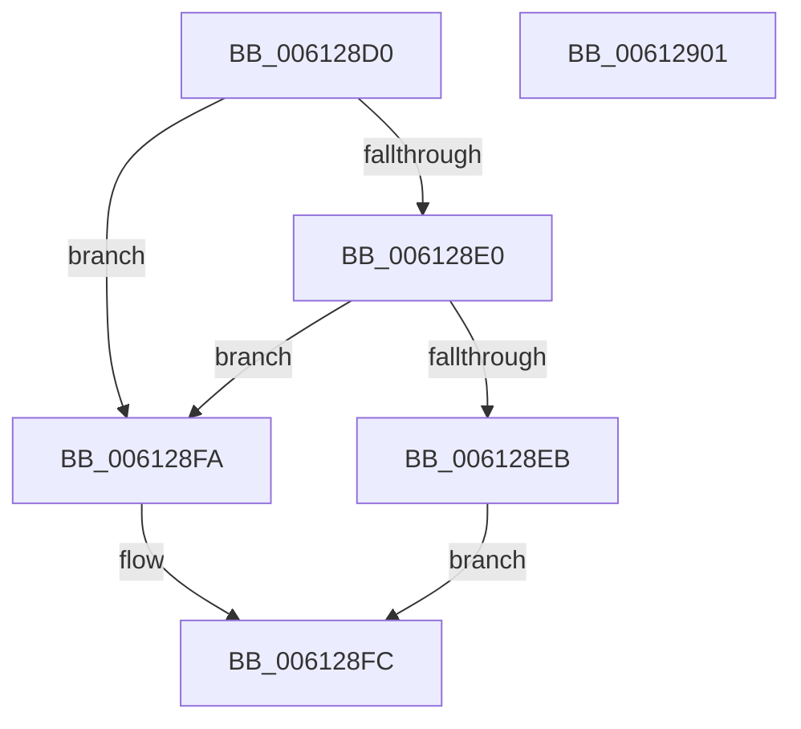

# VfQueryDeviceContext

- RVA: `0x006128D0`–`0x00612902` (길이 `50` bytes)
- VA: `0x00000001406128D0`
- 실행 섹션: `.text`
- PDB 이름 있음: `예`; PDB Function 태그: `아니요`
- unwind 정보 RVA: `0x0005C788`
- 디코드: `17`개 명령, `50/50` bytes 표시
- 미해석 바이트: `0` (있으면 어셈블리에 `.byte`로 보존)

> 이 문서는 커널 이미지의 기계어와 PDB 기호를 분석해 생성했습니다. 4번과 5번은 함수 원형과 자료형을 바이너리 사용 방식에서 추정한 C 해석이며 원본 소스 복구 결과는 아닙니다.

## 1. Dependencies

- 직접 호출 지점: **2**; 고유 호출 대상: **2**
- 직접 호출자로 확인된 함수: **0**
- RIP 상대 이미지 참조: **1**

### Outgoing calls
- `0x006128E2` → [ViIsContextIdValid](../../pagevrfy/B9/ViIsContextIdValid_function_00B94934.md) (function, `0x00B94934`)
- `0x006128F3` → [ViQueryObjectContext](../../pagevrfy/B9/ViQueryObjectContext_function_00B9499C.md) (function, `0x00B9499C`)

### Direct callers
- 이 함수 시작 RVA로 연결되는 직접 call은 확인되지 않았습니다. 간접 호출은 완전히 역산할 수 없습니다.

### Static image references
- `0x006128D4` → RVA `0x00F04984` (`.data`; read)

## 2. Other-region calls and transfers

- 다른 실행 섹션으로 향하는 call: **2**
  - `0x006128E2` → [ViIsContextIdValid](../../pagevrfy/B9/ViIsContextIdValid_function_00B94934.md) (`.text` → `PAGEVRFY`)
  - `0x006128F3` → [ViQueryObjectContext](../../pagevrfy/B9/ViQueryObjectContext_function_00B9499C.md) (`.text` → `PAGEVRFY`)
- 별도 외부 분기/꼬리 이동을 확인하지 못했습니다.

## 3. Assembly (complete function range)

```asm
006128D0  48 83 EC 28                     sub rsp, 0x28
006128D4  83 3D A9 20 8F 00 00            cmp dword ptr [rip + 0x8f20a9], 0
006128DB  4C 8B C9                        mov r9, rcx
006128DE  74 1A                           je 0x1406128fa
006128E0  33 C9                           xor ecx, ecx
006128E2  E8 4D 20 58 00                  call 0x140b94934
006128E7  84 C0                           test al, al
006128E9  74 0F                           je 0x1406128fa
006128EB  44 8B C2                        mov r8d, edx
006128EE  49 8B C9                        mov rcx, r9
006128F1  33 D2                           xor edx, edx
006128F3  E8 A4 20 58 00                  call 0x140b9499c
006128F8  EB 02                           jmp 0x1406128fc
006128FA  33 C0                           xor eax, eax
006128FC  48 83 C4 28                     add rsp, 0x28
00612900  C3                              ret
00612901  CC                              int3
```

## 4. C-style interpretation (structured pseudocode)

```c
__int64 __fastcall VfQueryDeviceContext(__int64 a1, int a2)
{
    __int64 result;
    __int64 v_rsp;

    v_rsp = (v_rsp) - (40);
    if ((*(unsigned int *)(v_rip + 9380009)) == 0) goto loc_006128FA;
    a1 = 0;
    result = ViIsContextIdValid(a1, a2, a3, a1);
    if ((unsigned __int8)(result) == 0) goto loc_006128FA;
    a2 = 0;
    result = ViQueryObjectContext(0, a2, (unsigned int)(a2), a1);
    goto loc_006128FC;
loc_006128FA:
    result = 0;
loc_006128FC:
    v_rsp = (v_rsp) + (40);
    return result;
}
```

## 5. (Beta) C Style

```c
int64_t VfQueryDeviceContext(int64_t Arg1, int32_t Arg2)
{
    int64_t result;
    int64_t local_rsp;

    local_rsp = (local_rsp) - (40);
    if ((*(uint32_t *)(v_rip + 0x8F20A9)) == 0) goto loc_006128FA;
    Arg1 = 0;
    result = ViIsContextIdValid(Arg1, Arg2, a3, Arg1);
    if ((uint8_t)(result) == 0) goto loc_006128FA;
    Arg2 = 0;
    result = ViQueryObjectContext(0, Arg2, (uint32_t)(Arg2), Arg1);
    goto loc_006128FC;
loc_006128FA:
    result = 0;
loc_006128FC:
    local_rsp = (local_rsp) + (40);
    return result;
}
```

## 6. Execution-region graph

[열기: 2D/3D 그래프와 함수 탐색 컨트롤 패널](../../../control-panel.html?section=text&rva=0x006128D0&view=graph)

- 2D 그래프는 위에서 아래로 흐르고, 3D 그래프는 빈 공간을 드래그해 회전합니다. Shift+드래그는 이동, 휠은 확대·축소, 함수 노드 선택은 대상 보고서 이동입니다.

### Static fallback


