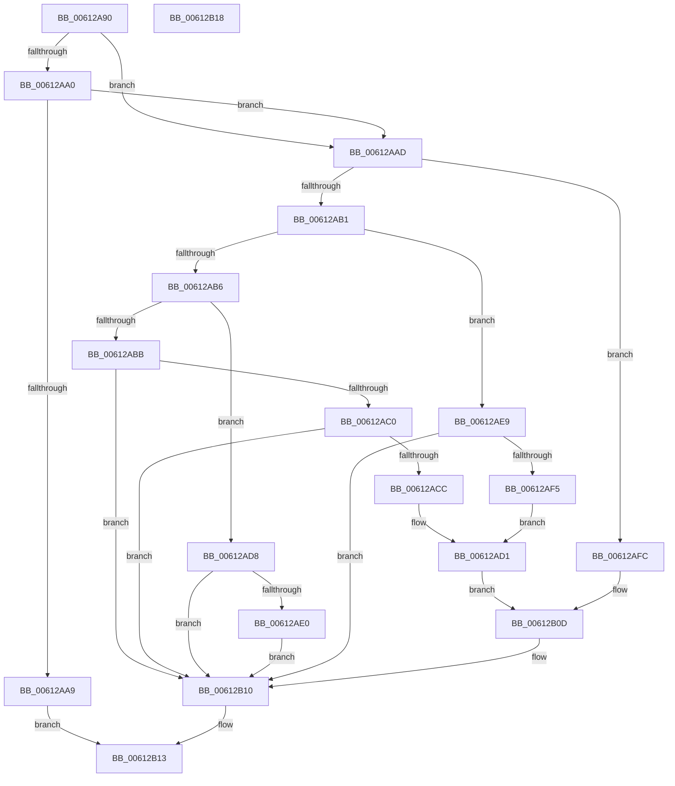

# VfQueryDispatchTable

- RVA: `0x00612A90`–`0x00612B19` (길이 `137` bytes)
- VA: `0x0000000140612A90`
- 실행 섹션: `.text`
- PDB 이름 있음: `예`; PDB Function 태그: `아니요`
- unwind 정보 RVA: `0x0005C788`
- 디코드: `39`개 명령, `137/137` bytes 표시
- 미해석 바이트: `0` (있으면 어셈블리에 `.byte`로 보존)

> 이 문서는 커널 이미지의 기계어와 PDB 기호를 분석해 생성했습니다. 4번과 5번은 함수 원형과 자료형을 바이너리 사용 방식에서 추정한 C 해석이며 원본 소스 복구 결과는 아닙니다.

## 1. Dependencies

- 직접 호출 지점: **1**; 고유 호출 대상: **1**
- 직접 호출자로 확인된 함수: **0**
- RIP 상대 이미지 참조: **7**

### Outgoing calls
- `0x00612AD1` → [guard_dispatch_icall](../6B/guard_dispatch_icall_function_006BAAD0.md) (function, `0x006BAAD0`)

### Direct callers
- 이 함수 시작 RVA로 연결되는 직접 call은 확인되지 않았습니다. 간접 호출은 완전히 역산할 수 없습니다.

### Static image references
- `0x00612A97` → RVA `0x00F04890` (`.data`; read)
- `0x00612AA0` → RVA `0x00F04350` (`.data`; read)
- `0x00612AC0` → RVA `0x00FFDAD8` (`PAGEVRFD`; read)
- `0x00612AD8` → RVA `0x00E01EE4` (`.data`; read)
- `0x00612AE0` → RVA `0x00E01EE0` (`.data`; read)
- `0x00612AFC` → RVA `0x00E01F04` (`.data`; read)
- `0x00612B02` → RVA `0x00E01F00` (`.data`; read)

## 2. Other-region calls and transfers

- 다른 실행 섹션으로 향하는 call: **0**
- 별도 외부 분기/꼬리 이동을 확인하지 못했습니다.

## 3. Assembly (complete function range)

```asm
00612A90  48 83 EC 28                     sub rsp, 0x28
00612A94  45 33 C0                        xor r8d, r8d
00612A97  4C 39 05 F2 1D 8F 00            cmp qword ptr [rip + 0x8f1df2], r8
00612A9E  75 0D                           jne 0x140612aad
00612AA0  44 39 05 A9 18 8F 00            cmp dword ptr [rip + 0x8f18a9], r8d
00612AA7  75 04                           jne 0x140612aad
00612AA9  33 C0                           xor eax, eax
00612AAB  EB 66                           jmp 0x140612b13
00612AAD  85 C9                           test ecx, ecx
00612AAF  74 4B                           je 0x140612afc
00612AB1  83 E9 02                        sub ecx, 2
00612AB4  74 33                           je 0x140612ae9
00612AB6  83 E9 01                        sub ecx, 1
00612AB9  74 1D                           je 0x140612ad8
00612ABB  83 F9 01                        cmp ecx, 1
00612ABE  75 50                           jne 0x140612b10
00612AC0  48 8B 05 11 B0 9E 00            mov rax, qword ptr [rip + 0x9eb011]
00612AC7  48 85 C0                        test rax, rax
00612ACA  74 44                           je 0x140612b10
00612ACC  B9 04 00 00 00                  mov ecx, 4
00612AD1  E8 FA 7F 0A 00                  call 0x1406baad0
00612AD6  EB 35                           jmp 0x140612b0d
00612AD8  3B 15 06 F4 7E 00               cmp edx, dword ptr [rip + 0x7ef406]
00612ADE  77 30                           ja 0x140612b10
00612AE0  4C 8D 05 F9 F3 7E 00            lea r8, [rip + 0x7ef3f9]
00612AE7  EB 27                           jmp 0x140612b10
00612AE9  48 8B 05 E8 AF 9E 00            mov rax, qword ptr [rip + 0x9eafe8]
00612AF0  48 85 C0                        test rax, rax
00612AF3  74 1B                           je 0x140612b10
00612AF5  B9 02 00 00 00                  mov ecx, 2
00612AFA  EB D5                           jmp 0x140612ad1
00612AFC  3B 15 02 F4 7E 00               cmp edx, dword ptr [rip + 0x7ef402]
00612B02  48 8D 05 F7 F3 7E 00            lea rax, [rip + 0x7ef3f7]
00612B09  49 0F 47 C0                     cmova rax, r8
00612B0D  4C 8B C0                        mov r8, rax
00612B10  49 8B C0                        mov rax, r8
00612B13  48 83 C4 28                     add rsp, 0x28
00612B17  C3                              ret
00612B18  CC                              int3
```

## 4. C-style interpretation (structured pseudocode)

```c
__int64 __fastcall VfQueryDispatchTable(int a1, int a2, int a3)
{
    __int64 result;
    __int64 v_rsp;

    v_rsp = (v_rsp) - (40);
    a3 = 0;
    if ((*(unsigned __int64 *)(v_rip + 9379314)) != 0) goto loc_00612AAD;
    if ((*(unsigned int *)(v_rip + 9377961)) != 0) goto loc_00612AAD;
    result = 0;
    goto loc_00612B13;
loc_00612AAD:
    if (a1 == 0) goto loc_00612AFC;
    a1 = (unsigned int)((a1) - (2));
    if (condition_is_equal) goto loc_00612AE9;
    a1 = (unsigned int)((a1) - (1));
    if (condition_is_equal) goto loc_00612AD8;
    if (a1 != 1) goto loc_00612B10;
    if (*(unsigned __int64 *)(v_rip + 10399761) == 0) goto loc_00612B10;
loc_00612AD1:
    result = guard_dispatch_icall(4, a2, a3, a4);
    goto loc_00612B0D;
loc_00612AD8:
    if (a2 > (*(unsigned int *)(v_rip + 8320006))) goto loc_00612B10;
    goto loc_00612B10;
loc_00612AE9:
    if (*(unsigned __int64 *)(v_rip + 10399720) == 0) goto loc_00612B10;
    goto loc_00612AD1;
loc_00612AFC:
    result = v_rip + 8319991;
    if (a2 > (*(unsigned int *)(v_rip + 8320002))) { result = v_rip + 8319993; }
loc_00612B0D:
loc_00612B10:
loc_00612B13:
    v_rsp = (v_rsp) + (40);
    return result;
}
```

## 5. (Beta) C Style

```c
int64_t VfQueryDispatchTable(int32_t Arg1, int32_t Arg2, int32_t Arg3)
{
    int64_t result;
    int64_t local_rsp;

    local_rsp = (local_rsp) - (40);
    Arg3 = 0;
    if ((*(uint64_t *)(v_rip + 0x8F1DF2)) != 0) goto loc_00612AAD;
    if ((*(uint32_t *)(v_rip + 0x8F18A9)) != 0) goto loc_00612AAD;
    result = 0;
    goto loc_00612B13;
loc_00612AAD:
    if (Arg1 == 0) goto loc_00612AFC;
    Arg1 = (uint32_t)((Arg1) - (2));
    if (condition_is_equal) goto loc_00612AE9;
    Arg1 = (uint32_t)((Arg1) - (1));
    if (condition_is_equal) goto loc_00612AD8;
    if (Arg1 != 1) goto loc_00612B10;
    if (*(uint64_t *)(v_rip + 0x9EB011) == 0) goto loc_00612B10;
loc_00612AD1:
    result = guard_dispatch_icall(4, Arg2, Arg3, a4);
    goto loc_00612B0D;
loc_00612AD8:
    if (Arg2 > (*(uint32_t *)(v_rip + 0x7EF406))) goto loc_00612B10;
    goto loc_00612B10;
loc_00612AE9:
    if (*(uint64_t *)(v_rip + 0x9EAFE8) == 0) goto loc_00612B10;
    goto loc_00612AD1;
loc_00612AFC:
    result = v_rip + 8319991;
    if (Arg2 > (*(uint32_t *)(v_rip + 0x7EF402))) { result = v_rip + 8319993; }
loc_00612B0D:
loc_00612B10:
loc_00612B13:
    local_rsp = (local_rsp) + (40);
    return result;
}
```

## 6. Execution-region graph

[열기: 2D/3D 그래프와 함수 탐색 컨트롤 패널](../../../control-panel.html?section=text&rva=0x00612A90&view=graph)

- 2D 그래프는 위에서 아래로 흐르고, 3D 그래프는 빈 공간을 드래그해 회전합니다. Shift+드래그는 이동, 휠은 확대·축소, 함수 노드 선택은 대상 보고서 이동입니다.

### Static fallback


