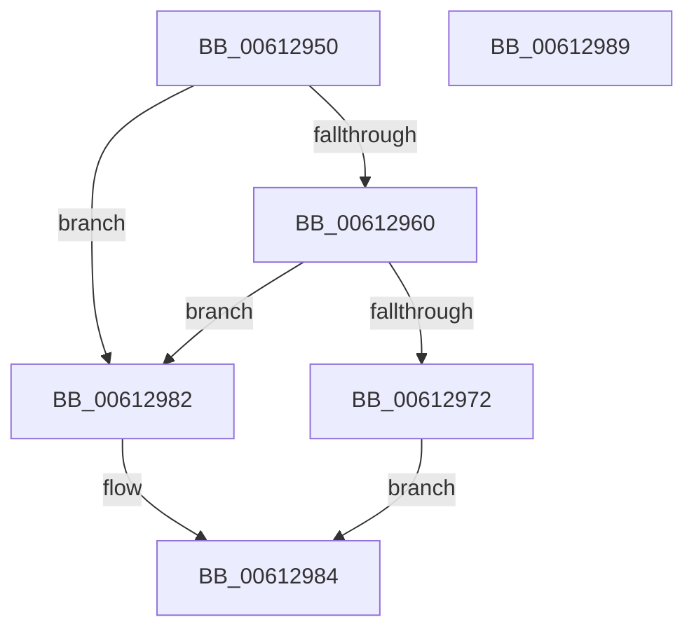

# VfQueryIrpContext

- RVA: `0x00612950`–`0x0061298A` (길이 `58` bytes)
- VA: `0x0000000140612950`
- 실행 섹션: `.text`
- PDB 이름 있음: `예`; PDB Function 태그: `아니요`
- unwind 정보 RVA: `0x0005C788`
- 디코드: `18`개 명령, `58/58` bytes 표시
- 미해석 바이트: `0` (있으면 어셈블리에 `.byte`로 보존)

> 이 문서는 커널 이미지의 기계어와 PDB 기호를 분석해 생성했습니다. 4번과 5번은 함수 원형과 자료형을 바이너리 사용 방식에서 추정한 C 해석이며 원본 소스 복구 결과는 아닙니다.

## 1. Dependencies

- 직접 호출 지점: **2**; 고유 호출 대상: **2**
- 직접 호출자로 확인된 함수: **0**
- RIP 상대 이미지 참조: **1**

### Outgoing calls
- `0x00612969` → [ViIsContextIdValid](../../pagevrfy/B9/ViIsContextIdValid_function_00B94934.md) (function, `0x00B94934`)
- `0x0061297B` → [ViQueryObjectContext](../../pagevrfy/B9/ViQueryObjectContext_function_00B9499C.md) (function, `0x00B9499C`)

### Direct callers
- 이 함수 시작 RVA로 연결되는 직접 call은 확인되지 않았습니다. 간접 호출은 완전히 역산할 수 없습니다.

### Static image references
- `0x00612954` → RVA `0x00F04984` (`.data`; read)

## 2. Other-region calls and transfers

- 다른 실행 섹션으로 향하는 call: **2**
  - `0x00612969` → [ViIsContextIdValid](../../pagevrfy/B9/ViIsContextIdValid_function_00B94934.md) (`.text` → `PAGEVRFY`)
  - `0x0061297B` → [ViQueryObjectContext](../../pagevrfy/B9/ViQueryObjectContext_function_00B9499C.md) (`.text` → `PAGEVRFY`)
- 별도 외부 분기/꼬리 이동을 확인하지 못했습니다.

## 3. Assembly (complete function range)

```asm
00612950  48 83 EC 28                     sub rsp, 0x28
00612954  83 3D 29 20 8F 00 00            cmp dword ptr [rip + 0x8f2029], 0
0061295B  4C 8B C9                        mov r9, rcx
0061295E  74 22                           je 0x140612982
00612960  41 BA 02 00 00 00               mov r10d, 2
00612966  41 8B CA                        mov ecx, r10d
00612969  E8 C6 1F 58 00                  call 0x140b94934
0061296E  84 C0                           test al, al
00612970  74 10                           je 0x140612982
00612972  44 8B C2                        mov r8d, edx
00612975  49 8B C9                        mov rcx, r9
00612978  41 8B D2                        mov edx, r10d
0061297B  E8 1C 20 58 00                  call 0x140b9499c
00612980  EB 02                           jmp 0x140612984
00612982  33 C0                           xor eax, eax
00612984  48 83 C4 28                     add rsp, 0x28
00612988  C3                              ret
00612989  CC                              int3
```

## 4. C-style interpretation (structured pseudocode)

```c
__int64 __fastcall VfQueryIrpContext(__int64 a1, int a2)
{
    __int64 result;
    __int64 v_rsp;

    v_rsp = (v_rsp) - (40);
    if ((*(unsigned int *)(v_rip + 9379881)) == 0) goto loc_00612982;
    result = ViIsContextIdValid(2, a2, a3, a1);
    if ((unsigned __int8)(result) == 0) goto loc_00612982;
    result = ViQueryObjectContext(a1, 2, (unsigned int)(a2), a1);
    goto loc_00612984;
loc_00612982:
    result = 0;
loc_00612984:
    v_rsp = (v_rsp) + (40);
    return result;
}
```

## 5. (Beta) C Style

```c
int64_t VfQueryIrpContext(int64_t Arg1, int32_t Arg2)
{
    int64_t result;
    int64_t local_rsp;

    local_rsp = (local_rsp) - (40);
    if ((*(uint32_t *)(v_rip + 0x8F2029)) == 0) goto loc_00612982;
    result = ViIsContextIdValid(2, Arg2, a3, Arg1);
    if ((uint8_t)(result) == 0) goto loc_00612982;
    result = ViQueryObjectContext(Arg1, 2, (uint32_t)(Arg2), Arg1);
    goto loc_00612984;
loc_00612982:
    result = 0;
loc_00612984:
    local_rsp = (local_rsp) + (40);
    return result;
}
```

## 6. Execution-region graph

[열기: 2D/3D 그래프와 함수 탐색 컨트롤 패널](../../../control-panel.html?section=text&rva=0x00612950&view=graph)

- 2D 그래프는 위에서 아래로 흐르고, 3D 그래프는 빈 공간을 드래그해 회전합니다. Shift+드래그는 이동, 휠은 확대·축소, 함수 노드 선택은 대상 보고서 이동입니다.

### Static fallback


