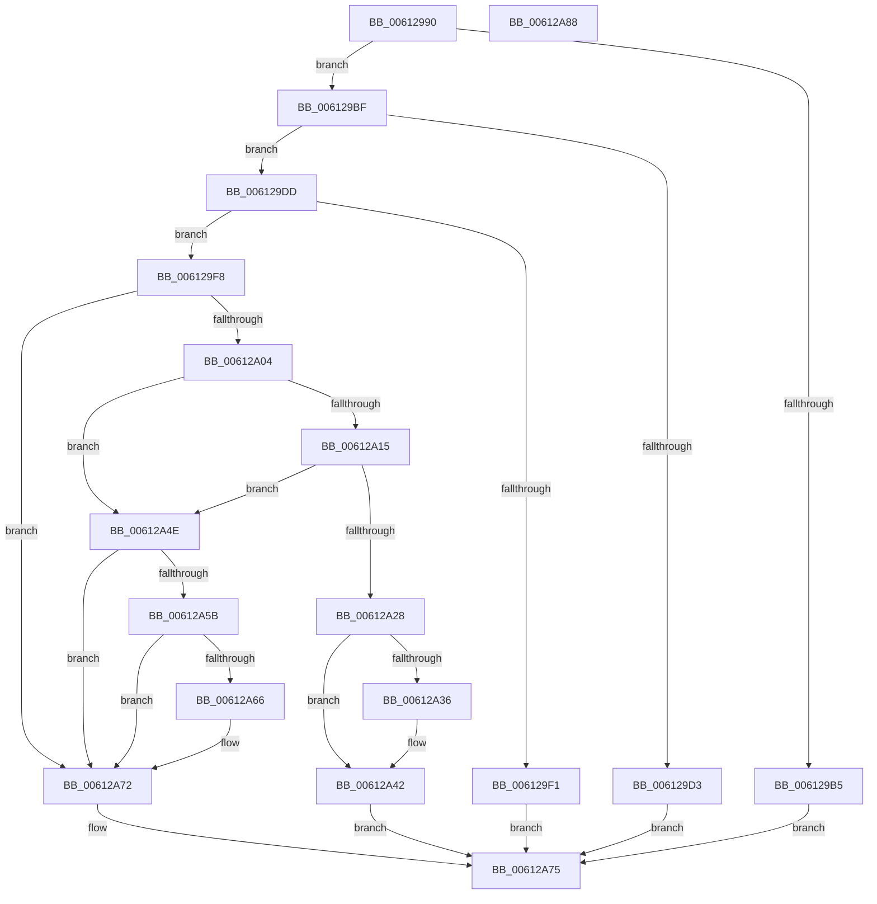

# VfRemoveContext

- RVA: `0x00612990`–`0x00612A89` (길이 `249` bytes)
- VA: `0x0000000140612990`
- 실행 섹션: `.text`
- PDB 이름 있음: `예`; PDB Function 태그: `아니요`
- unwind 정보 RVA: `0x00061768`
- 디코드: `76`개 명령, `249/249` bytes 표시
- 미해석 바이트: `0` (있으면 어셈블리에 `.byte`로 보존)

> 이 문서는 커널 이미지의 기계어와 PDB 기호를 분석해 생성했습니다. 4번과 5번은 함수 원형과 자료형을 바이너리 사용 방식에서 추정한 C 해석이며 원본 소스 복구 결과는 아닙니다.

## 1. Dependencies

- 직접 호출 지점: **7**; 고유 호출 대상: **6**
- 직접 호출자로 확인된 함수: **0**
- RIP 상대 이미지 참조: **1**

### Outgoing calls
- `0x006129CA` → [ViIsContextIdValid](../../pagevrfy/B9/ViIsContextIdValid_function_00B94934.md) (function, `0x00B94934`)
- `0x006129E4` → [ViGetContextPointer](../../pagevrfy/B9/ViGetContextPointer_function_00B948E8.md) (function, `0x00B948E8`)
- `0x006129FB` → [ViLockContextPointer](../../pagevrfy/B9/ViLockContextPointer_function_00B94954.md) (function, `0x00B94954`)
- `0x00612A3D` → [guard_dispatch_icall](../6B/guard_dispatch_icall_function_006BAAD0.md) (function, `0x006BAAD0`)
- `0x00612A45` → [ViFreeContextTable](../../pagevrfy/B9/ViFreeContextTable_function_00B948C8.md) (function, `0x00B948C8`)
- `0x00612A51` → [ViUnlockContextPointer](../../pagevrfy/B9/ViUnlockContextPointer_function_00B949FC.md) (function, `0x00B949FC`)
- `0x00612A6D` → [guard_dispatch_icall](../6B/guard_dispatch_icall_function_006BAAD0.md) (function, `0x006BAAD0`)

### Direct callers
- 이 함수 시작 RVA로 연결되는 직접 call은 확인되지 않았습니다. 간접 호출은 완전히 역산할 수 없습니다.

### Static image references
- `0x006129A7` → RVA `0x00F04984` (`.data`; read)

## 2. Other-region calls and transfers

- 다른 실행 섹션으로 향하는 call: **5**
  - `0x006129CA` → [ViIsContextIdValid](../../pagevrfy/B9/ViIsContextIdValid_function_00B94934.md) (`.text` → `PAGEVRFY`)
  - `0x006129E4` → [ViGetContextPointer](../../pagevrfy/B9/ViGetContextPointer_function_00B948E8.md) (`.text` → `PAGEVRFY`)
  - `0x006129FB` → [ViLockContextPointer](../../pagevrfy/B9/ViLockContextPointer_function_00B94954.md) (`.text` → `PAGEVRFY`)
  - `0x00612A45` → [ViFreeContextTable](../../pagevrfy/B9/ViFreeContextTable_function_00B948C8.md) (`.text` → `PAGEVRFY`)
  - `0x00612A51` → [ViUnlockContextPointer](../../pagevrfy/B9/ViUnlockContextPointer_function_00B949FC.md) (`.text` → `PAGEVRFY`)
- 별도 외부 분기/꼬리 이동을 확인하지 못했습니다.

## 3. Assembly (complete function range)

```asm
00612990  48 89 5C 24 08                  mov qword ptr [rsp + 8], rbx
00612995  48 89 6C 24 18                  mov qword ptr [rsp + 0x18], rbp
0061299A  56                              push rsi
0061299B  57                              push rdi
0061299C  41 56                           push r14
0061299E  48 83 EC 20                     sub rsp, 0x20
006129A2  33 FF                           xor edi, edi
006129A4  48 8B D9                        mov rbx, rcx
006129A7  39 3D D7 1F 8F 00               cmp dword ptr [rip + 0x8f1fd7], edi
006129AD  41 BE 25 02 00 C0               mov r14d, 0xc0000225
006129B3  75 0A                           jne 0x1406129bf
006129B5  B8 01 00 00 C0                  mov eax, 0xc0000001
006129BA  E9 B6 00 00 00                  jmp 0x140612a75
006129BF  44 0F B7 01                     movzx r8d, word ptr [rcx]
006129C3  0F B7 51 02                     movzx edx, word ptr [rcx + 2]
006129C7  41 8B C8                        mov ecx, r8d
006129CA  E8 65 1F 58 00                  call 0x140b94934
006129CF  84 C0                           test al, al
006129D1  75 0A                           jne 0x1406129dd
006129D3  B8 0D 00 00 C0                  mov eax, 0xc000000d
006129D8  E9 98 00 00 00                  jmp 0x140612a75
006129DD  48 8B 4B 08                     mov rcx, qword ptr [rbx + 8]
006129E1  41 8B D0                        mov edx, r8d
006129E4  E8 FF 1E 58 00                  call 0x140b948e8
006129E9  48 8B F0                        mov rsi, rax
006129EC  48 85 C0                        test rax, rax
006129EF  75 07                           jne 0x1406129f8
006129F1  B8 BB 00 00 C0                  mov eax, 0xc00000bb
006129F6  EB 7D                           jmp 0x140612a75
006129F8  48 8B CE                        mov rcx, rsi
006129FB  E8 54 1F 58 00                  call 0x140b94954
00612A00  84 C0                           test al, al
00612A02  74 6E                           je 0x140612a72
00612A04  48 8B 2E                        mov rbp, qword ptr [rsi]
00612A07  83 CA FF                        or edx, 0xffffffff
00612A0A  0F B7 43 02                     movzx eax, word ptr [rbx + 2]
00612A0E  48 39 5C C5 08                  cmp qword ptr [rbp + rax*8 + 8], rbx
00612A13  75 39                           jne 0x140612a4e
00612A15  48 89 7C C5 08                  mov qword ptr [rbp + rax*8 + 8], rdi
00612A1A  44 8B F7                        mov r14d, edi
00612A1D  8B C2                           mov eax, edx
00612A1F  F0 0F C1 45 04                  lock xadd dword ptr [rbp + 4], eax
00612A24  03 C2                           add eax, edx
00612A26  75 26                           jne 0x140612a4e
00612A28  48 87 3E                        xchg qword ptr [rsi], rdi
00612A2B  8B C2                           mov eax, edx
00612A2D  F0 0F C1 43 04                  lock xadd dword ptr [rbx + 4], eax
00612A32  03 C2                           add eax, edx
00612A34  75 0C                           jne 0x140612a42
00612A36  48 8B 43 10                     mov rax, qword ptr [rbx + 0x10]
00612A3A  48 8B CB                        mov rcx, rbx
00612A3D  E8 8E 80 0A 00                  call 0x1406baad0
00612A42  48 8B CD                        mov rcx, rbp
00612A45  E8 7E 1E 58 00                  call 0x140b948c8
00612A4A  33 C0                           xor eax, eax
00612A4C  EB 27                           jmp 0x140612a75
00612A4E  48 8B CE                        mov rcx, rsi
00612A51  E8 A6 1F 58 00                  call 0x140b949fc
00612A56  45 85 F6                        test r14d, r14d
00612A59  78 17                           js 0x140612a72
00612A5B  8B CA                           mov ecx, edx
00612A5D  F0 0F C1 4B 04                  lock xadd dword ptr [rbx + 4], ecx
00612A62  03 CA                           add ecx, edx
00612A64  75 0C                           jne 0x140612a72
00612A66  48 8B 43 10                     mov rax, qword ptr [rbx + 0x10]
00612A6A  48 8B CB                        mov rcx, rbx
00612A6D  E8 5E 80 0A 00                  call 0x1406baad0
00612A72  41 8B C6                        mov eax, r14d
00612A75  48 8B 5C 24 40                  mov rbx, qword ptr [rsp + 0x40]
00612A7A  48 8B 6C 24 50                  mov rbp, qword ptr [rsp + 0x50]
00612A7F  48 83 C4 20                     add rsp, 0x20
00612A83  41 5E                           pop r14
00612A85  5F                              pop rdi
00612A86  5E                              pop rsi
00612A87  C3                              ret
00612A88  CC                              int3
```

## 4. C-style interpretation (structured pseudocode)

```c
__int64 __fastcall VfRemoveContext(__int64 a1)
{
    __int64 result;
    __int64 v_rdi;
    __int64 v_rsp;
    unsigned __int64 v_stack_p18;
    unsigned __int64 v_stack_p8;

    v_stack_p8 = v_rbx;
    v_stack_p18 = v_rbp;
    v_rsp = (v_rsp) - (32);
    v_rdi = 0;
    if ((*(unsigned int *)(v_rip + 9379799)) != 0) goto loc_006129BF;
    goto loc_00612A75;
loc_006129BF:
    result = ViIsContextIdValid((unsigned int)((unsigned int)(*(unsigned __int16 *)(a1))), *(unsigned __int16 *)(a1 + 2), *(unsigned __int16 *)(a1), a4);
    if ((unsigned __int8)(result) != 0) goto loc_006129DD;
    goto loc_00612A75;
loc_006129DD:
    result = ViGetContextPointer(*(unsigned __int64 *)(a1 + 8), (unsigned int)((unsigned int)(*(unsigned __int16 *)(a1))), *(unsigned __int16 *)(a1), a4);
    if (result != 0) goto loc_006129F8;
    goto loc_00612A75;
loc_006129F8:
    result = ViLockContextPointer(result, (unsigned int)((unsigned int)(*(unsigned __int16 *)(a1))), *(unsigned __int16 *)(a1), a4);
    if ((unsigned __int8)(result) == 0) goto loc_00612A72;
    a2 = (unsigned int)(((unsigned int)((unsigned int)(*(unsigned __int16 *)(a1)))) | (0xFFFFFFFFULL));
    if ((*(unsigned __int64 *)(*(unsigned __int64 *)(result) + *(unsigned __int16 *)(a1 + 2) * 8 + 8)) != a1) goto loc_00612A4E;
    *(unsigned __int64 *)(*(unsigned __int64 *)(result) + *(unsigned __int16 *)(a1 + 2) * 8 + 8) = 0;
    result = (unsigned int)(((unsigned int)((unsigned int)(a2))) + ((unsigned int)(a2)));
    if (condition_is_not_equal) goto loc_00612A4E;
    result = (unsigned int)(((unsigned int)((unsigned int)(a2))) + ((unsigned int)(a2)));
    if (!(condition_is_not_equal)) {
        result = *(unsigned __int64 *)(a1 + 16);
        a1 = a1;
        result = guard_dispatch_icall(a1, a2, *(unsigned __int16 *)(a1), a4);
    }
    result = ViFreeContextTable(*(unsigned __int64 *)(result), a2, *(unsigned __int16 *)(a1), a4);
    result = 0;
    goto loc_00612A75;
loc_00612A4E:
    result = ViUnlockContextPointer(0, a2, *(unsigned __int16 *)(a1), a4);
    if (sign_flag) goto loc_00612A72;
    a1 = (unsigned int)(((unsigned int)((unsigned int)(a2))) + ((unsigned int)(a2)));
    if (!(condition_is_not_equal)) {
        result = *(unsigned __int64 *)(a1 + 16);
        a1 = a1;
        result = guard_dispatch_icall(a1, a2, *(unsigned __int16 *)(a1), a4);
    }
loc_00612A75:
    v_rsp = (v_rsp) + (32);
    return 0;
}
```

## 5. (Beta) C Style

```c
int64_t VfRemoveContext(void *Arg1)
{
    uint8_t *arg1 = (uint8_t *)Arg1;

    int64_t result;
    int64_t local_rdi;
    int64_t local_rsp;
    uint64_t v_stack_p18;
    uint64_t v_stack_p8;

    v_stack_p8 = local_rbx;
    v_stack_p18 = local_rbp;
    local_rsp = (local_rsp) - (32);
    local_rdi = 0;
    if ((*(uint32_t *)(v_rip + 0x8F1FD7)) != 0) goto loc_006129BF;
    goto loc_00612A75;
loc_006129BF:
    result = ViIsContextIdValid((uint32_t)((uint32_t)(*(uint16_t *)(arg1))), *(uint16_t *)(arg1 + 0x2), *(uint16_t *)(arg1), a4);
    if ((uint8_t)(result) != 0) goto loc_006129DD;
    goto loc_00612A75;
loc_006129DD:
    result = ViGetContextPointer(*(uint64_t *)(arg1 + 0x8), (uint32_t)((uint32_t)(*(uint16_t *)(arg1))), *(uint16_t *)(arg1), a4);
    if (result != 0) goto loc_006129F8;
    goto loc_00612A75;
loc_006129F8:
    result = ViLockContextPointer(result, (uint32_t)((uint32_t)(*(uint16_t *)(arg1))), *(uint16_t *)(arg1), a4);
    if ((uint8_t)(result) == 0) goto loc_00612A72;
    a2 = (uint32_t)(((uint32_t)((uint32_t)(*(uint16_t *)(arg1)))) | (0xFFFFFFFFULL));
    if ((*(uint64_t *)(*(uint64_t *)(result) + *(uint16_t *)(arg1 + 0x2) * 8 + 0x8)) != Arg1) goto loc_00612A4E;
    *(uint64_t *)(*(uint64_t *)(result) + *(uint16_t *)(arg1 + 0x2) * 8 + 0x8) = 0;
    result = (uint32_t)(((uint32_t)((uint32_t)(a2))) + ((uint32_t)(a2)));
    if (condition_is_not_equal) goto loc_00612A4E;
    result = (uint32_t)(((uint32_t)((uint32_t)(a2))) + ((uint32_t)(a2)));
    if (!(condition_is_not_equal)) {
        result = *(uint64_t *)(arg1 + 0x10);
        Arg1 = Arg1;
        result = guard_dispatch_icall(Arg1, a2, *(uint16_t *)(arg1), a4);
    }
    result = ViFreeContextTable(*(uint64_t *)(result), a2, *(uint16_t *)(arg1), a4);
    result = 0;
    goto loc_00612A75;
loc_00612A4E:
    result = ViUnlockContextPointer(0, a2, *(uint16_t *)(arg1), a4);
    if (sign_flag) goto loc_00612A72;
    Arg1 = (uint32_t)(((uint32_t)((uint32_t)(a2))) + ((uint32_t)(a2)));
    if (!(condition_is_not_equal)) {
        result = *(uint64_t *)(arg1 + 0x10);
        Arg1 = Arg1;
        result = guard_dispatch_icall(Arg1, a2, *(uint16_t *)(arg1), a4);
    }
loc_00612A75:
    local_rsp = (local_rsp) + (32);
    return 0;
}
```

### 관측된 메모리 오프셋

구조체 형식이 확인되지 않은 접근은 인자 기준의 오프셋으로만 기록했습니다.

| 기준 인자 | 오프셋 표현 | 폭 (bit) | 접근 |
|---|---:|---:|---|
| `Arg1` | `+ 0x0` | `16` | `R` |
| `Arg1` | `+ 0x2` | `16` | `R` |
| `Arg1` | `+ 0x4` | `32` | `R/W` |
| `Arg1` | `+ 0x8` | `64` | `R` |
| `Arg1` | `+ 0x10` | `64` | `R` |

## 6. Execution-region graph

[열기: 2D/3D 그래프와 함수 탐색 컨트롤 패널](../../../control-panel.html?section=text&rva=0x00612990&view=graph)

- 2D 그래프는 위에서 아래로 흐르고, 3D 그래프는 빈 공간을 드래그해 회전합니다. Shift+드래그는 이동, 휠은 확대·축소, 함수 노드 선택은 대상 보고서 이동입니다.

### Static fallback


