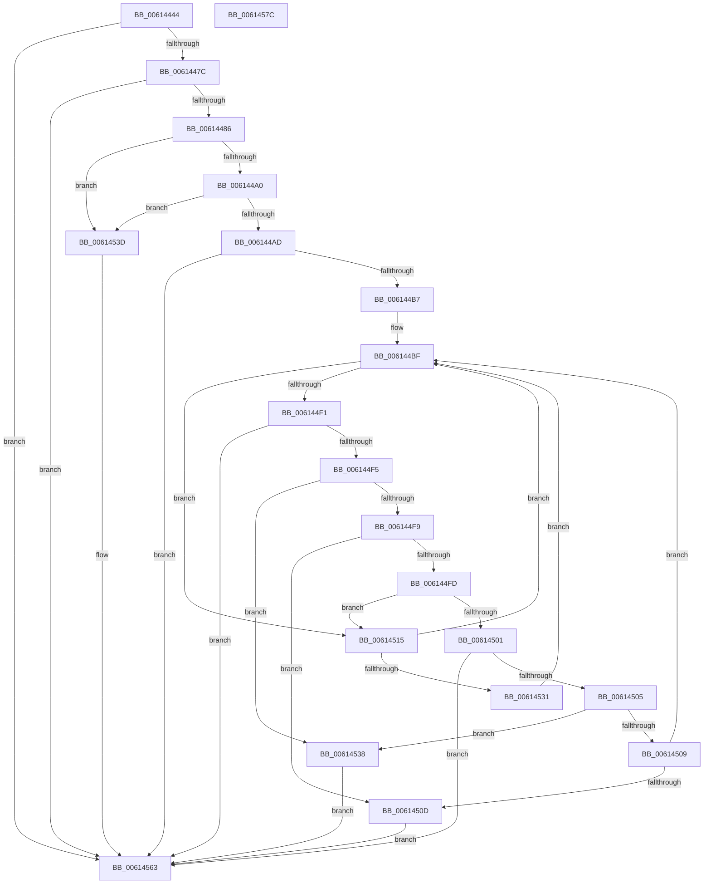

# VfReportIssueWithOptions

- RVA: `0x00614444`–`0x0061457D` (길이 `313` bytes)
- VA: `0x0000000140614444`
- 실행 섹션: `.text`
- PDB 이름 있음: `예`; PDB Function 태그: `아니요`
- unwind 정보 RVA: `0x00093E28`
- 디코드: `83`개 명령, `313/313` bytes 표시
- 미해석 바이트: `0` (있으면 어셈블리에 `.byte`로 보존)

> 이 문서는 커널 이미지의 기계어와 PDB 기호를 분석해 생성했습니다. 4번과 5번은 함수 원형과 자료형을 바이너리 사용 방식에서 추정한 C 해석이며 원본 소스 복구 결과는 아닙니다.

## 1. Dependencies

- 직접 호출 지점: **5**; 고유 호출 대상: **5**
- 직접 호출자로 확인된 함수: **35**
- RIP 상대 이미지 참조: **4**

### Outgoing calls
- `0x006144C6` → [VfUtilDbgPrint](VfUtilDbgPrint_function_006122AC.md) (function, `0x006122AC`)
- `0x006144E0` → [DbgPrompt](../5E/DbgPrompt_function_005E5880.md) (function, `0x005E5880`)
- `0x00614526` → [VfErrorStoreTriageInformation](../../pagevrfy/BA/VfErrorStoreTriageInformation_function_00BA35D0.md) (function, `0x00BA35D0`)
- `0x00614531` → [VfErrorReleaseTriageInformation](../../pagevrfy/BA/VfErrorReleaseTriageInformation_function_00BA34A0.md) (function, `0x00BA34A0`)
- `0x0061455E` → [CarReportRuleViolationFromNt](../../pagevrfy/B9/CarReportRuleViolationFromNt_function_00B9D904.md) (function, `0x00B9D904`)

### Direct callers
- [ADD_MAP_REGISTERS](../../pagevrfy/B9/ADD_MAP_REGISTERS_function_00B94A08.md) at `0x00B94A8D`
- [ADD_MAP_REGISTERS](../../pagevrfy/B9/ADD_MAP_REGISTERS_function_00B94A08.md) at `0x00B94AEB`
- [DECREMENT_ADAPTER_CHANNELS](../../pagevrfy/B9/DECREMENT_ADAPTER_CHANNELS_function_00B94B14.md) at `0x00B94B94`
- [DECREMENT_COMMON_BUFFERS](../../pagevrfy/B9/DECREMENT_COMMON_BUFFERS_function_00B94BB0.md) at `0x00B94C28`
- [DECREMENT_SCATTER_GATHER_LISTS](../../pagevrfy/B9/DECREMENT_SCATTER_GATHER_LISTS_function_00B94C44.md) at `0x00B94CBA`
- [INCREASE_MAPPED_TRANSFER_BYTE_COUNT](../../pagevrfy/B9/INCREASE_MAPPED_TRANSFER_BYTE_COUNT_function_00B94CD8.md) at `0x00B94D51`
- [INCREMENT_ADAPTER_CHANNELS](../../pagevrfy/B9/INCREMENT_ADAPTER_CHANNELS_function_00B94D70.md) at `0x00B94DF4`
- [SUBTRACT_MAP_REGISTERS](../../pagevrfy/B9/SUBTRACT_MAP_REGISTERS_function_00B94E10.md) at `0x00B94E7B`
- [VERIFY_BUFFER_LOCKED](../../pagevrfy/B9/VERIFY_BUFFER_LOCKED_function_00B94EA4.md) at `0x00B94F14`
- [VF_ASSERT_IRQL](../../pagevrfy/B9/VF_ASSERT_IRQL_function_00B94F30.md) at `0x00B94F93`
- [VF_ASSERT_MAX_IRQL](../../pagevrfy/B9/VF_ASSERT_MAX_IRQL_function_00B94FB0.md) at `0x00B95010`
- [VfBuildScatterGatherList](../../pagevrfy/B9/VfBuildScatterGatherList_function_00B95AA0.md) at `0x00B95B8A`
- [VfBuildScatterGatherListEx](../../pagevrfy/B9/VfBuildScatterGatherListEx_function_00B95DA0.md) at `0x00B95E81`
- [VfCreateCommonBufferFromMdl](../../pagevrfy/B9/VfCreateCommonBufferFromMdl_function_00B96130.md) at `0x00B961E4`
- [VfFlushAdapterBuffers](../../pagevrfy/B9/VfFlushAdapterBuffers_function_00B96220.md) at `0x00B96351`
- [VfGetScatterGatherList](../../pagevrfy/B9/VfGetScatterGatherList_function_00B96BD0.md) at `0x00B96CB4`
- [VfGetScatterGatherListEx](../../pagevrfy/B9/VfGetScatterGatherListEx_function_00B96F20.md) at `0x00B96FE9`
- [VfMapTransfer](../../pagevrfy/B9/VfMapTransfer_function_00B97300.md) at `0x00B973D6`
- [VfMapTransferEx](../../pagevrfy/B9/VfMapTransferEx_function_00B974B0.md) at `0x00B97568`
- [VfPutDmaAdapter](../../pagevrfy/B9/VfPutDmaAdapter_function_00B97680.md) at `0x00B97711`
- [VfPutDmaAdapter](../../pagevrfy/B9/VfPutDmaAdapter_function_00B97680.md) at `0x00B9777C`
- [VfPutDmaAdapter](../../pagevrfy/B9/VfPutDmaAdapter_function_00B97680.md) at `0x00B977DF`
- [VfPutDmaAdapter](../../pagevrfy/B9/VfPutDmaAdapter_function_00B97680.md) at `0x00B97834`
- [VfPutDmaAdapter](../../pagevrfy/B9/VfPutDmaAdapter_function_00B97680.md) at `0x00B97889`
- [ViAllocateMapRegistersFromFile](../../pagevrfy/B9/ViAllocateMapRegistersFromFile_function_00B980A8.md) at `0x00B98189`
- [ViAllocateMapRegistersFromFile](../../pagevrfy/B9/ViAllocateMapRegistersFromFile_function_00B980A8.md) at `0x00B9821B`
- [ViCheckPadding](../../pagevrfy/B9/ViCheckPadding_function_00B98464.md) at `0x00B9858E`
- [ViCheckPadding](../../pagevrfy/B9/ViCheckPadding_function_00B98464.md) at `0x00B985ED`
- [ViCheckTag](../../pagevrfy/B9/ViCheckTag_function_00B98614.md) at `0x00B986B1`
- [ViCheckTag](../../pagevrfy/B9/ViCheckTag_function_00B98614.md) at `0x00B98720`
- [ViCopyDeviceDescription](../../pagevrfy/B9/ViCopyDeviceDescription_function_00B988A0.md) at `0x00B98900`
- [ViFlushDoubleBuffer](../../pagevrfy/B9/ViFlushDoubleBuffer_function_00B989D0.md) at `0x00B98A6E`
- [ViFlushDoubleBuffer](../../pagevrfy/B9/ViFlushDoubleBuffer_function_00B989D0.md) at `0x00B98B09`
- [ViGetAdapterInformationInternal](../../pagevrfy/B9/ViGetAdapterInformationInternal_function_00B98E88.md) at `0x00B98F60`
- [ViGetMdlBufferSa](../../pagevrfy/B9/ViGetMdlBufferSa_function_00B98FC8.md) at `0x00B990BE`
- [ViGetRealDmaAdapter](../../pagevrfy/B9/ViGetRealDmaAdapter_function_00B990DC.md) at `0x00B9914B`
- [ViMapDoubleBuffer](../../pagevrfy/B9/ViMapDoubleBuffer_function_00B99640.md) at `0x00B996B0`
- [ViReleaseDmaAdapter](../../pagevrfy/B9/ViReleaseDmaAdapter_function_00B99A0C.md) at `0x00B99AEE`
- [ViDeadlockAddResource](../../pagevrfy/BA/ViDeadlockAddResource_function_00BA8870.md) at `0x00BA8913`
- [ViDeadlockAddResource](../../pagevrfy/BA/ViDeadlockAddResource_function_00BA8870.md) at `0x00BA8969`
- [ViDeadlockAnalyze](../../pagevrfy/BA/ViDeadlockAnalyze_function_00BA8BD4.md) at `0x00BA8DEA`
- [ViDeadlockRemoveResource](../../pagevrfy/BA/ViDeadlockRemoveResource_function_00BA9DEC.md) at `0x00BA9E8A`
- [ViDeadlockRemoveThread](../../pagevrfy/BA/ViDeadlockRemoveThread_function_00BA9F8C.md) at `0x00BAA00D`
- [VfDeadlockReleaseResource](../../pagevrfy/BB/VfDeadlockReleaseResource_function_00BB759C.md) at `0x00BB77C8`
- [VfDeadlockReleaseResource](../../pagevrfy/BB/VfDeadlockReleaseResource_function_00BB759C.md) at `0x00BB78D3`
- [VfDeadlockAcquireResource](../../pagevrfy/BB/VfDeadlockAcquireResource_function_00BB83B4.md) at `0x00BB86A0`

### Static image references
- `0x0061448D` → RVA `0x00F04980` (`.data`; read)
- `0x006144A0` → RVA `0x00F475F8` (`.data`; read)
- `0x006144BF` → RVA `0x006CE660` (` ?? ::FNODOBFM::`string'`; read)
- `0x006144D9` → RVA `0x006CE620` (` ?? ::FNODOBFM::`string'`; read)

## 2. Other-region calls and transfers

- 다른 실행 섹션으로 향하는 call: **3**
  - `0x00614526` → [VfErrorStoreTriageInformation](../../pagevrfy/BA/VfErrorStoreTriageInformation_function_00BA35D0.md) (`.text` → `PAGEVRFY`)
  - `0x00614531` → [VfErrorReleaseTriageInformation](../../pagevrfy/BA/VfErrorReleaseTriageInformation_function_00BA34A0.md) (`.text` → `PAGEVRFY`)
  - `0x0061455E` → [CarReportRuleViolationFromNt](../../pagevrfy/B9/CarReportRuleViolationFromNt_function_00B9D904.md) (`.text` → `PAGEVRFY`)
- 별도 외부 분기/꼬리 이동을 확인하지 못했습니다.

## 3. Assembly (complete function range)

```asm
00614444  48 89 5C 24 08                  mov qword ptr [rsp + 8], rbx
00614449  48 89 6C 24 10                  mov qword ptr [rsp + 0x10], rbp
0061444E  48 89 74 24 18                  mov qword ptr [rsp + 0x18], rsi
00614453  57                              push rdi
00614454  41 56                           push r14
00614456  41 57                           push r15
00614458  48 83 EC 40                     sub rsp, 0x40
0061445C  48 8B 9C 24 88 00 00 00         mov rbx, qword ptr [rsp + 0x88]
00614464  49 8B F1                        mov rsi, r9
00614467  49 8B E8                        mov rbp, r8
0061446A  44 8B F9                        mov r15d, ecx
0061446D  4C 8B F2                        mov r14, rdx
00614470  44 8B 13                        mov r10d, dword ptr [rbx]
00614473  45 85 D2                        test r10d, r10d
00614476  0F 84 E7 00 00 00               je 0x140614563
0061447C  41 F6 C2 02                     test r10b, 2
00614480  0F 85 DD 00 00 00               jne 0x140614563
00614486  41 F6 C2 08                     test r10b, 8
0061448A  0F 94 C2                        sete dl
0061448D  0F BA 25 EB 04 8F 00 09         bt dword ptr [rip + 0x8f04eb], 9
00614495  0F 93 C0                        setae al
00614498  84 D0                           test al, dl
0061449A  0F 84 9D 00 00 00               je 0x14061453d
006144A0  80 3D 51 31 93 00 00            cmp byte ptr [rip + 0x933151], 0
006144A7  0F 84 90 00 00 00               je 0x14061453d
006144AD  41 F6 C2 04                     test r10b, 4
006144B1  0F 84 AC 00 00 00               je 0x140614563
006144B7  48 8B BC 24 80 00 00 00         mov rdi, qword ptr [rsp + 0x80]
006144BF  48 8D 0D 9A A1 0B 00            lea rcx, [rip + 0xba19a]
006144C6  E8 E1 DD FF FF                  call 0x1406122ac
006144CB  41 B8 02 00 00 00               mov r8d, 2
006144D1  48 8D 94 24 88 00 00 00         lea rdx, [rsp + 0x88]
006144D9  48 8D 0D 40 A1 0B 00            lea rcx, [rip + 0xba140]
006144E0  E8 9B 13 FD FF                  call 0x1405e5880
006144E5  0F B7 84 24 88 00 00 00         movzx eax, word ptr [rsp + 0x88]
006144ED  3C 42                           cmp al, 0x42
006144EF  74 24                           je 0x140614515
006144F1  3C 49                           cmp al, 0x49
006144F3  74 6E                           je 0x140614563
006144F5  3C 52                           cmp al, 0x52
006144F7  74 3F                           je 0x140614538
006144F9  3C 57                           cmp al, 0x57
006144FB  74 10                           je 0x14061450d
006144FD  3C 62                           cmp al, 0x62
006144FF  74 14                           je 0x140614515
00614501  3C 69                           cmp al, 0x69
00614503  74 5E                           je 0x140614563
00614505  3C 72                           cmp al, 0x72
00614507  74 2F                           je 0x140614538
00614509  3C 77                           cmp al, 0x77
0061450B  75 B2                           jne 0x1406144bf
0061450D  C7 03 02 00 00 00               mov dword ptr [rbx], 2
00614513  EB 4E                           jmp 0x140614563
00614515  49 8B CF                        mov rcx, r15
00614518  48 89 7C 24 20                  mov qword ptr [rsp + 0x20], rdi
0061451D  4C 8B CE                        mov r9, rsi
00614520  4C 8B C5                        mov r8, rbp
00614523  49 8B D6                        mov rdx, r14
00614526  E8 A5 F0 58 00                  call 0x140ba35d0
0061452B  90                              nop
0061452C  CC                              int3
0061452D  85 C0                           test eax, eax
0061452F  74 8E                           je 0x1406144bf
00614531  E8 6A EF 58 00                  call 0x140ba34a0
00614536  EB 87                           jmp 0x1406144bf
00614538  83 23 00                        and dword ptr [rbx], 0
0061453B  EB 26                           jmp 0x140614563
0061453D  48 83 64 24 30 00               and qword ptr [rsp + 0x30], 0
00614543  49 8B D6                        mov rdx, r14
00614546  48 8B 84 24 80 00 00 00         mov rax, qword ptr [rsp + 0x80]
0061454E  41 8B CF                        mov ecx, r15d
00614551  C7 44 24 28 05 00 00 00         mov dword ptr [rsp + 0x28], 5
00614559  48 89 44 24 20                  mov qword ptr [rsp + 0x20], rax
0061455E  E8 A1 93 58 00                  call 0x140b9d904
00614563  48 8B 5C 24 60                  mov rbx, qword ptr [rsp + 0x60]
00614568  48 8B 6C 24 68                  mov rbp, qword ptr [rsp + 0x68]
0061456D  48 8B 74 24 70                  mov rsi, qword ptr [rsp + 0x70]
00614572  48 83 C4 40                     add rsp, 0x40
00614576  41 5F                           pop r15
00614578  41 5E                           pop r14
0061457A  5F                              pop rdi
0061457B  C3                              ret
0061457C  CC                              int3
```

## 4. C-style interpretation (structured pseudocode)

```c
__int64 __fastcall VfReportIssueWithOptions(int a1, __int64 a2, __int64 a3, __int64 a4, __int64 a5, unsigned __int16 a6)
{
    __int64 result;
    __int64 v_rsp;
    unsigned __int64 v_stack_m28;
    unsigned int v_stack_m30;
    unsigned __int64 v_stack_m38;
    unsigned __int64 v_stack_p10;
    unsigned __int64 v_stack_p18;
    unsigned __int64 v_stack_p8;

    v_stack_p8 = v_rbx;
    v_stack_p10 = v_rbp;
    v_stack_p18 = v_rsi;
    v_rsp = (v_rsp) - (64);
    if ((unsigned int)((unsigned int)(*(unsigned int *)(a6))) == 0) goto loc_00614563;
    if ((((unsigned __int8)((unsigned int)(*(unsigned int *)(a6)))) & (2)) != 0) goto loc_00614563;
    a2 = ((((unsigned __int8)((unsigned int)(*(unsigned int *)(a6)))) & (8)) == 0) ? 1 : 0;
    result = (condition_is_above_or_equal) ? 1 : 0;
    if ((((unsigned __int8)(result)) & ((unsigned __int8)(a2))) == 0) goto loc_0061453D;
    if ((*(unsigned __int8 *)(v_rip + 9646417)) == 0) goto loc_0061453D;
    if ((((unsigned __int8)((unsigned int)(*(unsigned int *)(a6)))) & (4)) == 0) goto loc_00614563;
loc_006144BF:
    result = VfUtilDbgPrint(v_rip + 762266, a2, a3, a4);
    result = DbgPrompt(v_rip + 762176, a6, 2, a4);
    if (((unsigned __int8)(a6)) == 66) goto loc_00614515;
    if (((unsigned __int8)(a6)) == 73) goto loc_00614563;
    if (((unsigned __int8)(a6)) == 82) goto loc_00614538;
    if (((unsigned __int8)(a6)) == 87) goto loc_0061450D;
    if (((unsigned __int8)(a6)) == 98) goto loc_00614515;
    if (((unsigned __int8)(a6)) == 105) goto loc_00614563;
    if (((unsigned __int8)(a6)) == 114) goto loc_00614538;
    if (((unsigned __int8)(a6)) != 119) goto loc_006144BF;
loc_0061450D:
    *(unsigned int *)(a6) = 2;
    goto loc_00614563;
loc_00614515:
    v_stack_m38 = a5;
    result = VfErrorStoreTriageInformation((unsigned int)(a1), a2, a3, a4);
    if ((unsigned int)(result) == 0) goto loc_006144BF;
    result = VfErrorReleaseTriageInformation((unsigned int)(a1), a2, a3, a4);
    goto loc_006144BF;
loc_00614538:
    goto loc_00614563;
loc_0061453D:
    v_stack_m30 = 5;
    v_stack_m38 = a5;
    result = CarReportRuleViolationFromNt((unsigned int)((unsigned int)((unsigned int)(a1))), a2, a3, a4);
loc_00614563:
    v_rsp = (v_rsp) + (64);
    return result;
}
```

## 5. (Beta) C Style

```c
int64_t VfReportIssueWithOptions(int32_t Arg1, int64_t Arg2, int64_t Arg3, int64_t Arg4, int64_t Arg5, void *Arg6)
{
    uint8_t *arg6 = (uint8_t *)Arg6;

    int64_t result;
    int64_t local_rsp;
    uint64_t v_stack_m28;
    uint32_t v_stack_m30;
    uint64_t v_stack_m38;
    uint64_t v_stack_p10;
    uint64_t v_stack_p18;
    uint64_t v_stack_p8;

    v_stack_p8 = local_rbx;
    v_stack_p10 = local_rbp;
    v_stack_p18 = local_rsi;
    local_rsp = (local_rsp) - (64);
    if ((uint32_t)((uint32_t)(*(uint32_t *)(arg6))) == 0) goto loc_00614563;
    if ((((uint8_t)((uint32_t)(*(uint32_t *)(arg6)))) & (2)) != 0) goto loc_00614563;
    Arg2 = ((((uint8_t)((uint32_t)(*(uint32_t *)(arg6)))) & (8)) == 0) ? 1 : 0;
    result = (condition_is_above_or_equal) ? 1 : 0;
    if ((((uint8_t)(result)) & ((uint8_t)(Arg2))) == 0) goto loc_0061453D;
    if ((*(uint8_t *)(v_rip + 0x933151)) == 0) goto loc_0061453D;
    if ((((uint8_t)((uint32_t)(*(uint32_t *)(arg6)))) & (4)) == 0) goto loc_00614563;
loc_006144BF:
    result = VfUtilDbgPrint(v_rip + 762266, Arg2, Arg3, Arg4);
    result = DbgPrompt(v_rip + 762176, Arg6, 2, Arg4);
    if (((uint8_t)(Arg6)) == 66) goto loc_00614515;
    if (((uint8_t)(Arg6)) == 73) goto loc_00614563;
    if (((uint8_t)(Arg6)) == 82) goto loc_00614538;
    if (((uint8_t)(Arg6)) == 87) goto loc_0061450D;
    if (((uint8_t)(Arg6)) == 98) goto loc_00614515;
    if (((uint8_t)(Arg6)) == 105) goto loc_00614563;
    if (((uint8_t)(Arg6)) == 114) goto loc_00614538;
    if (((uint8_t)(Arg6)) != 119) goto loc_006144BF;
loc_0061450D:
    *(uint32_t *)(arg6) = 2;
    goto loc_00614563;
loc_00614515:
    v_stack_m38 = Arg5;
    result = VfErrorStoreTriageInformation((uint32_t)(Arg1), Arg2, Arg3, Arg4);
    if ((uint32_t)(result) == 0) goto loc_006144BF;
    result = VfErrorReleaseTriageInformation((uint32_t)(Arg1), Arg2, Arg3, Arg4);
    goto loc_006144BF;
loc_00614538:
    goto loc_00614563;
loc_0061453D:
    v_stack_m30 = 5;
    v_stack_m38 = Arg5;
    result = CarReportRuleViolationFromNt((uint32_t)((uint32_t)((uint32_t)(Arg1))), Arg2, Arg3, Arg4);
loc_00614563:
    local_rsp = (local_rsp) + (64);
    return result;
}
```

### 관측된 메모리 오프셋

구조체 형식이 확인되지 않은 접근은 인자 기준의 오프셋으로만 기록했습니다.

| 기준 인자 | 오프셋 표현 | 폭 (bit) | 접근 |
|---|---:|---:|---|
| `Arg6` | `+ 0x0` | `32` | `R` |
| `Arg6` | `+ 0x0` | `32` | `R/W` |
| `Arg6` | `+ 0x0` | `32` | `W` |

## 6. Execution-region graph

[열기: 2D/3D 그래프와 함수 탐색 컨트롤 패널](../../../control-panel.html?section=text&rva=0x00614444&view=graph)

- 2D 그래프는 위에서 아래로 흐르고, 3D 그래프는 빈 공간을 드래그해 회전합니다. Shift+드래그는 이동, 휠은 확대·축소, 함수 노드 선택은 대상 보고서 이동입니다.

### Static fallback


