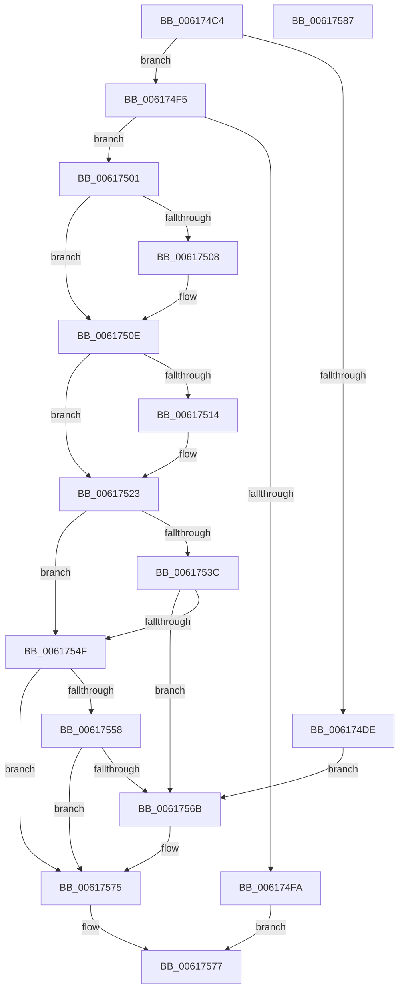

# VfRlrsVolatileConfigUpdate

- RVA: `0x006174C4`–`0x00617588` (길이 `196` bytes)
- VA: `0x00000001406174C4`
- 실행 섹션: `.text`
- PDB 이름 있음: `예`; PDB Function 태그: `아니요`
- unwind 정보 RVA: `0x0008E1D0`
- 디코드: `58`개 명령, `196/196` bytes 표시
- 미해석 바이트: `0` (있으면 어셈블리에 `.byte`로 보존)

> 이 문서는 커널 이미지의 기계어와 PDB 기호를 분석해 생성했습니다. 4번과 5번은 함수 원형과 자료형을 바이너리 사용 방식에서 추정한 C 해석이며 원본 소스 복구 결과는 아닙니다.

## 1. Dependencies

- 직접 호출 지점: **6**; 고유 호출 대상: **4**
- 직접 호출자로 확인된 함수: **1**
- RIP 상대 이미지 참조: **2**

### Outgoing calls
- `0x00617529` → [VfFaultsRemoveAllTags](../../pagevrfy/BA/VfFaultsRemoveAllTags_function_00BA6744.md) (function, `0x00BA6744`)
- `0x0061752E` → [VfFaultsRemoveAllApps](../../pagevrfy/BA/VfFaultsRemoveAllApps_function_00BA66AC.md) (function, `0x00BA66AC`)
- `0x00617544` → [VfFaultsAddAllApps](../../pagevrfy/BA/VfFaultsAddAllApps_function_00BA61D0.md) (function, `0x00BA61D0`)
- `0x00617560` → [VfFaultsAddAllTags](../../pagevrfy/BA/VfFaultsAddAllTags_function_00BA627C.md) (function, `0x00BA627C`)
- `0x0061756B` → [VfFaultsRemoveAllTags](../../pagevrfy/BA/VfFaultsRemoveAllTags_function_00BA6744.md) (function, `0x00BA6744`)
- `0x00617570` → [VfFaultsRemoveAllApps](../../pagevrfy/BA/VfFaultsRemoveAllApps_function_00BA66AC.md) (function, `0x00BA66AC`)

### Direct callers
- [VfVolatileSetDifRuleClass](VfVolatileSetDifRuleClass_function_00616AA4.md) at `0x00616C28`
- [VfVolatileSetDifRuleClass](VfVolatileSetDifRuleClass_function_00616AA4.md) at `0x00616D2F`

### Static image references
- `0x006174E3` → RVA `0x00E0E938` (`.data`; write)
- `0x006174ED` → RVA `0x00E0E93C` (`.data`; write)

## 2. Other-region calls and transfers

- 다른 실행 섹션으로 향하는 call: **6**
  - `0x00617529` → [VfFaultsRemoveAllTags](../../pagevrfy/BA/VfFaultsRemoveAllTags_function_00BA6744.md) (`.text` → `PAGEVRFY`)
  - `0x0061752E` → [VfFaultsRemoveAllApps](../../pagevrfy/BA/VfFaultsRemoveAllApps_function_00BA66AC.md) (`.text` → `PAGEVRFY`)
  - `0x00617544` → [VfFaultsAddAllApps](../../pagevrfy/BA/VfFaultsAddAllApps_function_00BA61D0.md) (`.text` → `PAGEVRFY`)
  - `0x00617560` → [VfFaultsAddAllTags](../../pagevrfy/BA/VfFaultsAddAllTags_function_00BA627C.md) (`.text` → `PAGEVRFY`)
  - `0x0061756B` → [VfFaultsRemoveAllTags](../../pagevrfy/BA/VfFaultsRemoveAllTags_function_00BA6744.md) (`.text` → `PAGEVRFY`)
  - `0x00617570` → [VfFaultsRemoveAllApps](../../pagevrfy/BA/VfFaultsRemoveAllApps_function_00BA66AC.md) (`.text` → `PAGEVRFY`)
- 별도 외부 분기/꼬리 이동을 확인하지 못했습니다.

## 3. Assembly (complete function range)

```asm
006174C4  48 89 5C 24 08                  mov qword ptr [rsp + 8], rbx
006174C9  48 89 74 24 18                  mov qword ptr [rsp + 0x18], rsi
006174CE  57                              push rdi
006174CF  48 83 EC 20                     sub rsp, 0x20
006174D3  33 F6                           xor esi, esi
006174D5  48 8B D9                        mov rbx, rcx
006174D8  8B FE                           mov edi, esi
006174DA  84 D2                           test dl, dl
006174DC  74 17                           je 0x1406174f5
006174DE  B8 58 02 00 00                  mov eax, 0x258
006174E3  C7 05 4B 74 7F 00 10 27 00 00   mov dword ptr [rip + 0x7f744b], 0x2710
006174ED  89 05 49 74 7F 00               mov dword ptr [rip + 0x7f7449], eax
006174F3  EB 76                           jmp 0x14061756b
006174F5  48 85 DB                        test rbx, rbx
006174F8  75 07                           jne 0x140617501
006174FA  B8 0D 00 00 C0                  mov eax, 0xc000000d
006174FF  EB 76                           jmp 0x140617577
00617501  8B 41 04                        mov eax, dword ptr [rcx + 4]
00617504  85 C0                           test eax, eax
00617506  74 06                           je 0x14061750e
00617508  89 05 2A 74 7F 00               mov dword ptr [rip + 0x7f742a], eax
0061750E  8B 01                           mov eax, dword ptr [rcx]
00617510  85 C0                           test eax, eax
00617512  75 0F                           jne 0x140617523
00617514  C7 05 1A 74 7F 00 10 27 00 00   mov dword ptr [rip + 0x7f741a], 0x2710
0061751E  B8 58 02 00 00                  mov eax, 0x258
00617523  89 05 13 74 7F 00               mov dword ptr [rip + 0x7f7413], eax
00617529  E8 16 F2 58 00                  call 0x140ba6744
0061752E  E8 79 F1 58 00                  call 0x140ba66ac
00617533  0F B7 43 18                     movzx eax, word ptr [rbx + 0x18]
00617537  66 85 C0                        test ax, ax
0061753A  74 13                           je 0x14061754f
0061753C  48 8B 4B 20                     mov rcx, qword ptr [rbx + 0x20]
00617540  8B D0                           mov edx, eax
00617542  D1 EA                           shr edx, 1
00617544  E8 87 EC 58 00                  call 0x140ba61d0
00617549  8B F8                           mov edi, eax
0061754B  85 C0                           test eax, eax
0061754D  78 1C                           js 0x14061756b
0061754F  0F B7 43 08                     movzx eax, word ptr [rbx + 8]
00617553  66 85 C0                        test ax, ax
00617556  74 1D                           je 0x140617575
00617558  48 8B 4B 10                     mov rcx, qword ptr [rbx + 0x10]
0061755C  8B D0                           mov edx, eax
0061755E  D1 EA                           shr edx, 1
00617560  E8 17 ED 58 00                  call 0x140ba627c
00617565  8B F8                           mov edi, eax
00617567  85 C0                           test eax, eax
00617569  79 0A                           jns 0x140617575
0061756B  E8 D4 F1 58 00                  call 0x140ba6744
00617570  E8 37 F1 58 00                  call 0x140ba66ac
00617575  8B C7                           mov eax, edi
00617577  48 8B 5C 24 30                  mov rbx, qword ptr [rsp + 0x30]
0061757C  48 8B 74 24 40                  mov rsi, qword ptr [rsp + 0x40]
00617581  48 83 C4 20                     add rsp, 0x20
00617585  5F                              pop rdi
00617586  C3                              ret
00617587  CC                              int3
```

## 4. C-style interpretation (structured pseudocode)

```c
__int64 __fastcall VfRlrsVolatileConfigUpdate(__int64 a1, unsigned __int8 a2)
{
    __int64 result;
    __int64 v_rsi;
    __int64 v_rsp;
    unsigned __int64 v_stack_p18;
    unsigned __int64 v_stack_p8;

    v_stack_p8 = v_rbx;
    v_stack_p18 = v_rsi;
    v_rsp = (v_rsp) - (32);
    v_rsi = 0;
    if (a2 == 0) goto loc_006174F5;
    *(unsigned int *)(v_rip + 8352843) = 0x2710ULL;
    *(unsigned int *)(v_rip + 8352841) = 600;
    goto loc_0061756B;
loc_006174F5:
    if (a1 != 0) goto loc_00617501;
    goto loc_00617577;
loc_00617501:
    if ((unsigned int)((unsigned int)(*(unsigned int *)(a1 + 4))) != 0) {
        *(unsigned int *)(v_rip + 8352810) = (unsigned int)((unsigned int)(*(unsigned int *)(a1 + 4)));
    }
    result = (unsigned int)(*(unsigned int *)(a1));
    if ((unsigned int)((unsigned int)(*(unsigned int *)(a1))) == 0) {
        *(unsigned int *)(v_rip + 8352794) = 0x2710ULL;
        result = 600;
    }
    *(unsigned int *)(v_rip + 8352787) = (unsigned int)(result);
    result = VfFaultsRemoveAllTags(a1, a2, a3, a4);
    result = VfFaultsRemoveAllApps(a1, a2, a3, a4);
    if ((unsigned __int16)(*(unsigned __int16 *)(a1 + 24)) == 0) goto loc_0061754F;
    a2 = (unsigned int)(((unsigned int)((unsigned int)(*(unsigned __int16 *)(a1 + 24)))) >> (1));
    result = VfFaultsAddAllApps(*(unsigned __int64 *)(a1 + 32), a2, a3, a4);
    if (sign_flag) goto loc_0061756B;
loc_0061754F:
    if ((unsigned __int16)(*(unsigned __int16 *)(a1 + 8)) == 0) goto loc_00617575;
    a2 = (unsigned int)(((unsigned int)((unsigned int)(*(unsigned __int16 *)(a1 + 8)))) >> (1));
    result = VfFaultsAddAllTags(*(unsigned __int64 *)(a1 + 16), a2, a3, a4);
    if (sign_flag) {
        result = VfFaultsRemoveAllTags(*(unsigned __int64 *)(a1 + 16), a2, a3, a4);
        result = VfFaultsRemoveAllApps(*(unsigned __int64 *)(a1 + 16), a2, a3, a4);
    }
loc_00617577:
    v_rsp = (v_rsp) + (32);
    return (unsigned int)((unsigned int)((unsigned int)((unsigned int)(result))));
}
```

## 5. (Beta) C Style

```c
int64_t VfRlrsVolatileConfigUpdate(void *Arg1, uint8_t Arg2)
{
    uint8_t *arg1 = (uint8_t *)Arg1;

    int64_t result;
    int64_t local_rsi;
    int64_t local_rsp;
    uint64_t v_stack_p18;
    uint64_t v_stack_p8;

    v_stack_p8 = local_rbx;
    v_stack_p18 = local_rsi;
    local_rsp = (local_rsp) - (32);
    local_rsi = 0;
    if (Arg2 == 0) goto loc_006174F5;
    *(uint32_t *)(v_rip + 0x7F744B) = 0x2710ULL;
    *(uint32_t *)(v_rip + 0x7F7449) = 600;
    goto loc_0061756B;
loc_006174F5:
    if (Arg1 != NULL) goto loc_00617501;
    goto loc_00617577;
loc_00617501:
    if ((uint32_t)((uint32_t)(*(uint32_t *)(arg1 + 0x4))) != 0) {
        *(uint32_t *)(v_rip + 0x7F742A) = (uint32_t)((uint32_t)(*(uint32_t *)(arg1 + 0x4)));
    }
    result = (uint32_t)(*(uint32_t *)(arg1));
    if ((uint32_t)((uint32_t)(*(uint32_t *)(arg1))) == 0) {
        *(uint32_t *)(v_rip + 0x7F741A) = 0x2710ULL;
        result = 600;
    }
    *(uint32_t *)(v_rip + 0x7F7413) = (uint32_t)(result);
    result = VfFaultsRemoveAllTags(Arg1, Arg2, a3, a4);
    result = VfFaultsRemoveAllApps(Arg1, Arg2, a3, a4);
    if ((uint16_t)(*(uint16_t *)(arg1 + 0x18)) == 0) goto loc_0061754F;
    Arg2 = (uint32_t)(((uint32_t)((uint32_t)(*(uint16_t *)(arg1 + 0x18)))) >> (1));
    result = VfFaultsAddAllApps(*(uint64_t *)(arg1 + 0x20), Arg2, a3, a4);
    if (sign_flag) goto loc_0061756B;
loc_0061754F:
    if ((uint16_t)(*(uint16_t *)(arg1 + 0x8)) == 0) goto loc_00617575;
    Arg2 = (uint32_t)(((uint32_t)((uint32_t)(*(uint16_t *)(arg1 + 0x8)))) >> (1));
    result = VfFaultsAddAllTags(*(uint64_t *)(arg1 + 0x10), Arg2, a3, a4);
    if (sign_flag) {
        result = VfFaultsRemoveAllTags(*(uint64_t *)(arg1 + 0x10), Arg2, a3, a4);
        result = VfFaultsRemoveAllApps(*(uint64_t *)(arg1 + 0x10), Arg2, a3, a4);
    }
loc_00617577:
    local_rsp = (local_rsp) + (32);
    return (uint32_t)((uint32_t)((uint32_t)((uint32_t)(result))));
}
```

### 관측된 메모리 오프셋

구조체 형식이 확인되지 않은 접근은 인자 기준의 오프셋으로만 기록했습니다.

| 기준 인자 | 오프셋 표현 | 폭 (bit) | 접근 |
|---|---:|---:|---|
| `Arg1` | `+ 0x0` | `32` | `R` |
| `Arg1` | `+ 0x4` | `32` | `R` |

## 6. Execution-region graph

[열기: 2D/3D 그래프와 함수 탐색 컨트롤 패널](../../../control-panel.html?section=text&rva=0x006174C4&view=graph)

- 2D 그래프는 위에서 아래로 흐르고, 3D 그래프는 빈 공간을 드래그해 회전합니다. Shift+드래그는 이동, 휠은 확대·축소, 함수 노드 선택은 대상 보고서 이동입니다.

### Static fallback


