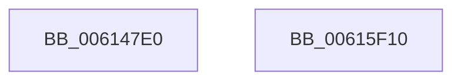

# VfSecurityEntry

- RVA: `0x006147E0`–`0x00615F11` (길이 `5,937` bytes)
- VA: `0x00000001406147E0`
- 실행 섹션: `.text`
- PDB 이름 있음: `예`; PDB Function 태그: `아니요`
- unwind 정보 RVA: `0x000D259C`
- 디코드: `817`개 명령, `5,937/5,937` bytes 표시
- 미해석 바이트: `0` (있으면 어셈블리에 `.byte`로 보존)

> 이 문서는 커널 이미지의 기계어와 PDB 기호를 분석해 생성했습니다. 4번과 5번은 함수 원형과 자료형을 바이너리 사용 방식에서 추정한 C 해석이며 원본 소스 복구 결과는 아닙니다.

## 1. Dependencies

- 직접 호출 지점: **2**; 고유 호출 대상: **2**
- 직접 호출자로 확인된 함수: **0**
- RIP 상대 이미지 참조: **185**

### Outgoing calls
- `0x00615EF3` → [DifRegisterPlugin](DifRegisterPlugin_function_0061ABE0.md) (function, `0x0061ABE0`)
- `0x00615F02` → [_security_check_cookie](../6A/_security_check_cookie_function_006AC640.md) (function, `0x006AC640`)

### Direct callers
- 이 함수 시작 RVA로 연결되는 직접 call은 확인되지 않았습니다. 간접 호출은 완전히 역산할 수 없습니다.

### Static image references
- `0x006147F1` → RVA `0x00E0A740` (`.data`; read)
- `0x0061480C` → RVA `0x006CE900` (` ?? ::FNODOBFM::`string'`; read)
- `0x00614822` → RVA `0x00BA3C40` (`VfZwAccessCheckAndAuditAlarm_Entry`; read)
- `0x00614836` → RVA `0x006CE8B0` (` ?? ::FNODOBFM::`string'`; read)
- `0x00614842` → RVA `0x00BA3CC0` (`VfZwAddBootEntry_Entry`; read)
- `0x0061484E` → RVA `0x006CE890` (` ?? ::FNODOBFM::`string'`; read)
- `0x00614866` → RVA `0x006CE8E0` (` ?? ::FNODOBFM::`string'`; read)
- `0x00614871` → RVA `0x00BA3D00` (`VfZwAdjustPrivilegesToken_Entry`; read)
- `0x0061487C` → RVA `0x006CE8C0` (` ?? ::FNODOBFM::`string'`; read)
- `0x00614887` → RVA `0x00BA3D50` (`VfZwAllocateVirtualMemory_Entry`; read)
- `0x00614892` → RVA `0x006CE850` (` ?? ::FNODOBFM::`string'`; read)
- `0x0061489D` → RVA `0x00BA3EE0` (`VfZwAlpcCreateResourceReserve_Entry`; read)
- `0x006148A8` → RVA `0x006CE840` (` ?? ::FNODOBFM::`string'`; read)
- `0x006148BE` → RVA `0x006CE870` (` ?? ::FNODOBFM::`string'`; read)
- `0x006148C9` → RVA `0x00BA3FF0` (`VfZwCloseObjectAuditAlarm_Entry`; read)
- `0x006148D4` → RVA `0x006CE860` (` ?? ::FNODOBFM::`string'`; read)
- `0x006148DF` → RVA `0x00BA4020` (`VfZwConnectPort_Entry`; read)
- `0x006148EA` → RVA `0x006CE7F0` (` ?? ::FNODOBFM::`string'`; read)
- `0x006148F5` → RVA `0x00BA40A0` (`VfZwCreateDirectoryObject_Entry`; read)
- `0x00614900` → RVA `0x006CE7E0` (` ?? ::FNODOBFM::`string'`; read)
- `0x0061490B` → RVA `0x00BA4120` (`VfZwCreateEvent_Entry`; read)
- `0x00614916` → RVA `0x006CE830` (` ?? ::FNODOBFM::`string'`; read)
- `0x00614924` → RVA `0x00BA4160` (`VfZwCreateFile_Entry`; read)
- `0x00614932` → RVA `0x006CE810` (` ?? ::FNODOBFM::`string'`; read)
- `0x0061494E` → RVA `0x006CEA80` (` ?? ::FNODOBFM::`string'`; read)
- `0x006149E4` → RVA `0x00BA41C0` (`VfZwCreateKey_Entry`; read)
- `0x006149F2` → RVA `0x006CEA70` (` ?? ::FNODOBFM::`string'`; read)
- `0x00614A00` → RVA `0x00BA4210` (`VfZwCreateSection_Entry`; read)
- `0x00614A0E` → RVA `0x006CEAA0` (` ?? ::FNODOBFM::`string'`; read)
- `0x00614A1C` → RVA `0x00BA4260` (`VfZwCreateSymbolicLinkObject_Entry`; read)
- `0x00614A2A` → RVA `0x006CEA90` (` ?? ::FNODOBFM::`string'`; read)
- `0x00614A46` → RVA `0x006CEA10` (` ?? ::FNODOBFM::`string'`; read)
- `0x00614A54` → RVA `0x00BA4360` (`VfZwDeleteBootEntry_Entry`; read)
- `0x00614A62` → RVA `0x006CEA00` (` ?? ::FNODOBFM::`string'`; read)
- `0x00614A70` → RVA `0x00BA4390` (`VfZwDeleteFile_Entry`; read)
- `0x00614A7E` → RVA `0x006CEA50` (` ?? ::FNODOBFM::`string'`; read)
- `0x00614A8C` → RVA `0x00BA43C0` (`VfZwDeleteValueKey_Entry`; read)
- `0x00614A9A` → RVA `0x006CEA30` (` ?? ::FNODOBFM::`string'`; read)
- `0x00614AA8` → RVA `0x00BA43F0` (`VfZwDeviceIoControlFile_Entry`; read)
- `0x00614AB6` → RVA `0x006CE9B0` (` ?? ::FNODOBFM::`string'`; read)
- `0x00614AD2` → RVA `0x006CE990` (` ?? ::FNODOBFM::`string'`; read)
- `0x00614AE0` → RVA `0x00BA4460` (`VfZwDuplicateObject_Entry`; read)
- `0x00614AEE` → RVA `0x006CE9E0` (` ?? ::FNODOBFM::`string'`; read)
- `0x00614AFC` → RVA `0x00BA4490` (`VfZwDuplicateToken_Entry`; read)
- `0x00614B0A` → RVA `0x006CE9C0` (` ?? ::FNODOBFM::`string'`; read)
- `0x00614B26` → RVA `0x006CE930` (` ?? ::FNODOBFM::`string'`; read)
- `0x00614B42` → RVA `0x006CE920` (` ?? ::FNODOBFM::`string'`; read)
- `0x00614B50` → RVA `0x00BA3F10` (`VfZwAlpcQueryInformation_Entry`; read)
- `0x00614C45` → RVA `0x006CE970` (` ?? ::FNODOBFM::`string'`; read)
- `0x00614C61` → RVA `0x006CE950` (` ?? ::FNODOBFM::`string'`; read)
- `0x00614C6F` → RVA `0x00BA3FC0` (`VfZwAlpcSetInformation_Entry`; read)
- `0x00614C7D` → RVA `0x006CEC00` (` ?? ::FNODOBFM::`string'`; read)
- `0x00614C8B` → RVA `0x00BA44D0` (`VfZwFlushVirtualMemory_Entry`; read)
- `0x00614C99` → RVA `0x006CEBE0` (` ?? ::FNODOBFM::`string'`; read)
- `0x00614CA7` → RVA `0x00BA4520` (`VfZwFreeVirtualMemory_Entry`; read)
- `0x00614CB5` → RVA `0x006CEC30` (` ?? ::FNODOBFM::`string'`; read)
- `0x00614CD1` → RVA `0x006CEC20` (` ?? ::FNODOBFM::`string'`; read)
- `0x00614CED` → RVA `0x006CEB90` (` ?? ::FNODOBFM::`string'`; read)
- `0x00614CFB` → RVA `0x00BA4560` (`VfZwLoadKey_Entry`; read)
- `0x00614D09` → RVA `0x006CEB70` (` ?? ::FNODOBFM::`string'`; read)
- `0x00614D17` → RVA `0x00BA45A0` (`VfZwMapViewOfSection_Entry`; read)
- `0x00614D25` → RVA `0x006CEBC0` (` ?? ::FNODOBFM::`string'`; read)
- `0x00614D41` → RVA `0x006CEBA0` (` ?? ::FNODOBFM::`string'`; read)
- `0x00614D5D` → RVA `0x006CEB30` (` ?? ::FNODOBFM::`string'`; read)
- `0x00614D6B` → RVA `0x00BA45F0` (`VfZwNotifyChangeKey_Entry`; read)
- `0x00614D79` → RVA `0x006CEB10` (` ?? ::FNODOBFM::`string'`; read)
- `0x00614D95` → RVA `0x006CEB60` (` ?? ::FNODOBFM::`string'`; read)
- `0x00614DB1` → RVA `0x006CEB50` (` ?? ::FNODOBFM::`string'`; read)
- `0x00614EA3` → RVA `0x00BA46B0` (`VfZwOpenFile_Entry`; read)
- `0x00614EB1` → RVA `0x006CEAD0` (` ?? ::FNODOBFM::`string'`; read)
- `0x00614ECD` → RVA `0x006CEAC0` (` ?? ::FNODOBFM::`string'`; read)
- `0x00614EE9` → RVA `0x006CEB00` (` ?? ::FNODOBFM::`string'`; read)
- `0x00614EF7` → RVA `0x00BA4700` (`VfZwOpenProcess_Entry`; read)
- `0x00614F05` → RVA `0x006CEAE0` (` ?? ::FNODOBFM::`string'`; read)
- `0x00614F21` → RVA `0x006CEDB0` (` ?? ::FNODOBFM::`string'`; read)
- `0x00614F3D` → RVA `0x006CEDA0` (` ?? ::FNODOBFM::`string'`; read)
- `0x00614F59` → RVA `0x006CEDE0` (` ?? ::FNODOBFM::`string'`; read)
- `0x00614F75` → RVA `0x006CEDD0` (` ?? ::FNODOBFM::`string'`; read)
- `0x00614F91` → RVA `0x006CED50` (` ?? ::FNODOBFM::`string'`; read)
- `0x00614FAD` → RVA `0x006CED30` (` ?? ::FNODOBFM::`string'`; read)
- `0x00614FC9` → RVA `0x006CED90` (` ?? ::FNODOBFM::`string'`; read)
- `0x00614FE5` → RVA `0x006CED70` (` ?? ::FNODOBFM::`string'`; read)
- `0x00615001` → RVA `0x006CECD0` (` ?? ::FNODOBFM::`string'`; read)
- `0x0061500F` → RVA `0x00BA47F0` (`VfZwProtectVirtualMemory_Entry`; read)
- `0x00615104` → RVA `0x006CECC0` (` ?? ::FNODOBFM::`string'`; read)
- `0x00615120` → RVA `0x006CED10` (` ?? ::FNODOBFM::`string'`; read)
- `0x0061513C` → RVA `0x006CECF0` (` ?? ::FNODOBFM::`string'`; read)
- `0x00615158` → RVA `0x006CEC60` (` ?? ::FNODOBFM::`string'`; read)
- `0x00615174` → RVA `0x006CEC40` (` ?? ::FNODOBFM::`string'`; read)
- `0x00615190` → RVA `0x006CECA0` (` ?? ::FNODOBFM::`string'`; read)
- `0x006151AC` → RVA `0x006CEC80` (` ?? ::FNODOBFM::`string'`; read)
- `0x006151C8` → RVA `0x006CEF70` (` ?? ::FNODOBFM::`string'`; read)
- `0x006151D6` → RVA `0x00BA48B0` (`VfZwQueryDirectoryFile_Entry`; read)
- `0x006151E4` → RVA `0x006CEF50` (` ?? ::FNODOBFM::`string'`; read)
- `0x006151F2` → RVA `0x00BA4840` (`VfZwQueryDirectoryFileEx_Entry`; read)
- `0x00615200` → RVA `0x006CEFA0` (` ?? ::FNODOBFM::`string'`; read)
- `0x0061521C` → RVA `0x006CEF90` (` ?? ::FNODOBFM::`string'`; read)
- `0x0061522A` → RVA `0x00BA4920` (`VfZwQueryEaFile_Entry`; read)
- `0x00615238` → RVA `0x006CEEF0` (` ?? ::FNODOBFM::`string'`; read)
- `0x00615246` → RVA `0x00BA4970` (`VfZwQueryFullAttributesFile_Entry`; read)
- `0x00615254` → RVA `0x006CEED0` (` ?? ::FNODOBFM::`string'`; read)
- `0x00615270` → RVA `0x006CEF30` (` ?? ::FNODOBFM::`string'`; read)
- `0x00615370` → RVA `0x006CEF10` (` ?? ::FNODOBFM::`string'`; read)
- `0x0061538C` → RVA `0x006CEE90` (` ?? ::FNODOBFM::`string'`; read)
- `0x006153A8` → RVA `0x006CEE70` (` ?? ::FNODOBFM::`string'`; read)
- `0x006153C4` → RVA `0x006CEEC0` (` ?? ::FNODOBFM::`string'`; read)
- `0x006153E0` → RVA `0x006CEEB0` (` ?? ::FNODOBFM::`string'`; read)
- `0x006153FC` → RVA `0x006CEE20` (` ?? ::FNODOBFM::`string'`; read)
- `0x00615418` → RVA `0x006CEE00` (` ?? ::FNODOBFM::`string'`; read)
- `0x00615434` → RVA `0x006CEE50` (` ?? ::FNODOBFM::`string'`; read)
- `0x00615442` → RVA `0x00BA4A00` (`VfZwQuerySymbolicLinkObject_Entry`; read)
- `0x00615450` → RVA `0x006CEE30` (` ?? ::FNODOBFM::`string'`; read)
- `0x0061546C` → RVA `0x006CF130` (` ?? ::FNODOBFM::`string'`; read)
- `0x0061547A` → RVA `0x00BA4A40` (`VfZwQueryValueKey_Entry`; read)
- `0x00615488` → RVA `0x006CF110` (` ?? ::FNODOBFM::`string'`; read)
- `0x006154A4` → RVA `0x006CF150` (` ?? ::FNODOBFM::`string'`; read)
- `0x006154B2` → RVA `0x00BA4A90` (`VfZwReadFile_Entry`; read)
- `0x006154C0` → RVA `0x006CF140` (` ?? ::FNODOBFM::`string'`; read)
- `0x006154CE` → RVA `0x00BA4B50` (`VfZwReplaceKey_Entry`; read)
- `0x006155C3` → RVA `0x006CF0B0` (` ?? ::FNODOBFM::`string'`; read)
- `0x006155DF` → RVA `0x006CF0A0` (` ?? ::FNODOBFM::`string'`; read)
- `0x006155FB` → RVA `0x006CF0F0` (` ?? ::FNODOBFM::`string'`; read)
- `0x00615617` → RVA `0x006CF0D0` (` ?? ::FNODOBFM::`string'`; read)
- `0x00615633` → RVA `0x006CF050` (` ?? ::FNODOBFM::`string'`; read)
- `0x0061564F` → RVA `0x006CF040` (` ?? ::FNODOBFM::`string'`; read)
- `0x0061566B` → RVA `0x006CF090` (` ?? ::FNODOBFM::`string'`; read)
- `0x00615687` → RVA `0x006CF070` (` ?? ::FNODOBFM::`string'`; read)
- `0x006156A3` → RVA `0x006CEFE0` (` ?? ::FNODOBFM::`string'`; read)
- `0x006156BF` → RVA `0x006CEFC0` (` ?? ::FNODOBFM::`string'`; read)
- `0x006156DB` → RVA `0x006CF020` (` ?? ::FNODOBFM::`string'`; read)
- `0x006156F7` → RVA `0x006CF000` (` ?? ::FNODOBFM::`string'`; read)
- `0x00615713` → RVA `0x006CF2C0` (` ?? ::FNODOBFM::`string'`; read)
- `0x0061572F` → RVA `0x006CF2A0` (` ?? ::FNODOBFM::`string'`; read)
- `0x0061583D` → RVA `0x006CF2F0` (` ?? ::FNODOBFM::`string'`; read)
- `0x00615859` → RVA `0x006CF2E0` (` ?? ::FNODOBFM::`string'`; read)
- `0x00615867` → RVA `0x00BA4B90` (`VfZwSetTimer_Entry`; read)
- `0x00615875` → RVA `0x006CF260` (` ?? ::FNODOBFM::`string'`; read)
- `0x00615883` → RVA `0x00BA4BE0` (`VfZwSetValueKey_Entry`; read)
- `0x00615891` → RVA `0x006CF240` (` ?? ::FNODOBFM::`string'`; read)
- `0x006158AD` → RVA `0x006CF280` (` ?? ::FNODOBFM::`string'`; read)
- `0x006158C9` → RVA `0x006CF270` (` ?? ::FNODOBFM::`string'`; read)
- `0x006158E5` → RVA `0x006CF200` (` ?? ::FNODOBFM::`string'`; read)
- `0x00615901` → RVA `0x006CF1E0` (` ?? ::FNODOBFM::`string'`; read)
- `0x0061591D` → RVA `0x006CF220` (` ?? ::FNODOBFM::`string'`; read)
- `0x00615939` → RVA `0x006CF210` (` ?? ::FNODOBFM::`string'`; read)
- `0x00615955` → RVA `0x006CF180` (` ?? ::FNODOBFM::`string'`; read)
- `0x00615963` → RVA `0x00BA3E90` (`VfZwAlpcCreatePort_Entry`; read)
- `0x00615971` → RVA `0x006CF160` (` ?? ::FNODOBFM::`string'`; read)
- `0x0061597F` → RVA `0x00BA3DF0` (`VfZwAlpcConnectPort_Entry`; read)
- `0x0061598D` → RVA `0x006CF1C0` (` ?? ::FNODOBFM::`string'`; read)
- `0x00615A71` → RVA `0x00BA3D90` (`VfZwAlpcAcceptConnectPort_Entry`; read)
- `0x00615A86` → RVA `0x006CF1A0` (` ?? ::FNODOBFM::`string'`; read)
- `0x00615A94` → RVA `0x00BA3F50` (`VfZwAlpcSendWaitReceivePort_Entry`; read)
- `0x00615AA2` → RVA `0x006CF4B0` (` ?? ::FNODOBFM::`string'`; read)
- `0x00615ABE` → RVA `0x006CF490` (` ?? ::FNODOBFM::`string'`; read)
- `0x00615ADA` → RVA `0x006CF4F0` (` ?? ::FNODOBFM::`string'`; read)
- `0x00615AF6` → RVA `0x006CF4D0` (` ?? ::FNODOBFM::`string'`; read)
- `0x00615B12` → RVA `0x006CF430` (` ?? ::FNODOBFM::`string'`; read)
- `0x00615B2E` → RVA `0x006CF410` (` ?? ::FNODOBFM::`string'`; read)
- `0x00615B4A` → RVA `0x006CF470` (` ?? ::FNODOBFM::`string'`; read)
- `0x00615B58` → RVA `0x00BA4B00` (`VfZwRemoveIoCompletionEx_Entry`; read)
- `0x00615B66` → RVA `0x006CF450` (` ?? ::FNODOBFM::`string'`; read)
- `0x00615B74` → RVA `0x00BA42B0` (`VfZwCreateTransactionManager_Entry`; read)
- `0x00615B82` → RVA `0x006CF3B0` (` ?? ::FNODOBFM::`string'`; read)
- `0x00615B90` → RVA `0x00BA4750` (`VfZwOpenTransactionManager_Entry`; read)
- `0x00615B9E` → RVA `0x006CF380` (` ?? ::FNODOBFM::`string'`; read)
- `0x00615BBA` → RVA `0x006CF3F0` (` ?? ::FNODOBFM::`string'`; read)
- `0x00615BC8` → RVA `0x00BA4300` (`VfZwCreateTransaction_Entry`; read)
- `0x00615BD6` → RVA `0x006CF3D0` (` ?? ::FNODOBFM::`string'`; read)
- `0x00615BE4` → RVA `0x00BA47A0` (`VfZwOpenTransaction_Entry`; read)
- `0x00615CCF` → RVA `0x006CF320` (` ?? ::FNODOBFM::`string'`; read)
- `0x00615CF5` → RVA `0x006CF300` (` ?? ::FNODOBFM::`string'`; read)
- `0x00615D11` → RVA `0x006CF360` (` ?? ::FNODOBFM::`string'`; read)
- `0x00615D2D` → RVA `0x006CF340` (` ?? ::FNODOBFM::`string'`; read)
- `0x00615D49` → RVA `0x006CF5B0` (` ?? ::FNODOBFM::`string'`; read)
- `0x00615D65` → RVA `0x006CF590` (` ?? ::FNODOBFM::`string'`; read)
- `0x00615D81` → RVA `0x006CF5F0` (` ?? ::FNODOBFM::`string'`; read)
- `0x00615D9D` → RVA `0x006CF5D0` (` ?? ::FNODOBFM::`string'`; read)
- `0x00615DAB` → RVA `0x00BA40E0` (`VfZwCreateEnlistment_Entry`; read)
- `0x00615DB9` → RVA `0x006CF530` (` ?? ::FNODOBFM::`string'`; read)
- `0x00615DC7` → RVA `0x00BA4670` (`VfZwOpenEnlistment_Entry`; read)
- `0x00615DD5` → RVA `0x006CF510` (` ?? ::FNODOBFM::`string'`; read)
- `0x00615DF1` → RVA `0x006CF570` (` ?? ::FNODOBFM::`string'`; read)
- `0x00615E0D` → RVA `0x006CF550` (` ?? ::FNODOBFM::`string'`; read)
- `0x00615E1B` → RVA `0x00BA49B0` (`VfZwQueryLicenseValue_Entry`; read)

## 2. Other-region calls and transfers

- 다른 실행 섹션으로 향하는 call: **0**
- 별도 외부 분기/꼬리 이동을 확인하지 못했습니다.

## 3. Assembly (complete function range)

```asm
006147E0  40 55                           push rbp
006147E2  48 8D AC 24 30 F0 FF FF         lea rbp, [rsp - 0xfd0]
006147EA  48 81 EC D0 10 00 00            sub rsp, 0x10d0
006147F1  48 8B 05 48 5F 7F 00            mov rax, qword ptr [rip + 0x7f5f48]
006147F8  48 33 C4                        xor rax, rsp
006147FB  48 89 85 C0 0F 00 00            mov qword ptr [rbp + 0xfc0], rax
00614802  33 C9                           xor ecx, ecx
00614804  C7 44 24 28 94 00 00 00         mov dword ptr [rsp + 0x28], 0x94
0061480C  48 8D 05 ED A0 0B 00            lea rax, [rip + 0xba0ed]
00614813  48 89 4C 24 38                  mov qword ptr [rsp + 0x38], rcx
00614818  48 89 44 24 20                  mov qword ptr [rsp + 0x20], rax
0061481D  BA 85 00 00 00                  mov edx, 0x85
00614822  48 8D 05 17 F4 58 00            lea rax, [rip + 0x58f417]
00614829  C7 44 24 48 93 00 00 00         mov dword ptr [rsp + 0x48], 0x93
00614831  48 89 44 24 30                  mov qword ptr [rsp + 0x30], rax
00614836  48 8D 05 73 A0 0B 00            lea rax, [rip + 0xba073]
0061483D  48 89 44 24 40                  mov qword ptr [rsp + 0x40], rax
00614842  48 8D 05 77 F4 58 00            lea rax, [rip + 0x58f477]
00614849  48 89 44 24 50                  mov qword ptr [rsp + 0x50], rax
0061484E  48 8D 05 3B A0 0B 00            lea rax, [rip + 0xba03b]
00614855  48 89 44 24 60                  mov qword ptr [rsp + 0x60], rax
0061485A  48 8D 05 5F F4 58 00            lea rax, [rip + 0x58f45f]
00614861  48 89 44 24 70                  mov qword ptr [rsp + 0x70], rax
00614866  48 8D 05 73 A0 0B 00            lea rax, [rip + 0xba073]
0061486D  48 89 45 80                     mov qword ptr [rbp - 0x80], rax
00614871  48 8D 05 88 F4 58 00            lea rax, [rip + 0x58f488]
00614878  48 89 45 90                     mov qword ptr [rbp - 0x70], rax
0061487C  48 8D 05 3D A0 0B 00            lea rax, [rip + 0xba03d]
00614883  48 89 45 A0                     mov qword ptr [rbp - 0x60], rax
00614887  48 8D 05 C2 F4 58 00            lea rax, [rip + 0x58f4c2]
0061488E  48 89 45 B0                     mov qword ptr [rbp - 0x50], rax
00614892  48 8D 05 B7 9F 0B 00            lea rax, [rip + 0xb9fb7]
00614899  48 89 45 C0                     mov qword ptr [rbp - 0x40], rax
0061489D  48 8D 05 3C F6 58 00            lea rax, [rip + 0x58f63c]
006148A4  48 89 45 D0                     mov qword ptr [rbp - 0x30], rax
006148A8  48 8D 05 91 9F 0B 00            lea rax, [rip + 0xb9f91]
006148AF  48 89 45 E0                     mov qword ptr [rbp - 0x20], rax
006148B3  48 8D 05 26 F6 58 00            lea rax, [rip + 0x58f626]
006148BA  48 89 45 F0                     mov qword ptr [rbp - 0x10], rax
006148BE  48 8D 05 AB 9F 0B 00            lea rax, [rip + 0xb9fab]
006148C5  48 89 45 00                     mov qword ptr [rbp], rax
006148C9  48 8D 05 20 F7 58 00            lea rax, [rip + 0x58f720]
006148D0  48 89 45 10                     mov qword ptr [rbp + 0x10], rax
006148D4  48 8D 05 85 9F 0B 00            lea rax, [rip + 0xb9f85]
006148DB  48 89 45 20                     mov qword ptr [rbp + 0x20], rax
006148DF  48 8D 05 3A F7 58 00            lea rax, [rip + 0x58f73a]
006148E6  48 89 45 30                     mov qword ptr [rbp + 0x30], rax
006148EA  48 8D 05 FF 9E 0B 00            lea rax, [rip + 0xb9eff]
006148F1  48 89 45 40                     mov qword ptr [rbp + 0x40], rax
006148F5  48 8D 05 A4 F7 58 00            lea rax, [rip + 0x58f7a4]
006148FC  48 89 45 50                     mov qword ptr [rbp + 0x50], rax
00614900  48 8D 05 D9 9E 0B 00            lea rax, [rip + 0xb9ed9]
00614907  48 89 45 60                     mov qword ptr [rbp + 0x60], rax
0061490B  48 8D 05 0E F8 58 00            lea rax, [rip + 0x58f80e]
00614912  48 89 45 70                     mov qword ptr [rbp + 0x70], rax
00614916  48 8D 05 13 9F 0B 00            lea rax, [rip + 0xb9f13]
0061491D  48 89 85 80 00 00 00            mov qword ptr [rbp + 0x80], rax
00614924  48 8D 05 35 F8 58 00            lea rax, [rip + 0x58f835]
0061492B  48 89 85 90 00 00 00            mov qword ptr [rbp + 0x90], rax
00614932  48 8D 05 D7 9E 0B 00            lea rax, [rip + 0xb9ed7]
00614939  48 89 85 A0 00 00 00            mov qword ptr [rbp + 0xa0], rax
00614940  48 8D 05 59 F7 58 00            lea rax, [rip + 0x58f759]
00614947  48 89 85 B0 00 00 00            mov qword ptr [rbp + 0xb0], rax
0061494E  48 8D 05 2B A1 0B 00            lea rax, [rip + 0xba12b]
00614955  48 89 4C 24 58                  mov qword ptr [rsp + 0x58], rcx
0061495A  C7 44 24 68 92 00 00 00         mov dword ptr [rsp + 0x68], 0x92
00614962  48 89 4C 24 78                  mov qword ptr [rsp + 0x78], rcx
00614967  C7 45 88 91 00 00 00            mov dword ptr [rbp - 0x78], 0x91
0061496E  48 89 4D 98                     mov qword ptr [rbp - 0x68], rcx
00614972  C7 45 A8 90 00 00 00            mov dword ptr [rbp - 0x58], 0x90
00614979  48 89 4D B8                     mov qword ptr [rbp - 0x48], rcx
0061497D  89 55 C8                        mov dword ptr [rbp - 0x38], edx
00614980  48 89 4D D8                     mov qword ptr [rbp - 0x28], rcx
00614984  C7 45 E8 84 00 00 00            mov dword ptr [rbp - 0x18], 0x84
0061498B  48 89 4D F8                     mov qword ptr [rbp - 8], rcx
0061498F  C7 45 08 82 00 00 00            mov dword ptr [rbp + 8], 0x82
00614996  48 89 4D 18                     mov qword ptr [rbp + 0x18], rcx
0061499A  C7 45 28 80 00 00 00            mov dword ptr [rbp + 0x28], 0x80
006149A1  48 89 4D 38                     mov qword ptr [rbp + 0x38], rcx
006149A5  C7 45 48 7F 00 00 00            mov dword ptr [rbp + 0x48], 0x7f
006149AC  48 89 4D 58                     mov qword ptr [rbp + 0x58], rcx
006149B0  C7 45 68 7D 00 00 00            mov dword ptr [rbp + 0x68], 0x7d
006149B7  48 89 4D 78                     mov qword ptr [rbp + 0x78], rcx
006149BB  C7 85 88 00 00 00 7C 00 00 00   mov dword ptr [rbp + 0x88], 0x7c
006149C5  48 89 8D 98 00 00 00            mov qword ptr [rbp + 0x98], rcx
006149CC  C7 85 A8 00 00 00 7B 00 00 00   mov dword ptr [rbp + 0xa8], 0x7b
006149D6  48 89 8D B8 00 00 00            mov qword ptr [rbp + 0xb8], rcx
006149DD  48 89 85 C0 00 00 00            mov qword ptr [rbp + 0xc0], rax
006149E4  48 8D 05 D5 F7 58 00            lea rax, [rip + 0x58f7d5]
006149EB  48 89 85 D0 00 00 00            mov qword ptr [rbp + 0xd0], rax
006149F2  48 8D 05 77 A0 0B 00            lea rax, [rip + 0xba077]
006149F9  48 89 85 E0 00 00 00            mov qword ptr [rbp + 0xe0], rax
00614A00  48 8D 05 09 F8 58 00            lea rax, [rip + 0x58f809]
00614A07  48 89 85 F0 00 00 00            mov qword ptr [rbp + 0xf0], rax
00614A0E  48 8D 05 8B A0 0B 00            lea rax, [rip + 0xba08b]
00614A15  48 89 85 00 01 00 00            mov qword ptr [rbp + 0x100], rax
00614A1C  48 8D 05 3D F8 58 00            lea rax, [rip + 0x58f83d]
00614A23  48 89 85 10 01 00 00            mov qword ptr [rbp + 0x110], rax
00614A2A  48 8D 05 5F A0 0B 00            lea rax, [rip + 0xba05f]
00614A31  48 89 85 20 01 00 00            mov qword ptr [rbp + 0x120], rax
00614A38  48 8D 05 E1 F6 58 00            lea rax, [rip + 0x58f6e1]
00614A3F  48 89 85 30 01 00 00            mov qword ptr [rbp + 0x130], rax
00614A46  48 8D 05 C3 9F 0B 00            lea rax, [rip + 0xb9fc3]
00614A4D  48 89 85 40 01 00 00            mov qword ptr [rbp + 0x140], rax
00614A54  48 8D 05 05 F9 58 00            lea rax, [rip + 0x58f905]
00614A5B  48 89 85 50 01 00 00            mov qword ptr [rbp + 0x150], rax
00614A62  48 8D 05 97 9F 0B 00            lea rax, [rip + 0xb9f97]
00614A69  48 89 85 60 01 00 00            mov qword ptr [rbp + 0x160], rax
00614A70  48 8D 05 19 F9 58 00            lea rax, [rip + 0x58f919]
00614A77  48 89 85 70 01 00 00            mov qword ptr [rbp + 0x170], rax
00614A7E  48 8D 05 CB 9F 0B 00            lea rax, [rip + 0xb9fcb]
00614A85  48 89 85 80 01 00 00            mov qword ptr [rbp + 0x180], rax
00614A8C  48 8D 05 2D F9 58 00            lea rax, [rip + 0x58f92d]
00614A93  48 89 85 90 01 00 00            mov qword ptr [rbp + 0x190], rax
00614A9A  48 8D 05 8F 9F 0B 00            lea rax, [rip + 0xb9f8f]
00614AA1  48 89 85 A0 01 00 00            mov qword ptr [rbp + 0x1a0], rax
00614AA8  48 8D 05 41 F9 58 00            lea rax, [rip + 0x58f941]
00614AAF  48 89 85 B0 01 00 00            mov qword ptr [rbp + 0x1b0], rax
00614AB6  48 8D 05 F3 9E 0B 00            lea rax, [rip + 0xb9ef3]
00614ABD  48 89 85 C0 01 00 00            mov qword ptr [rbp + 0x1c0], rax
00614AC4  48 8D 05 F5 F8 58 00            lea rax, [rip + 0x58f8f5]
00614ACB  48 89 85 D0 01 00 00            mov qword ptr [rbp + 0x1d0], rax
00614AD2  48 8D 05 B7 9E 0B 00            lea rax, [rip + 0xb9eb7]
00614AD9  48 89 85 E0 01 00 00            mov qword ptr [rbp + 0x1e0], rax
00614AE0  48 8D 05 79 F9 58 00            lea rax, [rip + 0x58f979]
00614AE7  48 89 85 F0 01 00 00            mov qword ptr [rbp + 0x1f0], rax
00614AEE  48 8D 05 EB 9E 0B 00            lea rax, [rip + 0xb9eeb]
00614AF5  48 89 85 00 02 00 00            mov qword ptr [rbp + 0x200], rax
00614AFC  48 8D 05 8D F9 58 00            lea rax, [rip + 0x58f98d]
00614B03  48 89 85 10 02 00 00            mov qword ptr [rbp + 0x210], rax
00614B0A  48 8D 05 AF 9E 0B 00            lea rax, [rip + 0xb9eaf]
00614B11  48 89 85 20 02 00 00            mov qword ptr [rbp + 0x220], rax
00614B18  48 8D 05 A1 F1 58 00            lea rax, [rip + 0x58f1a1]
00614B1F  48 89 85 30 02 00 00            mov qword ptr [rbp + 0x230], rax
00614B26  48 8D 05 03 9E 0B 00            lea rax, [rip + 0xb9e03]
00614B2D  48 89 85 40 02 00 00            mov qword ptr [rbp + 0x240], rax
00614B34  48 8D 05 85 F1 58 00            lea rax, [rip + 0x58f185]
00614B3B  48 89 85 50 02 00 00            mov qword ptr [rbp + 0x250], rax
00614B42  48 8D 05 D7 9D 0B 00            lea rax, [rip + 0xb9dd7]
00614B49  48 89 85 60 02 00 00            mov qword ptr [rbp + 0x260], rax
00614B50  48 8D 05 B9 F3 58 00            lea rax, [rip + 0x58f3b9]
00614B57  C7 85 C8 00 00 00 7A 00 00 00   mov dword ptr [rbp + 0xc8], 0x7a
00614B61  48 89 8D D8 00 00 00            mov qword ptr [rbp + 0xd8], rcx
00614B68  C7 85 E8 00 00 00 77 00 00 00   mov dword ptr [rbp + 0xe8], 0x77
00614B72  48 89 8D F8 00 00 00            mov qword ptr [rbp + 0xf8], rcx
00614B79  C7 85 08 01 00 00 76 00 00 00   mov dword ptr [rbp + 0x108], 0x76
00614B83  48 89 8D 18 01 00 00            mov qword ptr [rbp + 0x118], rcx
00614B8A  C7 85 28 01 00 00 75 00 00 00   mov dword ptr [rbp + 0x128], 0x75
00614B94  48 89 8D 38 01 00 00            mov qword ptr [rbp + 0x138], rcx
00614B9B  C7 85 48 01 00 00 72 00 00 00   mov dword ptr [rbp + 0x148], 0x72
00614BA5  48 89 8D 58 01 00 00            mov qword ptr [rbp + 0x158], rcx
00614BAC  C7 85 68 01 00 00 71 00 00 00   mov dword ptr [rbp + 0x168], 0x71
00614BB6  48 89 8D 78 01 00 00            mov qword ptr [rbp + 0x178], rcx
00614BBD  C7 85 88 01 00 00 6F 00 00 00   mov dword ptr [rbp + 0x188], 0x6f
00614BC7  48 89 8D 98 01 00 00            mov qword ptr [rbp + 0x198], rcx
00614BCE  C7 85 A8 01 00 00 6E 00 00 00   mov dword ptr [rbp + 0x1a8], 0x6e
00614BD8  48 89 8D B8 01 00 00            mov qword ptr [rbp + 0x1b8], rcx
00614BDF  C7 85 C8 01 00 00 6D 00 00 00   mov dword ptr [rbp + 0x1c8], 0x6d
00614BE9  48 89 8D D8 01 00 00            mov qword ptr [rbp + 0x1d8], rcx
00614BF0  C7 85 E8 01 00 00 6C 00 00 00   mov dword ptr [rbp + 0x1e8], 0x6c
00614BFA  48 89 8D F8 01 00 00            mov qword ptr [rbp + 0x1f8], rcx
00614C01  C7 85 08 02 00 00 6B 00 00 00   mov dword ptr [rbp + 0x208], 0x6b
00614C0B  48 89 8D 18 02 00 00            mov qword ptr [rbp + 0x218], rcx
00614C12  C7 85 28 02 00 00 6A 00 00 00   mov dword ptr [rbp + 0x228], 0x6a
00614C1C  48 89 8D 38 02 00 00            mov qword ptr [rbp + 0x238], rcx
00614C23  C7 85 48 02 00 00 69 00 00 00   mov dword ptr [rbp + 0x248], 0x69
00614C2D  48 89 8D 58 02 00 00            mov qword ptr [rbp + 0x258], rcx
00614C34  C7 85 68 02 00 00 68 00 00 00   mov dword ptr [rbp + 0x268], 0x68
00614C3E  48 89 85 70 02 00 00            mov qword ptr [rbp + 0x270], rax
00614C45  48 8D 05 24 9D 0B 00            lea rax, [rip + 0xb9d24]
00614C4C  48 89 85 80 02 00 00            mov qword ptr [rbp + 0x280], rax
00614C53  48 8D 05 B6 F2 58 00            lea rax, [rip + 0x58f2b6]
00614C5A  48 89 85 90 02 00 00            mov qword ptr [rbp + 0x290], rax
00614C61  48 8D 05 E8 9C 0B 00            lea rax, [rip + 0xb9ce8]
00614C68  48 89 85 A0 02 00 00            mov qword ptr [rbp + 0x2a0], rax
00614C6F  48 8D 05 4A F3 58 00            lea rax, [rip + 0x58f34a]
00614C76  48 89 85 B0 02 00 00            mov qword ptr [rbp + 0x2b0], rax
00614C7D  48 8D 05 7C 9F 0B 00            lea rax, [rip + 0xb9f7c]
00614C84  48 89 85 C0 02 00 00            mov qword ptr [rbp + 0x2c0], rax
00614C8B  48 8D 05 3E F8 58 00            lea rax, [rip + 0x58f83e]
00614C92  48 89 85 D0 02 00 00            mov qword ptr [rbp + 0x2d0], rax
00614C99  48 8D 05 40 9F 0B 00            lea rax, [rip + 0xb9f40]
00614CA0  48 89 85 E0 02 00 00            mov qword ptr [rbp + 0x2e0], rax
00614CA7  48 8D 05 72 F8 58 00            lea rax, [rip + 0x58f872]
00614CAE  48 89 85 F0 02 00 00            mov qword ptr [rbp + 0x2f0], rax
00614CB5  48 8D 05 74 9F 0B 00            lea rax, [rip + 0xb9f74]
00614CBC  48 89 85 00 03 00 00            mov qword ptr [rbp + 0x300], rax
00614CC3  48 8D 05 26 F7 58 00            lea rax, [rip + 0x58f726]
00614CCA  48 89 85 10 03 00 00            mov qword ptr [rbp + 0x310], rax
00614CD1  48 8D 05 48 9F 0B 00            lea rax, [rip + 0xb9f48]
00614CD8  48 89 85 20 03 00 00            mov qword ptr [rbp + 0x320], rax
00614CDF  48 8D 05 DA F6 58 00            lea rax, [rip + 0x58f6da]
00614CE6  48 89 85 30 03 00 00            mov qword ptr [rbp + 0x330], rax
00614CED  48 8D 05 9C 9E 0B 00            lea rax, [rip + 0xb9e9c]
00614CF4  48 89 85 40 03 00 00            mov qword ptr [rbp + 0x340], rax
00614CFB  48 8D 05 5E F8 58 00            lea rax, [rip + 0x58f85e]
00614D02  48 89 85 50 03 00 00            mov qword ptr [rbp + 0x350], rax
00614D09  48 8D 05 60 9E 0B 00            lea rax, [rip + 0xb9e60]
00614D10  48 89 85 60 03 00 00            mov qword ptr [rbp + 0x360], rax
00614D17  48 8D 05 82 F8 58 00            lea rax, [rip + 0x58f882]
00614D1E  48 89 85 70 03 00 00            mov qword ptr [rbp + 0x370], rax
00614D25  48 8D 05 94 9E 0B 00            lea rax, [rip + 0xb9e94]
00614D2C  48 89 85 80 03 00 00            mov qword ptr [rbp + 0x380], rax
00614D33  48 8D 05 A6 F1 58 00            lea rax, [rip + 0x58f1a6]
00614D3A  48 89 85 90 03 00 00            mov qword ptr [rbp + 0x390], rax
00614D41  48 8D 05 58 9E 0B 00            lea rax, [rip + 0xb9e58]
00614D48  48 89 85 A0 03 00 00            mov qword ptr [rbp + 0x3a0], rax
00614D4F  48 8D 05 8A F1 58 00            lea rax, [rip + 0x58f18a]
00614D56  48 89 85 B0 03 00 00            mov qword ptr [rbp + 0x3b0], rax
00614D5D  48 8D 05 CC 9D 0B 00            lea rax, [rip + 0xb9dcc]
00614D64  48 89 85 C0 03 00 00            mov qword ptr [rbp + 0x3c0], rax
00614D6B  48 8D 05 7E F8 58 00            lea rax, [rip + 0x58f87e]
00614D72  48 89 85 D0 03 00 00            mov qword ptr [rbp + 0x3d0], rax
00614D79  48 8D 05 90 9D 0B 00            lea rax, [rip + 0xb9d90]
00614D80  48 89 85 E0 03 00 00            mov qword ptr [rbp + 0x3e0], rax
00614D87  48 8D 05 12 F3 58 00            lea rax, [rip + 0x58f312]
00614D8E  48 89 85 F0 03 00 00            mov qword ptr [rbp + 0x3f0], rax
00614D95  48 8D 05 C4 9D 0B 00            lea rax, [rip + 0xb9dc4]
00614D9C  48 89 85 00 04 00 00            mov qword ptr [rbp + 0x400], rax
00614DA3  48 8D 05 F6 F2 58 00            lea rax, [rip + 0x58f2f6]
00614DAA  48 89 85 10 04 00 00            mov qword ptr [rbp + 0x410], rax
00614DB1  48 8D 05 98 9D 0B 00            lea rax, [rip + 0xb9d98]
00614DB8  48 89 8D 78 02 00 00            mov qword ptr [rbp + 0x278], rcx
00614DBF  C7 85 88 02 00 00 67 00 00 00   mov dword ptr [rbp + 0x288], 0x67
00614DC9  48 89 8D 98 02 00 00            mov qword ptr [rbp + 0x298], rcx
00614DD0  C7 85 A8 02 00 00 64 00 00 00   mov dword ptr [rbp + 0x2a8], 0x64
00614DDA  48 89 8D B8 02 00 00            mov qword ptr [rbp + 0x2b8], rcx
00614DE1  C7 85 C8 02 00 00 62 00 00 00   mov dword ptr [rbp + 0x2c8], 0x62
00614DEB  48 89 8D D8 02 00 00            mov qword ptr [rbp + 0x2d8], rcx
00614DF2  C7 85 E8 02 00 00 61 00 00 00   mov dword ptr [rbp + 0x2e8], 0x61
00614DFC  48 89 8D F8 02 00 00            mov qword ptr [rbp + 0x2f8], rcx
00614E03  C7 85 08 03 00 00 60 00 00 00   mov dword ptr [rbp + 0x308], 0x60
00614E0D  48 89 8D 18 03 00 00            mov qword ptr [rbp + 0x318], rcx
00614E14  C7 85 28 03 00 00 5E 00 00 00   mov dword ptr [rbp + 0x328], 0x5e
00614E1E  48 89 8D 38 03 00 00            mov qword ptr [rbp + 0x338], rcx
00614E25  C7 85 48 03 00 00 5D 00 00 00   mov dword ptr [rbp + 0x348], 0x5d
00614E2F  48 89 8D 58 03 00 00            mov qword ptr [rbp + 0x358], rcx
00614E36  C7 85 68 03 00 00 5C 00 00 00   mov dword ptr [rbp + 0x368], 0x5c
00614E40  48 89 8D 78 03 00 00            mov qword ptr [rbp + 0x378], rcx
00614E47  C7 85 88 03 00 00 5B 00 00 00   mov dword ptr [rbp + 0x388], 0x5b
00614E51  48 89 8D 98 03 00 00            mov qword ptr [rbp + 0x398], rcx
00614E58  C7 85 A8 03 00 00 5A 00 00 00   mov dword ptr [rbp + 0x3a8], 0x5a
00614E62  48 89 8D B8 03 00 00            mov qword ptr [rbp + 0x3b8], rcx
00614E69  C7 85 C8 03 00 00 59 00 00 00   mov dword ptr [rbp + 0x3c8], 0x59
00614E73  48 89 8D D8 03 00 00            mov qword ptr [rbp + 0x3d8], rcx
00614E7A  C7 85 E8 03 00 00 58 00 00 00   mov dword ptr [rbp + 0x3e8], 0x58
00614E84  48 89 8D F8 03 00 00            mov qword ptr [rbp + 0x3f8], rcx
00614E8B  C7 85 08 04 00 00 56 00 00 00   mov dword ptr [rbp + 0x408], 0x56
00614E95  48 89 8D 18 04 00 00            mov qword ptr [rbp + 0x418], rcx
00614E9C  48 89 85 20 04 00 00            mov qword ptr [rbp + 0x420], rax
00614EA3  48 8D 05 06 F8 58 00            lea rax, [rip + 0x58f806]
00614EAA  48 89 85 30 04 00 00            mov qword ptr [rbp + 0x430], rax
00614EB1  48 8D 05 18 9C 0B 00            lea rax, [rip + 0xb9c18]
00614EB8  48 89 85 40 04 00 00            mov qword ptr [rbp + 0x440], rax
00614EBF  48 8D 05 DA F1 58 00            lea rax, [rip + 0x58f1da]
00614EC6  48 89 85 50 04 00 00            mov qword ptr [rbp + 0x450], rax
00614ECD  48 8D 05 EC 9B 0B 00            lea rax, [rip + 0xb9bec]
00614ED4  48 89 85 60 04 00 00            mov qword ptr [rbp + 0x460], rax
00614EDB  48 8D 05 BE F1 58 00            lea rax, [rip + 0x58f1be]
00614EE2  48 89 85 70 04 00 00            mov qword ptr [rbp + 0x470], rax
00614EE9  48 8D 05 10 9C 0B 00            lea rax, [rip + 0xb9c10]
00614EF0  48 89 85 80 04 00 00            mov qword ptr [rbp + 0x480], rax
00614EF7  48 8D 05 02 F8 58 00            lea rax, [rip + 0x58f802]
00614EFE  48 89 85 90 04 00 00            mov qword ptr [rbp + 0x490], rax
00614F05  48 8D 05 D4 9B 0B 00            lea rax, [rip + 0xb9bd4]
00614F0C  48 89 85 A0 04 00 00            mov qword ptr [rbp + 0x4a0], rax
00614F13  48 8D 05 C6 EF 58 00            lea rax, [rip + 0x58efc6]
00614F1A  48 89 85 B0 04 00 00            mov qword ptr [rbp + 0x4b0], rax
00614F21  48 8D 05 88 9E 0B 00            lea rax, [rip + 0xb9e88]
00614F28  48 89 85 C0 04 00 00            mov qword ptr [rbp + 0x4c0], rax
00614F2F  48 8D 05 AA EF 58 00            lea rax, [rip + 0x58efaa]
00614F36  48 89 85 D0 04 00 00            mov qword ptr [rbp + 0x4d0], rax
00614F3D  48 8D 05 5C 9E 0B 00            lea rax, [rip + 0xb9e5c]
00614F44  48 89 85 E0 04 00 00            mov qword ptr [rbp + 0x4e0], rax
00614F4B  48 8D 05 4E F1 58 00            lea rax, [rip + 0x58f14e]
00614F52  48 89 85 F0 04 00 00            mov qword ptr [rbp + 0x4f0], rax
00614F59  48 8D 05 80 9E 0B 00            lea rax, [rip + 0xb9e80]
00614F60  48 89 85 00 05 00 00            mov qword ptr [rbp + 0x500], rax
00614F67  48 8D 05 32 F1 58 00            lea rax, [rip + 0x58f132]
00614F6E  48 89 85 10 05 00 00            mov qword ptr [rbp + 0x510], rax
00614F75  48 8D 05 54 9E 0B 00            lea rax, [rip + 0xb9e54]
00614F7C  48 89 85 20 05 00 00            mov qword ptr [rbp + 0x520], rax
00614F83  48 8D 05 76 F7 58 00            lea rax, [rip + 0x58f776]
00614F8A  48 89 85 30 05 00 00            mov qword ptr [rbp + 0x530], rax
00614F91  48 8D 05 B8 9D 0B 00            lea rax, [rip + 0xb9db8]
00614F98  48 89 85 40 05 00 00            mov qword ptr [rbp + 0x540], rax
00614F9F  48 8D 05 3A EF 58 00            lea rax, [rip + 0x58ef3a]
00614FA6  48 89 85 50 05 00 00            mov qword ptr [rbp + 0x550], rax
00614FAD  48 8D 05 7C 9D 0B 00            lea rax, [rip + 0xb9d7c]
00614FB4  48 89 85 60 05 00 00            mov qword ptr [rbp + 0x560], rax
00614FBB  48 8D 05 1E EF 58 00            lea rax, [rip + 0x58ef1e]
00614FC2  48 89 85 70 05 00 00            mov qword ptr [rbp + 0x570], rax
00614FC9  48 8D 05 C0 9D 0B 00            lea rax, [rip + 0xb9dc0]
00614FD0  48 89 85 80 05 00 00            mov qword ptr [rbp + 0x580], rax
00614FD7  48 8D 05 C2 F0 58 00            lea rax, [rip + 0x58f0c2]
00614FDE  48 89 85 90 05 00 00            mov qword ptr [rbp + 0x590], rax
00614FE5  48 8D 05 84 9D 0B 00            lea rax, [rip + 0xb9d84]
00614FEC  48 89 85 A0 05 00 00            mov qword ptr [rbp + 0x5a0], rax
00614FF3  48 8D 05 56 ED 58 00            lea rax, [rip + 0x58ed56]
00614FFA  48 89 85 B0 05 00 00            mov qword ptr [rbp + 0x5b0], rax
00615001  48 8D 05 C8 9C 0B 00            lea rax, [rip + 0xb9cc8]
00615008  48 89 85 C0 05 00 00            mov qword ptr [rbp + 0x5c0], rax
0061500F  48 8D 05 DA F7 58 00            lea rax, [rip + 0x58f7da]
00615016  C7 85 28 04 00 00 55 00 00 00   mov dword ptr [rbp + 0x428], 0x55
00615020  48 89 8D 38 04 00 00            mov qword ptr [rbp + 0x438], rcx
00615027  C7 85 48 04 00 00 54 00 00 00   mov dword ptr [rbp + 0x448], 0x54
00615031  48 89 8D 58 04 00 00            mov qword ptr [rbp + 0x458], rcx
00615038  C7 85 68 04 00 00 53 00 00 00   mov dword ptr [rbp + 0x468], 0x53
00615042  48 89 8D 78 04 00 00            mov qword ptr [rbp + 0x478], rcx
00615049  C7 85 88 04 00 00 4F 00 00 00   mov dword ptr [rbp + 0x488], 0x4f
00615053  48 89 8D 98 04 00 00            mov qword ptr [rbp + 0x498], rcx
0061505A  C7 85 A8 04 00 00 4E 00 00 00   mov dword ptr [rbp + 0x4a8], 0x4e
00615064  48 89 8D B8 04 00 00            mov qword ptr [rbp + 0x4b8], rcx
0061506B  C7 85 C8 04 00 00 4D 00 00 00   mov dword ptr [rbp + 0x4c8], 0x4d
00615075  48 89 8D D8 04 00 00            mov qword ptr [rbp + 0x4d8], rcx
0061507C  C7 85 E8 04 00 00 4B 00 00 00   mov dword ptr [rbp + 0x4e8], 0x4b
00615086  48 89 8D F8 04 00 00            mov qword ptr [rbp + 0x4f8], rcx
0061508D  C7 85 08 05 00 00 4A 00 00 00   mov dword ptr [rbp + 0x508], 0x4a
00615097  48 89 8D 18 05 00 00            mov qword ptr [rbp + 0x518], rcx
0061509E  C7 85 28 05 00 00 49 00 00 00   mov dword ptr [rbp + 0x528], 0x49
006150A8  48 89 8D 38 05 00 00            mov qword ptr [rbp + 0x538], rcx
006150AF  C7 85 48 05 00 00 48 00 00 00   mov dword ptr [rbp + 0x548], 0x48
006150B9  48 89 8D 58 05 00 00            mov qword ptr [rbp + 0x558], rcx
006150C0  C7 85 68 05 00 00 47 00 00 00   mov dword ptr [rbp + 0x568], 0x47
006150CA  48 89 8D 78 05 00 00            mov qword ptr [rbp + 0x578], rcx
006150D1  C7 85 88 05 00 00 46 00 00 00   mov dword ptr [rbp + 0x588], 0x46
006150DB  48 89 8D 98 05 00 00            mov qword ptr [rbp + 0x598], rcx
006150E2  C7 85 A8 05 00 00 43 00 00 00   mov dword ptr [rbp + 0x5a8], 0x43
006150EC  48 89 8D B8 05 00 00            mov qword ptr [rbp + 0x5b8], rcx
006150F3  C7 85 C8 05 00 00 3F 00 00 00   mov dword ptr [rbp + 0x5c8], 0x3f
006150FD  48 89 85 D0 05 00 00            mov qword ptr [rbp + 0x5d0], rax
00615104  48 8D 05 B5 9B 0B 00            lea rax, [rip + 0xb9bb5]
0061510B  48 89 85 E0 05 00 00            mov qword ptr [rbp + 0x5e0], rax
00615112  48 8D 05 C7 ED 58 00            lea rax, [rip + 0x58edc7]
00615119  48 89 85 F0 05 00 00            mov qword ptr [rbp + 0x5f0], rax
00615120  48 8D 05 E9 9B 0B 00            lea rax, [rip + 0xb9be9]
00615127  48 89 85 00 06 00 00            mov qword ptr [rbp + 0x600], rax
0061512E  48 8D 05 8B EB 58 00            lea rax, [rip + 0x58eb8b]
00615135  48 89 85 10 06 00 00            mov qword ptr [rbp + 0x610], rax
0061513C  48 8D 05 AD 9B 0B 00            lea rax, [rip + 0xb9bad]
00615143  48 89 85 20 06 00 00            mov qword ptr [rbp + 0x620], rax
0061514A  48 8D 05 6F EB 58 00            lea rax, [rip + 0x58eb6f]
00615151  48 89 85 30 06 00 00            mov qword ptr [rbp + 0x630], rax
00615158  48 8D 05 01 9B 0B 00            lea rax, [rip + 0xb9b01]
0061515F  48 89 85 40 06 00 00            mov qword ptr [rbp + 0x640], rax
00615166  48 8D 05 73 ED 58 00            lea rax, [rip + 0x58ed73]
0061516D  48 89 85 50 06 00 00            mov qword ptr [rbp + 0x650], rax
00615174  48 8D 05 C5 9A 0B 00            lea rax, [rip + 0xb9ac5]
0061517B  48 89 85 60 06 00 00            mov qword ptr [rbp + 0x660], rax
00615182  48 8D 05 57 ED 58 00            lea rax, [rip + 0x58ed57]
00615189  48 89 85 70 06 00 00            mov qword ptr [rbp + 0x670], rax
00615190  48 8D 05 09 9B 0B 00            lea rax, [rip + 0xb9b09]
00615197  48 89 85 80 06 00 00            mov qword ptr [rbp + 0x680], rax
0061519E  48 8D 05 1B EB 58 00            lea rax, [rip + 0x58eb1b]
006151A5  48 89 85 90 06 00 00            mov qword ptr [rbp + 0x690], rax
006151AC  48 8D 05 CD 9A 0B 00            lea rax, [rip + 0xb9acd]
006151B3  48 89 85 A0 06 00 00            mov qword ptr [rbp + 0x6a0], rax
006151BA  48 8D 05 1F ED 58 00            lea rax, [rip + 0x58ed1f]
006151C1  48 89 85 B0 06 00 00            mov qword ptr [rbp + 0x6b0], rax
006151C8  48 8D 05 A1 9D 0B 00            lea rax, [rip + 0xb9da1]
006151CF  48 89 85 C0 06 00 00            mov qword ptr [rbp + 0x6c0], rax
006151D6  48 8D 05 D3 F6 58 00            lea rax, [rip + 0x58f6d3]
006151DD  48 89 85 D0 06 00 00            mov qword ptr [rbp + 0x6d0], rax
006151E4  48 8D 05 65 9D 0B 00            lea rax, [rip + 0xb9d65]
006151EB  48 89 85 E0 06 00 00            mov qword ptr [rbp + 0x6e0], rax
006151F2  48 8D 05 47 F6 58 00            lea rax, [rip + 0x58f647]
006151F9  48 89 85 F0 06 00 00            mov qword ptr [rbp + 0x6f0], rax
00615200  48 8D 05 99 9D 0B 00            lea rax, [rip + 0xb9d99]
00615207  48 89 85 00 07 00 00            mov qword ptr [rbp + 0x700], rax
0061520E  48 8D 05 EB EA 58 00            lea rax, [rip + 0x58eaeb]
00615215  48 89 85 10 07 00 00            mov qword ptr [rbp + 0x710], rax
0061521C  48 8D 05 6D 9D 0B 00            lea rax, [rip + 0xb9d6d]
00615223  48 89 85 20 07 00 00            mov qword ptr [rbp + 0x720], rax
0061522A  48 8D 05 EF F6 58 00            lea rax, [rip + 0x58f6ef]
00615231  48 89 85 30 07 00 00            mov qword ptr [rbp + 0x730], rax
00615238  48 8D 05 B1 9C 0B 00            lea rax, [rip + 0xb9cb1]
0061523F  48 89 85 40 07 00 00            mov qword ptr [rbp + 0x740], rax
00615246  48 8D 05 23 F7 58 00            lea rax, [rip + 0x58f723]
0061524D  48 89 85 50 07 00 00            mov qword ptr [rbp + 0x750], rax
00615254  48 8D 05 75 9C 0B 00            lea rax, [rip + 0xb9c75]
0061525B  48 89 85 60 07 00 00            mov qword ptr [rbp + 0x760], rax
00615262  48 8D 05 B7 F2 58 00            lea rax, [rip + 0x58f2b7]
00615269  48 89 85 70 07 00 00            mov qword ptr [rbp + 0x770], rax
00615270  48 8D 05 B9 9C 0B 00            lea rax, [rip + 0xb9cb9]
00615277  48 89 8D D8 05 00 00            mov qword ptr [rbp + 0x5d8], rcx
0061527E  C7 85 E8 05 00 00 3E 00 00 00   mov dword ptr [rbp + 0x5e8], 0x3e
00615288  48 89 8D F8 05 00 00            mov qword ptr [rbp + 0x5f8], rcx
0061528F  C7 85 08 06 00 00 3D 00 00 00   mov dword ptr [rbp + 0x608], 0x3d
00615299  48 89 8D 18 06 00 00            mov qword ptr [rbp + 0x618], rcx
006152A0  C7 85 28 06 00 00 3C 00 00 00   mov dword ptr [rbp + 0x628], 0x3c
006152AA  48 89 8D 38 06 00 00            mov qword ptr [rbp + 0x638], rcx
006152B1  C7 85 48 06 00 00 3B 00 00 00   mov dword ptr [rbp + 0x648], 0x3b
006152BB  48 89 8D 58 06 00 00            mov qword ptr [rbp + 0x658], rcx
006152C2  C7 85 68 06 00 00 3A 00 00 00   mov dword ptr [rbp + 0x668], 0x3a
006152CC  48 89 8D 78 06 00 00            mov qword ptr [rbp + 0x678], rcx
006152D3  C7 85 88 06 00 00 36 00 00 00   mov dword ptr [rbp + 0x688], 0x36
006152DD  48 89 8D 98 06 00 00            mov qword ptr [rbp + 0x698], rcx
006152E4  C7 85 A8 06 00 00 2A 00 00 00   mov dword ptr [rbp + 0x6a8], 0x2a
006152EE  48 89 8D B8 06 00 00            mov qword ptr [rbp + 0x6b8], rcx
006152F5  C7 85 C8 06 00 00 39 00 00 00   mov dword ptr [rbp + 0x6c8], 0x39
006152FF  48 89 8D D8 06 00 00            mov qword ptr [rbp + 0x6d8], rcx
00615306  C7 85 E8 06 00 00 38 00 00 00   mov dword ptr [rbp + 0x6e8], 0x38
00615310  48 89 8D F8 06 00 00            mov qword ptr [rbp + 0x6f8], rcx
00615317  C7 85 08 07 00 00 37 00 00 00   mov dword ptr [rbp + 0x708], 0x37
00615321  48 89 8D 18 07 00 00            mov qword ptr [rbp + 0x718], rcx
00615328  C7 85 28 07 00 00 35 00 00 00   mov dword ptr [rbp + 0x728], 0x35
00615332  48 89 8D 38 07 00 00            mov qword ptr [rbp + 0x738], rcx
00615339  C7 85 48 07 00 00 34 00 00 00   mov dword ptr [rbp + 0x748], 0x34
00615343  48 89 8D 58 07 00 00            mov qword ptr [rbp + 0x758], rcx
0061534A  C7 85 68 07 00 00 32 00 00 00   mov dword ptr [rbp + 0x768], 0x32
00615354  48 89 8D 78 07 00 00            mov qword ptr [rbp + 0x778], rcx
0061535B  48 89 85 80 07 00 00            mov qword ptr [rbp + 0x780], rax
00615362  48 8D 05 A7 EB 58 00            lea rax, [rip + 0x58eba7]
00615369  48 89 85 90 07 00 00            mov qword ptr [rbp + 0x790], rax
00615370  48 8D 05 99 9B 0B 00            lea rax, [rip + 0xb9b99]
00615377  48 89 85 A0 07 00 00            mov qword ptr [rbp + 0x7a0], rax
0061537E  48 8D 05 8B EB 58 00            lea rax, [rip + 0x58eb8b]
00615385  48 89 85 B0 07 00 00            mov qword ptr [rbp + 0x7b0], rax
0061538C  48 8D 05 FD 9A 0B 00            lea rax, [rip + 0xb9afd]
00615393  48 89 85 C0 07 00 00            mov qword ptr [rbp + 0x7c0], rax
0061539A  48 8D 05 6F EB 58 00            lea rax, [rip + 0x58eb6f]
006153A1  48 89 85 D0 07 00 00            mov qword ptr [rbp + 0x7d0], rax
006153A8  48 8D 05 C1 9A 0B 00            lea rax, [rip + 0xb9ac1]
006153AF  48 89 85 E0 07 00 00            mov qword ptr [rbp + 0x7e0], rax
006153B6  48 8D 05 53 EB 58 00            lea rax, [rip + 0x58eb53]
006153BD  48 89 85 F0 07 00 00            mov qword ptr [rbp + 0x7f0], rax
006153C4  48 8D 05 F5 9A 0B 00            lea rax, [rip + 0xb9af5]
006153CB  48 89 85 00 08 00 00            mov qword ptr [rbp + 0x800], rax
006153D2  48 8D 05 37 EB 58 00            lea rax, [rip + 0x58eb37]
006153D9  48 89 85 10 08 00 00            mov qword ptr [rbp + 0x810], rax
006153E0  48 8D 05 C9 9A 0B 00            lea rax, [rip + 0xb9ac9]
006153E7  48 89 85 20 08 00 00            mov qword ptr [rbp + 0x820], rax
006153EE  48 8D 05 1B EB 58 00            lea rax, [rip + 0x58eb1b]
006153F5  48 89 85 30 08 00 00            mov qword ptr [rbp + 0x830], rax
006153FC  48 8D 05 1D 9A 0B 00            lea rax, [rip + 0xb9a1d]
00615403  48 89 85 40 08 00 00            mov qword ptr [rbp + 0x840], rax
0061540A  48 8D 05 FF EA 58 00            lea rax, [rip + 0x58eaff]
00615411  48 89 85 50 08 00 00            mov qword ptr [rbp + 0x850], rax
00615418  48 8D 05 E1 99 0B 00            lea rax, [rip + 0xb99e1]
0061541F  48 89 85 60 08 00 00            mov qword ptr [rbp + 0x860], rax
00615426  48 8D 05 E3 EA 58 00            lea rax, [rip + 0x58eae3]
0061542D  48 89 85 70 08 00 00            mov qword ptr [rbp + 0x870], rax
00615434  48 8D 05 15 9A 0B 00            lea rax, [rip + 0xb9a15]
0061543B  48 89 85 80 08 00 00            mov qword ptr [rbp + 0x880], rax
00615442  48 8D 05 B7 F5 58 00            lea rax, [rip + 0x58f5b7]
00615449  48 89 85 90 08 00 00            mov qword ptr [rbp + 0x890], rax
00615450  48 8D 05 D9 99 0B 00            lea rax, [rip + 0xb99d9]
00615457  48 89 85 A0 08 00 00            mov qword ptr [rbp + 0x8a0], rax
0061545E  48 8D 05 AB EA 58 00            lea rax, [rip + 0x58eaab]
00615465  48 89 85 B0 08 00 00            mov qword ptr [rbp + 0x8b0], rax
0061546C  48 8D 05 BD 9C 0B 00            lea rax, [rip + 0xb9cbd]
00615473  48 89 85 C0 08 00 00            mov qword ptr [rbp + 0x8c0], rax
0061547A  48 8D 05 BF F5 58 00            lea rax, [rip + 0x58f5bf]
00615481  48 89 85 D0 08 00 00            mov qword ptr [rbp + 0x8d0], rax
00615488  48 8D 05 81 9C 0B 00            lea rax, [rip + 0xb9c81]
0061548F  48 89 85 E0 08 00 00            mov qword ptr [rbp + 0x8e0], rax
00615496  48 8D 05 83 F0 58 00            lea rax, [rip + 0x58f083]
0061549D  48 89 85 F0 08 00 00            mov qword ptr [rbp + 0x8f0], rax
006154A4  48 8D 05 A5 9C 0B 00            lea rax, [rip + 0xb9ca5]
006154AB  48 89 85 00 09 00 00            mov qword ptr [rbp + 0x900], rax
006154B2  48 8D 05 D7 F5 58 00            lea rax, [rip + 0x58f5d7]
006154B9  48 89 85 10 09 00 00            mov qword ptr [rbp + 0x910], rax
006154C0  48 8D 05 79 9C 0B 00            lea rax, [rip + 0xb9c79]
006154C7  48 89 85 20 09 00 00            mov qword ptr [rbp + 0x920], rax
006154CE  48 8D 05 7B F6 58 00            lea rax, [rip + 0x58f67b]
006154D5  C7 85 88 07 00 00 31 00 00 00   mov dword ptr [rbp + 0x788], 0x31
006154DF  48 89 8D 98 07 00 00            mov qword ptr [rbp + 0x798], rcx
006154E6  C7 85 A8 07 00 00 30 00 00 00   mov dword ptr [rbp + 0x7a8], 0x30
006154F0  48 89 8D B8 07 00 00            mov qword ptr [rbp + 0x7b8], rcx
006154F7  C7 85 C8 07 00 00 2E 00 00 00   mov dword ptr [rbp + 0x7c8], 0x2e
00615501  48 89 8D D8 07 00 00            mov qword ptr [rbp + 0x7d8], rcx
00615508  C7 85 E8 07 00 00 2D 00 00 00   mov dword ptr [rbp + 0x7e8], 0x2d
00615512  48 89 8D F8 07 00 00            mov qword ptr [rbp + 0x7f8], rcx
00615519  C7 85 08 08 00 00 29 00 00 00   mov dword ptr [rbp + 0x808], 0x29
00615523  48 89 8D 18 08 00 00            mov qword ptr [rbp + 0x818], rcx
0061552A  C7 85 28 08 00 00 27 00 00 00   mov dword ptr [rbp + 0x828], 0x27
00615534  48 89 8D 38 08 00 00            mov qword ptr [rbp + 0x838], rcx
0061553B  C7 85 48 08 00 00 26 00 00 00   mov dword ptr [rbp + 0x848], 0x26
00615545  48 89 8D 58 08 00 00            mov qword ptr [rbp + 0x858], rcx
0061554C  C7 85 68 08 00 00 25 00 00 00   mov dword ptr [rbp + 0x868], 0x25
00615556  48 89 8D 78 08 00 00            mov qword ptr [rbp + 0x878], rcx
0061555D  C7 85 88 08 00 00 24 00 00 00   mov dword ptr [rbp + 0x888], 0x24
00615567  48 89 8D 98 08 00 00            mov qword ptr [rbp + 0x898], rcx
0061556E  C7 85 A8 08 00 00 23 00 00 00   mov dword ptr [rbp + 0x8a8], 0x23
00615578  48 89 8D B8 08 00 00            mov qword ptr [rbp + 0x8b8], rcx
0061557F  C7 85 C8 08 00 00 22 00 00 00   mov dword ptr [rbp + 0x8c8], 0x22
00615589  48 89 8D D8 08 00 00            mov qword ptr [rbp + 0x8d8], rcx
00615590  C7 85 E8 08 00 00 21 00 00 00   mov dword ptr [rbp + 0x8e8], 0x21
0061559A  48 89 8D F8 08 00 00            mov qword ptr [rbp + 0x8f8], rcx
006155A1  C7 85 08 09 00 00 20 00 00 00   mov dword ptr [rbp + 0x908], 0x20
006155AB  48 89 8D 18 09 00 00            mov qword ptr [rbp + 0x918], rcx
006155B2  C7 85 28 09 00 00 1D 00 00 00   mov dword ptr [rbp + 0x928], 0x1d
006155BC  48 89 85 30 09 00 00            mov qword ptr [rbp + 0x930], rax
006155C3  48 8D 05 E6 9A 0B 00            lea rax, [rip + 0xb9ae6]
006155CA  48 89 85 40 09 00 00            mov qword ptr [rbp + 0x940], rax
006155D1  48 8D 05 E8 E6 58 00            lea rax, [rip + 0x58e6e8]
006155D8  48 89 85 50 09 00 00            mov qword ptr [rbp + 0x950], rax
006155DF  48 8D 05 BA 9A 0B 00            lea rax, [rip + 0xb9aba]
006155E6  48 89 85 60 09 00 00            mov qword ptr [rbp + 0x960], rax
006155ED  48 8D 05 EC E8 58 00            lea rax, [rip + 0x58e8ec]
006155F4  48 89 85 70 09 00 00            mov qword ptr [rbp + 0x970], rax
006155FB  48 8D 05 EE 9A 0B 00            lea rax, [rip + 0xb9aee]
00615602  48 89 85 80 09 00 00            mov qword ptr [rbp + 0x980], rax
00615609  48 8D 05 B0 E9 58 00            lea rax, [rip + 0x58e9b0]
00615610  48 89 85 90 09 00 00            mov qword ptr [rbp + 0x990], rax
00615617  48 8D 05 B2 9A 0B 00            lea rax, [rip + 0xb9ab2]
0061561E  48 89 85 A0 09 00 00            mov qword ptr [rbp + 0x9a0], rax
00615625  48 8D 05 94 E9 58 00            lea rax, [rip + 0x58e994]
0061562C  48 89 85 B0 09 00 00            mov qword ptr [rbp + 0x9b0], rax
00615633  48 8D 05 16 9A 0B 00            lea rax, [rip + 0xb9a16]
0061563A  48 89 85 C0 09 00 00            mov qword ptr [rbp + 0x9c0], rax
00615641  48 8D 05 78 E9 58 00            lea rax, [rip + 0x58e978]
00615648  48 89 85 D0 09 00 00            mov qword ptr [rbp + 0x9d0], rax
0061564F  48 8D 05 EA 99 0B 00            lea rax, [rip + 0xb99ea]
00615656  48 89 85 E0 09 00 00            mov qword ptr [rbp + 0x9e0], rax
0061565D  48 8D 05 BC EE 58 00            lea rax, [rip + 0x58eebc]
00615664  48 89 85 F0 09 00 00            mov qword ptr [rbp + 0x9f0], rax
0061566B  48 8D 05 1E 9A 0B 00            lea rax, [rip + 0xb9a1e]
00615672  48 89 85 00 0A 00 00            mov qword ptr [rbp + 0xa00], rax
00615679  48 8D 05 60 E8 58 00            lea rax, [rip + 0x58e860]
00615680  48 89 85 10 0A 00 00            mov qword ptr [rbp + 0xa10], rax
00615687  48 8D 05 E2 99 0B 00            lea rax, [rip + 0xb99e2]
0061568E  48 89 85 20 0A 00 00            mov qword ptr [rbp + 0xa20], rax
00615695  48 8D 05 84 EE 58 00            lea rax, [rip + 0x58ee84]
0061569C  48 89 85 30 0A 00 00            mov qword ptr [rbp + 0xa30], rax
006156A3  48 8D 05 36 99 0B 00            lea rax, [rip + 0xb9936]
006156AA  48 89 85 40 0A 00 00            mov qword ptr [rbp + 0xa40], rax
006156B1  48 8D 05 08 E9 58 00            lea rax, [rip + 0x58e908]
006156B8  48 89 85 50 0A 00 00            mov qword ptr [rbp + 0xa50], rax
006156BF  48 8D 05 FA 98 0B 00            lea rax, [rip + 0xb98fa]
006156C6  48 89 85 60 0A 00 00            mov qword ptr [rbp + 0xa60], rax
006156CD  48 8D 05 EC E8 58 00            lea rax, [rip + 0x58e8ec]
006156D4  48 89 85 70 0A 00 00            mov qword ptr [rbp + 0xa70], rax
006156DB  48 8D 05 3E 99 0B 00            lea rax, [rip + 0xb993e]
006156E2  48 89 85 80 0A 00 00            mov qword ptr [rbp + 0xa80], rax
006156E9  48 8D 05 D0 E8 58 00            lea rax, [rip + 0x58e8d0]
006156F0  48 89 85 90 0A 00 00            mov qword ptr [rbp + 0xa90], rax
006156F7  48 8D 05 02 99 0B 00            lea rax, [rip + 0xb9902]
006156FE  48 89 85 A0 0A 00 00            mov qword ptr [rbp + 0xaa0], rax
00615705  48 8D 05 B4 E8 58 00            lea rax, [rip + 0x58e8b4]
0061570C  48 89 85 B0 0A 00 00            mov qword ptr [rbp + 0xab0], rax
00615713  48 8D 05 A6 9B 0B 00            lea rax, [rip + 0xb9ba6]
0061571A  48 89 85 C0 0A 00 00            mov qword ptr [rbp + 0xac0], rax
00615721  48 8D 05 B8 E7 58 00            lea rax, [rip + 0x58e7b8]
00615728  48 89 85 D0 0A 00 00            mov qword ptr [rbp + 0xad0], rax
0061572F  48 8D 05 6A 9B 0B 00            lea rax, [rip + 0xb9b6a]
00615736  48 89 8D 38 09 00 00            mov qword ptr [rbp + 0x938], rcx
0061573D  C7 85 48 09 00 00 1C 00 00 00   mov dword ptr [rbp + 0x948], 0x1c
00615747  48 89 8D 58 09 00 00            mov qword ptr [rbp + 0x958], rcx
0061574E  C7 85 68 09 00 00 1B 00 00 00   mov dword ptr [rbp + 0x968], 0x1b
00615758  48 89 8D 78 09 00 00            mov qword ptr [rbp + 0x978], rcx
0061575F  C7 85 88 09 00 00 18 00 00 00   mov dword ptr [rbp + 0x988], 0x18
00615769  48 89 8D 98 09 00 00            mov qword ptr [rbp + 0x998], rcx
00615770  C7 85 A8 09 00 00 17 00 00 00   mov dword ptr [rbp + 0x9a8], 0x17
0061577A  48 89 8D B8 09 00 00            mov qword ptr [rbp + 0x9b8], rcx
00615781  C7 85 C8 09 00 00 16 00 00 00   mov dword ptr [rbp + 0x9c8], 0x16
0061578B  48 89 8D D8 09 00 00            mov qword ptr [rbp + 0x9d8], rcx
00615792  C7 85 E8 09 00 00 15 00 00 00   mov dword ptr [rbp + 0x9e8], 0x15
0061579C  48 89 8D F8 09 00 00            mov qword ptr [rbp + 0x9f8], rcx
006157A3  C7 85 08 0A 00 00 14 00 00 00   mov dword ptr [rbp + 0xa08], 0x14
006157AD  48 89 8D 18 0A 00 00            mov qword ptr [rbp + 0xa18], rcx
006157B4  C7 85 28 0A 00 00 12 00 00 00   mov dword ptr [rbp + 0xa28], 0x12
006157BE  48 89 8D 38 0A 00 00            mov qword ptr [rbp + 0xa38], rcx
006157C5  C7 85 48 0A 00 00 11 00 00 00   mov dword ptr [rbp + 0xa48], 0x11
006157CF  48 89 8D 58 0A 00 00            mov qword ptr [rbp + 0xa58], rcx
006157D6  C7 85 68 0A 00 00 0F 00 00 00   mov dword ptr [rbp + 0xa68], 0xf
006157E0  48 89 8D 78 0A 00 00            mov qword ptr [rbp + 0xa78], rcx
006157E7  C7 85 88 0A 00 00 0E 00 00 00   mov dword ptr [rbp + 0xa88], 0xe
006157F1  48 89 8D 98 0A 00 00            mov qword ptr [rbp + 0xa98], rcx
006157F8  C7 85 A8 0A 00 00 0D 00 00 00   mov dword ptr [rbp + 0xaa8], 0xd
00615802  48 89 8D B8 0A 00 00            mov qword ptr [rbp + 0xab8], rcx
00615809  C7 85 C8 0A 00 00 0B 00 00 00   mov dword ptr [rbp + 0xac8], 0xb
00615813  48 89 8D D8 0A 00 00            mov qword ptr [rbp + 0xad8], rcx
0061581A  48 89 85 E0 0A 00 00            mov qword ptr [rbp + 0xae0], rax
00615821  44 8D 41 08                     lea r8d, [rcx + 8]
00615825  48 8D 05 94 E7 58 00            lea rax, [rip + 0x58e794]
0061582C  C7 85 E8 0A 00 00 0A 00 00 00   mov dword ptr [rbp + 0xae8], 0xa
00615836  48 89 85 F0 0A 00 00            mov qword ptr [rbp + 0xaf0], rax
0061583D  48 8D 05 AC 9A 0B 00            lea rax, [rip + 0xb9aac]
00615844  48 89 85 00 0B 00 00            mov qword ptr [rbp + 0xb00], rax
0061584B  48 8D 05 6E E4 58 00            lea rax, [rip + 0x58e46e]
00615852  48 89 85 10 0B 00 00            mov qword ptr [rbp + 0xb10], rax
00615859  48 8D 05 80 9A 0B 00            lea rax, [rip + 0xb9a80]
00615860  48 89 85 20 0B 00 00            mov qword ptr [rbp + 0xb20], rax
00615867  48 8D 05 22 F3 58 00            lea rax, [rip + 0x58f322]
0061586E  48 89 85 30 0B 00 00            mov qword ptr [rbp + 0xb30], rax
00615875  48 8D 05 E4 99 0B 00            lea rax, [rip + 0xb99e4]
0061587C  48 89 85 40 0B 00 00            mov qword ptr [rbp + 0xb40], rax
00615883  48 8D 05 56 F3 58 00            lea rax, [rip + 0x58f356]
0061588A  48 89 85 50 0B 00 00            mov qword ptr [rbp + 0xb50], rax
00615891  48 8D 05 A8 99 0B 00            lea rax, [rip + 0xb99a8]
00615898  48 89 85 60 0B 00 00            mov qword ptr [rbp + 0xb60], rax
0061589F  48 8D 05 7A EC 58 00            lea rax, [rip + 0x58ec7a]
006158A6  48 89 85 70 0B 00 00            mov qword ptr [rbp + 0xb70], rax
006158AD  48 8D 05 CC 99 0B 00            lea rax, [rip + 0xb99cc]
006158B4  48 89 85 80 0B 00 00            mov qword ptr [rbp + 0xb80], rax
006158BB  48 8D 05 3E E4 58 00            lea rax, [rip + 0x58e43e]
006158C2  48 89 85 90 0B 00 00            mov qword ptr [rbp + 0xb90], rax
006158C9  48 8D 05 A0 99 0B 00            lea rax, [rip + 0xb99a0]
006158D0  48 89 85 A0 0B 00 00            mov qword ptr [rbp + 0xba0], rax
006158D7  48 8D 05 E2 EA 58 00            lea rax, [rip + 0x58eae2]
006158DE  48 89 85 B0 0B 00 00            mov qword ptr [rbp + 0xbb0], rax
006158E5  48 8D 05 14 99 0B 00            lea rax, [rip + 0xb9914]
006158EC  48 89 85 C0 0B 00 00            mov qword ptr [rbp + 0xbc0], rax
006158F3  48 8D 05 96 EA 58 00            lea rax, [rip + 0x58ea96]
006158FA  48 89 85 D0 0B 00 00            mov qword ptr [rbp + 0xbd0], rax
00615901  48 8D 05 D8 98 0B 00            lea rax, [rip + 0xb98d8]
00615908  48 89 85 E0 0B 00 00            mov qword ptr [rbp + 0xbe0], rax
0061590F  48 8D 05 FA E5 58 00            lea rax, [rip + 0x58e5fa]
00615916  48 89 85 F0 0B 00 00            mov qword ptr [rbp + 0xbf0], rax
0061591D  48 8D 05 FC 98 0B 00            lea rax, [rip + 0xb98fc]
00615924  48 89 85 00 0C 00 00            mov qword ptr [rbp + 0xc00], rax
0061592B  48 8D 05 AE E5 58 00            lea rax, [rip + 0x58e5ae]
00615932  48 89 85 10 0C 00 00            mov qword ptr [rbp + 0xc10], rax
00615939  48 8D 05 D0 98 0B 00            lea rax, [rip + 0xb98d0]
00615940  48 89 85 20 0C 00 00            mov qword ptr [rbp + 0xc20], rax
00615947  48 8D 05 42 F1 58 00            lea rax, [rip + 0x58f142]
0061594E  48 89 85 30 0C 00 00            mov qword ptr [rbp + 0xc30], rax
00615955  48 8D 05 24 98 0B 00            lea rax, [rip + 0xb9824]
0061595C  48 89 85 40 0C 00 00            mov qword ptr [rbp + 0xc40], rax
00615963  48 8D 05 26 E5 58 00            lea rax, [rip + 0x58e526]
0061596A  48 89 85 50 0C 00 00            mov qword ptr [rbp + 0xc50], rax
00615971  48 8D 05 E8 97 0B 00            lea rax, [rip + 0xb97e8]
00615978  48 89 85 60 0C 00 00            mov qword ptr [rbp + 0xc60], rax
0061597F  48 8D 05 6A E4 58 00            lea rax, [rip + 0x58e46a]
00615986  48 89 85 70 0C 00 00            mov qword ptr [rbp + 0xc70], rax
0061598D  48 8D 05 2C 98 0B 00            lea rax, [rip + 0xb982c]
00615994  48 89 85 80 0C 00 00            mov qword ptr [rbp + 0xc80], rax
0061599B  48 89 8D F8 0A 00 00            mov qword ptr [rbp + 0xaf8], rcx
006159A2  C7 85 08 0B 00 00 09 00 00 00   mov dword ptr [rbp + 0xb08], 9
006159AC  48 89 8D 18 0B 00 00            mov qword ptr [rbp + 0xb18], rcx
006159B3  44 89 85 28 0B 00 00            mov dword ptr [rbp + 0xb28], r8d
006159BA  48 89 8D 38 0B 00 00            mov qword ptr [rbp + 0xb38], rcx
006159C1  C7 85 48 0B 00 00 07 00 00 00   mov dword ptr [rbp + 0xb48], 7
006159CB  48 89 8D 58 0B 00 00            mov qword ptr [rbp + 0xb58], rcx
006159D2  C7 85 68 0B 00 00 06 00 00 00   mov dword ptr [rbp + 0xb68], 6
006159DC  48 89 8D 78 0B 00 00            mov qword ptr [rbp + 0xb78], rcx
006159E3  C7 85 88 0B 00 00 05 00 00 00   mov dword ptr [rbp + 0xb88], 5
006159ED  48 89 8D 98 0B 00 00            mov qword ptr [rbp + 0xb98], rcx
006159F4  C7 85 A8 0B 00 00 04 00 00 00   mov dword ptr [rbp + 0xba8], 4
006159FE  48 89 8D B8 0B 00 00            mov qword ptr [rbp + 0xbb8], rcx
00615A05  C7 85 C8 0B 00 00 03 00 00 00   mov dword ptr [rbp + 0xbc8], 3
00615A0F  48 89 8D D8 0B 00 00            mov qword ptr [rbp + 0xbd8], rcx
00615A16  C7 85 E8 0B 00 00 02 00 00 00   mov dword ptr [rbp + 0xbe8], 2
00615A20  48 89 8D F8 0B 00 00            mov qword ptr [rbp + 0xbf8], rcx
00615A27  C7 85 08 0C 00 00 01 00 00 00   mov dword ptr [rbp + 0xc08], 1
00615A31  48 89 8D 18 0C 00 00            mov qword ptr [rbp + 0xc18], rcx
00615A38  89 8D 28 0C 00 00               mov dword ptr [rbp + 0xc28], ecx
00615A3E  48 89 8D 38 0C 00 00            mov qword ptr [rbp + 0xc38], rcx
00615A45  C7 85 48 0C 00 00 8D 00 00 00   mov dword ptr [rbp + 0xc48], 0x8d
00615A4F  48 89 8D 58 0C 00 00            mov qword ptr [rbp + 0xc58], rcx
00615A56  C7 85 68 0C 00 00 8E 00 00 00   mov dword ptr [rbp + 0xc68], 0x8e
00615A60  48 89 8D 78 0C 00 00            mov qword ptr [rbp + 0xc78], rcx
00615A67  C7 85 88 0C 00 00 8F 00 00 00   mov dword ptr [rbp + 0xc88], 0x8f
00615A71  48 8D 05 18 E3 58 00            lea rax, [rip + 0x58e318]
00615A78  48 89 8D 98 0C 00 00            mov qword ptr [rbp + 0xc98], rcx
00615A7F  48 89 85 90 0C 00 00            mov qword ptr [rbp + 0xc90], rax
00615A86  48 8D 05 13 97 0B 00            lea rax, [rip + 0xb9713]
00615A8D  48 89 85 A0 0C 00 00            mov qword ptr [rbp + 0xca0], rax
00615A94  48 8D 05 B5 E4 58 00            lea rax, [rip + 0x58e4b5]
00615A9B  48 89 85 B0 0C 00 00            mov qword ptr [rbp + 0xcb0], rax
00615AA2  48 8D 05 07 9A 0B 00            lea rax, [rip + 0xb9a07]
00615AA9  48 89 85 C0 0C 00 00            mov qword ptr [rbp + 0xcc0], rax
00615AB0  48 8D 05 29 E4 58 00            lea rax, [rip + 0x58e429]
00615AB7  48 89 85 D0 0C 00 00            mov qword ptr [rbp + 0xcd0], rax
00615ABE  48 8D 05 CB 99 0B 00            lea rax, [rip + 0xb99cb]
00615AC5  48 89 85 E0 0C 00 00            mov qword ptr [rbp + 0xce0], rax
00615ACC  48 8D 05 ED E1 58 00            lea rax, [rip + 0x58e1ed]
00615AD3  48 89 85 F0 0C 00 00            mov qword ptr [rbp + 0xcf0], rax
00615ADA  48 8D 05 0F 9A 0B 00            lea rax, [rip + 0xb9a0f]
00615AE1  48 89 85 00 0D 00 00            mov qword ptr [rbp + 0xd00], rax
00615AE8  48 8D 05 F1 E3 58 00            lea rax, [rip + 0x58e3f1]
00615AEF  48 89 85 10 0D 00 00            mov qword ptr [rbp + 0xd10], rax
00615AF6  48 8D 05 D3 99 0B 00            lea rax, [rip + 0xb99d3]
00615AFD  48 89 85 20 0D 00 00            mov qword ptr [rbp + 0xd20], rax
00615B04  48 8D 05 D5 E3 58 00            lea rax, [rip + 0x58e3d5]
00615B0B  48 89 85 30 0D 00 00            mov qword ptr [rbp + 0xd30], rax
00615B12  48 8D 05 17 99 0B 00            lea rax, [rip + 0xb9917]
00615B19  48 89 85 40 0D 00 00            mov qword ptr [rbp + 0xd40], rax
00615B20  48 8D 05 99 E4 58 00            lea rax, [rip + 0x58e499]
00615B27  48 89 85 50 0D 00 00            mov qword ptr [rbp + 0xd50], rax
00615B2E  48 8D 05 DB 98 0B 00            lea rax, [rip + 0xb98db]
00615B35  48 89 85 60 0D 00 00            mov qword ptr [rbp + 0xd60], rax
00615B3C  48 8D 05 CD E3 58 00            lea rax, [rip + 0x58e3cd]
00615B43  48 89 85 70 0D 00 00            mov qword ptr [rbp + 0xd70], rax
00615B4A  48 8D 05 1F 99 0B 00            lea rax, [rip + 0xb991f]
00615B51  48 89 85 80 0D 00 00            mov qword ptr [rbp + 0xd80], rax
00615B58  48 8D 05 A1 EF 58 00            lea rax, [rip + 0x58efa1]
00615B5F  48 89 85 90 0D 00 00            mov qword ptr [rbp + 0xd90], rax
00615B66  48 8D 05 E3 98 0B 00            lea rax, [rip + 0xb98e3]
00615B6D  48 89 85 A0 0D 00 00            mov qword ptr [rbp + 0xda0], rax
00615B74  48 8D 05 35 E7 58 00            lea rax, [rip + 0x58e735]
00615B7B  48 89 85 B0 0D 00 00            mov qword ptr [rbp + 0xdb0], rax
00615B82  48 8D 05 27 98 0B 00            lea rax, [rip + 0xb9827]
00615B89  48 89 85 C0 0D 00 00            mov qword ptr [rbp + 0xdc0], rax
00615B90  48 8D 05 B9 EB 58 00            lea rax, [rip + 0x58ebb9]
00615B97  48 89 85 D0 0D 00 00            mov qword ptr [rbp + 0xdd0], rax
00615B9E  48 8D 05 DB 97 0B 00            lea rax, [rip + 0xb97db]
00615BA5  48 89 85 E0 0D 00 00            mov qword ptr [rbp + 0xde0], rax
00615BAC  48 8D 05 5D E3 58 00            lea rax, [rip + 0x58e35d]
00615BB3  48 89 85 F0 0D 00 00            mov qword ptr [rbp + 0xdf0], rax
00615BBA  48 8D 05 2F 98 0B 00            lea rax, [rip + 0xb982f]
00615BC1  48 89 85 00 0E 00 00            mov qword ptr [rbp + 0xe00], rax
00615BC8  48 8D 05 31 E7 58 00            lea rax, [rip + 0x58e731]
00615BCF  48 89 85 10 0E 00 00            mov qword ptr [rbp + 0xe10], rax
00615BD6  48 8D 05 F3 97 0B 00            lea rax, [rip + 0xb97f3]
00615BDD  48 89 85 20 0E 00 00            mov qword ptr [rbp + 0xe20], rax
00615BE4  48 8D 05 B5 EB 58 00            lea rax, [rip + 0x58ebb5]
00615BEB  48 89 85 30 0E 00 00            mov qword ptr [rbp + 0xe30], rax
00615BF2  C7 85 A8 0C 00 00 87 00 00 00   mov dword ptr [rbp + 0xca8], 0x87
00615BFC  48 89 8D B8 0C 00 00            mov qword ptr [rbp + 0xcb8], rcx
00615C03  C7 85 C8 0C 00 00 89 00 00 00   mov dword ptr [rbp + 0xcc8], 0x89
00615C0D  48 89 8D D8 0C 00 00            mov qword ptr [rbp + 0xcd8], rcx
00615C14  C7 85 E8 0C 00 00 8C 00 00 00   mov dword ptr [rbp + 0xce8], 0x8c
00615C1E  48 89 8D F8 0C 00 00            mov qword ptr [rbp + 0xcf8], rcx
00615C25  C7 85 08 0D 00 00 8A 00 00 00   mov dword ptr [rbp + 0xd08], 0x8a
00615C2F  48 89 8D 18 0D 00 00            mov qword ptr [rbp + 0xd18], rcx
00615C36  C7 85 28 0D 00 00 8B 00 00 00   mov dword ptr [rbp + 0xd28], 0x8b
00615C40  48 89 8D 38 0D 00 00            mov qword ptr [rbp + 0xd38], rcx
00615C47  C7 85 48 0D 00 00 86 00 00 00   mov dword ptr [rbp + 0xd48], 0x86
00615C51  48 89 8D 58 0D 00 00            mov qword ptr [rbp + 0xd58], rcx
00615C58  C7 85 68 0D 00 00 88 00 00 00   mov dword ptr [rbp + 0xd68], 0x88
00615C62  48 89 8D 78 0D 00 00            mov qword ptr [rbp + 0xd78], rcx
00615C69  C7 85 88 0D 00 00 1F 00 00 00   mov dword ptr [rbp + 0xd88], 0x1f
00615C73  48 89 8D 98 0D 00 00            mov qword ptr [rbp + 0xd98], rcx
00615C7A  C7 85 A8 0D 00 00 73 00 00 00   mov dword ptr [rbp + 0xda8], 0x73
00615C84  48 89 8D B8 0D 00 00            mov qword ptr [rbp + 0xdb8], rcx
00615C8B  C7 85 C8 0D 00 00 44 00 00 00   mov dword ptr [rbp + 0xdc8], 0x44
00615C95  48 89 8D D8 0D 00 00            mov qword ptr [rbp + 0xdd8], rcx
00615C9C  C7 85 E8 0D 00 00 2B 00 00 00   mov dword ptr [rbp + 0xde8], 0x2b
00615CA6  48 89 8D F8 0D 00 00            mov qword ptr [rbp + 0xdf8], rcx
00615CAD  C7 85 08 0E 00 00 74 00 00 00   mov dword ptr [rbp + 0xe08], 0x74
00615CB7  48 89 8D 18 0E 00 00            mov qword ptr [rbp + 0xe18], rcx
00615CBE  C7 85 28 0E 00 00 45 00 00 00   mov dword ptr [rbp + 0xe28], 0x45
00615CC8  48 89 8D 38 0E 00 00            mov qword ptr [rbp + 0xe38], rcx
00615CCF  48 8D 05 4A 96 0B 00            lea rax, [rip + 0xb964a]
00615CD6  C7 85 48 0E 00 00 2C 00 00 00   mov dword ptr [rbp + 0xe48], 0x2c
00615CE0  48 89 85 40 0E 00 00            mov qword ptr [rbp + 0xe40], rax
00615CE7  48 8D 05 22 E2 58 00            lea rax, [rip + 0x58e222]
00615CEE  48 89 85 50 0E 00 00            mov qword ptr [rbp + 0xe50], rax
00615CF5  48 8D 05 04 96 0B 00            lea rax, [rip + 0xb9604]
00615CFC  48 89 85 60 0E 00 00            mov qword ptr [rbp + 0xe60], rax
00615D03  48 8D 05 B6 E2 58 00            lea rax, [rip + 0x58e2b6]
00615D0A  48 89 85 70 0E 00 00            mov qword ptr [rbp + 0xe70], rax
00615D11  48 8D 05 48 96 0B 00            lea rax, [rip + 0xb9648]
00615D18  48 89 85 80 0E 00 00            mov qword ptr [rbp + 0xe80], rax
00615D1F  48 8D 05 BA E1 58 00            lea rax, [rip + 0x58e1ba]
00615D26  48 89 85 90 0E 00 00            mov qword ptr [rbp + 0xe90], rax
00615D2D  48 8D 05 0C 96 0B 00            lea rax, [rip + 0xb960c]
00615D34  48 89 85 A0 0E 00 00            mov qword ptr [rbp + 0xea0], rax
00615D3B  48 8D 05 9E E1 58 00            lea rax, [rip + 0x58e19e]
00615D42  48 89 85 B0 0E 00 00            mov qword ptr [rbp + 0xeb0], rax
00615D49  48 8D 05 60 98 0B 00            lea rax, [rip + 0xb9860]
00615D50  48 89 85 C0 0E 00 00            mov qword ptr [rbp + 0xec0], rax
00615D57  48 8D 05 82 E1 58 00            lea rax, [rip + 0x58e182]
00615D5E  48 89 85 D0 0E 00 00            mov qword ptr [rbp + 0xed0], rax
00615D65  48 8D 05 24 98 0B 00            lea rax, [rip + 0xb9824]
00615D6C  48 89 85 E0 0E 00 00            mov qword ptr [rbp + 0xee0], rax
00615D73  48 8D 05 66 E1 58 00            lea rax, [rip + 0x58e166]
00615D7A  48 89 85 F0 0E 00 00            mov qword ptr [rbp + 0xef0], rax
00615D81  48 8D 05 68 98 0B 00            lea rax, [rip + 0xb9868]
00615D88  48 89 85 00 0F 00 00            mov qword ptr [rbp + 0xf00], rax
00615D8F  48 8D 05 4A E1 58 00            lea rax, [rip + 0x58e14a]
00615D96  48 89 85 10 0F 00 00            mov qword ptr [rbp + 0xf10], rax
00615D9D  48 8D 05 2C 98 0B 00            lea rax, [rip + 0xb982c]
00615DA4  48 89 85 20 0F 00 00            mov qword ptr [rbp + 0xf20], rax
00615DAB  48 8D 05 2E E3 58 00            lea rax, [rip + 0x58e32e]
00615DB2  48 89 85 30 0F 00 00            mov qword ptr [rbp + 0xf30], rax
00615DB9  48 8D 05 70 97 0B 00            lea rax, [rip + 0xb9770]
00615DC0  48 89 85 40 0F 00 00            mov qword ptr [rbp + 0xf40], rax
00615DC7  48 8D 05 A2 E8 58 00            lea rax, [rip + 0x58e8a2]
00615DCE  48 89 85 50 0F 00 00            mov qword ptr [rbp + 0xf50], rax
00615DD5  48 8D 05 34 97 0B 00            lea rax, [rip + 0xb9734]
00615DDC  48 89 85 60 0F 00 00            mov qword ptr [rbp + 0xf60], rax
00615DE3  48 8D 05 26 E1 58 00            lea rax, [rip + 0x58e126]
00615DEA  48 89 85 70 0F 00 00            mov qword ptr [rbp + 0xf70], rax
00615DF1  48 8D 05 78 97 0B 00            lea rax, [rip + 0xb9778]
00615DF8  48 89 85 80 0F 00 00            mov qword ptr [rbp + 0xf80], rax
00615DFF  48 8D 05 BA E1 58 00            lea rax, [rip + 0x58e1ba]
00615E06  48 89 85 90 0F 00 00            mov qword ptr [rbp + 0xf90], rax
00615E0D  48 8D 05 3C 97 0B 00            lea rax, [rip + 0xb973c]
00615E14  48 89 85 A0 0F 00 00            mov qword ptr [rbp + 0xfa0], rax
00615E1B  48 8D 05 8E EB 58 00            lea rax, [rip + 0x58eb8e]
00615E22  48 89 85 B0 0F 00 00            mov qword ptr [rbp + 0xfb0], rax
00615E29  48 89 8D 58 0E 00 00            mov qword ptr [rbp + 0xe58], rcx
00615E30  C7 85 68 0E 00 00 0C 00 00 00   mov dword ptr [rbp + 0xe68], 0xc
00615E3A  48 89 8D 78 0E 00 00            mov qword ptr [rbp + 0xe78], rcx
00615E41  C7 85 88 0E 00 00 42 00 00 00   mov dword ptr [rbp + 0xe88], 0x42
00615E4B  48 89 8D 98 0E 00 00            mov qword ptr [rbp + 0xe98], rcx
00615E52  C7 85 A8 0E 00 00 40 00 00 00   mov dword ptr [rbp + 0xea8], 0x40
00615E5C  48 89 8D B8 0E 00 00            mov qword ptr [rbp + 0xeb8], rcx
00615E63  C7 85 C8 0E 00 00 81 00 00 00   mov dword ptr [rbp + 0xec8], 0x81
00615E6D  48 89 8D D8 0E 00 00            mov qword ptr [rbp + 0xed8], rcx
00615E74  C7 85 E8 0E 00 00 19 00 00 00   mov dword ptr [rbp + 0xee8], 0x19
00615E7E  48 89 8D F8 0E 00 00            mov qword ptr [rbp + 0xef8], rcx
00615E85  C7 85 08 0F 00 00 41 00 00 00   mov dword ptr [rbp + 0xf08], 0x41
00615E8F  48 89 8D 18 0F 00 00            mov qword ptr [rbp + 0xf18], rcx
00615E96  C7 85 28 0F 00 00 7E 00 00 00   mov dword ptr [rbp + 0xf28], 0x7e
00615EA0  48 89 8D 38 0F 00 00            mov qword ptr [rbp + 0xf38], rcx
00615EA7  C7 85 48 0F 00 00 57 00 00 00   mov dword ptr [rbp + 0xf48], 0x57
00615EB1  48 89 8D 58 0F 00 00            mov qword ptr [rbp + 0xf58], rcx
00615EB8  C7 85 68 0F 00 00 33 00 00 00   mov dword ptr [rbp + 0xf68], 0x33
00615EC2  48 89 8D 78 0F 00 00            mov qword ptr [rbp + 0xf78], rcx
00615EC9  C7 85 88 0F 00 00 13 00 00 00   mov dword ptr [rbp + 0xf88], 0x13
00615ED3  48 89 8D 98 0F 00 00            mov qword ptr [rbp + 0xf98], rcx
00615EDA  C7 85 A8 0F 00 00 28 00 00 00   mov dword ptr [rbp + 0xfa8], 0x28
00615EE4  48 89 8D B8 0F 00 00            mov qword ptr [rbp + 0xfb8], rcx
00615EEB  45 33 C9                        xor r9d, r9d
00615EEE  48 8D 4C 24 20                  lea rcx, [rsp + 0x20]
00615EF3  E8 E8 4C 00 00                  call 0x14061abe0
00615EF8  48 8B 8D C0 0F 00 00            mov rcx, qword ptr [rbp + 0xfc0]
00615EFF  48 33 CC                        xor rcx, rsp
00615F02  E8 39 67 09 00                  call 0x1406ac640
00615F07  48 81 C4 D0 10 00 00            add rsp, 0x10d0
00615F0E  5D                              pop rbp
00615F0F  C3                              ret
00615F10  CC                              int3
```

## 4. C-style interpretation (structured pseudocode)

```c
__int64 __fastcall VfSecurityEntry(int a1, __int64 a2, __int64 a3, int a4)
{
    __int64 result;
    __int64 v_rsp;
    unsigned __int64 v_stack_m100;
    unsigned __int64 v_stack_m1000;
    unsigned __int64 v_stack_m1008;
    unsigned int v_stack_m1010;
    unsigned __int64 v_stack_m1018;
    unsigned __int64 v_stack_m1020;
    unsigned __int64 v_stack_m1028;
    unsigned int v_stack_m1030;
    unsigned __int64 v_stack_m1038;
    unsigned __int64 v_stack_m1040;
    unsigned __int64 v_stack_m1048;
    unsigned int v_stack_m1050;
    unsigned __int64 v_stack_m1058;
    unsigned __int64 v_stack_m1060;
    unsigned __int64 v_stack_m1068;
    unsigned int v_stack_m1070;
    unsigned __int64 v_stack_m1078;
    unsigned __int64 v_stack_m108;
    unsigned __int64 v_stack_m1080;
    unsigned __int64 v_stack_m1088;
    unsigned int v_stack_m1090;
    unsigned __int64 v_stack_m1098;
    unsigned __int64 v_stack_m10A0;
    unsigned __int64 v_stack_m10A8;
    unsigned int v_stack_m10B0;
    unsigned __int64 v_stack_m10B8;
    unsigned int v_stack_m110;
    unsigned __int64 v_stack_m118;
    unsigned __int64 v_stack_m120;
    unsigned __int64 v_stack_m128;
    unsigned int v_stack_m130;
    unsigned __int64 v_stack_m138;
    unsigned __int64 v_stack_m140;
    unsigned __int64 v_stack_m148;
    unsigned int v_stack_m150;
    unsigned __int64 v_stack_m158;
    unsigned __int64 v_stack_m160;
    unsigned __int64 v_stack_m168;
    unsigned int v_stack_m170;
    unsigned __int64 v_stack_m178;
    unsigned __int64 v_stack_m18;
    unsigned __int64 v_stack_m180;
    unsigned __int64 v_stack_m188;
    unsigned int v_stack_m190;
    unsigned __int64 v_stack_m198;
    unsigned __int64 v_stack_m1A0;
    unsigned __int64 v_stack_m1A8;
    unsigned int v_stack_m1B0;
    unsigned __int64 v_stack_m1B8;
    unsigned __int64 v_stack_m1C0;
    unsigned __int64 v_stack_m1C8;
    unsigned int v_stack_m1D0;
    unsigned __int64 v_stack_m1D8;
    unsigned __int64 v_stack_m1E0;
    unsigned __int64 v_stack_m1E8;
    unsigned int v_stack_m1F0;
    unsigned __int64 v_stack_m1F8;
    unsigned __int64 v_stack_m20;
    unsigned __int64 v_stack_m200;
    unsigned __int64 v_stack_m208;
    unsigned int v_stack_m210;
    unsigned __int64 v_stack_m218;
    unsigned __int64 v_stack_m220;
    unsigned __int64 v_stack_m228;
    unsigned int v_stack_m230;
    unsigned __int64 v_stack_m238;
    unsigned __int64 v_stack_m240;
    unsigned __int64 v_stack_m248;
    unsigned int v_stack_m250;
    unsigned __int64 v_stack_m258;
    unsigned __int64 v_stack_m260;
    unsigned __int64 v_stack_m268;
    unsigned int v_stack_m270;
    unsigned __int64 v_stack_m278;
    unsigned __int64 v_stack_m28;
    unsigned __int64 v_stack_m280;
    unsigned __int64 v_stack_m288;
    unsigned int v_stack_m290;
    unsigned __int64 v_stack_m298;
    unsigned __int64 v_stack_m2A0;
    unsigned __int64 v_stack_m2A8;
    unsigned int v_stack_m2B0;
    unsigned __int64 v_stack_m2B8;
    unsigned __int64 v_stack_m2C0;
    unsigned __int64 v_stack_m2C8;
    unsigned int v_stack_m2D0;
    unsigned __int64 v_stack_m2D8;
    unsigned __int64 v_stack_m2E0;
    unsigned __int64 v_stack_m2E8;
    unsigned int v_stack_m2F0;
    unsigned __int64 v_stack_m2F8;
    unsigned int v_stack_m30;
    unsigned __int64 v_stack_m300;
    unsigned __int64 v_stack_m308;
    unsigned int v_stack_m310;
    unsigned __int64 v_stack_m318;
    unsigned __int64 v_stack_m320;
    unsigned __int64 v_stack_m328;
    unsigned int v_stack_m330;
    unsigned __int64 v_stack_m338;
    unsigned __int64 v_stack_m340;
    unsigned __int64 v_stack_m348;
    unsigned int v_stack_m350;
    unsigned __int64 v_stack_m358;
    unsigned __int64 v_stack_m360;
    unsigned __int64 v_stack_m368;
    unsigned int v_stack_m370;
    unsigned __int64 v_stack_m378;
    unsigned __int64 v_stack_m38;
    unsigned __int64 v_stack_m380;
    unsigned __int64 v_stack_m388;
    unsigned int v_stack_m390;
    unsigned __int64 v_stack_m398;
    unsigned __int64 v_stack_m3A0;
    unsigned __int64 v_stack_m3A8;
    unsigned int v_stack_m3B0;
    unsigned __int64 v_stack_m3B8;
    unsigned __int64 v_stack_m3C0;
    unsigned __int64 v_stack_m3C8;
    unsigned int v_stack_m3D0;
    unsigned __int64 v_stack_m3D8;
    unsigned __int64 v_stack_m3E0;
    unsigned __int64 v_stack_m3E8;
    unsigned int v_stack_m3F0;
    unsigned __int64 v_stack_m3F8;
    unsigned __int64 v_stack_m40;
    unsigned __int64 v_stack_m400;
    unsigned __int64 v_stack_m408;
    unsigned int v_stack_m410;
    unsigned __int64 v_stack_m418;
    unsigned __int64 v_stack_m420;
    unsigned __int64 v_stack_m428;
    unsigned int v_stack_m430;
    unsigned __int64 v_stack_m438;
    unsigned __int64 v_stack_m440;
    unsigned __int64 v_stack_m448;
    unsigned int v_stack_m450;
    unsigned __int64 v_stack_m458;
    unsigned __int64 v_stack_m460;
    unsigned __int64 v_stack_m468;
    unsigned int v_stack_m470;
    unsigned __int64 v_stack_m478;
    unsigned __int64 v_stack_m48;
    unsigned __int64 v_stack_m480;
    unsigned __int64 v_stack_m488;
    unsigned int v_stack_m490;
    unsigned __int64 v_stack_m498;
    unsigned __int64 v_stack_m4A0;
    unsigned __int64 v_stack_m4A8;
    unsigned int v_stack_m4B0;
    unsigned __int64 v_stack_m4B8;
    unsigned __int64 v_stack_m4C0;
    unsigned __int64 v_stack_m4C8;
    unsigned int v_stack_m4D0;
    unsigned __int64 v_stack_m4D8;
    unsigned __int64 v_stack_m4E0;
    unsigned __int64 v_stack_m4E8;
    unsigned int v_stack_m4F0;
    unsigned __int64 v_stack_m4F8;
    unsigned int v_stack_m50;
    unsigned __int64 v_stack_m500;
    unsigned __int64 v_stack_m508;
    unsigned int v_stack_m510;
    unsigned __int64 v_stack_m518;
    unsigned __int64 v_stack_m520;
    unsigned __int64 v_stack_m528;
    unsigned int v_stack_m530;
    unsigned __int64 v_stack_m538;
    unsigned __int64 v_stack_m540;
    unsigned __int64 v_stack_m548;
    unsigned int v_stack_m550;
    unsigned __int64 v_stack_m558;
    unsigned __int64 v_stack_m560;
    unsigned __int64 v_stack_m568;
    unsigned int v_stack_m570;
    unsigned __int64 v_stack_m578;
    unsigned __int64 v_stack_m58;
    unsigned __int64 v_stack_m580;
    unsigned __int64 v_stack_m588;
    unsigned int v_stack_m590;
    unsigned __int64 v_stack_m598;
    unsigned __int64 v_stack_m5A0;
    unsigned __int64 v_stack_m5A8;
    unsigned int v_stack_m5B0;
    unsigned __int64 v_stack_m5B8;
    unsigned __int64 v_stack_m5C0;
    unsigned __int64 v_stack_m5C8;
    unsigned int v_stack_m5D0;
    unsigned __int64 v_stack_m5D8;
    unsigned __int64 v_stack_m5E0;
    unsigned __int64 v_stack_m5E8;
    unsigned int v_stack_m5F0;
    unsigned __int64 v_stack_m5F8;
    unsigned __int64 v_stack_m60;
    unsigned __int64 v_stack_m600;
    unsigned __int64 v_stack_m608;
    unsigned int v_stack_m610;
    unsigned __int64 v_stack_m618;
    unsigned __int64 v_stack_m620;
    unsigned __int64 v_stack_m628;
    unsigned int v_stack_m630;
    unsigned __int64 v_stack_m638;
    unsigned __int64 v_stack_m640;
    unsigned __int64 v_stack_m648;
    unsigned int v_stack_m650;
    unsigned __int64 v_stack_m658;
    unsigned __int64 v_stack_m660;
    unsigned __int64 v_stack_m668;
    unsigned int v_stack_m670;
    unsigned __int64 v_stack_m678;
    unsigned __int64 v_stack_m68;
    unsigned __int64 v_stack_m680;
    unsigned __int64 v_stack_m688;
    unsigned int v_stack_m690;
    unsigned __int64 v_stack_m698;
    unsigned __int64 v_stack_m6A0;
    unsigned __int64 v_stack_m6A8;
    unsigned int v_stack_m6B0;
    unsigned __int64 v_stack_m6B8;
    unsigned __int64 v_stack_m6C0;
    unsigned __int64 v_stack_m6C8;
    unsigned int v_stack_m6D0;
    unsigned __int64 v_stack_m6D8;
    unsigned __int64 v_stack_m6E0;
    unsigned __int64 v_stack_m6E8;
    unsigned int v_stack_m6F0;
    unsigned __int64 v_stack_m6F8;
    unsigned int v_stack_m70;
    unsigned __int64 v_stack_m700;
    unsigned __int64 v_stack_m708;
    unsigned int v_stack_m710;
    unsigned __int64 v_stack_m718;
    unsigned __int64 v_stack_m720;
    unsigned __int64 v_stack_m728;
    unsigned int v_stack_m730;
    unsigned __int64 v_stack_m738;
    unsigned __int64 v_stack_m740;
    unsigned __int64 v_stack_m748;
    unsigned int v_stack_m750;
    unsigned __int64 v_stack_m758;
    unsigned __int64 v_stack_m760;
    unsigned __int64 v_stack_m768;
    unsigned int v_stack_m770;
    unsigned __int64 v_stack_m778;
    unsigned __int64 v_stack_m78;
    unsigned __int64 v_stack_m780;
    unsigned __int64 v_stack_m788;
    unsigned int v_stack_m790;
    unsigned __int64 v_stack_m798;
    unsigned __int64 v_stack_m7A0;
    unsigned __int64 v_stack_m7A8;
    unsigned int v_stack_m7B0;
    unsigned __int64 v_stack_m7B8;
    unsigned __int64 v_stack_m7C0;
    unsigned __int64 v_stack_m7C8;
    unsigned int v_stack_m7D0;
    unsigned __int64 v_stack_m7D8;
    unsigned __int64 v_stack_m7E0;
    unsigned __int64 v_stack_m7E8;
    unsigned int v_stack_m7F0;
    unsigned __int64 v_stack_m7F8;
    unsigned __int64 v_stack_m80;
    unsigned __int64 v_stack_m800;
    unsigned __int64 v_stack_m808;
    unsigned int v_stack_m810;
    unsigned __int64 v_stack_m818;
    unsigned __int64 v_stack_m820;
    unsigned __int64 v_stack_m828;
    unsigned int v_stack_m830;
    unsigned __int64 v_stack_m838;
    unsigned __int64 v_stack_m840;
    unsigned __int64 v_stack_m848;
    unsigned int v_stack_m850;
    unsigned __int64 v_stack_m858;
    unsigned __int64 v_stack_m860;
    unsigned __int64 v_stack_m868;
    unsigned int v_stack_m870;
    unsigned __int64 v_stack_m878;
    unsigned __int64 v_stack_m88;
    unsigned __int64 v_stack_m880;
    unsigned __int64 v_stack_m888;
    unsigned int v_stack_m890;
    unsigned __int64 v_stack_m898;
    unsigned __int64 v_stack_m8A0;
    unsigned __int64 v_stack_m8A8;
    unsigned int v_stack_m8B0;
    unsigned __int64 v_stack_m8B8;
    unsigned __int64 v_stack_m8C0;
    unsigned __int64 v_stack_m8C8;
    unsigned int v_stack_m8D0;
    unsigned __int64 v_stack_m8D8;
    unsigned __int64 v_stack_m8E0;
    unsigned __int64 v_stack_m8E8;
    unsigned int v_stack_m8F0;
    unsigned __int64 v_stack_m8F8;
    unsigned int v_stack_m90;
    unsigned __int64 v_stack_m900;
    unsigned __int64 v_stack_m908;
    unsigned int v_stack_m910;
    unsigned __int64 v_stack_m918;
    unsigned __int64 v_stack_m920;
    unsigned __int64 v_stack_m928;
    unsigned int v_stack_m930;
    unsigned __int64 v_stack_m938;
    unsigned __int64 v_stack_m940;
    unsigned __int64 v_stack_m948;
    unsigned int v_stack_m950;
    unsigned __int64 v_stack_m958;
    unsigned __int64 v_stack_m960;
    unsigned __int64 v_stack_m968;
    unsigned int v_stack_m970;
    unsigned __int64 v_stack_m978;
    unsigned __int64 v_stack_m98;
    unsigned __int64 v_stack_m980;
    unsigned __int64 v_stack_m988;
    unsigned int v_stack_m990;
    unsigned __int64 v_stack_m998;
    unsigned __int64 v_stack_m9A0;
    unsigned __int64 v_stack_m9A8;
    unsigned int v_stack_m9B0;
    unsigned __int64 v_stack_m9B8;
    unsigned __int64 v_stack_m9C0;
    unsigned __int64 v_stack_m9C8;
    unsigned int v_stack_m9D0;
    unsigned __int64 v_stack_m9D8;
    unsigned __int64 v_stack_m9E0;
    unsigned __int64 v_stack_m9E8;
    unsigned int v_stack_m9F0;
    unsigned __int64 v_stack_m9F8;
    unsigned __int64 v_stack_mA0;
    unsigned __int64 v_stack_mA00;
    unsigned __int64 v_stack_mA08;
    unsigned int v_stack_mA10;
    unsigned __int64 v_stack_mA18;
    unsigned __int64 v_stack_mA20;
    unsigned __int64 v_stack_mA28;
    unsigned int v_stack_mA30;
    unsigned __int64 v_stack_mA38;
    unsigned __int64 v_stack_mA40;
    unsigned __int64 v_stack_mA48;
    unsigned int v_stack_mA50;
    unsigned __int64 v_stack_mA58;
    unsigned __int64 v_stack_mA60;
    unsigned __int64 v_stack_mA68;
    unsigned int v_stack_mA70;
    unsigned __int64 v_stack_mA78;
    unsigned __int64 v_stack_mA8;
    unsigned __int64 v_stack_mA80;
    unsigned __int64 v_stack_mA88;
    unsigned int v_stack_mA90;
    unsigned __int64 v_stack_mA98;
    unsigned __int64 v_stack_mAA0;
    unsigned __int64 v_stack_mAA8;
    unsigned int v_stack_mAB0;
    unsigned __int64 v_stack_mAB8;
    unsigned __int64 v_stack_mAC0;
    unsigned __int64 v_stack_mAC8;
    unsigned int v_stack_mAD0;
    unsigned __int64 v_stack_mAD8;
    unsigned __int64 v_stack_mAE0;
    unsigned __int64 v_stack_mAE8;
    unsigned int v_stack_mAF0;
    unsigned __int64 v_stack_mAF8;
    unsigned int v_stack_mB0;
    unsigned __int64 v_stack_mB00;
    unsigned __int64 v_stack_mB08;
    unsigned int v_stack_mB10;
    unsigned __int64 v_stack_mB18;
    unsigned __int64 v_stack_mB20;
    unsigned __int64 v_stack_mB28;
    unsigned int v_stack_mB30;
    unsigned __int64 v_stack_mB38;
    unsigned __int64 v_stack_mB40;
    unsigned __int64 v_stack_mB48;
    unsigned int v_stack_mB50;
    unsigned __int64 v_stack_mB58;
    unsigned __int64 v_stack_mB60;
    unsigned __int64 v_stack_mB68;
    unsigned int v_stack_mB70;
    unsigned __int64 v_stack_mB78;
    unsigned __int64 v_stack_mB8;
    unsigned __int64 v_stack_mB80;
    unsigned __int64 v_stack_mB88;
    unsigned int v_stack_mB90;
    unsigned __int64 v_stack_mB98;
    unsigned __int64 v_stack_mBA0;
    unsigned __int64 v_stack_mBA8;
    unsigned int v_stack_mBB0;
    unsigned __int64 v_stack_mBB8;
    unsigned __int64 v_stack_mBC0;
    unsigned __int64 v_stack_mBC8;
    unsigned int v_stack_mBD0;
    unsigned __int64 v_stack_mBD8;
    unsigned __int64 v_stack_mBE0;
    unsigned __int64 v_stack_mBE8;
    unsigned int v_stack_mBF0;
    unsigned __int64 v_stack_mBF8;
    unsigned __int64 v_stack_mC0;
    unsigned __int64 v_stack_mC00;
    unsigned __int64 v_stack_mC08;
    unsigned int v_stack_mC10;
    unsigned __int64 v_stack_mC18;
    unsigned __int64 v_stack_mC20;
    unsigned __int64 v_stack_mC28;
    unsigned int v_stack_mC30;
    unsigned __int64 v_stack_mC38;
    unsigned __int64 v_stack_mC40;
    unsigned __int64 v_stack_mC48;
    unsigned int v_stack_mC50;
    unsigned __int64 v_stack_mC58;
    unsigned __int64 v_stack_mC60;
    unsigned __int64 v_stack_mC68;
    unsigned int v_stack_mC70;
    unsigned __int64 v_stack_mC78;
    unsigned __int64 v_stack_mC8;
    unsigned __int64 v_stack_mC80;
    unsigned __int64 v_stack_mC88;
    unsigned int v_stack_mC90;
    unsigned __int64 v_stack_mC98;
    unsigned __int64 v_stack_mCA0;
    unsigned __int64 v_stack_mCA8;
    unsigned int v_stack_mCB0;
    unsigned __int64 v_stack_mCB8;
    unsigned __int64 v_stack_mCC0;
    unsigned __int64 v_stack_mCC8;
    unsigned int v_stack_mCD0;
    unsigned __int64 v_stack_mCD8;
    unsigned __int64 v_stack_mCE0;
    unsigned __int64 v_stack_mCE8;
    unsigned int v_stack_mCF0;
    unsigned __int64 v_stack_mCF8;
    unsigned int v_stack_mD0;
    unsigned __int64 v_stack_mD00;
    unsigned __int64 v_stack_mD08;
    unsigned int v_stack_mD10;
    unsigned __int64 v_stack_mD18;
    unsigned __int64 v_stack_mD20;
    unsigned __int64 v_stack_mD28;
    unsigned int v_stack_mD30;
    unsigned __int64 v_stack_mD38;
    unsigned __int64 v_stack_mD40;
    unsigned __int64 v_stack_mD48;
    unsigned int v_stack_mD50;
    unsigned __int64 v_stack_mD58;
    unsigned __int64 v_stack_mD60;
    unsigned __int64 v_stack_mD68;
    unsigned int v_stack_mD70;
    unsigned __int64 v_stack_mD78;
    unsigned __int64 v_stack_mD8;
    unsigned __int64 v_stack_mD80;
    unsigned __int64 v_stack_mD88;
    unsigned int v_stack_mD90;
    unsigned __int64 v_stack_mD98;
    unsigned __int64 v_stack_mDA0;
    unsigned __int64 v_stack_mDA8;
    unsigned int v_stack_mDB0;
    unsigned __int64 v_stack_mDB8;
    unsigned __int64 v_stack_mDC0;
    unsigned __int64 v_stack_mDC8;
    unsigned int v_stack_mDD0;
    unsigned __int64 v_stack_mDD8;
    unsigned __int64 v_stack_mDE0;
    unsigned __int64 v_stack_mDE8;
    unsigned int v_stack_mDF0;
    unsigned __int64 v_stack_mDF8;
    unsigned __int64 v_stack_mE0;
    unsigned __int64 v_stack_mE00;
    unsigned __int64 v_stack_mE08;
    unsigned int v_stack_mE10;
    unsigned __int64 v_stack_mE18;
    unsigned __int64 v_stack_mE20;
    unsigned __int64 v_stack_mE28;
    unsigned int v_stack_mE30;
    unsigned __int64 v_stack_mE38;
    unsigned __int64 v_stack_mE40;
    unsigned __int64 v_stack_mE48;
    unsigned int v_stack_mE50;
    unsigned __int64 v_stack_mE58;
    unsigned __int64 v_stack_mE60;
    unsigned __int64 v_stack_mE68;
    unsigned int v_stack_mE70;
    unsigned __int64 v_stack_mE78;
    unsigned __int64 v_stack_mE8;
    unsigned __int64 v_stack_mE80;
    unsigned __int64 v_stack_mE88;
    unsigned int v_stack_mE90;
    unsigned __int64 v_stack_mE98;
    unsigned __int64 v_stack_mEA0;
    unsigned __int64 v_stack_mEA8;
    unsigned int v_stack_mEB0;
    unsigned __int64 v_stack_mEB8;
    unsigned __int64 v_stack_mEC0;
    unsigned __int64 v_stack_mEC8;
    unsigned int v_stack_mED0;
    unsigned __int64 v_stack_mED8;
    unsigned __int64 v_stack_mEE0;
    unsigned __int64 v_stack_mEE8;
    unsigned int v_stack_mEF0;
    unsigned __int64 v_stack_mEF8;
    unsigned int v_stack_mF0;
    unsigned __int64 v_stack_mF00;
    unsigned __int64 v_stack_mF08;
    unsigned int v_stack_mF10;
    unsigned __int64 v_stack_mF18;
    unsigned __int64 v_stack_mF20;
    unsigned __int64 v_stack_mF28;
    unsigned int v_stack_mF30;
    unsigned __int64 v_stack_mF38;
    unsigned __int64 v_stack_mF40;
    unsigned __int64 v_stack_mF48;
    unsigned int v_stack_mF50;
    unsigned __int64 v_stack_mF58;
    unsigned __int64 v_stack_mF60;
    unsigned __int64 v_stack_mF68;
    unsigned int v_stack_mF70;
    unsigned __int64 v_stack_mF78;
    unsigned __int64 v_stack_mF8;
    unsigned __int64 v_stack_mF80;
    unsigned __int64 v_stack_mF88;
    unsigned int v_stack_mF90;
    unsigned __int64 v_stack_mF98;
    unsigned __int64 v_stack_mFA0;
    unsigned __int64 v_stack_mFA8;
    unsigned int v_stack_mFB0;
    unsigned __int64 v_stack_mFB8;
    unsigned __int64 v_stack_mFC0;
    unsigned __int64 v_stack_mFC8;
    unsigned int v_stack_mFD0;
    unsigned __int64 v_stack_mFD8;
    unsigned __int64 v_stack_mFE0;
    unsigned __int64 v_stack_mFE8;
    unsigned int v_stack_mFF0;
    unsigned __int64 v_stack_mFF8;

    v_rsp = (v_rsp) - (0x10D0ULL);
    result = (*(unsigned __int64 *)(v_rip + 8347464)) ^ (v_rsp);
    v_stack_m18 = result;
    a1 = 0;
    v_stack_m10B0 = 148;
    v_stack_m10A0 = 0;
    v_stack_m10B8 = v_rip + 762093;
    v_stack_m1090 = 147;
    v_stack_m10A8 = v_rip + 5829655;
    v_stack_m1098 = v_rip + 761971;
    v_stack_m1088 = v_rip + 5829751;
    v_stack_m1078 = v_rip + 761915;
    v_stack_m1068 = v_rip + 5829727;
    v_stack_m1058 = v_rip + 761971;
    v_stack_m1048 = v_rip + 5829768;
    v_stack_m1038 = v_rip + 761917;
    v_stack_m1028 = v_rip + 5829826;
    v_stack_m1018 = v_rip + 761783;
    v_stack_m1008 = v_rip + 5830204;
    v_stack_mFF8 = v_rip + 761745;
    v_stack_mFE8 = v_rip + 5830182;
    v_stack_mFD8 = v_rip + 761771;
    v_stack_mFC8 = v_rip + 5830432;
    v_stack_mFB8 = v_rip + 761733;
    v_stack_mFA8 = v_rip + 5830458;
    v_stack_mF98 = v_rip + 761599;
    v_stack_mF88 = v_rip + 5830564;
    v_stack_mF78 = v_rip + 761561;
    v_stack_mF68 = v_rip + 5830670;
    v_stack_mF58 = v_rip + 761619;
    v_stack_mF48 = v_rip + 5830709;
    v_stack_mF38 = v_rip + 761559;
    v_stack_mF28 = v_rip + 5830489;
    v_stack_m1080 = 0;
    v_stack_m1070 = 146;
    v_stack_m1060 = 0;
    v_stack_m1050 = 145;
    v_stack_m1040 = 0;
    v_stack_m1030 = 144;
    v_stack_m1020 = 0;
    v_stack_m1010 = 133;
    v_stack_m1000 = 0;
    v_stack_mFF0 = 132;
    v_stack_mFE0 = 0;
    v_stack_mFD0 = 130;
    v_stack_mFC0 = 0;
    v_stack_mFB0 = 128;
    v_stack_mFA0 = 0;
    v_stack_mF90 = 127;
    v_stack_mF80 = 0;
    v_stack_mF70 = 125;
    v_stack_mF60 = 0;
    v_stack_mF50 = 124;
    v_stack_mF40 = 0;
    v_stack_mF30 = 123;
    v_stack_mF20 = 0;
    v_stack_mF18 = v_rip + 762155;
    v_stack_mF08 = v_rip + 5830613;
    v_stack_mEF8 = v_rip + 761975;
    v_stack_mEE8 = v_rip + 5830665;
    v_stack_mED8 = v_rip + 761995;
    v_stack_mEC8 = v_rip + 5830717;
    v_stack_mEB8 = v_rip + 761951;
    v_stack_mEA8 = v_rip + 5830369;
    v_stack_mE98 = v_rip + 761795;
    v_stack_mE88 = v_rip + 5830917;
    v_stack_mE78 = v_rip + 761751;
    v_stack_mE68 = v_rip + 5830937;
    v_stack_mE58 = v_rip + 761803;
    v_stack_mE48 = v_rip + 5830957;
    v_stack_mE38 = v_rip + 761743;
    v_stack_mE28 = v_rip + 5830977;
    v_stack_mE18 = v_rip + 761587;
    v_stack_mE08 = v_rip + 5830901;
    v_stack_mDF8 = v_rip + 761527;
    v_stack_mDE8 = v_rip + 5831033;
    v_stack_mDD8 = v_rip + 761579;
    v_stack_mDC8 = v_rip + 5831053;
    v_stack_mDB8 = v_rip + 761519;
    v_stack_mDA8 = v_rip + 5829025;
    v_stack_mD98 = v_rip + 761347;
    v_stack_mD88 = v_rip + 5828997;
    v_stack_mD78 = v_rip + 761303;
    v_stack_mF10 = 122;
    v_stack_mF00 = 0;
    v_stack_mEF0 = 119;
    v_stack_mEE0 = 0;
    v_stack_mED0 = 118;
    v_stack_mEC0 = 0;
    v_stack_mEB0 = 117;
    v_stack_mEA0 = 0;
    v_stack_mE90 = 114;
    v_stack_mE80 = 0;
    v_stack_mE70 = 113;
    v_stack_mE60 = 0;
    v_stack_mE50 = 111;
    v_stack_mE40 = 0;
    v_stack_mE30 = 110;
    v_stack_mE20 = 0;
    v_stack_mE10 = 109;
    v_stack_mE00 = 0;
    v_stack_mDF0 = 108;
    v_stack_mDE0 = 0;
    v_stack_mDD0 = 107;
    v_stack_mDC0 = 0;
    v_stack_mDB0 = 106;
    v_stack_mDA0 = 0;
    v_stack_mD90 = 105;
    v_stack_mD80 = 0;
    v_stack_mD70 = 104;
    v_stack_mD68 = v_rip + 5829561;
    v_stack_mD58 = v_rip + 761124;
    v_stack_mD48 = v_rip + 5829302;
    v_stack_mD38 = v_rip + 761064;
    v_stack_mD28 = v_rip + 5829450;
    v_stack_mD18 = v_rip + 761724;
    v_stack_mD08 = v_rip + 5830718;
    v_stack_mCF8 = v_rip + 761664;
    v_stack_mCE8 = v_rip + 5830770;
    v_stack_mCD8 = v_rip + 761716;
    v_stack_mCC8 = v_rip + 5830438;
    v_stack_mCB8 = v_rip + 761672;
    v_stack_mCA8 = v_rip + 5830362;
    v_stack_mC98 = v_rip + 761500;
    v_stack_mC88 = v_rip + 5830750;
    v_stack_mC78 = v_rip + 761440;
    v_stack_mC68 = v_rip + 5830786;
    v_stack_mC58 = v_rip + 761492;
    v_stack_mC48 = v_rip + 5829030;
    v_stack_mC38 = v_rip + 761432;
    v_stack_mC28 = v_rip + 5829002;
    v_stack_mC18 = v_rip + 761292;
    v_stack_mC08 = v_rip + 5830782;
    v_stack_mBF8 = v_rip + 761232;
    v_stack_mBE8 = v_rip + 5829394;
    v_stack_mBD8 = v_rip + 761284;
    v_stack_mBC8 = v_rip + 5829366;
    v_stack_mD60 = 0;
    v_stack_mD50 = 103;
    v_stack_mD40 = 0;
    v_stack_mD30 = 100;
    v_stack_mD20 = 0;
    v_stack_mD10 = 98;
    v_stack_mD00 = 0;
    v_stack_mCF0 = 97;
    v_stack_mCE0 = 0;
    v_stack_mCD0 = 96;
    v_stack_mCC0 = 0;
    v_stack_mCB0 = 94;
    v_stack_mCA0 = 0;
    v_stack_mC90 = 93;
    v_stack_mC80 = 0;
    v_stack_mC70 = 92;
    v_stack_mC60 = 0;
    v_stack_mC50 = 91;
    v_stack_mC40 = 0;
    v_stack_mC30 = 90;
    v_stack_mC20 = 0;
    v_stack_mC10 = 89;
    v_stack_mC00 = 0;
    v_stack_mBF0 = 88;
    v_stack_mBE0 = 0;
    v_stack_mBD0 = 86;
    v_stack_mBC0 = 0;
    v_stack_mBB8 = v_rip + 761240;
    v_stack_mBA8 = v_rip + 5830662;
    v_stack_mB98 = v_rip + 760856;
    v_stack_mB88 = v_rip + 5829082;
    v_stack_mB78 = v_rip + 760812;
    v_stack_mB68 = v_rip + 5829054;
    v_stack_mB58 = v_rip + 760848;
    v_stack_mB48 = v_rip + 5830658;
    v_stack_mB38 = v_rip + 760788;
    v_stack_mB28 = v_rip + 5828550;
    v_stack_mB18 = v_rip + 761480;
    v_stack_mB08 = v_rip + 5828522;
    v_stack_mAF8 = v_rip + 761436;
    v_stack_mAE8 = v_rip + 5828942;
    v_stack_mAD8 = v_rip + 761472;
    v_stack_mAC8 = v_rip + 5828914;
    v_stack_mAB8 = v_rip + 761428;
    v_stack_mAA8 = v_rip + 5830518;
    v_stack_mA98 = v_rip + 761272;
    v_stack_mA88 = v_rip + 5828410;
    v_stack_mA78 = v_rip + 761212;
    v_stack_mA68 = v_rip + 5828382;
    v_stack_mA58 = v_rip + 761280;
    v_stack_mA48 = v_rip + 5828802;
    v_stack_mA38 = v_rip + 761220;
    v_stack_mA28 = v_rip + 5827926;
    v_stack_mA18 = v_rip + 761032;
    v_stack_mBB0 = 85;
    v_stack_mBA0 = 0;
    v_stack_mB90 = 84;
    v_stack_mB80 = 0;
    v_stack_mB70 = 83;
    v_stack_mB60 = 0;
    v_stack_mB50 = 79;
    v_stack_mB40 = 0;
    v_stack_mB30 = 78;
    v_stack_mB20 = 0;
    v_stack_mB10 = 77;
    v_stack_mB00 = 0;
    v_stack_mAF0 = 75;
    v_stack_mAE0 = 0;
    v_stack_mAD0 = 74;
    v_stack_mAC0 = 0;
    v_stack_mAB0 = 73;
    v_stack_mAA0 = 0;
    v_stack_mA90 = 72;
    v_stack_mA80 = 0;
    v_stack_mA70 = 71;
    v_stack_mA60 = 0;
    v_stack_mA50 = 70;
    v_stack_mA40 = 0;
    v_stack_mA30 = 67;
    v_stack_mA20 = 0;
    v_stack_mA10 = 63;
    v_stack_mA08 = v_rip + 5830618;
    v_stack_m9F8 = v_rip + 760757;
    v_stack_m9E8 = v_rip + 5828039;
    v_stack_m9D8 = v_rip + 760809;
    v_stack_m9C8 = v_rip + 5827467;
    v_stack_m9B8 = v_rip + 760749;
    v_stack_m9A8 = v_rip + 5827439;
    v_stack_m998 = v_rip + 760577;
    v_stack_m988 = v_rip + 5827955;
    v_stack_m978 = v_rip + 760517;
    v_stack_m968 = v_rip + 5827927;
    v_stack_m958 = v_rip + 760585;
    v_stack_m948 = v_rip + 5827355;
    v_stack_m938 = v_rip + 760525;
    v_stack_m928 = v_rip + 5827871;
    v_stack_m918 = v_rip + 761249;
    v_stack_m908 = v_rip + 5830355;
    v_stack_m8F8 = v_rip + 761189;
    v_stack_m8E8 = v_rip + 5830215;
    v_stack_m8D8 = v_rip + 761241;
    v_stack_m8C8 = v_rip + 5827307;
    v_stack_m8B8 = v_rip + 761197;
    v_stack_m8A8 = v_rip + 5830383;
    v_stack_m898 = v_rip + 761009;
    v_stack_m888 = v_rip + 5830435;
    v_stack_m878 = v_rip + 760949;
    v_stack_m868 = v_rip + 5829303;
    v_stack_mA00 = 0;
    v_stack_m9F0 = 62;
    v_stack_m9E0 = 0;
    v_stack_m9D0 = 61;
    v_stack_m9C0 = 0;
    v_stack_m9B0 = 60;
    v_stack_m9A0 = 0;
    v_stack_m990 = 59;
    v_stack_m980 = 0;
    v_stack_m970 = 58;
    v_stack_m960 = 0;
    v_stack_m950 = 54;
    v_stack_m940 = 0;
    v_stack_m930 = 42;
    v_stack_m920 = 0;
    v_stack_m910 = 57;
    v_stack_m900 = 0;
    v_stack_m8F0 = 56;
    v_stack_m8E0 = 0;
    v_stack_m8D0 = 55;
    v_stack_m8C0 = 0;
    v_stack_m8B0 = 53;
    v_stack_m8A0 = 0;
    v_stack_m890 = 52;
    v_stack_m880 = 0;
    v_stack_m870 = 50;
    v_stack_m860 = 0;
    v_stack_m858 = v_rip + 761017;
    v_stack_m848 = v_rip + 5827495;
    v_stack_m838 = v_rip + 760729;
    v_stack_m828 = v_rip + 5827467;
    v_stack_m818 = v_rip + 760573;
    v_stack_m808 = v_rip + 5827439;
    v_stack_m7F8 = v_rip + 760513;
    v_stack_m7E8 = v_rip + 5827411;
    v_stack_m7D8 = v_rip + 760565;
    v_stack_m7C8 = v_rip + 5827383;
    v_stack_m7B8 = v_rip + 760521;
    v_stack_m7A8 = v_rip + 5827355;
    v_stack_m798 = v_rip + 760349;
    v_stack_m788 = v_rip + 5827327;
    v_stack_m778 = v_rip + 760289;
    v_stack_m768 = v_rip + 5827299;
    v_stack_m758 = v_rip + 760341;
    v_stack_m748 = v_rip + 5830071;
    v_stack_m738 = v_rip + 760281;
    v_stack_m728 = v_rip + 5827243;
    v_stack_m718 = v_rip + 761021;
    v_stack_m708 = v_rip + 5830079;
    v_stack_m6F8 = v_rip + 760961;
    v_stack_m6E8 = v_rip + 5828739;
    v_stack_m6D8 = v_rip + 760997;
    v_stack_m6C8 = v_rip + 5830103;
    v_stack_m6B8 = v_rip + 760953;
    v_stack_m850 = 49;
    v_stack_m840 = 0;
    v_stack_m830 = 48;
    v_stack_m820 = 0;
    v_stack_m810 = 46;
    v_stack_m800 = 0;
    v_stack_m7F0 = 45;
    v_stack_m7E0 = 0;
    v_stack_m7D0 = 41;
    v_stack_m7C0 = 0;
    v_stack_m7B0 = 39;
    v_stack_m7A0 = 0;
    v_stack_m790 = 38;
    v_stack_m780 = 0;
    v_stack_m770 = 37;
    v_stack_m760 = 0;
    v_stack_m750 = 36;
    v_stack_m740 = 0;
    v_stack_m730 = 35;
    v_stack_m720 = 0;
    v_stack_m710 = 34;
    v_stack_m700 = 0;
    v_stack_m6F0 = 33;
    v_stack_m6E0 = 0;
    v_stack_m6D0 = 32;
    v_stack_m6C0 = 0;
    v_stack_m6B0 = 29;
    v_stack_m6A8 = v_rip + 5830267;
    v_stack_m698 = v_rip + 760550;
    v_stack_m688 = v_rip + 5826280;
    v_stack_m678 = v_rip + 760506;
    v_stack_m668 = v_rip + 5826796;
    v_stack_m658 = v_rip + 760558;
    v_stack_m648 = v_rip + 5826992;
    v_stack_m638 = v_rip + 760498;
    v_stack_m628 = v_rip + 5826964;
    v_stack_m618 = v_rip + 760342;
    v_stack_m608 = v_rip + 5826936;
    v_stack_m5F8 = v_rip + 760298;
    v_stack_m5E8 = v_rip + 5828284;
    v_stack_m5D8 = v_rip + 760350;
    v_stack_m5C8 = v_rip + 5826656;
    v_stack_m5B8 = v_rip + 760290;
    v_stack_m5A8 = v_rip + 5828228;
    v_stack_m598 = v_rip + 760118;
    v_stack_m588 = v_rip + 5826824;
    v_stack_m578 = v_rip + 760058;
    v_stack_m568 = v_rip + 5826796;
    v_stack_m558 = v_rip + 760126;
    v_stack_m548 = v_rip + 5826768;
    v_stack_m538 = v_rip + 760066;
    v_stack_m528 = v_rip + 5826740;
    v_stack_m518 = v_rip + 760742;
    v_stack_m508 = v_rip + 5826488;
    v_stack_m6A0 = 0;
    v_stack_m690 = 28;
    v_stack_m680 = 0;
    v_stack_m670 = 27;
    v_stack_m660 = 0;
    v_stack_m650 = 24;
    v_stack_m640 = 0;
    v_stack_m630 = 23;
    v_stack_m620 = 0;
    v_stack_m610 = 22;
    v_stack_m600 = 0;
    v_stack_m5F0 = 21;
    v_stack_m5E0 = 0;
    v_stack_m5D0 = 20;
    v_stack_m5C0 = 0;
    v_stack_m5B0 = 18;
    v_stack_m5A0 = 0;
    v_stack_m590 = 17;
    v_stack_m580 = 0;
    v_stack_m570 = 15;
    v_stack_m560 = 0;
    v_stack_m550 = 14;
    v_stack_m540 = 0;
    v_stack_m530 = 13;
    v_stack_m520 = 0;
    v_stack_m510 = 11;
    v_stack_m500 = 0;
    v_stack_m4F8 = v_rip + 760682;
    v_stack_m4F0 = 10;
    v_stack_m4E8 = v_rip + 5826452;
    v_stack_m4D8 = v_rip + 760492;
    v_stack_m4C8 = v_rip + 5825646;
    v_stack_m4B8 = v_rip + 760448;
    v_stack_m4A8 = v_rip + 5829410;
    v_stack_m498 = v_rip + 760292;
    v_stack_m488 = v_rip + 5829462;
    v_stack_m478 = v_rip + 760232;
    v_stack_m468 = v_rip + 5827706;
    v_stack_m458 = v_rip + 760268;
    v_stack_m448 = v_rip + 5825598;
    v_stack_m438 = v_rip + 760224;
    v_stack_m428 = v_rip + 5827298;
    v_stack_m418 = v_rip + 760084;
    v_stack_m408 = v_rip + 5827222;
    v_stack_m3F8 = v_rip + 760024;
    v_stack_m3E8 = v_rip + 5826042;
    v_stack_m3D8 = v_rip + 760060;
    v_stack_m3C8 = v_rip + 5825966;
    v_stack_m3B8 = v_rip + 760016;
    v_stack_m3A8 = v_rip + 5828930;
    v_stack_m398 = v_rip + 759844;
    v_stack_m388 = v_rip + 5825830;
    v_stack_m378 = v_rip + 759784;
    v_stack_m368 = v_rip + 5825642;
    v_stack_m358 = v_rip + 759852;
    v_stack_m4E0 = 0;
    v_stack_m4D0 = 9;
    v_stack_m4C0 = 0;
    v_stack_m4B0 = (unsigned int)(a1 + 8);
    v_stack_m4A0 = 0;
    v_stack_m490 = 7;
    v_stack_m480 = 0;
    v_stack_m470 = 6;
    v_stack_m460 = 0;
    v_stack_m450 = 5;
    v_stack_m440 = 0;
    v_stack_m430 = 4;
    v_stack_m420 = 0;
    v_stack_m410 = 3;
    v_stack_m400 = 0;
    v_stack_m3F0 = 2;
    v_stack_m3E0 = 0;
    v_stack_m3D0 = 1;
    v_stack_m3C0 = 0;
    v_stack_m3B0 = 0;
    v_stack_m3A0 = 0;
    v_stack_m390 = 141;
    v_stack_m380 = 0;
    v_stack_m370 = 142;
    v_stack_m360 = 0;
    v_stack_m350 = 143;
    v_stack_m340 = 0;
    v_stack_m348 = v_rip + 5825304;
    v_stack_m338 = v_rip + 759571;
    v_stack_m328 = v_rip + 5825717;
    v_stack_m318 = v_rip + 760327;
    v_stack_m308 = v_rip + 5825577;
    v_stack_m2F8 = v_rip + 760267;
    v_stack_m2E8 = v_rip + 5825005;
    v_stack_m2D8 = v_rip + 760335;
    v_stack_m2C8 = v_rip + 5825521;
    v_stack_m2B8 = v_rip + 760275;
    v_stack_m2A8 = v_rip + 5825493;
    v_stack_m298 = v_rip + 760087;
    v_stack_m288 = v_rip + 5825689;
    v_stack_m278 = v_rip + 760027;
    v_stack_m268 = v_rip + 5825485;
    v_stack_m258 = v_rip + 760095;
    v_stack_m248 = v_rip + 5828513;
    v_stack_m238 = v_rip + 760035;
    v_stack_m228 = v_rip + 5826357;
    v_stack_m218 = v_rip + 759847;
    v_stack_m208 = v_rip + 5827513;
    v_stack_m1F8 = v_rip + 759771;
    v_stack_m1E8 = v_rip + 5825373;
    v_stack_m1D8 = v_rip + 759855;
    v_stack_m1C8 = v_rip + 5826353;
    v_stack_m1B8 = v_rip + 759795;
    v_stack_m1A8 = v_rip + 5827509;
    v_stack_m330 = 135;
    v_stack_m320 = 0;
    v_stack_m310 = 137;
    v_stack_m300 = 0;
    v_stack_m2F0 = 140;
    v_stack_m2E0 = 0;
    v_stack_m2D0 = 138;
    v_stack_m2C0 = 0;
    v_stack_m2B0 = 139;
    v_stack_m2A0 = 0;
    v_stack_m290 = 134;
    v_stack_m280 = 0;
    v_stack_m270 = 136;
    v_stack_m260 = 0;
    v_stack_m250 = 31;
    v_stack_m240 = 0;
    v_stack_m230 = 115;
    v_stack_m220 = 0;
    v_stack_m210 = 68;
    v_stack_m200 = 0;
    v_stack_m1F0 = 43;
    v_stack_m1E0 = 0;
    v_stack_m1D0 = 116;
    v_stack_m1C0 = 0;
    v_stack_m1B0 = 69;
    v_stack_m1A0 = 0;
    v_stack_m190 = 44;
    v_stack_m198 = v_rip + 759370;
    v_stack_m188 = v_rip + 5825058;
    v_stack_m178 = v_rip + 759300;
    v_stack_m168 = v_rip + 5825206;
    v_stack_m158 = v_rip + 759368;
    v_stack_m148 = v_rip + 5824954;
    v_stack_m138 = v_rip + 759308;
    v_stack_m128 = v_rip + 5824926;
    v_stack_m118 = v_rip + 759904;
    v_stack_m108 = v_rip + 5824898;
    v_stack_mF8 = v_rip + 759844;
    v_stack_mE8 = v_rip + 5824870;
    v_stack_mD8 = v_rip + 759912;
    v_stack_mC8 = v_rip + 5824842;
    v_stack_mB8 = v_rip + 759852;
    v_stack_mA8 = v_rip + 5825326;
    v_stack_m98 = v_rip + 759664;
    v_stack_m88 = v_rip + 5826722;
    v_stack_m78 = v_rip + 759604;
    v_stack_m68 = v_rip + 5824806;
    v_stack_m58 = v_rip + 759672;
    v_stack_m48 = v_rip + 5824954;
    v_stack_m38 = v_rip + 759612;
    v_stack_m28 = v_rip + 5827470;
    v_stack_m180 = 0;
    v_stack_m170 = 12;
    v_stack_m160 = 0;
    v_stack_m150 = 66;
    v_stack_m140 = 0;
    v_stack_m130 = 64;
    v_stack_m120 = 0;
    v_stack_m110 = 129;
    v_stack_m100 = 0;
    v_stack_mF0 = 25;
    v_stack_mE0 = 0;
    v_stack_mD0 = 65;
    v_stack_mC0 = 0;
    v_stack_mB0 = 126;
    v_stack_mA0 = 0;
    v_stack_m90 = 87;
    v_stack_m80 = 0;
    v_stack_m70 = 51;
    v_stack_m60 = 0;
    v_stack_m50 = 19;
    v_stack_m40 = 0;
    v_stack_m30 = 40;
    v_stack_m20 = 0;
    a4 = 0;
    result = DifRegisterPlugin(v_stack_m10B8, 133, a1 + 8, a4);
    a1 = (v_stack_m18) ^ (v_rsp);
    result = _security_check_cookie(a1, 133, a1 + 8, a4);
    v_rsp = (v_rsp) + (0x10D0ULL);
    return result;
}
```

## 5. (Beta) C Style

```c
int64_t VfSecurityEntry(int32_t Arg1, int64_t Arg2, int64_t Arg3, int32_t Arg4)
{
    int64_t result;
    int64_t local_rsp;
    uint64_t v_stack_m100;
    uint64_t v_stack_m1000;
    uint64_t v_stack_m1008;
    uint32_t v_stack_m1010;
    uint64_t v_stack_m1018;
    uint64_t v_stack_m1020;
    uint64_t v_stack_m1028;
    uint32_t v_stack_m1030;
    uint64_t v_stack_m1038;
    uint64_t v_stack_m1040;
    uint64_t v_stack_m1048;
    uint32_t v_stack_m1050;
    uint64_t v_stack_m1058;
    uint64_t v_stack_m1060;
    uint64_t v_stack_m1068;
    uint32_t v_stack_m1070;
    uint64_t v_stack_m1078;
    uint64_t v_stack_m108;
    uint64_t v_stack_m1080;
    uint64_t v_stack_m1088;
    uint32_t v_stack_m1090;
    uint64_t v_stack_m1098;
    uint64_t v_stack_m10A0;
    uint64_t v_stack_m10A8;
    uint32_t v_stack_m10B0;
    uint64_t v_stack_m10B8;
    uint32_t v_stack_m110;
    uint64_t v_stack_m118;
    uint64_t v_stack_m120;
    uint64_t v_stack_m128;
    uint32_t v_stack_m130;
    uint64_t v_stack_m138;
    uint64_t v_stack_m140;
    uint64_t v_stack_m148;
    uint32_t v_stack_m150;
    uint64_t v_stack_m158;
    uint64_t v_stack_m160;
    uint64_t v_stack_m168;
    uint32_t v_stack_m170;
    uint64_t v_stack_m178;
    uint64_t v_stack_m18;
    uint64_t v_stack_m180;
    uint64_t v_stack_m188;
    uint32_t v_stack_m190;
    uint64_t v_stack_m198;
    uint64_t v_stack_m1A0;
    uint64_t v_stack_m1A8;
    uint32_t v_stack_m1B0;
    uint64_t v_stack_m1B8;
    uint64_t v_stack_m1C0;
    uint64_t v_stack_m1C8;
    uint32_t v_stack_m1D0;
    uint64_t v_stack_m1D8;
    uint64_t v_stack_m1E0;
    uint64_t v_stack_m1E8;
    uint32_t v_stack_m1F0;
    uint64_t v_stack_m1F8;
    uint64_t v_stack_m20;
    uint64_t v_stack_m200;
    uint64_t v_stack_m208;
    uint32_t v_stack_m210;
    uint64_t v_stack_m218;
    uint64_t v_stack_m220;
    uint64_t v_stack_m228;
    uint32_t v_stack_m230;
    uint64_t v_stack_m238;
    uint64_t v_stack_m240;
    uint64_t v_stack_m248;
    uint32_t v_stack_m250;
    uint64_t v_stack_m258;
    uint64_t v_stack_m260;
    uint64_t v_stack_m268;
    uint32_t v_stack_m270;
    uint64_t v_stack_m278;
    uint64_t v_stack_m28;
    uint64_t v_stack_m280;
    uint64_t v_stack_m288;
    uint32_t v_stack_m290;
    uint64_t v_stack_m298;
    uint64_t v_stack_m2A0;
    uint64_t v_stack_m2A8;
    uint32_t v_stack_m2B0;
    uint64_t v_stack_m2B8;
    uint64_t v_stack_m2C0;
    uint64_t v_stack_m2C8;
    uint32_t v_stack_m2D0;
    uint64_t v_stack_m2D8;
    uint64_t v_stack_m2E0;
    uint64_t v_stack_m2E8;
    uint32_t v_stack_m2F0;
    uint64_t v_stack_m2F8;
    uint32_t v_stack_m30;
    uint64_t v_stack_m300;
    uint64_t v_stack_m308;
    uint32_t v_stack_m310;
    uint64_t v_stack_m318;
    uint64_t v_stack_m320;
    uint64_t v_stack_m328;
    uint32_t v_stack_m330;
    uint64_t v_stack_m338;
    uint64_t v_stack_m340;
    uint64_t v_stack_m348;
    uint32_t v_stack_m350;
    uint64_t v_stack_m358;
    uint64_t v_stack_m360;
    uint64_t v_stack_m368;
    uint32_t v_stack_m370;
    uint64_t v_stack_m378;
    uint64_t v_stack_m38;
    uint64_t v_stack_m380;
    uint64_t v_stack_m388;
    uint32_t v_stack_m390;
    uint64_t v_stack_m398;
    uint64_t v_stack_m3A0;
    uint64_t v_stack_m3A8;
    uint32_t v_stack_m3B0;
    uint64_t v_stack_m3B8;
    uint64_t v_stack_m3C0;
    uint64_t v_stack_m3C8;
    uint32_t v_stack_m3D0;
    uint64_t v_stack_m3D8;
    uint64_t v_stack_m3E0;
    uint64_t v_stack_m3E8;
    uint32_t v_stack_m3F0;
    uint64_t v_stack_m3F8;
    uint64_t v_stack_m40;
    uint64_t v_stack_m400;
    uint64_t v_stack_m408;
    uint32_t v_stack_m410;
    uint64_t v_stack_m418;
    uint64_t v_stack_m420;
    uint64_t v_stack_m428;
    uint32_t v_stack_m430;
    uint64_t v_stack_m438;
    uint64_t v_stack_m440;
    uint64_t v_stack_m448;
    uint32_t v_stack_m450;
    uint64_t v_stack_m458;
    uint64_t v_stack_m460;
    uint64_t v_stack_m468;
    uint32_t v_stack_m470;
    uint64_t v_stack_m478;
    uint64_t v_stack_m48;
    uint64_t v_stack_m480;
    uint64_t v_stack_m488;
    uint32_t v_stack_m490;
    uint64_t v_stack_m498;
    uint64_t v_stack_m4A0;
    uint64_t v_stack_m4A8;
    uint32_t v_stack_m4B0;
    uint64_t v_stack_m4B8;
    uint64_t v_stack_m4C0;
    uint64_t v_stack_m4C8;
    uint32_t v_stack_m4D0;
    uint64_t v_stack_m4D8;
    uint64_t v_stack_m4E0;
    uint64_t v_stack_m4E8;
    uint32_t v_stack_m4F0;
    uint64_t v_stack_m4F8;
    uint32_t v_stack_m50;
    uint64_t v_stack_m500;
    uint64_t v_stack_m508;
    uint32_t v_stack_m510;
    uint64_t v_stack_m518;
    uint64_t v_stack_m520;
    uint64_t v_stack_m528;
    uint32_t v_stack_m530;
    uint64_t v_stack_m538;
    uint64_t v_stack_m540;
    uint64_t v_stack_m548;
    uint32_t v_stack_m550;
    uint64_t v_stack_m558;
    uint64_t v_stack_m560;
    uint64_t v_stack_m568;
    uint32_t v_stack_m570;
    uint64_t v_stack_m578;
    uint64_t v_stack_m58;
    uint64_t v_stack_m580;
    uint64_t v_stack_m588;
    uint32_t v_stack_m590;
    uint64_t v_stack_m598;
    uint64_t v_stack_m5A0;
    uint64_t v_stack_m5A8;
    uint32_t v_stack_m5B0;
    uint64_t v_stack_m5B8;
    uint64_t v_stack_m5C0;
    uint64_t v_stack_m5C8;
    uint32_t v_stack_m5D0;
    uint64_t v_stack_m5D8;
    uint64_t v_stack_m5E0;
    uint64_t v_stack_m5E8;
    uint32_t v_stack_m5F0;
    uint64_t v_stack_m5F8;
    uint64_t v_stack_m60;
    uint64_t v_stack_m600;
    uint64_t v_stack_m608;
    uint32_t v_stack_m610;
    uint64_t v_stack_m618;
    uint64_t v_stack_m620;
    uint64_t v_stack_m628;
    uint32_t v_stack_m630;
    uint64_t v_stack_m638;
    uint64_t v_stack_m640;
    uint64_t v_stack_m648;
    uint32_t v_stack_m650;
    uint64_t v_stack_m658;
    uint64_t v_stack_m660;
    uint64_t v_stack_m668;
    uint32_t v_stack_m670;
    uint64_t v_stack_m678;
    uint64_t v_stack_m68;
    uint64_t v_stack_m680;
    uint64_t v_stack_m688;
    uint32_t v_stack_m690;
    uint64_t v_stack_m698;
    uint64_t v_stack_m6A0;
    uint64_t v_stack_m6A8;
    uint32_t v_stack_m6B0;
    uint64_t v_stack_m6B8;
    uint64_t v_stack_m6C0;
    uint64_t v_stack_m6C8;
    uint32_t v_stack_m6D0;
    uint64_t v_stack_m6D8;
    uint64_t v_stack_m6E0;
    uint64_t v_stack_m6E8;
    uint32_t v_stack_m6F0;
    uint64_t v_stack_m6F8;
    uint32_t v_stack_m70;
    uint64_t v_stack_m700;
    uint64_t v_stack_m708;
    uint32_t v_stack_m710;
    uint64_t v_stack_m718;
    uint64_t v_stack_m720;
    uint64_t v_stack_m728;
    uint32_t v_stack_m730;
    uint64_t v_stack_m738;
    uint64_t v_stack_m740;
    uint64_t v_stack_m748;
    uint32_t v_stack_m750;
    uint64_t v_stack_m758;
    uint64_t v_stack_m760;
    uint64_t v_stack_m768;
    uint32_t v_stack_m770;
    uint64_t v_stack_m778;
    uint64_t v_stack_m78;
    uint64_t v_stack_m780;
    uint64_t v_stack_m788;
    uint32_t v_stack_m790;
    uint64_t v_stack_m798;
    uint64_t v_stack_m7A0;
    uint64_t v_stack_m7A8;
    uint32_t v_stack_m7B0;
    uint64_t v_stack_m7B8;
    uint64_t v_stack_m7C0;
    uint64_t v_stack_m7C8;
    uint32_t v_stack_m7D0;
    uint64_t v_stack_m7D8;
    uint64_t v_stack_m7E0;
    uint64_t v_stack_m7E8;
    uint32_t v_stack_m7F0;
    uint64_t v_stack_m7F8;
    uint64_t v_stack_m80;
    uint64_t v_stack_m800;
    uint64_t v_stack_m808;
    uint32_t v_stack_m810;
    uint64_t v_stack_m818;
    uint64_t v_stack_m820;
    uint64_t v_stack_m828;
    uint32_t v_stack_m830;
    uint64_t v_stack_m838;
    uint64_t v_stack_m840;
    uint64_t v_stack_m848;
    uint32_t v_stack_m850;
    uint64_t v_stack_m858;
    uint64_t v_stack_m860;
    uint64_t v_stack_m868;
    uint32_t v_stack_m870;
    uint64_t v_stack_m878;
    uint64_t v_stack_m88;
    uint64_t v_stack_m880;
    uint64_t v_stack_m888;
    uint32_t v_stack_m890;
    uint64_t v_stack_m898;
    uint64_t v_stack_m8A0;
    uint64_t v_stack_m8A8;
    uint32_t v_stack_m8B0;
    uint64_t v_stack_m8B8;
    uint64_t v_stack_m8C0;
    uint64_t v_stack_m8C8;
    uint32_t v_stack_m8D0;
    uint64_t v_stack_m8D8;
    uint64_t v_stack_m8E0;
    uint64_t v_stack_m8E8;
    uint32_t v_stack_m8F0;
    uint64_t v_stack_m8F8;
    uint32_t v_stack_m90;
    uint64_t v_stack_m900;
    uint64_t v_stack_m908;
    uint32_t v_stack_m910;
    uint64_t v_stack_m918;
    uint64_t v_stack_m920;
    uint64_t v_stack_m928;
    uint32_t v_stack_m930;
    uint64_t v_stack_m938;
    uint64_t v_stack_m940;
    uint64_t v_stack_m948;
    uint32_t v_stack_m950;
    uint64_t v_stack_m958;
    uint64_t v_stack_m960;
    uint64_t v_stack_m968;
    uint32_t v_stack_m970;
    uint64_t v_stack_m978;
    uint64_t v_stack_m98;
    uint64_t v_stack_m980;
    uint64_t v_stack_m988;
    uint32_t v_stack_m990;
    uint64_t v_stack_m998;
    uint64_t v_stack_m9A0;
    uint64_t v_stack_m9A8;
    uint32_t v_stack_m9B0;
    uint64_t v_stack_m9B8;
    uint64_t v_stack_m9C0;
    uint64_t v_stack_m9C8;
    uint32_t v_stack_m9D0;
    uint64_t v_stack_m9D8;
    uint64_t v_stack_m9E0;
    uint64_t v_stack_m9E8;
    uint32_t v_stack_m9F0;
    uint64_t v_stack_m9F8;
    uint64_t v_stack_mA0;
    uint64_t v_stack_mA00;
    uint64_t v_stack_mA08;
    uint32_t v_stack_mA10;
    uint64_t v_stack_mA18;
    uint64_t v_stack_mA20;
    uint64_t v_stack_mA28;
    uint32_t v_stack_mA30;
    uint64_t v_stack_mA38;
    uint64_t v_stack_mA40;
    uint64_t v_stack_mA48;
    uint32_t v_stack_mA50;
    uint64_t v_stack_mA58;
    uint64_t v_stack_mA60;
    uint64_t v_stack_mA68;
    uint32_t v_stack_mA70;
    uint64_t v_stack_mA78;
    uint64_t v_stack_mA8;
    uint64_t v_stack_mA80;
    uint64_t v_stack_mA88;
    uint32_t v_stack_mA90;
    uint64_t v_stack_mA98;
    uint64_t v_stack_mAA0;
    uint64_t v_stack_mAA8;
    uint32_t v_stack_mAB0;
    uint64_t v_stack_mAB8;
    uint64_t v_stack_mAC0;
    uint64_t v_stack_mAC8;
    uint32_t v_stack_mAD0;
    uint64_t v_stack_mAD8;
    uint64_t v_stack_mAE0;
    uint64_t v_stack_mAE8;
    uint32_t v_stack_mAF0;
    uint64_t v_stack_mAF8;
    uint32_t v_stack_mB0;
    uint64_t v_stack_mB00;
    uint64_t v_stack_mB08;
    uint32_t v_stack_mB10;
    uint64_t v_stack_mB18;
    uint64_t v_stack_mB20;
    uint64_t v_stack_mB28;
    uint32_t v_stack_mB30;
    uint64_t v_stack_mB38;
    uint64_t v_stack_mB40;
    uint64_t v_stack_mB48;
    uint32_t v_stack_mB50;
    uint64_t v_stack_mB58;
    uint64_t v_stack_mB60;
    uint64_t v_stack_mB68;
    uint32_t v_stack_mB70;
    uint64_t v_stack_mB78;
    uint64_t v_stack_mB8;
    uint64_t v_stack_mB80;
    uint64_t v_stack_mB88;
    uint32_t v_stack_mB90;
    uint64_t v_stack_mB98;
    uint64_t v_stack_mBA0;
    uint64_t v_stack_mBA8;
    uint32_t v_stack_mBB0;
    uint64_t v_stack_mBB8;
    uint64_t v_stack_mBC0;
    uint64_t v_stack_mBC8;
    uint32_t v_stack_mBD0;
    uint64_t v_stack_mBD8;
    uint64_t v_stack_mBE0;
    uint64_t v_stack_mBE8;
    uint32_t v_stack_mBF0;
    uint64_t v_stack_mBF8;
    uint64_t v_stack_mC0;
    uint64_t v_stack_mC00;
    uint64_t v_stack_mC08;
    uint32_t v_stack_mC10;
    uint64_t v_stack_mC18;
    uint64_t v_stack_mC20;
    uint64_t v_stack_mC28;
    uint32_t v_stack_mC30;
    uint64_t v_stack_mC38;
    uint64_t v_stack_mC40;
    uint64_t v_stack_mC48;
    uint32_t v_stack_mC50;
    uint64_t v_stack_mC58;
    uint64_t v_stack_mC60;
    uint64_t v_stack_mC68;
    uint32_t v_stack_mC70;
    uint64_t v_stack_mC78;
    uint64_t v_stack_mC8;
    uint64_t v_stack_mC80;
    uint64_t v_stack_mC88;
    uint32_t v_stack_mC90;
    uint64_t v_stack_mC98;
    uint64_t v_stack_mCA0;
    uint64_t v_stack_mCA8;
    uint32_t v_stack_mCB0;
    uint64_t v_stack_mCB8;
    uint64_t v_stack_mCC0;
    uint64_t v_stack_mCC8;
    uint32_t v_stack_mCD0;
    uint64_t v_stack_mCD8;
    uint64_t v_stack_mCE0;
    uint64_t v_stack_mCE8;
    uint32_t v_stack_mCF0;
    uint64_t v_stack_mCF8;
    uint32_t v_stack_mD0;
    uint64_t v_stack_mD00;
    uint64_t v_stack_mD08;
    uint32_t v_stack_mD10;
    uint64_t v_stack_mD18;
    uint64_t v_stack_mD20;
    uint64_t v_stack_mD28;
    uint32_t v_stack_mD30;
    uint64_t v_stack_mD38;
    uint64_t v_stack_mD40;
    uint64_t v_stack_mD48;
    uint32_t v_stack_mD50;
    uint64_t v_stack_mD58;
    uint64_t v_stack_mD60;
    uint64_t v_stack_mD68;
    uint32_t v_stack_mD70;
    uint64_t v_stack_mD78;
    uint64_t v_stack_mD8;
    uint64_t v_stack_mD80;
    uint64_t v_stack_mD88;
    uint32_t v_stack_mD90;
    uint64_t v_stack_mD98;
    uint64_t v_stack_mDA0;
    uint64_t v_stack_mDA8;
    uint32_t v_stack_mDB0;
    uint64_t v_stack_mDB8;
    uint64_t v_stack_mDC0;
    uint64_t v_stack_mDC8;
    uint32_t v_stack_mDD0;
    uint64_t v_stack_mDD8;
    uint64_t v_stack_mDE0;
    uint64_t v_stack_mDE8;
    uint32_t v_stack_mDF0;
    uint64_t v_stack_mDF8;
    uint64_t v_stack_mE0;
    uint64_t v_stack_mE00;
    uint64_t v_stack_mE08;
    uint32_t v_stack_mE10;
    uint64_t v_stack_mE18;
    uint64_t v_stack_mE20;
    uint64_t v_stack_mE28;
    uint32_t v_stack_mE30;
    uint64_t v_stack_mE38;
    uint64_t v_stack_mE40;
    uint64_t v_stack_mE48;
    uint32_t v_stack_mE50;
    uint64_t v_stack_mE58;
    uint64_t v_stack_mE60;
    uint64_t v_stack_mE68;
    uint32_t v_stack_mE70;
    uint64_t v_stack_mE78;
    uint64_t v_stack_mE8;
    uint64_t v_stack_mE80;
    uint64_t v_stack_mE88;
    uint32_t v_stack_mE90;
    uint64_t v_stack_mE98;
    uint64_t v_stack_mEA0;
    uint64_t v_stack_mEA8;
    uint32_t v_stack_mEB0;
    uint64_t v_stack_mEB8;
    uint64_t v_stack_mEC0;
    uint64_t v_stack_mEC8;
    uint32_t v_stack_mED0;
    uint64_t v_stack_mED8;
    uint64_t v_stack_mEE0;
    uint64_t v_stack_mEE8;
    uint32_t v_stack_mEF0;
    uint64_t v_stack_mEF8;
    uint32_t v_stack_mF0;
    uint64_t v_stack_mF00;
    uint64_t v_stack_mF08;
    uint32_t v_stack_mF10;
    uint64_t v_stack_mF18;
    uint64_t v_stack_mF20;
    uint64_t v_stack_mF28;
    uint32_t v_stack_mF30;
    uint64_t v_stack_mF38;
    uint64_t v_stack_mF40;
    uint64_t v_stack_mF48;
    uint32_t v_stack_mF50;
    uint64_t v_stack_mF58;
    uint64_t v_stack_mF60;
    uint64_t v_stack_mF68;
    uint32_t v_stack_mF70;
    uint64_t v_stack_mF78;
    uint64_t v_stack_mF8;
    uint64_t v_stack_mF80;
    uint64_t v_stack_mF88;
    uint32_t v_stack_mF90;
    uint64_t v_stack_mF98;
    uint64_t v_stack_mFA0;
    uint64_t v_stack_mFA8;
    uint32_t v_stack_mFB0;
    uint64_t v_stack_mFB8;
    uint64_t v_stack_mFC0;
    uint64_t v_stack_mFC8;
    uint32_t v_stack_mFD0;
    uint64_t v_stack_mFD8;
    uint64_t v_stack_mFE0;
    uint64_t v_stack_mFE8;
    uint32_t v_stack_mFF0;
    uint64_t v_stack_mFF8;

    local_rsp = (local_rsp) - (0x10D0ULL);
    result = (*(uint64_t *)(v_rip + 0x7F5F48)) ^ (local_rsp);
    v_stack_m18 = result;
    Arg1 = 0;
    v_stack_m10B0 = 148;
    v_stack_m10A0 = 0;
    v_stack_m10B8 = v_rip + 762093;
    v_stack_m1090 = 147;
    v_stack_m10A8 = v_rip + 5829655;
    v_stack_m1098 = v_rip + 761971;
    v_stack_m1088 = v_rip + 5829751;
    v_stack_m1078 = v_rip + 761915;
    v_stack_m1068 = v_rip + 5829727;
    v_stack_m1058 = v_rip + 761971;
    v_stack_m1048 = v_rip + 5829768;
    v_stack_m1038 = v_rip + 761917;
    v_stack_m1028 = v_rip + 5829826;
    v_stack_m1018 = v_rip + 761783;
    v_stack_m1008 = v_rip + 5830204;
    v_stack_mFF8 = v_rip + 761745;
    v_stack_mFE8 = v_rip + 5830182;
    v_stack_mFD8 = v_rip + 761771;
    v_stack_mFC8 = v_rip + 5830432;
    v_stack_mFB8 = v_rip + 761733;
    v_stack_mFA8 = v_rip + 5830458;
    v_stack_mF98 = v_rip + 761599;
    v_stack_mF88 = v_rip + 5830564;
    v_stack_mF78 = v_rip + 761561;
    v_stack_mF68 = v_rip + 5830670;
    v_stack_mF58 = v_rip + 761619;
    v_stack_mF48 = v_rip + 5830709;
    v_stack_mF38 = v_rip + 761559;
    v_stack_mF28 = v_rip + 5830489;
    v_stack_m1080 = 0;
    v_stack_m1070 = 146;
    v_stack_m1060 = 0;
    v_stack_m1050 = 145;
    v_stack_m1040 = 0;
    v_stack_m1030 = 144;
    v_stack_m1020 = 0;
    v_stack_m1010 = 133;
    v_stack_m1000 = 0;
    v_stack_mFF0 = 132;
    v_stack_mFE0 = 0;
    v_stack_mFD0 = 130;
    v_stack_mFC0 = 0;
    v_stack_mFB0 = 128;
    v_stack_mFA0 = 0;
    v_stack_mF90 = 127;
    v_stack_mF80 = 0;
    v_stack_mF70 = 125;
    v_stack_mF60 = 0;
    v_stack_mF50 = 124;
    v_stack_mF40 = 0;
    v_stack_mF30 = 123;
    v_stack_mF20 = 0;
    v_stack_mF18 = v_rip + 762155;
    v_stack_mF08 = v_rip + 5830613;
    v_stack_mEF8 = v_rip + 761975;
    v_stack_mEE8 = v_rip + 5830665;
    v_stack_mED8 = v_rip + 761995;
    v_stack_mEC8 = v_rip + 5830717;
    v_stack_mEB8 = v_rip + 761951;
    v_stack_mEA8 = v_rip + 5830369;
    v_stack_mE98 = v_rip + 761795;
    v_stack_mE88 = v_rip + 5830917;
    v_stack_mE78 = v_rip + 761751;
    v_stack_mE68 = v_rip + 5830937;
    v_stack_mE58 = v_rip + 761803;
    v_stack_mE48 = v_rip + 5830957;
    v_stack_mE38 = v_rip + 761743;
    v_stack_mE28 = v_rip + 5830977;
    v_stack_mE18 = v_rip + 761587;
    v_stack_mE08 = v_rip + 5830901;
    v_stack_mDF8 = v_rip + 761527;
    v_stack_mDE8 = v_rip + 5831033;
    v_stack_mDD8 = v_rip + 761579;
    v_stack_mDC8 = v_rip + 5831053;
    v_stack_mDB8 = v_rip + 761519;
    v_stack_mDA8 = v_rip + 5829025;
    v_stack_mD98 = v_rip + 761347;
    v_stack_mD88 = v_rip + 5828997;
    v_stack_mD78 = v_rip + 761303;
    v_stack_mF10 = 122;
    v_stack_mF00 = 0;
    v_stack_mEF0 = 119;
    v_stack_mEE0 = 0;
    v_stack_mED0 = 118;
    v_stack_mEC0 = 0;
    v_stack_mEB0 = 117;
    v_stack_mEA0 = 0;
    v_stack_mE90 = 114;
    v_stack_mE80 = 0;
    v_stack_mE70 = 113;
    v_stack_mE60 = 0;
    v_stack_mE50 = 111;
    v_stack_mE40 = 0;
    v_stack_mE30 = 110;
    v_stack_mE20 = 0;
    v_stack_mE10 = 109;
    v_stack_mE00 = 0;
    v_stack_mDF0 = 108;
    v_stack_mDE0 = 0;
    v_stack_mDD0 = 107;
    v_stack_mDC0 = 0;
    v_stack_mDB0 = 106;
    v_stack_mDA0 = 0;
    v_stack_mD90 = 105;
    v_stack_mD80 = 0;
    v_stack_mD70 = 104;
    v_stack_mD68 = v_rip + 5829561;
    v_stack_mD58 = v_rip + 761124;
    v_stack_mD48 = v_rip + 5829302;
    v_stack_mD38 = v_rip + 761064;
    v_stack_mD28 = v_rip + 5829450;
    v_stack_mD18 = v_rip + 761724;
    v_stack_mD08 = v_rip + 5830718;
    v_stack_mCF8 = v_rip + 761664;
    v_stack_mCE8 = v_rip + 5830770;
    v_stack_mCD8 = v_rip + 761716;
    v_stack_mCC8 = v_rip + 5830438;
    v_stack_mCB8 = v_rip + 761672;
    v_stack_mCA8 = v_rip + 5830362;
    v_stack_mC98 = v_rip + 761500;
    v_stack_mC88 = v_rip + 5830750;
    v_stack_mC78 = v_rip + 761440;
    v_stack_mC68 = v_rip + 5830786;
    v_stack_mC58 = v_rip + 761492;
    v_stack_mC48 = v_rip + 5829030;
    v_stack_mC38 = v_rip + 761432;
    v_stack_mC28 = v_rip + 5829002;
    v_stack_mC18 = v_rip + 761292;
    v_stack_mC08 = v_rip + 5830782;
    v_stack_mBF8 = v_rip + 761232;
    v_stack_mBE8 = v_rip + 5829394;
    v_stack_mBD8 = v_rip + 761284;
    v_stack_mBC8 = v_rip + 5829366;
    v_stack_mD60 = 0;
    v_stack_mD50 = 103;
    v_stack_mD40 = 0;
    v_stack_mD30 = 100;
    v_stack_mD20 = 0;
    v_stack_mD10 = 98;
    v_stack_mD00 = 0;
    v_stack_mCF0 = 97;
    v_stack_mCE0 = 0;
    v_stack_mCD0 = 96;
    v_stack_mCC0 = 0;
    v_stack_mCB0 = 94;
    v_stack_mCA0 = 0;
    v_stack_mC90 = 93;
    v_stack_mC80 = 0;
    v_stack_mC70 = 92;
    v_stack_mC60 = 0;
    v_stack_mC50 = 91;
    v_stack_mC40 = 0;
    v_stack_mC30 = 90;
    v_stack_mC20 = 0;
    v_stack_mC10 = 89;
    v_stack_mC00 = 0;
    v_stack_mBF0 = 88;
    v_stack_mBE0 = 0;
    v_stack_mBD0 = 86;
    v_stack_mBC0 = 0;
    v_stack_mBB8 = v_rip + 761240;
    v_stack_mBA8 = v_rip + 5830662;
    v_stack_mB98 = v_rip + 760856;
    v_stack_mB88 = v_rip + 5829082;
    v_stack_mB78 = v_rip + 760812;
    v_stack_mB68 = v_rip + 5829054;
    v_stack_mB58 = v_rip + 760848;
    v_stack_mB48 = v_rip + 5830658;
    v_stack_mB38 = v_rip + 760788;
    v_stack_mB28 = v_rip + 5828550;
    v_stack_mB18 = v_rip + 761480;
    v_stack_mB08 = v_rip + 5828522;
    v_stack_mAF8 = v_rip + 761436;
    v_stack_mAE8 = v_rip + 5828942;
    v_stack_mAD8 = v_rip + 761472;
    v_stack_mAC8 = v_rip + 5828914;
    v_stack_mAB8 = v_rip + 761428;
    v_stack_mAA8 = v_rip + 5830518;
    v_stack_mA98 = v_rip + 761272;
    v_stack_mA88 = v_rip + 5828410;
    v_stack_mA78 = v_rip + 761212;
    v_stack_mA68 = v_rip + 5828382;
    v_stack_mA58 = v_rip + 761280;
    v_stack_mA48 = v_rip + 5828802;
    v_stack_mA38 = v_rip + 761220;
    v_stack_mA28 = v_rip + 5827926;
    v_stack_mA18 = v_rip + 761032;
    v_stack_mBB0 = 85;
    v_stack_mBA0 = 0;
    v_stack_mB90 = 84;
    v_stack_mB80 = 0;
    v_stack_mB70 = 83;
    v_stack_mB60 = 0;
    v_stack_mB50 = 79;
    v_stack_mB40 = 0;
    v_stack_mB30 = 78;
    v_stack_mB20 = 0;
    v_stack_mB10 = 77;
    v_stack_mB00 = 0;
    v_stack_mAF0 = 75;
    v_stack_mAE0 = 0;
    v_stack_mAD0 = 74;
    v_stack_mAC0 = 0;
    v_stack_mAB0 = 73;
    v_stack_mAA0 = 0;
    v_stack_mA90 = 72;
    v_stack_mA80 = 0;
    v_stack_mA70 = 71;
    v_stack_mA60 = 0;
    v_stack_mA50 = 70;
    v_stack_mA40 = 0;
    v_stack_mA30 = 67;
    v_stack_mA20 = 0;
    v_stack_mA10 = 63;
    v_stack_mA08 = v_rip + 5830618;
    v_stack_m9F8 = v_rip + 760757;
    v_stack_m9E8 = v_rip + 5828039;
    v_stack_m9D8 = v_rip + 760809;
    v_stack_m9C8 = v_rip + 5827467;
    v_stack_m9B8 = v_rip + 760749;
    v_stack_m9A8 = v_rip + 5827439;
    v_stack_m998 = v_rip + 760577;
    v_stack_m988 = v_rip + 5827955;
    v_stack_m978 = v_rip + 760517;
    v_stack_m968 = v_rip + 5827927;
    v_stack_m958 = v_rip + 760585;
    v_stack_m948 = v_rip + 5827355;
    v_stack_m938 = v_rip + 760525;
    v_stack_m928 = v_rip + 5827871;
    v_stack_m918 = v_rip + 761249;
    v_stack_m908 = v_rip + 5830355;
    v_stack_m8F8 = v_rip + 761189;
    v_stack_m8E8 = v_rip + 5830215;
    v_stack_m8D8 = v_rip + 761241;
    v_stack_m8C8 = v_rip + 5827307;
    v_stack_m8B8 = v_rip + 761197;
    v_stack_m8A8 = v_rip + 5830383;
    v_stack_m898 = v_rip + 761009;
    v_stack_m888 = v_rip + 5830435;
    v_stack_m878 = v_rip + 760949;
    v_stack_m868 = v_rip + 5829303;
    v_stack_mA00 = 0;
    v_stack_m9F0 = 62;
    v_stack_m9E0 = 0;
    v_stack_m9D0 = 61;
    v_stack_m9C0 = 0;
    v_stack_m9B0 = 60;
    v_stack_m9A0 = 0;
    v_stack_m990 = 59;
    v_stack_m980 = 0;
    v_stack_m970 = 58;
    v_stack_m960 = 0;
    v_stack_m950 = 54;
    v_stack_m940 = 0;
    v_stack_m930 = 42;
    v_stack_m920 = 0;
    v_stack_m910 = 57;
    v_stack_m900 = 0;
    v_stack_m8F0 = 56;
    v_stack_m8E0 = 0;
    v_stack_m8D0 = 55;
    v_stack_m8C0 = 0;
    v_stack_m8B0 = 53;
    v_stack_m8A0 = 0;
    v_stack_m890 = 52;
    v_stack_m880 = 0;
    v_stack_m870 = 50;
    v_stack_m860 = 0;
    v_stack_m858 = v_rip + 761017;
    v_stack_m848 = v_rip + 5827495;
    v_stack_m838 = v_rip + 760729;
    v_stack_m828 = v_rip + 5827467;
    v_stack_m818 = v_rip + 760573;
    v_stack_m808 = v_rip + 5827439;
    v_stack_m7F8 = v_rip + 760513;
    v_stack_m7E8 = v_rip + 5827411;
    v_stack_m7D8 = v_rip + 760565;
    v_stack_m7C8 = v_rip + 5827383;
    v_stack_m7B8 = v_rip + 760521;
    v_stack_m7A8 = v_rip + 5827355;
    v_stack_m798 = v_rip + 760349;
    v_stack_m788 = v_rip + 5827327;
    v_stack_m778 = v_rip + 760289;
    v_stack_m768 = v_rip + 5827299;
    v_stack_m758 = v_rip + 760341;
    v_stack_m748 = v_rip + 5830071;
    v_stack_m738 = v_rip + 760281;
    v_stack_m728 = v_rip + 5827243;
    v_stack_m718 = v_rip + 761021;
    v_stack_m708 = v_rip + 5830079;
    v_stack_m6F8 = v_rip + 760961;
    v_stack_m6E8 = v_rip + 5828739;
    v_stack_m6D8 = v_rip + 760997;
    v_stack_m6C8 = v_rip + 5830103;
    v_stack_m6B8 = v_rip + 760953;
    v_stack_m850 = 49;
    v_stack_m840 = 0;
    v_stack_m830 = 48;
    v_stack_m820 = 0;
    v_stack_m810 = 46;
    v_stack_m800 = 0;
    v_stack_m7F0 = 45;
    v_stack_m7E0 = 0;
    v_stack_m7D0 = 41;
    v_stack_m7C0 = 0;
    v_stack_m7B0 = 39;
    v_stack_m7A0 = 0;
    v_stack_m790 = 38;
    v_stack_m780 = 0;
    v_stack_m770 = 37;
    v_stack_m760 = 0;
    v_stack_m750 = 36;
    v_stack_m740 = 0;
    v_stack_m730 = 35;
    v_stack_m720 = 0;
    v_stack_m710 = 34;
    v_stack_m700 = 0;
    v_stack_m6F0 = 33;
    v_stack_m6E0 = 0;
    v_stack_m6D0 = 32;
    v_stack_m6C0 = 0;
    v_stack_m6B0 = 29;
    v_stack_m6A8 = v_rip + 5830267;
    v_stack_m698 = v_rip + 760550;
    v_stack_m688 = v_rip + 5826280;
    v_stack_m678 = v_rip + 760506;
    v_stack_m668 = v_rip + 5826796;
    v_stack_m658 = v_rip + 760558;
    v_stack_m648 = v_rip + 5826992;
    v_stack_m638 = v_rip + 760498;
    v_stack_m628 = v_rip + 5826964;
    v_stack_m618 = v_rip + 760342;
    v_stack_m608 = v_rip + 5826936;
    v_stack_m5F8 = v_rip + 760298;
    v_stack_m5E8 = v_rip + 5828284;
    v_stack_m5D8 = v_rip + 760350;
    v_stack_m5C8 = v_rip + 5826656;
    v_stack_m5B8 = v_rip + 760290;
    v_stack_m5A8 = v_rip + 5828228;
    v_stack_m598 = v_rip + 760118;
    v_stack_m588 = v_rip + 5826824;
    v_stack_m578 = v_rip + 760058;
    v_stack_m568 = v_rip + 5826796;
    v_stack_m558 = v_rip + 760126;
    v_stack_m548 = v_rip + 5826768;
    v_stack_m538 = v_rip + 760066;
    v_stack_m528 = v_rip + 5826740;
    v_stack_m518 = v_rip + 760742;
    v_stack_m508 = v_rip + 5826488;
    v_stack_m6A0 = 0;
    v_stack_m690 = 28;
    v_stack_m680 = 0;
    v_stack_m670 = 27;
    v_stack_m660 = 0;
    v_stack_m650 = 24;
    v_stack_m640 = 0;
    v_stack_m630 = 23;
    v_stack_m620 = 0;
    v_stack_m610 = 22;
    v_stack_m600 = 0;
    v_stack_m5F0 = 21;
    v_stack_m5E0 = 0;
    v_stack_m5D0 = 20;
    v_stack_m5C0 = 0;
    v_stack_m5B0 = 18;
    v_stack_m5A0 = 0;
    v_stack_m590 = 17;
    v_stack_m580 = 0;
    v_stack_m570 = 15;
    v_stack_m560 = 0;
    v_stack_m550 = 14;
    v_stack_m540 = 0;
    v_stack_m530 = 13;
    v_stack_m520 = 0;
    v_stack_m510 = 11;
    v_stack_m500 = 0;
    v_stack_m4F8 = v_rip + 760682;
    v_stack_m4F0 = 10;
    v_stack_m4E8 = v_rip + 5826452;
    v_stack_m4D8 = v_rip + 760492;
    v_stack_m4C8 = v_rip + 5825646;
    v_stack_m4B8 = v_rip + 760448;
    v_stack_m4A8 = v_rip + 5829410;
    v_stack_m498 = v_rip + 760292;
    v_stack_m488 = v_rip + 5829462;
    v_stack_m478 = v_rip + 760232;
    v_stack_m468 = v_rip + 5827706;
    v_stack_m458 = v_rip + 760268;
    v_stack_m448 = v_rip + 5825598;
    v_stack_m438 = v_rip + 760224;
    v_stack_m428 = v_rip + 5827298;
    v_stack_m418 = v_rip + 760084;
    v_stack_m408 = v_rip + 5827222;
    v_stack_m3F8 = v_rip + 760024;
    v_stack_m3E8 = v_rip + 5826042;
    v_stack_m3D8 = v_rip + 760060;
    v_stack_m3C8 = v_rip + 5825966;
    v_stack_m3B8 = v_rip + 760016;
    v_stack_m3A8 = v_rip + 5828930;
    v_stack_m398 = v_rip + 759844;
    v_stack_m388 = v_rip + 5825830;
    v_stack_m378 = v_rip + 759784;
    v_stack_m368 = v_rip + 5825642;
    v_stack_m358 = v_rip + 759852;
    v_stack_m4E0 = 0;
    v_stack_m4D0 = 9;
    v_stack_m4C0 = 0;
    v_stack_m4B0 = (uint32_t)(Arg1 + 8);
    v_stack_m4A0 = 0;
    v_stack_m490 = 7;
    v_stack_m480 = 0;
    v_stack_m470 = 6;
    v_stack_m460 = 0;
    v_stack_m450 = 5;
    v_stack_m440 = 0;
    v_stack_m430 = 4;
    v_stack_m420 = 0;
    v_stack_m410 = 3;
    v_stack_m400 = 0;
    v_stack_m3F0 = 2;
    v_stack_m3E0 = 0;
    v_stack_m3D0 = 1;
    v_stack_m3C0 = 0;
    v_stack_m3B0 = 0;
    v_stack_m3A0 = 0;
    v_stack_m390 = 141;
    v_stack_m380 = 0;
    v_stack_m370 = 142;
    v_stack_m360 = 0;
    v_stack_m350 = 143;
    v_stack_m340 = 0;
    v_stack_m348 = v_rip + 5825304;
    v_stack_m338 = v_rip + 759571;
    v_stack_m328 = v_rip + 5825717;
    v_stack_m318 = v_rip + 760327;
    v_stack_m308 = v_rip + 5825577;
    v_stack_m2F8 = v_rip + 760267;
    v_stack_m2E8 = v_rip + 5825005;
    v_stack_m2D8 = v_rip + 760335;
    v_stack_m2C8 = v_rip + 5825521;
    v_stack_m2B8 = v_rip + 760275;
    v_stack_m2A8 = v_rip + 5825493;
    v_stack_m298 = v_rip + 760087;
    v_stack_m288 = v_rip + 5825689;
    v_stack_m278 = v_rip + 760027;
    v_stack_m268 = v_rip + 5825485;
    v_stack_m258 = v_rip + 760095;
    v_stack_m248 = v_rip + 5828513;
    v_stack_m238 = v_rip + 760035;
    v_stack_m228 = v_rip + 5826357;
    v_stack_m218 = v_rip + 759847;
    v_stack_m208 = v_rip + 5827513;
    v_stack_m1F8 = v_rip + 759771;
    v_stack_m1E8 = v_rip + 5825373;
    v_stack_m1D8 = v_rip + 759855;
    v_stack_m1C8 = v_rip + 5826353;
    v_stack_m1B8 = v_rip + 759795;
    v_stack_m1A8 = v_rip + 5827509;
    v_stack_m330 = 135;
    v_stack_m320 = 0;
    v_stack_m310 = 137;
    v_stack_m300 = 0;
    v_stack_m2F0 = 140;
    v_stack_m2E0 = 0;
    v_stack_m2D0 = 138;
    v_stack_m2C0 = 0;
    v_stack_m2B0 = 139;
    v_stack_m2A0 = 0;
    v_stack_m290 = 134;
    v_stack_m280 = 0;
    v_stack_m270 = 136;
    v_stack_m260 = 0;
    v_stack_m250 = 31;
    v_stack_m240 = 0;
    v_stack_m230 = 115;
    v_stack_m220 = 0;
    v_stack_m210 = 68;
    v_stack_m200 = 0;
    v_stack_m1F0 = 43;
    v_stack_m1E0 = 0;
    v_stack_m1D0 = 116;
    v_stack_m1C0 = 0;
    v_stack_m1B0 = 69;
    v_stack_m1A0 = 0;
    v_stack_m190 = 44;
    v_stack_m198 = v_rip + 759370;
    v_stack_m188 = v_rip + 5825058;
    v_stack_m178 = v_rip + 759300;
    v_stack_m168 = v_rip + 5825206;
    v_stack_m158 = v_rip + 759368;
    v_stack_m148 = v_rip + 5824954;
    v_stack_m138 = v_rip + 759308;
    v_stack_m128 = v_rip + 5824926;
    v_stack_m118 = v_rip + 759904;
    v_stack_m108 = v_rip + 5824898;
    v_stack_mF8 = v_rip + 759844;
    v_stack_mE8 = v_rip + 5824870;
    v_stack_mD8 = v_rip + 759912;
    v_stack_mC8 = v_rip + 5824842;
    v_stack_mB8 = v_rip + 759852;
    v_stack_mA8 = v_rip + 5825326;
    v_stack_m98 = v_rip + 759664;
    v_stack_m88 = v_rip + 5826722;
    v_stack_m78 = v_rip + 759604;
    v_stack_m68 = v_rip + 5824806;
    v_stack_m58 = v_rip + 759672;
    v_stack_m48 = v_rip + 5824954;
    v_stack_m38 = v_rip + 759612;
    v_stack_m28 = v_rip + 5827470;
    v_stack_m180 = 0;
    v_stack_m170 = 12;
    v_stack_m160 = 0;
    v_stack_m150 = 66;
    v_stack_m140 = 0;
    v_stack_m130 = 64;
    v_stack_m120 = 0;
    v_stack_m110 = 129;
    v_stack_m100 = 0;
    v_stack_mF0 = 25;
    v_stack_mE0 = 0;
    v_stack_mD0 = 65;
    v_stack_mC0 = 0;
    v_stack_mB0 = 126;
    v_stack_mA0 = 0;
    v_stack_m90 = 87;
    v_stack_m80 = 0;
    v_stack_m70 = 51;
    v_stack_m60 = 0;
    v_stack_m50 = 19;
    v_stack_m40 = 0;
    v_stack_m30 = 40;
    v_stack_m20 = 0;
    Arg4 = 0;
    result = DifRegisterPlugin(v_stack_m10B8, 133, Arg1 + 8, Arg4);
    Arg1 = (v_stack_m18) ^ (local_rsp);
    result = _security_check_cookie(Arg1, 133, Arg1 + 8, Arg4);
    local_rsp = (local_rsp) + (0x10D0ULL);
    return result;
}
```

## 6. Execution-region graph

[열기: 2D/3D 그래프와 함수 탐색 컨트롤 패널](../../../control-panel.html?section=text&rva=0x006147E0&view=graph)

- 2D 그래프는 위에서 아래로 흐르고, 3D 그래프는 빈 공간을 드래그해 회전합니다. Shift+드래그는 이동, 휠은 확대·축소, 함수 노드 선택은 대상 보고서 이동입니다.

### Static fallback


