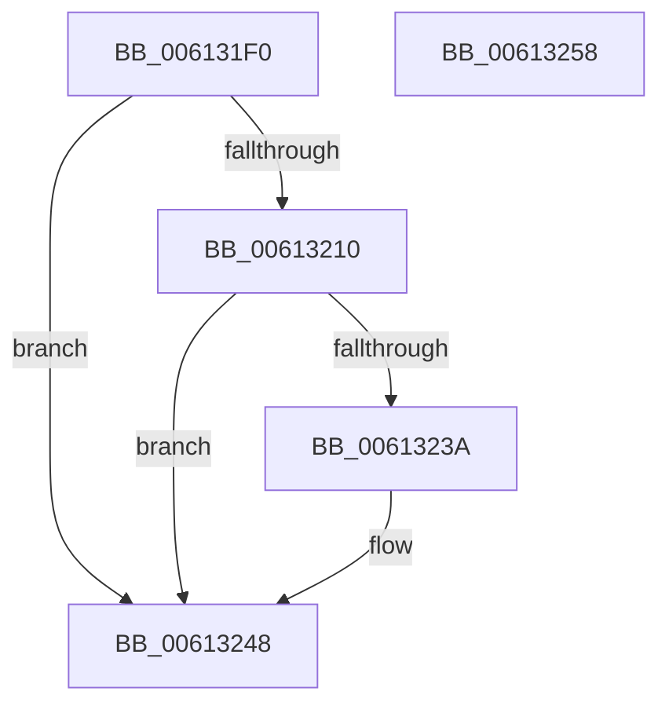

# VfTargetRecoverIoCallbacks

- RVA: `0x006131F0`–`0x00613259` (길이 `105` bytes)
- VA: `0x00000001406131F0`
- 실행 섹션: `.text`
- PDB 이름 있음: `예`; PDB Function 태그: `아니요`
- unwind 정보 RVA: `0x000697A4`
- 디코드: `28`개 명령, `105/105` bytes 표시
- 미해석 바이트: `0` (있으면 어셈블리에 `.byte`로 보존)

> 이 문서는 커널 이미지의 기계어와 PDB 기호를 분석해 생성했습니다. 4번과 5번은 함수 원형과 자료형을 바이너리 사용 방식에서 추정한 C 해석이며 원본 소스 복구 결과는 아닙니다.

## 1. Dependencies

- 직접 호출 지점: **4**; 고유 호출 대상: **4**
- 직접 호출자로 확인된 함수: **1**
- RIP 상대 이미지 참조: **2**

### Outgoing calls
- `0x0061321C` → [VfAvlInitializeLockContext](../4A/VfAvlInitializeLockContext_function_004A686C.md) (function, `0x004A686C`)
- `0x0061322D` → [VfAvlLookupTreeNode](../3E/VfAvlLookupTreeNode_function_003EF1B4.md) (function, `0x003EF1B4`)
- `0x0061323E` → [VfDifRecoverIoCallbacks](VfDifRecoverIoCallbacks_function_00612F40.md) (function, `0x00612F40`)
- `0x0061324D` → [VfAvlCleanupLockContext](../3E/VfAvlCleanupLockContext_function_003EF56C.md) (function, `0x003EF56C`)

### Direct callers
- [VfSuspectRemoveDifVolatileVerification](../../pagevrfy/BA/VfSuspectRemoveDifVolatileVerification_function_00BAB128.md) at `0x00BAB141`

### Static image references
- `0x006131FB` → RVA `0x00F044C0` (`.data`; read)
- `0x00613226` → RVA `0x00F049A0` (`.data`; read)

## 2. Other-region calls and transfers

- 다른 실행 섹션으로 향하는 call: **0**
- 별도 외부 분기/꼬리 이동을 확인하지 못했습니다.

## 3. Assembly (complete function range)

```asm
006131F0  40 53                           push rbx
006131F2  48 83 EC 40                     sub rsp, 0x40
006131F6  33 C0                           xor eax, eax
006131F8  0F 57 C0                        xorps xmm0, xmm0
006131FB  39 05 BF 12 8F 00               cmp dword ptr [rip + 0x8f12bf], eax
00613201  4C 8B C1                        mov r8, rcx
00613204  0F 11 44 24 20                  movups xmmword ptr [rsp + 0x20], xmm0
00613209  48 89 44 24 30                  mov qword ptr [rsp + 0x30], rax
0061320E  75 38                           jne 0x140613248
00613210  44 8D 48 01                     lea r9d, [rax + 1]
00613214  41 8B D1                        mov edx, r9d
00613217  48 8D 4C 24 20                  lea rcx, [rsp + 0x20]
0061321C  E8 4B 36 E9 FF                  call 0x1404a686c
00613221  48 8D 54 24 20                  lea rdx, [rsp + 0x20]
00613226  48 8D 0D 73 17 8F 00            lea rcx, [rip + 0x8f1773]
0061322D  E8 82 BF DD FF                  call 0x1403ef1b4
00613232  48 8B D8                        mov rbx, rax
00613235  48 85 C0                        test rax, rax
00613238  74 0E                           je 0x140613248
0061323A  48 8B 48 28                     mov rcx, qword ptr [rax + 0x28]
0061323E  E8 FD FC FF FF                  call 0x140612f40
00613243  48 83 63 30 00                  and qword ptr [rbx + 0x30], 0
00613248  48 8D 4C 24 20                  lea rcx, [rsp + 0x20]
0061324D  E8 1A C3 DD FF                  call 0x1403ef56c
00613252  48 83 C4 40                     add rsp, 0x40
00613256  5B                              pop rbx
00613257  C3                              ret
00613258  CC                              int3
```

## 4. C-style interpretation (structured pseudocode)

```c
__int64 __fastcall VfTargetRecoverIoCallbacks(__int64 a1)
{
    __int64 result;
    __int64 v_rsp;
    unsigned __int64 v_stack_m18;
    unsigned __int64 v_stack_m28;

    v_rsp = (v_rsp) - (64);
    result = 0;
    v_stack_m28 = v_xmm0;
    v_stack_m18 = 0;
    if ((*(unsigned int *)(v_rip + 9376447)) != 0) goto loc_00613248;
    result = VfAvlInitializeLockContext(v_stack_m28, (unsigned int)((unsigned int)(result + 1)), a1, result + 1);
    result = VfAvlLookupTreeNode(v_rip + 9377651, v_stack_m28, a1, result + 1);
    if (result != 0) {
        a1 = *(unsigned __int64 *)(result + 40);
        result = VfDifRecoverIoCallbacks(a1, v_stack_m28, a1, result + 1);
    }
    result = VfAvlCleanupLockContext(v_stack_m28, v_stack_m28, a1, result + 1);
    v_rsp = (v_rsp) + (64);
    return result;
}
```

## 5. (Beta) C Style

```c
int64_t VfTargetRecoverIoCallbacks(int64_t Arg1)
{
    int64_t result;
    int64_t local_rsp;
    uint64_t v_stack_m18;
    uint64_t v_stack_m28;

    local_rsp = (local_rsp) - (64);
    result = 0;
    v_stack_m28 = v_xmm0;
    v_stack_m18 = 0;
    if ((*(uint32_t *)(v_rip + 0x8F12BF)) != 0) goto loc_00613248;
    result = VfAvlInitializeLockContext(v_stack_m28, (uint32_t)((uint32_t)(result + 1)), Arg1, result + 1);
    result = VfAvlLookupTreeNode(v_rip + 9377651, v_stack_m28, Arg1, result + 1);
    if (result != 0) {
        Arg1 = *(uint64_t *)(result + 0x28);
        result = VfDifRecoverIoCallbacks(Arg1, v_stack_m28, Arg1, result + 1);
    }
    result = VfAvlCleanupLockContext(v_stack_m28, v_stack_m28, Arg1, result + 1);
    local_rsp = (local_rsp) + (64);
    return result;
}
```

## 6. Execution-region graph

[열기: 2D/3D 그래프와 함수 탐색 컨트롤 패널](../../../control-panel.html?section=text&rva=0x006131F0&view=graph)

- 2D 그래프는 위에서 아래로 흐르고, 3D 그래프는 빈 공간을 드래그해 회전합니다. Shift+드래그는 이동, 휠은 확대·축소, 함수 노드 선택은 대상 보고서 이동입니다.

### Static fallback


