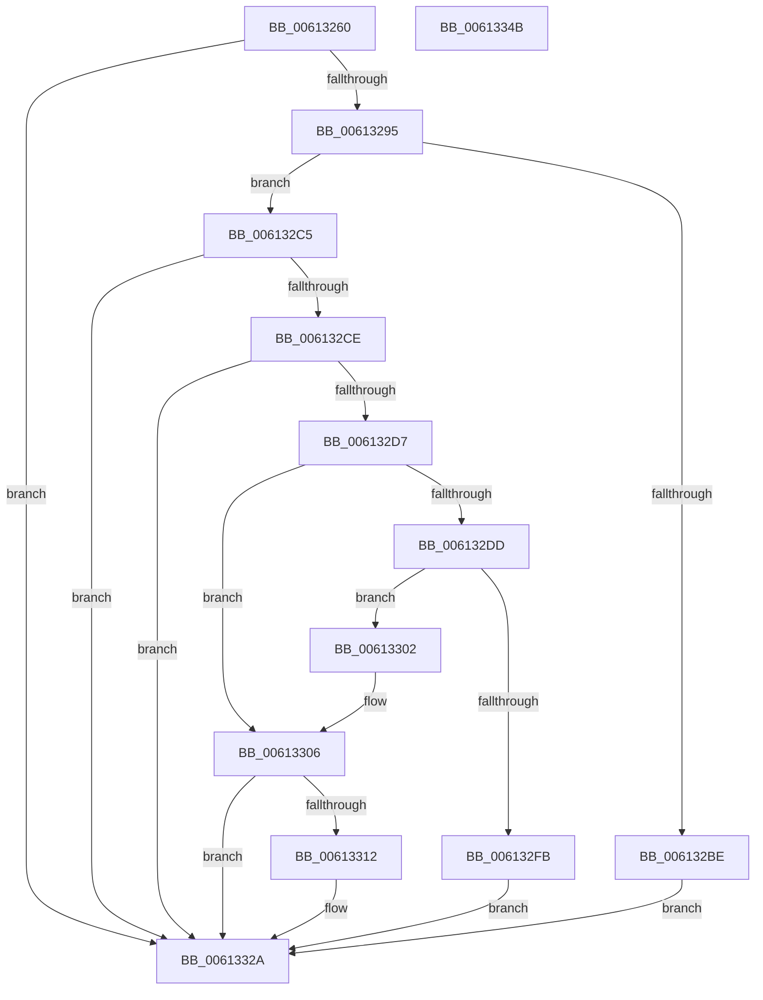

# VfTargetReplaceIoCallbacks

- RVA: `0x00613260`–`0x0061334C` (길이 `236` bytes)
- VA: `0x0000000140613260`
- 실행 섹션: `.text`
- PDB 이름 있음: `예`; PDB Function 태그: `아니요`
- unwind 정보 RVA: `0x0007D3C0`
- 디코드: `65`개 명령, `236/236` bytes 표시
- 미해석 바이트: `0` (있으면 어셈블리에 `.byte`로 보존)

> 이 문서는 커널 이미지의 기계어와 PDB 기호를 분석해 생성했습니다. 4번과 5번은 함수 원형과 자료형을 바이너리 사용 방식에서 추정한 C 해석이며 원본 소스 복구 결과는 아닙니다.

## 1. Dependencies

- 직접 호출 지점: **6**; 고유 호출 대상: **6**
- 직접 호출자로 확인된 함수: **1**
- RIP 상대 이미지 참조: **2**

### Outgoing calls
- `0x006132A0` → [VfAvlInitializeLockContext](../4A/VfAvlInitializeLockContext_function_004A686C.md) (function, `0x004A686C`)
- `0x006132B1` → [VfAvlLookupTreeNode](../3E/VfAvlLookupTreeNode_function_003EF1B4.md) (function, `0x003EF1B4`)
- `0x006132ED` → [ExAllocatePool2](../../poolcode/B8/ExAllocatePool2_function_00B820F0.md) (function, `0x00B820F0`)
- `0x00613309` → [VfDifCaptureIoCallbacks](../4A/VfDifCaptureIoCallbacks_function_004A8698.md) (function, `0x004A8698`)
- `0x00613318` → [ExFreePoolWithTag](../../poolcode/B8/ExFreePoolWithTag_function_00B82870.md) (function, `0x00B82870`)
- `0x0061332F` → [VfAvlCleanupLockContext](../3E/VfAvlCleanupLockContext_function_003EF56C.md) (function, `0x003EF56C`)

### Direct callers
- [VfSuspectApplyDifVolatileVerification](../../pagevrfy/BA/VfSuspectApplyDifVolatileVerification_function_00BAA558.md) at `0x00BAA5C1`

### Static image references
- `0x00613284` → RVA `0x00F04954` (`.data`; read)
- `0x006132AA` → RVA `0x00F049A0` (`.data`; read)

## 2. Other-region calls and transfers

- 다른 실행 섹션으로 향하는 call: **2**
  - `0x006132ED` → [ExAllocatePool2](../../poolcode/B8/ExAllocatePool2_function_00B820F0.md) (`.text` → `POOLCODE`)
  - `0x00613318` → [ExFreePoolWithTag](../../poolcode/B8/ExFreePoolWithTag_function_00B82870.md) (`.text` → `POOLCODE`)
- 별도 외부 분기/꼬리 이동을 확인하지 못했습니다.

## 3. Assembly (complete function range)

```asm
00613260  4C 8B DC                        mov r11, rsp
00613263  49 89 5B 08                     mov qword ptr [r11 + 8], rbx
00613267  49 89 6B 10                     mov qword ptr [r11 + 0x10], rbp
0061326B  49 89 73 18                     mov qword ptr [r11 + 0x18], rsi
0061326F  57                              push rdi
00613270  48 83 EC 40                     sub rsp, 0x40
00613274  33 C0                           xor eax, eax
00613276  0F 57 C0                        xorps xmm0, xmm0
00613279  0F 11 44 24 20                  movups xmmword ptr [rsp + 0x20], xmm0
0061327E  49 89 43 E8                     mov qword ptr [r11 - 0x18], rax
00613282  33 DB                           xor ebx, ebx
00613284  8B 05 CA 16 8F 00               mov eax, dword ptr [rip + 0x8f16ca]
0061328A  4C 8B C1                        mov r8, rcx
0061328D  85 C0                           test eax, eax
0061328F  0F 84 95 00 00 00               je 0x14061332a
00613295  44 8D 4B 01                     lea r9d, [rbx + 1]
00613299  41 8B D1                        mov edx, r9d
0061329C  49 8D 4B D8                     lea rcx, [r11 - 0x28]
006132A0  E8 C7 35 E9 FF                  call 0x1404a686c
006132A5  48 8D 54 24 20                  lea rdx, [rsp + 0x20]
006132AA  48 8D 0D EF 16 8F 00            lea rcx, [rip + 0x8f16ef]
006132B1  E8 FE BE DD FF                  call 0x1403ef1b4
006132B6  48 8B E8                        mov rbp, rax
006132B9  48 85 C0                        test rax, rax
006132BC  75 07                           jne 0x1406132c5
006132BE  BB C0 00 00 C0                  mov ebx, 0xc00000c0
006132C3  EB 65                           jmp 0x14061332a
006132C5  48 8B 70 28                     mov rsi, qword ptr [rax + 0x28]
006132C9  48 85 F6                        test rsi, rsi
006132CC  74 5C                           je 0x14061332a
006132CE  48 8B 7E 30                     mov rdi, qword ptr [rsi + 0x30]
006132D2  48 85 FF                        test rdi, rdi
006132D5  74 53                           je 0x14061332a
006132D7  48 39 5F 40                     cmp qword ptr [rdi + 0x40], rbx
006132DB  75 29                           jne 0x140613306
006132DD  BA 00 01 00 00                  mov edx, 0x100
006132E2  B9 40 00 00 00                  mov ecx, 0x40
006132E7  41 B8 56 66 43 62               mov r8d, 0x62436656
006132ED  E8 FE ED 56 00                  call 0x140b820f0
006132F2  48 89 47 40                     mov qword ptr [rdi + 0x40], rax
006132F6  48 85 C0                        test rax, rax
006132F9  75 07                           jne 0x140613302
006132FB  BB 17 00 00 C0                  mov ebx, 0xc0000017
00613300  EB 28                           jmp 0x14061332a
00613302  48 89 45 30                     mov qword ptr [rbp + 0x30], rax
00613306  48 8B CE                        mov rcx, rsi
00613309  E8 8A 53 E9 FF                  call 0x1404a8698
0061330E  84 C0                           test al, al
00613310  75 18                           jne 0x14061332a
00613312  48 8B 4F 40                     mov rcx, qword ptr [rdi + 0x40]
00613316  33 D2                           xor edx, edx
00613318  E8 53 F5 56 00                  call 0x140b82870
0061331D  48 89 5F 40                     mov qword ptr [rdi + 0x40], rbx
00613321  48 89 5D 30                     mov qword ptr [rbp + 0x30], rbx
00613325  BB 76 0C 00 C0                  mov ebx, 0xc0000c76
0061332A  48 8D 4C 24 20                  lea rcx, [rsp + 0x20]
0061332F  E8 38 C2 DD FF                  call 0x1403ef56c
00613334  48 8B 6C 24 58                  mov rbp, qword ptr [rsp + 0x58]
00613339  8B C3                           mov eax, ebx
0061333B  48 8B 5C 24 50                  mov rbx, qword ptr [rsp + 0x50]
00613340  48 8B 74 24 60                  mov rsi, qword ptr [rsp + 0x60]
00613345  48 83 C4 40                     add rsp, 0x40
00613349  5F                              pop rdi
0061334A  C3                              ret
0061334B  CC                              int3
```

## 4. C-style interpretation (structured pseudocode)

```c
__int64 __fastcall VfTargetReplaceIoCallbacks(__int64 a1)
{
    __int64 result;
    __int64 v_rbx;
    __int64 v_rsp;
    unsigned __int64 v_stack_m28;
    unsigned __int64 v_stack_p10;
    unsigned __int64 v_stack_p18;
    unsigned __int64 v_stack_p8;

    *(unsigned __int64 *)(v_rsp + 8) = v_rbx;
    *(unsigned __int64 *)(v_rsp + 16) = v_rbp;
    *(unsigned __int64 *)(v_rsp + 24) = v_rsi;
    v_rsp = (v_rsp) - (64);
    result = 0;
    v_stack_m28 = v_xmm0;
    *(unsigned __int64 *)(v_rsp - 24) = 0;
    v_rbx = 0;
    if ((unsigned int)((unsigned int)(*(unsigned int *)(v_rip + 9377482))) == 0) goto loc_0061332A;
    result = VfAvlInitializeLockContext(v_rsp - 40, (unsigned int)((unsigned int)(v_rbx + 1)), a1, v_rbx + 1);
    result = VfAvlLookupTreeNode(v_rip + 9377519, v_stack_m28, a1, v_rbx + 1);
    if (result != 0) goto loc_006132C5;
    goto loc_0061332A;
loc_006132C5:
    if (*(unsigned __int64 *)(result + 40) == 0) goto loc_0061332A;
    if (*(unsigned __int64 *)(*(unsigned __int64 *)(result + 40) + 48) == 0) goto loc_0061332A;
    if ((*(unsigned __int64 *)(*(unsigned __int64 *)(*(unsigned __int64 *)(result + 40) + 48) + 64)) != ((unsigned int)(0xC00000C0ULL))) goto loc_00613306;
    result = ExAllocatePool2(64, 256, (unsigned int)(0x62436656ULL), v_rbx + 1);
    *(unsigned __int64 *)(*(unsigned __int64 *)(*(unsigned __int64 *)(result + 40) + 48) + 64) = result;
    if (result != 0) goto loc_00613302;
    goto loc_0061332A;
loc_00613302:
    *(unsigned __int64 *)(result + 48) = result;
loc_00613306:
    result = VfDifCaptureIoCallbacks(*(unsigned __int64 *)(result + 40), 256, (unsigned int)(0x62436656ULL), v_rbx + 1);
    v_rbx = (unsigned int)(0xC0000017ULL);
    if ((unsigned __int8)(result) == 0) {
        a1 = *(unsigned __int64 *)(*(unsigned __int64 *)(*(unsigned __int64 *)(result + 40) + 48) + 64);
        a2 = 0;
        result = ExFreePoolWithTag(a1, a2, (unsigned int)(0x62436656ULL), v_rbx + 1);
        *(unsigned __int64 *)(*(unsigned __int64 *)(*(unsigned __int64 *)(result + 40) + 48) + 64) = (unsigned int)(0xC0000017ULL);
        *(unsigned __int64 *)(result + 48) = (unsigned int)(0xC0000017ULL);
        v_rbx = 0xC0000C76ULL;
    }
    result = VfAvlCleanupLockContext(v_stack_m28, a2, (unsigned int)(0x62436656ULL), v_rbx + 1);
    v_rsp = (v_rsp) + (64);
    return (unsigned int)((unsigned int)(v_rbx));
}
```

## 5. (Beta) C Style

```c
int64_t VfTargetReplaceIoCallbacks(int64_t Arg1)
{
    int64_t result;
    int64_t local_rbx;
    int64_t local_rsp;
    uint64_t v_stack_m28;
    uint64_t v_stack_p10;
    uint64_t v_stack_p18;
    uint64_t v_stack_p8;

    *(uint64_t *)(local_rsp + 0x8) = local_rbx;
    *(uint64_t *)(local_rsp + 0x10) = local_rbp;
    *(uint64_t *)(local_rsp + 0x18) = local_rsi;
    local_rsp = (local_rsp) - (64);
    result = 0;
    v_stack_m28 = v_xmm0;
    *(uint64_t *)(local_rsp - 0x18) = 0;
    local_rbx = 0;
    if ((uint32_t)((uint32_t)(*(uint32_t *)(v_rip + 0x8F16CA))) == 0) goto loc_0061332A;
    result = VfAvlInitializeLockContext(local_rsp - 40, (uint32_t)((uint32_t)(local_rbx + 1)), Arg1, local_rbx + 1);
    result = VfAvlLookupTreeNode(v_rip + 9377519, v_stack_m28, Arg1, local_rbx + 1);
    if (result != 0) goto loc_006132C5;
    goto loc_0061332A;
loc_006132C5:
    if (*(uint64_t *)(result + 0x28) == 0) goto loc_0061332A;
    if (*(uint64_t *)(*(uint64_t *)(result + 0x28) + 0x30) == 0) goto loc_0061332A;
    if ((*(uint64_t *)(*(uint64_t *)(*(uint64_t *)(result + 0x28) + 0x30) + 0x40)) != ((uint32_t)(0xC00000C0ULL))) goto loc_00613306;
    result = ExAllocatePool2(64, 256, (uint32_t)(0x62436656ULL), local_rbx + 1);
    *(uint64_t *)(*(uint64_t *)(*(uint64_t *)(result + 0x28) + 0x30) + 0x40) = result;
    if (result != 0) goto loc_00613302;
    goto loc_0061332A;
loc_00613302:
    *(uint64_t *)(result + 0x30) = result;
loc_00613306:
    result = VfDifCaptureIoCallbacks(*(uint64_t *)(result + 0x28), 256, (uint32_t)(0x62436656ULL), local_rbx + 1);
    local_rbx = (uint32_t)(0xC0000017ULL);
    if ((uint8_t)(result) == 0) {
        Arg1 = *(uint64_t *)(*(uint64_t *)(*(uint64_t *)(result + 0x28) + 0x30) + 0x40);
        a2 = 0;
        result = ExFreePoolWithTag(Arg1, a2, (uint32_t)(0x62436656ULL), local_rbx + 1);
        *(uint64_t *)(*(uint64_t *)(*(uint64_t *)(result + 0x28) + 0x30) + 0x40) = (uint32_t)(0xC0000017ULL);
        *(uint64_t *)(result + 0x30) = (uint32_t)(0xC0000017ULL);
        local_rbx = 0xC0000C76ULL;
    }
    result = VfAvlCleanupLockContext(v_stack_m28, a2, (uint32_t)(0x62436656ULL), local_rbx + 1);
    local_rsp = (local_rsp) + (64);
    return (uint32_t)((uint32_t)(local_rbx));
}
```

## 6. Execution-region graph

[열기: 2D/3D 그래프와 함수 탐색 컨트롤 패널](../../../control-panel.html?section=text&rva=0x00613260&view=graph)

- 2D 그래프는 위에서 아래로 흐르고, 3D 그래프는 빈 공간을 드래그해 회전합니다. Shift+드래그는 이동, 휠은 확대·축소, 함수 노드 선택은 대상 보고서 이동입니다.

### Static fallback


