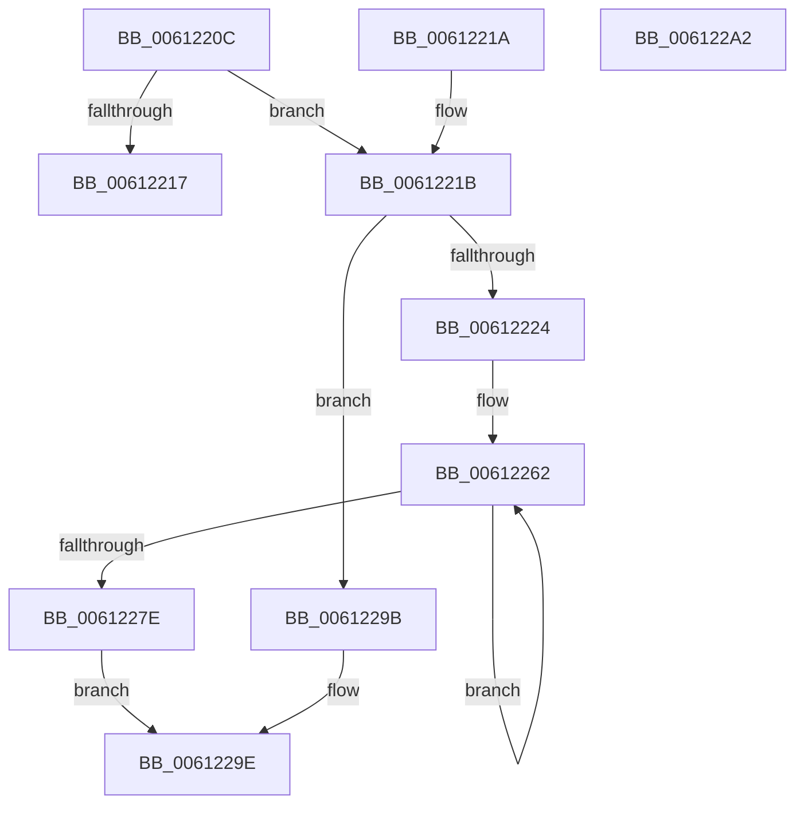

# VfUtilCrashEvent

- RVA: `0x0061220C`–`0x006122A3` (길이 `151` bytes)
- VA: `0x000000014061220C`
- 실행 섹션: `.text`
- PDB 이름 있음: `예`; PDB Function 태그: `아니요`
- unwind 정보 RVA: `0x000DB714`
- 디코드: `39`개 명령, `151/151` bytes 표시
- 미해석 바이트: `0` (있으면 어셈블리에 `.byte`로 보존)

> 이 문서는 커널 이미지의 기계어와 PDB 기호를 분석해 생성했습니다. 4번과 5번은 함수 원형과 자료형을 바이너리 사용 방식에서 추정한 C 해석이며 원본 소스 복구 결과는 아닙니다.

## 1. Dependencies

- 직접 호출 지점: **0**; 고유 호출 대상: **0**
- 직접 호출자로 확인된 함수: **1**
- RIP 상대 이미지 참조: **9**

### Outgoing calls
- 직접 디코드된 call 명령이 없습니다.

### Direct callers
- [CarReportUnusualShutdown](CarReportUnusualShutdown_function_0061951C.md) at `0x00619554`

### Static image references
- `0x0061221B` → RVA `0x00F049D0` (`.data`; read)
- `0x00612224` → RVA `0x00FFDA30` (`PAGEVRFD`; read)
- `0x00612232` → RVA `0x00FFDA38` (`PAGEVRFD`; read)
- `0x0061223D` → RVA `0x00FFDA40` (`PAGEVRFD`; read)
- `0x0061224C` → RVA `0x00FFDA48` (`PAGEVRFD`; read)
- `0x00612257` → RVA `0x00FFDA50` (`PAGEVRFD`; read)
- `0x0061227E` → RVA `0x00F04980` (`.data`; read)
- `0x00612287` → RVA `0x00F049F0` (`.data`; read)
- `0x00612290` → RVA `0x00F049D8` (`.data`; read)

## 2. Other-region calls and transfers

- 다른 실행 섹션으로 향하는 call: **0**
- 별도 외부 분기/꼬리 이동을 확인하지 못했습니다.

## 3. Assembly (complete function range)

```asm
0061220C  45 33 C0                        xor r8d, r8d
0061220F  48 8B D1                        mov rdx, rcx
00612212  48 85 C9                        test rcx, rcx
00612215  75 04                           jne 0x14061221b
00612217  32 C0                           xor al, al
00612219  C3                              ret
0061221A  CC                              int3
0061221B  44 39 05 AE 27 8F 00            cmp dword ptr [rip + 0x8f27ae], r8d
00612222  74 77                           je 0x14061229b
00612224  8B 05 06 B8 9E 00               mov eax, dword ptr [rip + 0x9eb806]
0061222A  41 B9 01 00 00 00               mov r9d, 1
00612230  89 01                           mov dword ptr [rcx], eax
00612232  48 8B 05 FF B7 9E 00            mov rax, qword ptr [rip + 0x9eb7ff]
00612239  48 89 41 08                     mov qword ptr [rcx + 8], rax
0061223D  48 8B 05 FC B7 9E 00            mov rax, qword ptr [rip + 0x9eb7fc]
00612244  45 8D 51 01                     lea r10d, [r9 + 1]
00612248  48 89 41 10                     mov qword ptr [rcx + 0x10], rax
0061224C  48 8B 05 F5 B7 9E 00            mov rax, qword ptr [rip + 0x9eb7f5]
00612253  48 89 41 18                     mov qword ptr [rcx + 0x18], rax
00612257  48 8B 05 F2 B7 9E 00            mov rax, qword ptr [rip + 0x9eb7f2]
0061225E  48 89 41 20                     mov qword ptr [rcx + 0x20], rax
00612262  48 8B 4A 28                     mov rcx, qword ptr [rdx + 0x28]
00612266  48 8D 05 63 27 8F 00            lea rax, [rip + 0x8f2763]
0061226D  41 8B 04 00                     mov eax, dword ptr [r8 + rax]
00612271  41 89 04 08                     mov dword ptr [r8 + rcx], eax
00612275  4D 8D 40 04                     lea r8, [r8 + 4]
00612279  4D 2B D1                        sub r10, r9
0061227C  75 E4                           jne 0x140612262
0061227E  8B 05 FC 26 8F 00               mov eax, dword ptr [rip + 0x8f26fc]
00612284  89 42 30                        mov dword ptr [rdx + 0x30], eax
00612287  8B 05 63 27 8F 00               mov eax, dword ptr [rip + 0x8f2763]
0061228D  89 42 34                        mov dword ptr [rdx + 0x34], eax
00612290  8B 05 42 27 8F 00               mov eax, dword ptr [rip + 0x8f2742]
00612296  89 42 38                        mov dword ptr [rdx + 0x38], eax
00612299  EB 03                           jmp 0x14061229e
0061229B  45 8A C8                        mov r9b, r8b
0061229E  41 8A C1                        mov al, r9b
006122A1  C3                              ret
006122A2  CC                              int3
```

## 4. C-style interpretation (structured pseudocode)

```c
__int64 __fastcall VfUtilCrashEvent(__int64 a1, __int64 a2, int a3)
{
    __int64 result;
    __int64 v_r10;

    a3 = 0;
    if (a1 != 0) goto loc_0061221B;
    result = 0;
    return result;
loc_0061221B:
    if ((*(unsigned int *)(v_rip + 9381806)) == 0) goto loc_0061229B;
    *(unsigned int *)(a1) = (unsigned int)((unsigned int)(*(unsigned int *)(v_rip + 10401798)));
    *(unsigned __int64 *)(a1 + 8) = *(unsigned __int64 *)(v_rip + 10401791);
    *(unsigned __int64 *)(a1 + 16) = *(unsigned __int64 *)(v_rip + 10401788);
    *(unsigned __int64 *)(a1 + 24) = *(unsigned __int64 *)(v_rip + 10401781);
    *(unsigned __int64 *)(a1 + 32) = *(unsigned __int64 *)(v_rip + 10401778);
loc_00612262:
    *(unsigned int *)(a3 + *(unsigned __int64 *)(a1 + 40) * 1) = (unsigned int)((unsigned int)(*(unsigned int *)(a3 + v_rip + 9381731 * 1)));
    v_r10 = (1 + 1) - (1);
    if (condition_is_not_equal) goto loc_00612262;
    *(unsigned int *)(a1 + 48) = (unsigned int)((unsigned int)(*(unsigned int *)(v_rip + 9381628)));
    *(unsigned int *)(a1 + 52) = (unsigned int)((unsigned int)(*(unsigned int *)(v_rip + 9381731)));
    *(unsigned int *)(a1 + 56) = (unsigned int)((unsigned int)(*(unsigned int *)(v_rip + 9381698)));
    goto loc_0061229E;
loc_0061229B:
loc_0061229E:
    return (unsigned __int8)((unsigned __int8)(a3 + 4));
}
```

## 5. (Beta) C Style

```c
int64_t VfUtilCrashEvent(void *Arg1, int64_t Arg2, int32_t Arg3)
{
    uint8_t *arg1 = (uint8_t *)Arg1;

    int64_t result;
    int64_t local_r10;

    Arg3 = 0;
    if (Arg1 != NULL) goto loc_0061221B;
    result = 0;
    return result;
loc_0061221B:
    if ((*(uint32_t *)(v_rip + 0x8F27AE)) == 0) goto loc_0061229B;
    *(uint32_t *)(arg1) = (uint32_t)((uint32_t)(*(uint32_t *)(v_rip + 0x9EB806)));
    *(uint64_t *)(arg1 + 0x8) = *(uint64_t *)(v_rip + 0x9EB7FF);
    *(uint64_t *)(arg1 + 0x10) = *(uint64_t *)(v_rip + 0x9EB7FC);
    *(uint64_t *)(arg1 + 0x18) = *(uint64_t *)(v_rip + 0x9EB7F5);
    *(uint64_t *)(arg1 + 0x20) = *(uint64_t *)(v_rip + 0x9EB7F2);
loc_00612262:
    *(uint32_t *)(Arg3 + *(uint64_t *)(arg1 + 0x28) * 1) = (uint32_t)((uint32_t)(*(uint32_t *)(Arg3 + v_rip + 0x8F2763 * 1)));
    local_r10 = (1 + 1) - (1);
    if (condition_is_not_equal) goto loc_00612262;
    *(uint32_t *)(arg1 + 0x30) = (uint32_t)((uint32_t)(*(uint32_t *)(v_rip + 0x8F26FC)));
    *(uint32_t *)(arg1 + 0x34) = (uint32_t)((uint32_t)(*(uint32_t *)(v_rip + 0x8F2763)));
    *(uint32_t *)(arg1 + 0x38) = (uint32_t)((uint32_t)(*(uint32_t *)(v_rip + 0x8F2742)));
    goto loc_0061229E;
loc_0061229B:
loc_0061229E:
    return (uint8_t)((uint8_t)(Arg3 + 4));
}
```

### 관측된 메모리 오프셋

구조체 형식이 확인되지 않은 접근은 인자 기준의 오프셋으로만 기록했습니다.

| 기준 인자 | 오프셋 표현 | 폭 (bit) | 접근 |
|---|---:|---:|---|
| `Arg1` | `+ 0x28` | `64` | `R` |
| `Arg1` | `+ 0x30` | `32` | `W` |
| `Arg1` | `+ 0x34` | `32` | `W` |
| `Arg1` | `+ 0x38` | `32` | `W` |

## 6. Execution-region graph

[열기: 2D/3D 그래프와 함수 탐색 컨트롤 패널](../../../control-panel.html?section=text&rva=0x0061220C&view=graph)

- 2D 그래프는 위에서 아래로 흐르고, 3D 그래프는 빈 공간을 드래그해 회전합니다. Shift+드래그는 이동, 휠은 확대·축소, 함수 노드 선택은 대상 보고서 이동입니다.

### Static fallback


