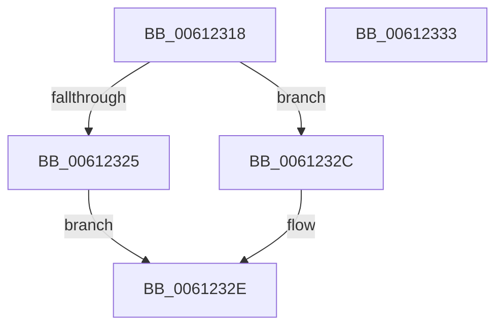

# VfUtilIsSignedDriver

- RVA: `0x00612318`–`0x00612334` (길이 `28` bytes)
- VA: `0x0000000140612318`
- 실행 섹션: `.text`
- PDB 이름 있음: `예`; PDB Function 태그: `아니요`
- unwind 정보 RVA: `0x0005C788`
- 디코드: `11`개 명령, `28/28` bytes 표시
- 미해석 바이트: `0` (있으면 어셈블리에 `.byte`로 보존)

> 이 문서는 커널 이미지의 기계어와 PDB 기호를 분석해 생성했습니다. 4번과 5번은 함수 원형과 자료형을 바이너리 사용 방식에서 추정한 C 해석이며 원본 소스 복구 결과는 아닙니다.

## 1. Dependencies

- 직접 호출 지점: **1**; 고유 호출 대상: **1**
- 직접 호출자로 확인된 함수: **1**
- RIP 상대 이미지 참조: **0**

### Outgoing calls
- `0x0061231C` → [VfUtilGetSigningLevel](../../pagevrfy/B9/VfUtilGetSigningLevel_function_00B933B0.md) (function, `0x00B933B0`)

### Direct callers
- [ViMiscEnforceRule](../../pagevrfy/BA/ViMiscEnforceRule_function_00BAF470.md) at `0x00BAF48F`

### Static image references
- 디코드된 RIP-relative 메모리 참조가 없습니다.

## 2. Other-region calls and transfers

- 다른 실행 섹션으로 향하는 call: **1**
  - `0x0061231C` → [VfUtilGetSigningLevel](../../pagevrfy/B9/VfUtilGetSigningLevel_function_00B933B0.md) (`.text` → `PAGEVRFY`)
- 별도 외부 분기/꼬리 이동을 확인하지 못했습니다.

## 3. Assembly (complete function range)

```asm
00612318  48 83 EC 28                     sub rsp, 0x28
0061231C  E8 8F 10 58 00                  call 0x140b933b0
00612321  3C 0C                           cmp al, 0xc
00612323  74 07                           je 0x14061232c
00612325  3C 08                           cmp al, 8
00612327  0F 94 C0                        sete al
0061232A  EB 02                           jmp 0x14061232e
0061232C  B0 01                           mov al, 1
0061232E  48 83 C4 28                     add rsp, 0x28
00612332  C3                              ret
00612333  CC                              int3
```

## 4. C-style interpretation (structured pseudocode)

```c
__int64 __fastcall VfUtilIsSignedDriver(void)
{
    __int64 result;
    __int64 v_rsp;

    v_rsp = (v_rsp) - (40);
    result = VfUtilGetSigningLevel(a1, a2, a3, a4);
    if (((unsigned __int8)(result)) == 12) goto loc_0061232C;
    result = (((unsigned __int8)(result)) == 8) ? 1 : 0;
    goto loc_0061232E;
loc_0061232C:
loc_0061232E:
    v_rsp = (v_rsp) + (40);
    return 1;
}
```

## 5. (Beta) C Style

```c
void VfUtilIsSignedDriver(void)
{
    int64_t result;
    int64_t local_rsp;

    local_rsp = (local_rsp) - (40);
    result = VfUtilGetSigningLevel(a1, a2, a3, a4);
    if (((uint8_t)(result)) == 12) goto loc_0061232C;
    result = (((uint8_t)(result)) == 8) ? 1 : 0;
    goto loc_0061232E;
loc_0061232C:
loc_0061232E:
    local_rsp = (local_rsp) + (40);
    return 1;
}
```

## 6. Execution-region graph

[열기: 2D/3D 그래프와 함수 탐색 컨트롤 패널](../../../control-panel.html?section=text&rva=0x00612318&view=graph)

- 2D 그래프는 위에서 아래로 흐르고, 3D 그래프는 빈 공간을 드래그해 회전합니다. Shift+드래그는 이동, 휠은 확대·축소, 함수 노드 선택은 대상 보고서 이동입니다.

### Static fallback


