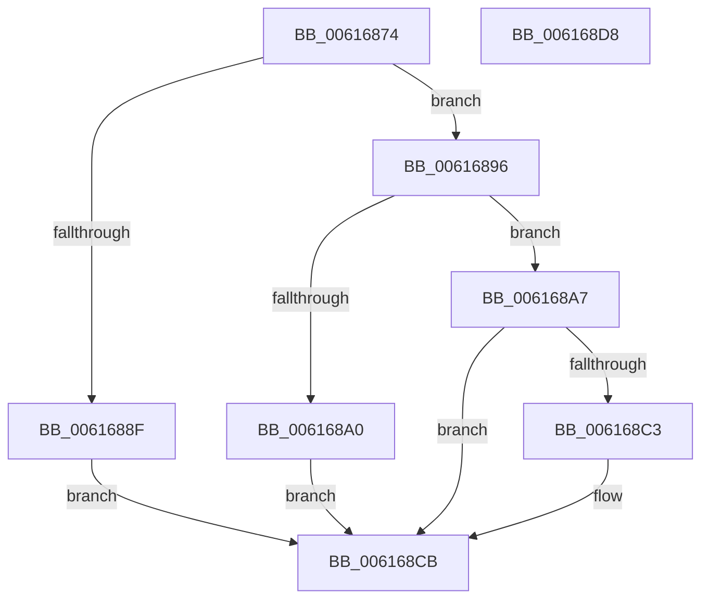

# VfVolatileApplyDifVerification

- RVA: `0x00616874`–`0x006168D9` (길이 `101` bytes)
- VA: `0x0000000140616874`
- 실행 섹션: `.text`
- PDB 이름 있음: `예`; PDB Function 태그: `아니요`
- unwind 정보 RVA: `0x0005CAAC`
- 디코드: `29`개 명령, `101/101` bytes 표시
- 미해석 바이트: `0` (있으면 어셈블리에 `.byte`로 보존)

> 이 문서는 커널 이미지의 기계어와 PDB 기호를 분석해 생성했습니다. 4번과 5번은 함수 원형과 자료형을 바이너리 사용 방식에서 추정한 C 해석이며 원본 소스 복구 결과는 아닙니다.

## 1. Dependencies

- 직접 호출 지점: **3**; 고유 호출 대상: **3**
- 직접 호출자로 확인된 함수: **1**
- RIP 상대 이미지 참조: **1**

### Outgoing calls
- `0x00616896` → [VfSuspectDriversAllocateEntry](../../pagevrfy/BA/VfSuspectDriversAllocateEntry_function_00BAA690.md) (function, `0x00BAA690`)
- `0x006168B5` → [MmEnableOrDisableVerifierForDriver](../../pagevrfy/B9/MmEnableOrDisableVerifierForDriver_function_00B92CC0.md) (function, `0x00B92CC0`)
- `0x006168C6` → [VfSuspectDifRemoveEntry](../../pagevrfy/BA/VfSuspectDifRemoveEntry_function_00BAA630.md) (function, `0x00BAA630`)

### Direct callers
- [NtSetSystemInformation](../../page/AF/NtSetSystemInformation_function_00AF4A60.md) at `0x00AF6648`

### Static image references
- `0x00616886` → RVA `0x00FC41C4` (`.data`; read)

## 2. Other-region calls and transfers

- 다른 실행 섹션으로 향하는 call: **3**
  - `0x00616896` → [VfSuspectDriversAllocateEntry](../../pagevrfy/BA/VfSuspectDriversAllocateEntry_function_00BAA690.md) (`.text` → `PAGEVRFY`)
  - `0x006168B5` → [MmEnableOrDisableVerifierForDriver](../../pagevrfy/B9/MmEnableOrDisableVerifierForDriver_function_00B92CC0.md) (`.text` → `PAGEVRFY`)
  - `0x006168C6` → [VfSuspectDifRemoveEntry](../../pagevrfy/BA/VfSuspectDifRemoveEntry_function_00BAA630.md) (`.text` → `PAGEVRFY`)
- 별도 외부 분기/꼬리 이동을 확인하지 못했습니다.

## 3. Assembly (complete function range)

```asm
00616874  48 89 5C 24 08                  mov qword ptr [rsp + 8], rbx
00616879  57                              push rdi
0061687A  48 83 EC 20                     sub rsp, 0x20
0061687E  83 64 24 38 00                  and dword ptr [rsp + 0x38], 0
00616883  48 8B F9                        mov rdi, rcx
00616886  83 3D 37 D9 9A 00 00            cmp dword ptr [rip + 0x9ad937], 0
0061688D  74 07                           je 0x140616896
0061688F  BB 0A 0C 00 C0                  mov ebx, 0xc0000c0a
00616894  EB 35                           jmp 0x1406168cb
00616896  E8 F5 3D 59 00                  call 0x140baa690
0061689B  48 85 C0                        test rax, rax
0061689E  75 07                           jne 0x1406168a7
006168A0  BB 9A 00 00 C0                  mov ebx, 0xc000009a
006168A5  EB 24                           jmp 0x1406168cb
006168A7  41 B8 02 00 00 00               mov r8d, 2
006168AD  48 8D 54 24 38                  lea rdx, [rsp + 0x38]
006168B2  48 8B C8                        mov rcx, rax
006168B5  E8 06 C4 57 00                  call 0x140b92cc0
006168BA  83 7C 24 38 00                  cmp dword ptr [rsp + 0x38], 0
006168BF  8B D8                           mov ebx, eax
006168C1  75 08                           jne 0x1406168cb
006168C3  48 8B CF                        mov rcx, rdi
006168C6  E8 65 3D 59 00                  call 0x140baa630
006168CB  8B C3                           mov eax, ebx
006168CD  48 8B 5C 24 30                  mov rbx, qword ptr [rsp + 0x30]
006168D2  48 83 C4 20                     add rsp, 0x20
006168D6  5F                              pop rdi
006168D7  C3                              ret
006168D8  CC                              int3
```

## 4. C-style interpretation (structured pseudocode)

```c
__int64 __fastcall VfVolatileApplyDifVerification(__int64 a1)
{
    __int64 result;
    __int64 v_rsp;
    unsigned int v_stack_p10;
    unsigned __int64 v_stack_p8;

    v_stack_p8 = v_rbx;
    v_rsp = (v_rsp) - (32);
    if ((*(unsigned int *)(v_rip + 10148151)) == 0) goto loc_00616896;
    goto loc_006168CB;
loc_00616896:
    result = VfSuspectDriversAllocateEntry(a1, a2, a3, a4);
    if (result != 0) goto loc_006168A7;
    goto loc_006168CB;
loc_006168A7:
    result = MmEnableOrDisableVerifierForDriver(result, v_stack_p10, 2, a4);
    if (v_stack_p10 == 0) {
        a1 = a1;
        result = VfSuspectDifRemoveEntry(a1, v_stack_p10, 2, a4);
    }
    v_rsp = (v_rsp) + (32);
    return (unsigned int)((unsigned int)((unsigned int)((unsigned int)(result))));
}
```

## 5. (Beta) C Style

```c
int64_t VfVolatileApplyDifVerification(int64_t Arg1)
{
    int64_t result;
    int64_t local_rsp;
    uint32_t v_stack_p10;
    uint64_t v_stack_p8;

    v_stack_p8 = local_rbx;
    local_rsp = (local_rsp) - (32);
    if ((*(uint32_t *)(v_rip + 0x9AD937)) == 0) goto loc_00616896;
    goto loc_006168CB;
loc_00616896:
    result = VfSuspectDriversAllocateEntry(Arg1, a2, a3, a4);
    if (result != 0) goto loc_006168A7;
    goto loc_006168CB;
loc_006168A7:
    result = MmEnableOrDisableVerifierForDriver(result, v_stack_p10, 2, a4);
    if (v_stack_p10 == 0) {
        Arg1 = Arg1;
        result = VfSuspectDifRemoveEntry(Arg1, v_stack_p10, 2, a4);
    }
    local_rsp = (local_rsp) + (32);
    return (uint32_t)((uint32_t)((uint32_t)((uint32_t)(result))));
}
```

## 6. Execution-region graph

[열기: 2D/3D 그래프와 함수 탐색 컨트롤 패널](../../../control-panel.html?section=text&rva=0x00616874&view=graph)

- 2D 그래프는 위에서 아래로 흐르고, 3D 그래프는 빈 공간을 드래그해 회전합니다. Shift+드래그는 이동, 휠은 확대·축소, 함수 노드 선택은 대상 보고서 이동입니다.

### Static fallback


