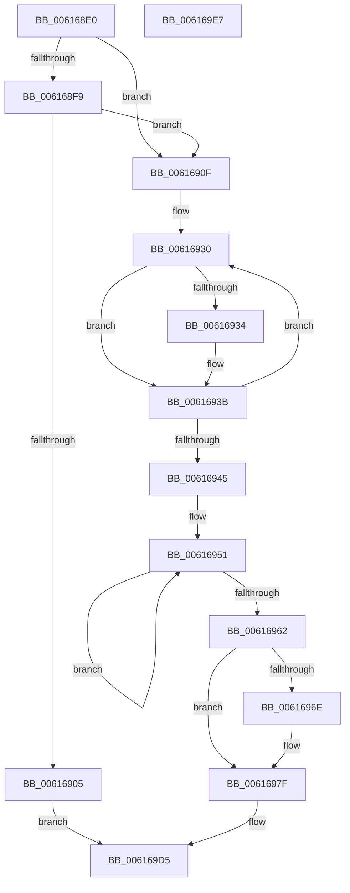

# VfVolatileClearDifRuleClass

- RVA: `0x006168E0`–`0x006169E8` (길이 `264` bytes)
- VA: `0x00000001406168E0`
- 실행 섹션: `.text`
- PDB 이름 있음: `예`; PDB Function 태그: `아니요`
- unwind 정보 RVA: `0x00060BC4`
- 디코드: `60`개 명령, `264/264` bytes 표시
- 미해석 바이트: `0` (있으면 어셈블리에 `.byte`로 보존)

> 이 문서는 커널 이미지의 기계어와 PDB 기호를 분석해 생성했습니다. 4번과 5번은 함수 원형과 자료형을 바이너리 사용 방식에서 추정한 C 해석이며 원본 소스 복구 결과는 아닙니다.

## 1. Dependencies

- 직접 호출 지점: **6**; 고유 호출 대상: **6**
- 직접 호출자로 확인된 함수: **2**
- RIP 상대 이미지 참조: **19**

### Outgoing calls
- `0x00616916` → [ExWaitForRundownProtectionRelease](../2A/ExWaitForRundownProtectionRelease_function_002A4CB0.md) (function, `0x002A4CB0`)
- `0x00616936` → [DifDeregisterPlugin](DifDeregisterPlugin_function_0061A6C8.md) (function, `0x0061A6C8`)
- `0x00616953` → [CarDeregisterRuleClassConfiguration](CarDeregisterRuleClassConfiguration_function_00618870.md) (function, `0x00618870`)
- `0x00616973` → [ExFreePoolWithTag](../../poolcode/B8/ExFreePoolWithTag_function_00B82870.md) (function, `0x00B82870`)
- `0x0061697F` → [CarCleanup](CarCleanup_function_0061850C.md) (function, `0x0061850C`)
- `0x006169D0` → [VfClearDifWithoutReboot](../../pagevrfy/B9/VfClearDifWithoutReboot_function_00B93880.md) (function, `0x00B93880`)

### Direct callers
- [NtSetSystemInformation](../../page/AF/NtSetSystemInformation_function_00AF4A60.md) at `0x00AF6678`
- [VfDriverUnloadImage](../../pagevrfy/B9/VfDriverUnloadImage_function_00B9A5B0.md) at `0x00B9A61A`

### Static image references
- `0x006168F1` → RVA `0x00F0437C` (`.data`; read)
- `0x006168F9` → RVA `0x00F04980` (`.data`; read)
- `0x0061690F` → RVA `0x00F03E80` (`.data`; read)
- `0x00616920` → RVA `0x00E68200` (`.data`; read)
- `0x00616927` → RVA `0x00F03E80` (`.data`; read/write)
- `0x00616945` → RVA `0x00E0EA80` (`.data`; read)
- `0x00616962` → RVA `0x00F04390` (`.data`; read)
- `0x00616978` → RVA `0x00F04390` (`.data`; write)
- `0x00616987` → RVA `0x00F048B8` (`.data`; write)
- `0x0061698F` → RVA `0x00F03E78` (`.data`; write)
- `0x00616995` → RVA `0x00E681D8` (`.data`; read)
- `0x0061699C` → RVA `0x00E681F8` (`.data`; write)
- `0x006169A3` → RVA `0x00E681E8` (`.data`; read)
- `0x006169AA` → RVA `0x00F04388` (`.data`; write)
- `0x006169B1` → RVA `0x00E681A0` (`.data`; write)
- `0x006169B8` → RVA `0x00E0EA70` (`.data`; write)
- `0x006169BE` → RVA `0x00E0EA74` (`.data`; write)
- `0x006169C4` → RVA `0x00F04980` (`.data`; write)
- `0x006169CA` → RVA `0x00F04A20` (`.data`; write)

## 2. Other-region calls and transfers

- 다른 실행 섹션으로 향하는 call: **2**
  - `0x00616973` → [ExFreePoolWithTag](../../poolcode/B8/ExFreePoolWithTag_function_00B82870.md) (`.text` → `POOLCODE`)
  - `0x006169D0` → [VfClearDifWithoutReboot](../../pagevrfy/B9/VfClearDifWithoutReboot_function_00B93880.md) (`.text` → `PAGEVRFY`)
- 별도 외부 분기/꼬리 이동을 확인하지 못했습니다.

## 3. Assembly (complete function range)

```asm
006168E0  48 89 5C 24 08                  mov qword ptr [rsp + 8], rbx
006168E5  48 89 74 24 10                  mov qword ptr [rsp + 0x10], rsi
006168EA  57                              push rdi
006168EB  48 83 EC 20                     sub rsp, 0x20
006168EF  33 DB                           xor ebx, ebx
006168F1  39 1D 85 DA 8E 00               cmp dword ptr [rip + 0x8eda85], ebx
006168F7  74 16                           je 0x14061690f
006168F9  F7 05 7D E0 8E 00 00 08 00 00   test dword ptr [rip + 0x8ee07d], 0x800
00616903  75 0A                           jne 0x14061690f
00616905  BB 7C 0C 00 C0                  mov ebx, 0xc0000c7c
0061690A  E9 C6 00 00 00                  jmp 0x1406169d5
0061690F  48 8D 0D 6A D5 8E 00            lea rcx, [rip + 0x8ed56a]
00616916  E8 95 E3 C8 FF                  call 0x1402a4cb0
0061691B  B8 01 00 00 00                  mov eax, 1
00616920  48 8D 35 D9 18 85 00            lea rsi, [rip + 0x8518d9]
00616927  48 87 05 52 D5 8E 00            xchg qword ptr [rip + 0x8ed552], rax
0061692E  8B FB                           mov edi, ebx
00616930  38 1E                           cmp byte ptr [rsi], bl
00616932  74 07                           je 0x14061693b
00616934  8B CF                           mov ecx, edi
00616936  E8 8D 3D 00 00                  call 0x14061a6c8
0061693B  FF C7                           inc edi
0061693D  48 FF C6                        inc rsi
00616940  83 FF 40                        cmp edi, 0x40
00616943  72 EB                           jb 0x140616930
00616945  48 8D 3D 34 81 7F 00            lea rdi, [rip + 0x7f8134]
0061694C  BE 04 00 00 00                  mov esi, 4
00616951  8B 0F                           mov ecx, dword ptr [rdi]
00616953  E8 18 1F 00 00                  call 0x140618870
00616958  48 8D 7F 10                     lea rdi, [rdi + 0x10]
0061695C  48 83 EE 01                     sub rsi, 1
00616960  75 EF                           jne 0x140616951
00616962  48 8B 0D 27 DA 8E 00            mov rcx, qword ptr [rip + 0x8eda27]
00616969  48 85 C9                        test rcx, rcx
0061696C  74 11                           je 0x14061697f
0061696E  BA 44 76 4D 6D                  mov edx, 0x6d4d7644
00616973  E8 F8 BE 56 00                  call 0x140b82870
00616978  48 89 1D 11 DA 8E 00            mov qword ptr [rip + 0x8eda11], rbx
0061697F  E8 88 1B 00 00                  call 0x14061850c
00616984  0F 57 C0                        xorps xmm0, xmm0
00616987  88 1D 2B DF 8E 00               mov byte ptr [rip + 0x8edf2b], bl
0061698D  33 C0                           xor eax, eax
0061698F  88 1D E3 D4 8E 00               mov byte ptr [rip + 0x8ed4e3], bl
00616995  0F 11 05 3C 18 85 00            movups xmmword ptr [rip + 0x85183c], xmm0
0061699C  48 89 05 55 18 85 00            mov qword ptr [rip + 0x851855], rax
006169A3  0F 11 05 3E 18 85 00            movups xmmword ptr [rip + 0x85183e], xmm0
006169AA  48 89 1D D7 D9 8E 00            mov qword ptr [rip + 0x8ed9d7], rbx
006169B1  48 89 1D E8 17 85 00            mov qword ptr [rip + 0x8517e8], rbx
006169B8  89 1D B2 80 7F 00               mov dword ptr [rip + 0x7f80b2], ebx
006169BE  89 1D B0 80 7F 00               mov dword ptr [rip + 0x7f80b0], ebx
006169C4  89 1D B6 DF 8E 00               mov dword ptr [rip + 0x8edfb6], ebx
006169CA  89 1D 50 E0 8E 00               mov dword ptr [rip + 0x8ee050], ebx
006169D0  E8 AB CE 57 00                  call 0x140b93880
006169D5  48 8B 74 24 38                  mov rsi, qword ptr [rsp + 0x38]
006169DA  8B C3                           mov eax, ebx
006169DC  48 8B 5C 24 30                  mov rbx, qword ptr [rsp + 0x30]
006169E1  48 83 C4 20                     add rsp, 0x20
006169E5  5F                              pop rdi
006169E6  C3                              ret
006169E7  CC                              int3
```

## 4. C-style interpretation (structured pseudocode)

```c
__int64 __fastcall VfVolatileClearDifRuleClass(void)
{
    __int64 result;
    __int64 v_rbx;
    __int64 v_rdi;
    __int64 v_rsi;
    __int64 v_rsp;
    unsigned __int64 v_stack_p10;
    unsigned __int64 v_stack_p8;

    v_stack_p8 = v_rbx;
    v_stack_p10 = v_rsi;
    v_rsp = (v_rsp) - (32);
    v_rbx = 0;
    if ((*(unsigned int *)(v_rip + 9362053)) == 0) goto loc_0061690F;
    if (((*(unsigned int *)(v_rip + 9363581)) & (0x800ULL)) != 0) goto loc_0061690F;
    goto loc_006169D5;
loc_0061690F:
    result = ExWaitForRundownProtectionRelease(v_rip + 9360746, a2, a3, a4);
loc_00616930:
    result = 1;
    if ((*(unsigned __int8 *)(v_rip + 8722649)) != ((unsigned __int8)((unsigned int)(0xC0000C7CULL)))) {
        a1 = (unsigned int)((unsigned int)((unsigned int)((unsigned int)(0xC0000C7CULL))));
        result = DifDeregisterPlugin(a1, a2, a3, a4);
    }
    v_rdi = (unsigned int)(((unsigned int)((unsigned int)((unsigned int)(0xC0000C7CULL)))) + 1);
    v_rsi = (v_rip + 8722649) + 1;
    if (((unsigned int)(v_rdi)) < 64) goto loc_00616930;
loc_00616951:
    result = CarDeregisterRuleClassConfiguration((unsigned int)(*(unsigned int *)(v_rip + 8356148)), a2, a3, a4);
    v_rsi = (4) - (1);
    if (condition_is_not_equal) goto loc_00616951;
    if (*(unsigned __int64 *)(v_rip + 9361959) != 0) {
        a2 = 0x6D4D7644ULL;
        result = ExFreePoolWithTag(*(unsigned __int64 *)(v_rip + 9361959), a2, a3, a4);
        *(unsigned __int64 *)(v_rip + 9361937) = (unsigned int)(0xC0000C7CULL);
    }
    result = CarCleanup(*(unsigned __int64 *)(v_rip + 9361959), a2, a3, a4);
    *(unsigned __int8 *)(v_rip + 9363243) = (unsigned __int8)((unsigned int)(0xC0000C7CULL));
    result = 0;
    *(unsigned __int8 *)(v_rip + 9360611) = (unsigned __int8)((unsigned int)(0xC0000C7CULL));
    *(unsigned __int64 *)(v_rip + 8722492) = v_xmm0;
    *(unsigned __int64 *)(v_rip + 8722517) = 0;
    *(unsigned __int64 *)(v_rip + 8722494) = v_xmm0;
    *(unsigned __int64 *)(v_rip + 9361879) = (unsigned int)(0xC0000C7CULL);
    *(unsigned __int64 *)(v_rip + 8722408) = (unsigned int)(0xC0000C7CULL);
    *(unsigned int *)(v_rip + 8356018) = (unsigned int)((unsigned int)(0xC0000C7CULL));
    *(unsigned int *)(v_rip + 8356016) = (unsigned int)((unsigned int)(0xC0000C7CULL));
    *(unsigned int *)(v_rip + 9363382) = (unsigned int)((unsigned int)(0xC0000C7CULL));
    *(unsigned int *)(v_rip + 9363536) = (unsigned int)((unsigned int)(0xC0000C7CULL));
    result = VfClearDifWithoutReboot(*(unsigned __int64 *)(v_rip + 9361959), a2, a3, a4);
loc_006169D5:
    v_rsp = (v_rsp) + (32);
    return (unsigned int)((unsigned int)((unsigned int)(0xC0000C7CULL)));
}
```

## 5. (Beta) C Style

```c
void VfVolatileClearDifRuleClass(void)
{
    int64_t result;
    int64_t local_rbx;
    int64_t local_rdi;
    int64_t local_rsi;
    int64_t local_rsp;
    uint64_t v_stack_p10;
    uint64_t v_stack_p8;

    v_stack_p8 = local_rbx;
    v_stack_p10 = local_rsi;
    local_rsp = (local_rsp) - (32);
    local_rbx = 0;
    if ((*(uint32_t *)(v_rip + 0x8EDA85)) == 0) goto loc_0061690F;
    if (((*(uint32_t *)(v_rip + 0x8EE07D)) & (0x800ULL)) != 0) goto loc_0061690F;
    goto loc_006169D5;
loc_0061690F:
    result = ExWaitForRundownProtectionRelease(v_rip + 9360746, a2, a3, a4);
loc_00616930:
    result = 1;
    if ((*(uint8_t *)(v_rip + 0x8518D9)) != ((uint8_t)((uint32_t)(0xC0000C7CULL)))) {
        a1 = (uint32_t)((uint32_t)((uint32_t)((uint32_t)(0xC0000C7CULL))));
        result = DifDeregisterPlugin(a1, a2, a3, a4);
    }
    local_rdi = (uint32_t)(((uint32_t)((uint32_t)((uint32_t)(0xC0000C7CULL)))) + 1);
    local_rsi = (v_rip + 8722649) + 1;
    if (((uint32_t)(local_rdi)) < 64) goto loc_00616930;
loc_00616951:
    result = CarDeregisterRuleClassConfiguration((uint32_t)(*(uint32_t *)(v_rip + 0x7F8134)), a2, a3, a4);
    local_rsi = (4) - (1);
    if (condition_is_not_equal) goto loc_00616951;
    if (*(uint64_t *)(v_rip + 0x8EDA27) != 0) {
        a2 = 0x6D4D7644ULL;
        result = ExFreePoolWithTag(*(uint64_t *)(v_rip + 0x8EDA27), a2, a3, a4);
        *(uint64_t *)(v_rip + 0x8EDA11) = (uint32_t)(0xC0000C7CULL);
    }
    result = CarCleanup(*(uint64_t *)(v_rip + 0x8EDA27), a2, a3, a4);
    *(uint8_t *)(v_rip + 0x8EDF2B) = (uint8_t)((uint32_t)(0xC0000C7CULL));
    result = 0;
    *(uint8_t *)(v_rip + 0x8ED4E3) = (uint8_t)((uint32_t)(0xC0000C7CULL));
    *(uint64_t *)(v_rip + 0x85183C) = v_xmm0;
    *(uint64_t *)(v_rip + 0x851855) = 0;
    *(uint64_t *)(v_rip + 0x85183E) = v_xmm0;
    *(uint64_t *)(v_rip + 0x8ED9D7) = (uint32_t)(0xC0000C7CULL);
    *(uint64_t *)(v_rip + 0x8517E8) = (uint32_t)(0xC0000C7CULL);
    *(uint32_t *)(v_rip + 0x7F80B2) = (uint32_t)((uint32_t)(0xC0000C7CULL));
    *(uint32_t *)(v_rip + 0x7F80B0) = (uint32_t)((uint32_t)(0xC0000C7CULL));
    *(uint32_t *)(v_rip + 0x8EDFB6) = (uint32_t)((uint32_t)(0xC0000C7CULL));
    *(uint32_t *)(v_rip + 0x8EE050) = (uint32_t)((uint32_t)(0xC0000C7CULL));
    result = VfClearDifWithoutReboot(*(uint64_t *)(v_rip + 0x8EDA27), a2, a3, a4);
loc_006169D5:
    local_rsp = (local_rsp) + (32);
    return (uint32_t)((uint32_t)((uint32_t)(0xC0000C7CULL)));
}
```

## 6. Execution-region graph

[열기: 2D/3D 그래프와 함수 탐색 컨트롤 패널](../../../control-panel.html?section=text&rva=0x006168E0&view=graph)

- 2D 그래프는 위에서 아래로 흐르고, 3D 그래프는 빈 공간을 드래그해 회전합니다. Shift+드래그는 이동, 휠은 확대·축소, 함수 노드 선택은 대상 보고서 이동입니다.

### Static fallback


