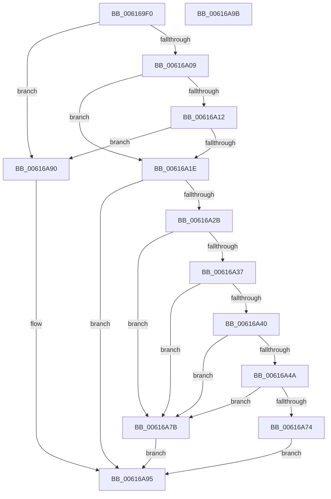

# VfVolatileRemoveDifVerification

- RVA: `0x006169F0`–`0x00616A9C` (길이 `172` bytes)
- VA: `0x00000001406169F0`
- 실행 섹션: `.text`
- PDB 이름 있음: `예`; PDB Function 태그: `아니요`
- unwind 정보 RVA: `0x0005CF00`
- 디코드: `40`개 명령, `172/172` bytes 표시
- 미해석 바이트: `0` (있으면 어셈블리에 `.byte`로 보존)

> 이 문서는 커널 이미지의 기계어와 PDB 기호를 분석해 생성했습니다. 4번과 5번은 함수 원형과 자료형을 바이너리 사용 방식에서 추정한 C 해석이며 원본 소스 복구 결과는 아닙니다.

## 1. Dependencies

- 직접 호출 지점: **3**; 고유 호출 대상: **3**
- 직접 호출자로 확인된 함수: **1**
- RIP 상대 이미지 참조: **6**

### Outgoing calls
- `0x00616A1E` → [ViSuspectDriversLookupEntry](../../pagevrfy/BA/ViSuspectDriversLookupEntry_function_00BAB194.md) (function, `0x00BAB194`)
- `0x00616A63` → [ExAllocatePool2](../../poolcode/B8/ExAllocatePool2_function_00B820F0.md) (function, `0x00B820F0`)
- `0x00616A89` → [MmEnableOrDisableVerifierForDriver](../../pagevrfy/B9/MmEnableOrDisableVerifierForDriver_function_00B92CC0.md) (function, `0x00B92CC0`)

### Direct callers
- [NtSetSystemInformation](../../page/AF/NtSetSystemInformation_function_00AF4A60.md) at `0x00AF663E`

### Static image references
- `0x006169FB` → RVA `0x00F04890` (`.data`; read)
- `0x00616A09` → RVA `0x00F048B8` (`.data`; read)
- `0x00616A12` → RVA `0x00F04980` (`.data`; read)
- `0x00616A40` → RVA `0x00F04390` (`.data`; read)
- `0x00616A4A` → RVA `0x00F044C4` (`.data`; read)
- `0x00616A68` → RVA `0x00F04390` (`.data`; write)

## 2. Other-region calls and transfers

- 다른 실행 섹션으로 향하는 call: **3**
  - `0x00616A1E` → [ViSuspectDriversLookupEntry](../../pagevrfy/BA/ViSuspectDriversLookupEntry_function_00BAB194.md) (`.text` → `PAGEVRFY`)
  - `0x00616A63` → [ExAllocatePool2](../../poolcode/B8/ExAllocatePool2_function_00B820F0.md) (`.text` → `POOLCODE`)
  - `0x00616A89` → [MmEnableOrDisableVerifierForDriver](../../pagevrfy/B9/MmEnableOrDisableVerifierForDriver_function_00B92CC0.md) (`.text` → `PAGEVRFY`)
- 별도 외부 분기/꼬리 이동을 확인하지 못했습니다.

## 3. Assembly (complete function range)

```asm
006169F0  40 53                           push rbx
006169F2  48 83 EC 20                     sub rsp, 0x20
006169F6  83 64 24 38 00                  and dword ptr [rsp + 0x38], 0
006169FB  48 83 3D 8D DE 8E 00 00         cmp qword ptr [rip + 0x8ede8d], 0
00616A03  0F 84 87 00 00 00               je 0x140616a90
00616A09  80 3D A8 DE 8E 00 00            cmp byte ptr [rip + 0x8edea8], 0
00616A10  75 0C                           jne 0x140616a1e
00616A12  F7 05 64 DF 8E 00 00 08 00 00   test dword ptr [rip + 0x8edf64], 0x800
00616A1C  74 72                           je 0x140616a90
00616A1E  E8 71 47 59 00                  call 0x140bab194
00616A23  48 8B D8                        mov rbx, rax
00616A26  48 85 C0                        test rax, rax
00616A29  74 6A                           je 0x140616a95
00616A2B  F7 05 4B DF 8E 00 00 08 00 00   test dword ptr [rip + 0x8edf4b], 0x800
00616A35  74 44                           je 0x140616a7b
00616A37  80 3D 7A DE 8E 00 00            cmp byte ptr [rip + 0x8ede7a], 0
00616A3E  75 3B                           jne 0x140616a7b
00616A40  48 83 3D 48 D9 8E 00 00         cmp qword ptr [rip + 0x8ed948], 0
00616A48  75 31                           jne 0x140616a7b
00616A4A  8B 05 74 DA 8E 00               mov eax, dword ptr [rip + 0x8eda74]
00616A50  B9 40 00 00 00                  mov ecx, 0x40
00616A55  41 B8 44 76 4D 6D               mov r8d, 0x6d4d7644
00616A5B  48 8D 14 40                     lea rdx, [rax + rax*2]
00616A5F  48 C1 E2 03                     shl rdx, 3
00616A63  E8 88 B6 56 00                  call 0x140b820f0
00616A68  48 89 05 21 D9 8E 00            mov qword ptr [rip + 0x8ed921], rax
00616A6F  48 85 C0                        test rax, rax
00616A72  75 07                           jne 0x140616a7b
00616A74  B8 17 00 00 C0                  mov eax, 0xc0000017
00616A79  EB 1A                           jmp 0x140616a95
00616A7B  41 B8 04 00 00 00               mov r8d, 4
00616A81  48 8D 54 24 38                  lea rdx, [rsp + 0x38]
00616A86  48 8B CB                        mov rcx, rbx
00616A89  E8 32 C2 57 00                  call 0x140b92cc0
00616A8E  EB 05                           jmp 0x140616a95
00616A90  B8 7C 0C 00 C0                  mov eax, 0xc0000c7c
00616A95  48 83 C4 20                     add rsp, 0x20
00616A99  5B                              pop rbx
00616A9A  C3                              ret
00616A9B  CC                              int3
```

## 4. C-style interpretation (structured pseudocode)

```c
__int64 __fastcall VfVolatileRemoveDifVerification(void)
{
    __int64 result;
    __int64 v_rsp;
    unsigned int v_stack_p10;

    v_rsp = (v_rsp) - (32);
    if ((*(unsigned __int64 *)(v_rip + 9363085)) == 0) goto loc_00616A90;
    if ((*(unsigned __int8 *)(v_rip + 9363112)) != 0) goto loc_00616A1E;
    if (((*(unsigned int *)(v_rip + 9363300)) & (0x800ULL)) == 0) goto loc_00616A90;
loc_00616A1E:
    result = ViSuspectDriversLookupEntry(a1, a2, a3, a4);
    if (result == 0) goto loc_00616A95;
    if (((*(unsigned int *)(v_rip + 9363275)) & (0x800ULL)) == 0) goto loc_00616A7B;
    if ((*(unsigned __int8 *)(v_rip + 9363066)) != 0) goto loc_00616A7B;
    if ((*(unsigned __int64 *)(v_rip + 9361736)) != 0) goto loc_00616A7B;
    a2 = ((unsigned int)(*(unsigned int *)(v_rip + 9362036)) + (unsigned int)(*(unsigned int *)(v_rip + 9362036)) * 2) << (3);
    result = ExAllocatePool2(64, a2, (unsigned int)(0x6D4D7644ULL), a4);
    *(unsigned __int64 *)(v_rip + 9361697) = result;
    if (result != 0) goto loc_00616A7B;
    goto loc_00616A95;
loc_00616A7B:
    result = MmEnableOrDisableVerifierForDriver(result, v_stack_p10, 4, a4);
    goto loc_00616A95;
loc_00616A90:
loc_00616A95:
    v_rsp = (v_rsp) + (32);
    return (unsigned int)(0xC0000C7CULL);
}
```

## 5. (Beta) C Style

```c
void VfVolatileRemoveDifVerification(void)
{
    int64_t result;
    int64_t local_rsp;
    uint32_t v_stack_p10;

    local_rsp = (local_rsp) - (32);
    if ((*(uint64_t *)(v_rip + 0x8EDE8D)) == 0) goto loc_00616A90;
    if ((*(uint8_t *)(v_rip + 0x8EDEA8)) != 0) goto loc_00616A1E;
    if (((*(uint32_t *)(v_rip + 0x8EDF64)) & (0x800ULL)) == 0) goto loc_00616A90;
loc_00616A1E:
    result = ViSuspectDriversLookupEntry(a1, a2, a3, a4);
    if (result == 0) goto loc_00616A95;
    if (((*(uint32_t *)(v_rip + 0x8EDF4B)) & (0x800ULL)) == 0) goto loc_00616A7B;
    if ((*(uint8_t *)(v_rip + 0x8EDE7A)) != 0) goto loc_00616A7B;
    if ((*(uint64_t *)(v_rip + 0x8ED948)) != 0) goto loc_00616A7B;
    a2 = ((uint32_t)(*(uint32_t *)(v_rip + 0x8EDA74)) + (uint32_t)(*(uint32_t *)(v_rip + 0x8EDA74)) * 2) << (3);
    result = ExAllocatePool2(64, a2, (uint32_t)(0x6D4D7644ULL), a4);
    *(uint64_t *)(v_rip + 0x8ED921) = result;
    if (result != 0) goto loc_00616A7B;
    goto loc_00616A95;
loc_00616A7B:
    result = MmEnableOrDisableVerifierForDriver(result, v_stack_p10, 4, a4);
    goto loc_00616A95;
loc_00616A90:
loc_00616A95:
    local_rsp = (local_rsp) + (32);
    return (uint32_t)(0xC0000C7CULL);
}
```

## 6. Execution-region graph

[열기: 2D/3D 그래프와 함수 탐색 컨트롤 패널](../../../control-panel.html?section=text&rva=0x006169F0&view=graph)

- 2D 그래프는 위에서 아래로 흐르고, 3D 그래프는 빈 공간을 드래그해 회전합니다. Shift+드래그는 이동, 휠은 확대·축소, 함수 노드 선택은 대상 보고서 이동입니다.

### Static fallback


