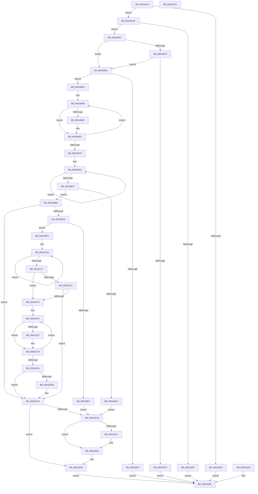

# VfVolatileSetDifRuleClass

- RVA: `0x00616AA4`–`0x00616D77` (길이 `723` bytes)
- VA: `0x0000000140616AA4`
- 실행 섹션: `.text`
- PDB 이름 있음: `예`; PDB Function 태그: `아니요`
- unwind 정보 RVA: `0x000D2778`
- 디코드: `179`개 명령, `723/723` bytes 표시
- 미해석 바이트: `0` (있으면 어셈블리에 `.byte`로 보존)

> 이 문서는 커널 이미지의 기계어와 PDB 기호를 분석해 생성했습니다. 4번과 5번은 함수 원형과 자료형을 바이너리 사용 방식에서 추정한 C 해석이며 원본 소스 복구 결과는 아닙니다.

## 1. Dependencies

- 직접 호출 지점: **13**; 고유 호출 대상: **9**
- 직접 호출자로 확인된 함수: **1**
- RIP 상대 이미지 참조: **23**

### Outgoing calls
- `0x00616B11` → [ExAllocatePool2](../../poolcode/B8/ExAllocatePool2_function_00B820F0.md) (function, `0x00B820F0`)
- `0x00616B79` → [memcpy](../6C/memcpy_function_006C6840.md) (function, `0x006C6840`)
- `0x00616BB9` → [VfInitDifWithoutReboot](../../pagevrfy/B9/VfInitDifWithoutReboot_function_00B938FC.md) (function, `0x00B938FC`)
- `0x00616BE1` → [ExAllocatePool2](../../poolcode/B8/ExAllocatePool2_function_00B820F0.md) (function, `0x00B820F0`)
- `0x00616C28` → [VfRlrsVolatileConfigUpdate](VfRlrsVolatileConfigUpdate_function_006174C4.md) (function, `0x006174C4`)
- `0x00616CAE` → [CarInit](CarInit_function_006189FC.md) (function, `0x006189FC`)
- `0x00616CC0` → [DifRegisterKernelPlugins](DifRegisterKernelPlugins_function_0061AA40.md) (function, `0x0061AA40`)
- `0x00616CF8` → [VfClearDifWithoutReboot](../../pagevrfy/B9/VfClearDifWithoutReboot_function_00B93880.md) (function, `0x00B93880`)
- `0x00616D1C` → [ExFreePoolWithTag](../../poolcode/B8/ExFreePoolWithTag_function_00B82870.md) (function, `0x00B82870`)
- `0x00616D2F` → [VfRlrsVolatileConfigUpdate](VfRlrsVolatileConfigUpdate_function_006174C4.md) (function, `0x006174C4`)
- `0x00616D34` → [CarCleanup](CarCleanup_function_0061850C.md) (function, `0x0061850C`)
- `0x00616D41` → [ExFreePoolWithTag](../../poolcode/B8/ExFreePoolWithTag_function_00B82870.md) (function, `0x00B82870`)
- `0x00616D54` → [ExFreePoolWithTag](../../poolcode/B8/ExFreePoolWithTag_function_00B82870.md) (function, `0x00B82870`)

### Direct callers
- [NtSetSystemInformation](../../page/AF/NtSetSystemInformation_function_00AF4A60.md) at `0x00AF66A5`

### Static image references
- `0x00616AC9` → RVA `0x00FC41C4` (`.data`; read)
- `0x00616ADC` → RVA `0x00E681A0` (`.data`; read)
- `0x00616B2D` → RVA `0x00F04388` (`.data`; read/write)
- `0x00616B34` → RVA `0x00038260` (`.rdata`; read)
- `0x00616B41` → RVA `0x00F04388` (`.data`; read)
- `0x00616BC8` → RVA `0x00F044C4` (`.data`; read)
- `0x00616BE6` → RVA `0x00F04390` (`.data`; write)
- `0x00616C37` → RVA `0x00E0EA70` (`.data`; write)
- `0x00616C3E` → RVA `0x00E0EA74` (`.data`; write)
- `0x00616C57` → RVA `0x00E0EA70` (`.data`; read)
- `0x00616C5D` → RVA `0x00E681D8` (`.data`; read)
- `0x00616C71` → RVA `0x00E0EA74` (`.data`; read/write)
- `0x00616C84` → RVA `0x00F04980` (`.data`; write)
- `0x00616C8D` → RVA `0x00F049D8` (`.data`; write)
- `0x00616C9A` → RVA `0x00F04A20` (`.data`; write)
- `0x00616CA0` → RVA `0x00F048B8` (`.data`; write)
- `0x00616CA7` → RVA `0x00F03E78` (`.data`; write)
- `0x00616CB9` → RVA `0x00F03E80` (`.data`; write)
- `0x00616CC9` → RVA `0x00F04388` (`.data`; write)
- `0x00616CD0` → RVA `0x00E681A0` (`.data`; write)
- `0x00616CE3` → RVA `0x00E681E8` (`.data`; read)
- `0x00616CEA` → RVA `0x00E681F8` (`.data`; write)
- `0x00616D0B` → RVA `0x00F04390` (`.data`; read)

## 2. Other-region calls and transfers

- 다른 실행 섹션으로 향하는 call: **7**
  - `0x00616B11` → [ExAllocatePool2](../../poolcode/B8/ExAllocatePool2_function_00B820F0.md) (`.text` → `POOLCODE`)
  - `0x00616BB9` → [VfInitDifWithoutReboot](../../pagevrfy/B9/VfInitDifWithoutReboot_function_00B938FC.md) (`.text` → `PAGEVRFY`)
  - `0x00616BE1` → [ExAllocatePool2](../../poolcode/B8/ExAllocatePool2_function_00B820F0.md) (`.text` → `POOLCODE`)
  - `0x00616CF8` → [VfClearDifWithoutReboot](../../pagevrfy/B9/VfClearDifWithoutReboot_function_00B93880.md) (`.text` → `PAGEVRFY`)
  - `0x00616D1C` → [ExFreePoolWithTag](../../poolcode/B8/ExFreePoolWithTag_function_00B82870.md) (`.text` → `POOLCODE`)
  - `0x00616D41` → [ExFreePoolWithTag](../../poolcode/B8/ExFreePoolWithTag_function_00B82870.md) (`.text` → `POOLCODE`)
  - `0x00616D54` → [ExFreePoolWithTag](../../poolcode/B8/ExFreePoolWithTag_function_00B82870.md) (`.text` → `POOLCODE`)
- 별도 외부 분기/꼬리 이동을 확인하지 못했습니다.

## 3. Assembly (complete function range)

```asm
00616AA4  48 89 5C 24 08                  mov qword ptr [rsp + 8], rbx
00616AA9  48 89 74 24 10                  mov qword ptr [rsp + 0x10], rsi
00616AAE  57                              push rdi
00616AAF  41 54                           push r12
00616AB1  41 55                           push r13
00616AB3  41 56                           push r14
00616AB5  41 57                           push r15
00616AB7  48 83 EC 20                     sub rsp, 0x20
00616ABB  8B F2                           mov esi, edx
00616ABD  4C 8B E9                        mov r13, rcx
00616AC0  45 33 FF                        xor r15d, r15d
00616AC3  45 33 E4                        xor r12d, r12d
00616AC6  45 32 F6                        xor r14b, r14b
00616AC9  44 39 25 F4 D6 9A 00            cmp dword ptr [rip + 0x9ad6f4], r12d
00616AD0  74 0A                           je 0x140616adc
00616AD2  B8 0A 0C 00 C0                  mov eax, 0xc0000c0a
00616AD7  E9 82 02 00 00                  jmp 0x140616d5e
00616ADC  44 39 25 BD 16 85 00            cmp dword ptr [rip + 0x8516bd], r12d
00616AE3  74 0A                           je 0x140616aef
00616AE5  B8 7D 0C 00 C0                  mov eax, 0xc0000c7d
00616AEA  E9 6F 02 00 00                  jmp 0x140616d5e
00616AEF  83 FE 10                        cmp esi, 0x10
00616AF2  74 0F                           je 0x140616b03
00616AF4  83 FE 60                        cmp esi, 0x60
00616AF7  74 0A                           je 0x140616b03
00616AF9  B8 04 00 00 C0                  mov eax, 0xc0000004
00616AFE  E9 5B 02 00 00                  jmp 0x140616d5e
00616B03  BA 60 00 00 00                  mov edx, 0x60
00616B08  8D 4A E0                        lea ecx, [rdx - 0x20]
00616B0B  41 B8 56 66 53 63               mov r8d, 0x63536656
00616B11  E8 DA B5 56 00                  call 0x140b820f0
00616B16  48 8B F8                        mov rdi, rax
00616B19  48 89 44 24 60                  mov qword ptr [rsp + 0x60], rax
00616B1E  48 85 C0                        test rax, rax
00616B21  75 0A                           jne 0x140616b2d
00616B23  B8 17 00 00 C0                  mov eax, 0xc0000017
00616B28  E9 31 02 00 00                  jmp 0x140616d5e
00616B2D  4C 21 25 54 D8 8E 00            and qword ptr [rip + 0x8ed854], r12
00616B34  48 8D 15 25 17 A2 FF            lea rdx, [rip - 0x5de8db]
00616B3B  41 B8 11 00 00 00               mov r8d, 0x11
00616B41  48 8D 1D 40 D8 8E 00            lea rbx, [rip + 0x8ed840]
00616B48  8B 0A                           mov ecx, dword ptr [rdx]
00616B4A  83 F9 40                        cmp ecx, 0x40
00616B4D  73 13                           jae 0x140616b62
00616B4F  44 8B F9                        mov r15d, ecx
00616B52  41 C1 EF 05                     shr r15d, 5
00616B56  80 E1 1F                        and cl, 0x1f
00616B59  41 BC 01 00 00 00               mov r12d, 1
00616B5F  41 D3 E4                        shl r12d, cl
00616B62  46 09 24 BB                     or dword ptr [rbx + r15*4], r12d
00616B66  48 83 C2 04                     add rdx, 4
00616B6A  49 83 E8 01                     sub r8, 1
00616B6E  75 D8                           jne 0x140616b48
00616B70  4C 8B C6                        mov r8, rsi
00616B73  49 8B D5                        mov rdx, r13
00616B76  48 8B CF                        mov rcx, rdi
00616B79  E8 C2 FC 0A 00                  call 0x1406c6840
00616B7E  90                              nop
00616B7F  48 8B D7                        mov rdx, rdi
00616B82  48 2B D3                        sub rdx, rbx
00616B85  BE 02 00 00 00                  mov esi, 2
00616B8A  44 8B C6                        mov r8d, esi
00616B8D  44 8D 66 FF                     lea r12d, [rsi - 1]
00616B91  8B 0B                           mov ecx, dword ptr [rbx]
00616B93  85 0C 1A                        test dword ptr [rdx + rbx], ecx
00616B96  45 0F B6 F6                     movzx r14d, r14b
00616B9A  45 0F 45 F4                     cmovne r14d, r12d
00616B9E  48 8D 5B 04                     lea rbx, [rbx + 4]
00616BA2  4D 2B C4                        sub r8, r12
00616BA5  75 EA                           jne 0x140616b91
00616BA7  45 33 FF                        xor r15d, r15d
00616BAA  45 84 F6                        test r14b, r14b
00616BAD  75 0A                           jne 0x140616bb9
00616BAF  BB 7E 0C 00 C0                  mov ebx, 0xc0000c7e
00616BB4  E9 10 01 00 00                  jmp 0x140616cc9
00616BB9  E8 3E CD 57 00                  call 0x140b938fc
00616BBE  8B D8                           mov ebx, eax
00616BC0  85 C0                           test eax, eax
00616BC2  0F 88 FD 00 00 00               js 0x140616cc5
00616BC8  8B 05 F6 D8 8E 00               mov eax, dword ptr [rip + 0x8ed8f6]
00616BCE  48 8D 14 40                     lea rdx, [rax + rax*2]
00616BD2  48 C1 E2 03                     shl rdx, 3
00616BD6  B9 40 00 00 00                  mov ecx, 0x40
00616BDB  41 B8 44 76 4D 6D               mov r8d, 0x6d4d7644
00616BE1  E8 0A B5 56 00                  call 0x140b820f0
00616BE6  48 89 05 A3 D7 8E 00            mov qword ptr [rip + 0x8ed7a3], rax
00616BED  48 85 C0                        test rax, rax
00616BF0  75 0A                           jne 0x140616bfc
00616BF2  BB 17 00 00 C0                  mov ebx, 0xc0000017
00616BF7  E9 CD 00 00 00                  jmp 0x140616cc9
00616BFC  48 8D 0D 9D 15 85 00            lea rcx, [rip + 0x85159d]
00616C03  48 8B D7                        mov rdx, rdi
00616C06  48 2B D1                        sub rdx, rcx
00616C09  8B 04 0A                        mov eax, dword ptr [rdx + rcx]
00616C0C  89 01                           mov dword ptr [rcx], eax
00616C0E  48 8D 49 04                     lea rcx, [rcx + 4]
00616C12  49 2B F4                        sub rsi, r12
00616C15  75 F2                           jne 0x140616c09
00616C17  48 8B 05 82 15 85 00            mov rax, qword ptr [rip + 0x851582]
00616C1E  A8 04                           test al, 4
00616C20  74 15                           je 0x140616c37
00616C22  48 8D 4F 38                     lea rcx, [rdi + 0x38]
00616C26  33 D2                           xor edx, edx
00616C28  E8 97 08 00 00                  call 0x1406174c4
00616C2D  8B D8                           mov ebx, eax
00616C2F  85 C0                           test eax, eax
00616C31  0F 88 8E 00 00 00               js 0x140616cc5
00616C37  44 89 3D 32 7E 7F 00            mov dword ptr [rip + 0x7f7e32], r15d
00616C3E  44 89 3D 2F 7E 7F 00            mov dword ptr [rip + 0x7f7e2f], r15d
00616C45  48 8D 57 10                     lea rdx, [rdi + 0x10]
00616C49  41 B8 0A 00 00 00               mov r8d, 0xa
00616C4F  44 8B 0A                        mov r9d, dword ptr [rdx]
00616C52  45 85 C9                        test r9d, r9d
00616C55  74 21                           je 0x140616c78
00616C57  8B 0D 13 7E 7F 00               mov ecx, dword ptr [rip + 0x7f7e13]
00616C5D  4C 8D 15 74 15 85 00            lea r10, [rip + 0x851574]
00616C64  45 89 0C 8A                     mov dword ptr [r10 + rcx*4], r9d
00616C68  41 03 CC                        add ecx, r12d
00616C6B  89 0D FF 7D 7F 00               mov dword ptr [rip + 0x7f7dff], ecx
00616C71  83 05 FC 7D 7F 00 04            add dword ptr [rip + 0x7f7dfc], 4
00616C78  48 83 C2 04                     add rdx, 4
00616C7C  4D 2B C4                        sub r8, r12
00616C7F  75 CE                           jne 0x140616c4f
00616C81  8B 47 08                        mov eax, dword ptr [rdi + 8]
00616C84  89 05 F6 DC 8E 00               mov dword ptr [rip + 0x8edcf6], eax
00616C8A  8B 47 0C                        mov eax, dword ptr [rdi + 0xc]
00616C8D  89 05 45 DD 8E 00               mov dword ptr [rip + 0x8edd45], eax
00616C93  48 8B 05 06 15 85 00            mov rax, qword ptr [rip + 0x851506]
00616C9A  89 05 80 DD 8E 00               mov dword ptr [rip + 0x8edd80], eax
00616CA0  44 88 25 11 DC 8E 00            mov byte ptr [rip + 0x8edc11], r12b
00616CA7  44 88 25 CA D1 8E 00            mov byte ptr [rip + 0x8ed1ca], r12b
00616CAE  E8 49 1D 00 00                  call 0x1406189fc
00616CB3  8B D8                           mov ebx, eax
00616CB5  85 C0                           test eax, eax
00616CB7  78 0C                           js 0x140616cc5
00616CB9  4C 89 3D C0 D1 8E 00            mov qword ptr [rip + 0x8ed1c0], r15
00616CC0  E8 7B 3D 00 00                  call 0x14061aa40
00616CC5  85 DB                           test ebx, ebx
00616CC7  79 70                           jns 0x140616d39
00616CC9  4C 89 3D B8 D6 8E 00            mov qword ptr [rip + 0x8ed6b8], r15
00616CD0  4C 89 3D C9 14 85 00            mov qword ptr [rip + 0x8514c9], r15
00616CD7  0F 57 C0                        xorps xmm0, xmm0
00616CDA  33 C0                           xor eax, eax
00616CDC  0F 11 05 F5 14 85 00            movups xmmword ptr [rip + 0x8514f5], xmm0
00616CE3  0F 11 05 FE 14 85 00            movups xmmword ptr [rip + 0x8514fe], xmm0
00616CEA  48 89 05 07 15 85 00            mov qword ptr [rip + 0x851507], rax
00616CF1  44 89 3D 28 DD 8E 00            mov dword ptr [rip + 0x8edd28], r15d
00616CF8  E8 83 CB 57 00                  call 0x140b93880
00616CFD  44 88 3D B4 DB 8E 00            mov byte ptr [rip + 0x8edbb4], r15b
00616D04  44 88 3D 6D D1 8E 00            mov byte ptr [rip + 0x8ed16d], r15b
00616D0B  48 8B 0D 7E D6 8E 00            mov rcx, qword ptr [rip + 0x8ed67e]
00616D12  48 85 C9                        test rcx, rcx
00616D15  74 11                           je 0x140616d28
00616D17  BA 44 76 4D 6D                  mov edx, 0x6d4d7644
00616D1C  E8 4F BB 56 00                  call 0x140b82870
00616D21  4C 89 3D 68 D6 8E 00            mov qword ptr [rip + 0x8ed668], r15
00616D28  48 8D 4F 38                     lea rcx, [rdi + 0x38]
00616D2C  41 8A D4                        mov dl, r12b
00616D2F  E8 90 07 00 00                  call 0x1406174c4
00616D34  E8 D3 17 00 00                  call 0x14061850c
00616D39  BA 56 66 53 63                  mov edx, 0x63536656
00616D3E  48 8B CF                        mov rcx, rdi
00616D41  E8 2A BB 56 00                  call 0x140b82870
00616D46  8B C3                           mov eax, ebx
00616D48  EB 14                           jmp 0x140616d5e
00616D4A  BA 56 66 53 63                  mov edx, 0x63536656
00616D4F  48 8B 4C 24 60                  mov rcx, qword ptr [rsp + 0x60]
00616D54  E8 17 BB 56 00                  call 0x140b82870
00616D59  B8 7A 0C 00 C0                  mov eax, 0xc0000c7a
00616D5E  48 8B 5C 24 50                  mov rbx, qword ptr [rsp + 0x50]
00616D63  48 8B 74 24 58                  mov rsi, qword ptr [rsp + 0x58]
00616D68  48 83 C4 20                     add rsp, 0x20
00616D6C  41 5F                           pop r15
00616D6E  41 5E                           pop r14
00616D70  41 5D                           pop r13
00616D72  41 5C                           pop r12
00616D74  5F                              pop rdi
00616D75  C3                              ret
00616D76  CC                              int3
```

## 4. C-style interpretation (structured pseudocode)

```c
__int64 __fastcall VfVolatileSetDifRuleClass(__int64 a1, int a2)
{
    __int64 result;
    __int64 v_r10;
    __int64 v_r12;
    __int64 v_r14;
    __int64 v_r15;
    __int64 v_rsi;
    __int64 v_rsp;
    unsigned __int64 v_stack_p10;
    unsigned __int64 v_stack_p18;
    unsigned __int64 v_stack_p8;

    v_stack_p8 = v_rbx;
    v_stack_p10 = v_rsi;
    v_rsp = (v_rsp) - (32);
    v_r15 = 0;
    v_r12 = 0;
    v_r14 = 0;
    if ((*(unsigned int *)(v_rip + 10147572)) == 0) goto loc_00616ADC;
    goto loc_00616D5E;
loc_00616ADC:
    if ((*(unsigned int *)(v_rip + 8722109)) == 0) goto loc_00616AEF;
    goto loc_00616D5E;
loc_00616AEF:
    if (((unsigned int)((unsigned int)(a2))) == 16) goto loc_00616B03;
    if (((unsigned int)((unsigned int)(a2))) == 96) goto loc_00616B03;
    goto loc_00616D5E;
loc_00616B03:
    result = ExAllocatePool2(96 - 32, 96, (unsigned int)(0x63536656ULL), a4);
    v_stack_p18 = result;
    if (result != 0) goto loc_00616B2D;
    goto loc_00616D5E;
loc_00616B2D:
loc_00616B48:
    if (((unsigned int)((unsigned int)(*(unsigned int *)(v_rip - 6154459)))) < 64) {
        v_r15 = (unsigned int)((unsigned int)(*(unsigned int *)(v_rip - 6154459)));
        v_r15 = (unsigned int)((v_r15) >> (5));
        a1 = (unsigned __int8)(((unsigned int)(*(unsigned int *)(v_rip - 6154459))) & (31));
        v_r12 = 1;
        v_r12 = (unsigned int)((v_r12) << ((unsigned __int8)(a1)));
    }
    a2 = (v_rip - 6154459) + (4);
    a3 = (17) - (1);
    if (condition_is_not_equal) goto loc_00616B48;
    result = memcpy(result, a1, (unsigned int)(a2), a4);
    a2 = (result) - (v_rip + 9361472);
loc_00616B91:
    v_r14 = 0;
    if (((*(unsigned int *)(a2 + v_rip + 9361472 * 1)) & ((unsigned int)((unsigned int)(*(unsigned int *)(v_rip + 9361472))))) != 0) { v_r14 = (unsigned int)(2 - 1); }
    a3 = (2) - (2 - 1);
    if (condition_is_not_equal) goto loc_00616B91;
    v_r15 = 0;
    if ((unsigned __int8)(v_r14) != 0) goto loc_00616BB9;
    goto loc_00616CC9;
loc_00616BB9:
    result = VfInitDifWithoutReboot((unsigned int)(*(unsigned int *)(v_rip + 9361472)), a2, a3, a4);
    if (sign_flag) goto loc_00616CC5;
    a2 = ((unsigned int)(*(unsigned int *)(v_rip + 9361654)) + (unsigned int)(*(unsigned int *)(v_rip + 9361654)) * 2) << (3);
    result = ExAllocatePool2(64, a2, (unsigned int)(0x6D4D7644ULL), a4);
    *(unsigned __int64 *)(v_rip + 9361315) = result;
    if (result != 0) goto loc_00616BFC;
    goto loc_00616CC9;
loc_00616BFC:
    a2 = (result) - (v_rip + 8721821);
loc_00616C09:
    *(unsigned int *)(v_rip + 8721821) = (unsigned int)((unsigned int)(*(unsigned int *)(a2 + v_rip + 8721821 * 1)));
    v_rsi = (2) - (2 - 1);
    if (condition_is_not_equal) goto loc_00616C09;
    if ((((unsigned __int8)(*(unsigned __int64 *)(v_rip + 8721794))) & (4)) == 0) goto loc_00616C37;
    a2 = 0;
    result = VfRlrsVolatileConfigUpdate(result + 56, a2, (unsigned int)(0x6D4D7644ULL), a4);
    if (sign_flag) goto loc_00616CC5;
loc_00616C37:
    *(unsigned int *)(v_rip + 8355378) = 0;
    *(unsigned int *)(v_rip + 8355375) = 0;
loc_00616C4F:
    if ((unsigned int)((unsigned int)(*(unsigned int *)(result + 16))) != 0) {
        a1 = *(unsigned int *)(v_rip + 8355347);
        v_r10 = v_rip + 8721780;
        *(unsigned int *)(v_r10 + a1 * 4) = (unsigned int)((unsigned int)(*(unsigned int *)(result + 16)));
        a1 = (unsigned int)((a1) + ((unsigned int)(2 - 1)));
        *(unsigned int *)(v_rip + 8355327) = (unsigned int)(a1);
    }
    a2 = (result + 16) + (4);
    a3 = (10) - (2 - 1);
    if (condition_is_not_equal) goto loc_00616C4F;
    *(unsigned int *)(v_rip + 9362678) = (unsigned int)((unsigned int)(*(unsigned int *)(result + 8)));
    *(unsigned int *)(v_rip + 9362757) = (unsigned int)((unsigned int)(*(unsigned int *)(result + 12)));
    *(unsigned int *)(v_rip + 9362816) = (unsigned int)(*(unsigned __int64 *)(v_rip + 8721670));
    *(unsigned __int8 *)(v_rip + 9362449) = (unsigned __int8)(2 - 1);
    *(unsigned __int8 *)(v_rip + 9359818) = (unsigned __int8)(2 - 1);
    result = CarInit(a1, a2, a3, (unsigned int)(*(unsigned int *)(result + 16)));
    if (!(sign_flag)) {
        *(unsigned __int64 *)(v_rip + 9359808) = 0;
        result = DifRegisterKernelPlugins(a1, a2, a3, (unsigned int)(*(unsigned int *)(result + 16)));
    }
    if (!sign_flag) goto loc_00616D39;
loc_00616CC9:
    *(unsigned __int64 *)(v_rip + 9361080) = 0;
    *(unsigned __int64 *)(v_rip + 8721609) = 0;
    result = 0;
    *(unsigned __int64 *)(v_rip + 8721653) = v_xmm0;
    *(unsigned __int64 *)(v_rip + 8721662) = v_xmm0;
    *(unsigned __int64 *)(v_rip + 8721671) = 0;
    *(unsigned int *)(v_rip + 9362728) = 0;
    result = VfClearDifWithoutReboot(a1, a2, a3, (unsigned int)(*(unsigned int *)(result + 16)));
    *(unsigned __int8 *)(v_rip + 9362356) = 0;
    *(unsigned __int8 *)(v_rip + 9359725) = 0;
    if (*(unsigned __int64 *)(v_rip + 9361022) != 0) {
        a2 = 0x6D4D7644ULL;
        result = ExFreePoolWithTag(*(unsigned __int64 *)(v_rip + 9361022), a2, a3, (unsigned int)(*(unsigned int *)(result + 16)));
        *(unsigned __int64 *)(v_rip + 9361000) = 0;
    }
    result = VfRlrsVolatileConfigUpdate(result + 56, (unsigned __int8)(2 - 1), a3, (unsigned int)(*(unsigned int *)(result + 16)));
    result = CarCleanup(result + 56, (unsigned __int8)(2 - 1), a3, (unsigned int)(*(unsigned int *)(result + 16)));
loc_00616D39:
    result = ExFreePoolWithTag(result, (unsigned int)(0x63536656ULL), a3, (unsigned int)(*(unsigned int *)(result + 16)));
    goto loc_00616D5E;
loc_00616D5E:
    v_rsp = (v_rsp) + (32);
    return (unsigned int)((unsigned int)((unsigned int)((unsigned int)(result))));
}
```

## 5. (Beta) C Style

```c
int64_t VfVolatileSetDifRuleClass(int64_t Arg1, int32_t Arg2)
{
    int64_t result;
    int64_t local_r10;
    int64_t local_r12;
    int64_t local_r14;
    int64_t local_r15;
    int64_t local_rsi;
    int64_t local_rsp;
    uint64_t v_stack_p10;
    uint64_t v_stack_p18;
    uint64_t v_stack_p8;

    v_stack_p8 = local_rbx;
    v_stack_p10 = local_rsi;
    local_rsp = (local_rsp) - (32);
    local_r15 = 0;
    local_r12 = 0;
    local_r14 = 0;
    if ((*(uint32_t *)(v_rip + 0x9AD6F4)) == 0) goto loc_00616ADC;
    goto loc_00616D5E;
loc_00616ADC:
    if ((*(uint32_t *)(v_rip + 0x8516BD)) == 0) goto loc_00616AEF;
    goto loc_00616D5E;
loc_00616AEF:
    if (((uint32_t)((uint32_t)(Arg2))) == 16) goto loc_00616B03;
    if (((uint32_t)((uint32_t)(Arg2))) == 96) goto loc_00616B03;
    goto loc_00616D5E;
loc_00616B03:
    result = ExAllocatePool2(96 - 32, 96, (uint32_t)(0x63536656ULL), a4);
    v_stack_p18 = result;
    if (result != 0) goto loc_00616B2D;
    goto loc_00616D5E;
loc_00616B2D:
loc_00616B48:
    if (((uint32_t)((uint32_t)(*(uint32_t *)(v_rip - 0x5DE8DB)))) < 64) {
        local_r15 = (uint32_t)((uint32_t)(*(uint32_t *)(v_rip - 0x5DE8DB)));
        local_r15 = (uint32_t)((local_r15) >> (5));
        Arg1 = (uint8_t)(((uint32_t)(*(uint32_t *)(v_rip - 0x5DE8DB))) & (31));
        local_r12 = 1;
        local_r12 = (uint32_t)((local_r12) << ((uint8_t)(Arg1)));
    }
    Arg2 = (v_rip - 6154459) + (4);
    a3 = (17) - (1);
    if (condition_is_not_equal) goto loc_00616B48;
    result = memcpy(result, Arg1, (uint32_t)(Arg2), a4);
    Arg2 = (result) - (v_rip + 9361472);
loc_00616B91:
    local_r14 = 0;
    if (((*(uint32_t *)(Arg2 + v_rip + 0x8ED840 * 1)) & ((uint32_t)((uint32_t)(*(uint32_t *)(v_rip + 0x8ED840))))) != 0) { local_r14 = (uint32_t)(2 - 1); }
    a3 = (2) - (2 - 1);
    if (condition_is_not_equal) goto loc_00616B91;
    local_r15 = 0;
    if ((uint8_t)(local_r14) != 0) goto loc_00616BB9;
    goto loc_00616CC9;
loc_00616BB9:
    result = VfInitDifWithoutReboot((uint32_t)(*(uint32_t *)(v_rip + 0x8ED840)), Arg2, a3, a4);
    if (sign_flag) goto loc_00616CC5;
    Arg2 = ((uint32_t)(*(uint32_t *)(v_rip + 0x8ED8F6)) + (uint32_t)(*(uint32_t *)(v_rip + 0x8ED8F6)) * 2) << (3);
    result = ExAllocatePool2(64, Arg2, (uint32_t)(0x6D4D7644ULL), a4);
    *(uint64_t *)(v_rip + 0x8ED7A3) = result;
    if (result != 0) goto loc_00616BFC;
    goto loc_00616CC9;
loc_00616BFC:
    Arg2 = (result) - (v_rip + 8721821);
loc_00616C09:
    *(uint32_t *)(v_rip + 0x85159D) = (uint32_t)((uint32_t)(*(uint32_t *)(Arg2 + v_rip + 0x85159D * 1)));
    local_rsi = (2) - (2 - 1);
    if (condition_is_not_equal) goto loc_00616C09;
    if ((((uint8_t)(*(uint64_t *)(v_rip + 0x851582))) & (4)) == 0) goto loc_00616C37;
    Arg2 = 0;
    result = VfRlrsVolatileConfigUpdate(result + 56, Arg2, (uint32_t)(0x6D4D7644ULL), a4);
    if (sign_flag) goto loc_00616CC5;
loc_00616C37:
    *(uint32_t *)(v_rip + 0x7F7E32) = 0;
    *(uint32_t *)(v_rip + 0x7F7E2F) = 0;
loc_00616C4F:
    if ((uint32_t)((uint32_t)(*(uint32_t *)(result + 0x10))) != 0) {
        Arg1 = *(uint32_t *)(v_rip + 0x7F7E13);
        local_r10 = v_rip + 8721780;
        *(uint32_t *)(local_r10 + Arg1 * 4) = (uint32_t)((uint32_t)(*(uint32_t *)(result + 0x10)));
        Arg1 = (uint32_t)((Arg1) + ((uint32_t)(2 - 1)));
        *(uint32_t *)(v_rip + 0x7F7DFF) = (uint32_t)(Arg1);
    }
    Arg2 = (result + 16) + (4);
    a3 = (10) - (2 - 1);
    if (condition_is_not_equal) goto loc_00616C4F;
    *(uint32_t *)(v_rip + 0x8EDCF6) = (uint32_t)((uint32_t)(*(uint32_t *)(result + 0x8)));
    *(uint32_t *)(v_rip + 0x8EDD45) = (uint32_t)((uint32_t)(*(uint32_t *)(result + 0xC)));
    *(uint32_t *)(v_rip + 0x8EDD80) = (uint32_t)(*(uint64_t *)(v_rip + 0x851506));
    *(uint8_t *)(v_rip + 0x8EDC11) = (uint8_t)(2 - 1);
    *(uint8_t *)(v_rip + 0x8ED1CA) = (uint8_t)(2 - 1);
    result = CarInit(Arg1, Arg2, a3, (uint32_t)(*(uint32_t *)(result + 0x10)));
    if (!(sign_flag)) {
        *(uint64_t *)(v_rip + 0x8ED1C0) = 0;
        result = DifRegisterKernelPlugins(Arg1, Arg2, a3, (uint32_t)(*(uint32_t *)(result + 0x10)));
    }
    if (!sign_flag) goto loc_00616D39;
loc_00616CC9:
    *(uint64_t *)(v_rip + 0x8ED6B8) = 0;
    *(uint64_t *)(v_rip + 0x8514C9) = 0;
    result = 0;
    *(uint64_t *)(v_rip + 0x8514F5) = v_xmm0;
    *(uint64_t *)(v_rip + 0x8514FE) = v_xmm0;
    *(uint64_t *)(v_rip + 0x851507) = 0;
    *(uint32_t *)(v_rip + 0x8EDD28) = 0;
    result = VfClearDifWithoutReboot(Arg1, Arg2, a3, (uint32_t)(*(uint32_t *)(result + 0x10)));
    *(uint8_t *)(v_rip + 0x8EDBB4) = 0;
    *(uint8_t *)(v_rip + 0x8ED16D) = 0;
    if (*(uint64_t *)(v_rip + 0x8ED67E) != 0) {
        Arg2 = 0x6D4D7644ULL;
        result = ExFreePoolWithTag(*(uint64_t *)(v_rip + 0x8ED67E), Arg2, a3, (uint32_t)(*(uint32_t *)(result + 0x10)));
        *(uint64_t *)(v_rip + 0x8ED668) = 0;
    }
    result = VfRlrsVolatileConfigUpdate(result + 56, (uint8_t)(2 - 1), a3, (uint32_t)(*(uint32_t *)(result + 0x10)));
    result = CarCleanup(result + 56, (uint8_t)(2 - 1), a3, (uint32_t)(*(uint32_t *)(result + 0x10)));
loc_00616D39:
    result = ExFreePoolWithTag(result, (uint32_t)(0x63536656ULL), a3, (uint32_t)(*(uint32_t *)(result + 0x10)));
    goto loc_00616D5E;
loc_00616D5E:
    local_rsp = (local_rsp) + (32);
    return (uint32_t)((uint32_t)((uint32_t)((uint32_t)(result))));
}
```

## 6. Execution-region graph

[열기: 2D/3D 그래프와 함수 탐색 컨트롤 패널](../../../control-panel.html?section=text&rva=0x00616AA4&view=graph)

- 2D 그래프는 위에서 아래로 흐르고, 3D 그래프는 빈 공간을 드래그해 회전합니다. Shift+드래그는 이동, 휠은 확대·축소, 함수 노드 선택은 대상 보고서 이동입니다.

### Static fallback


