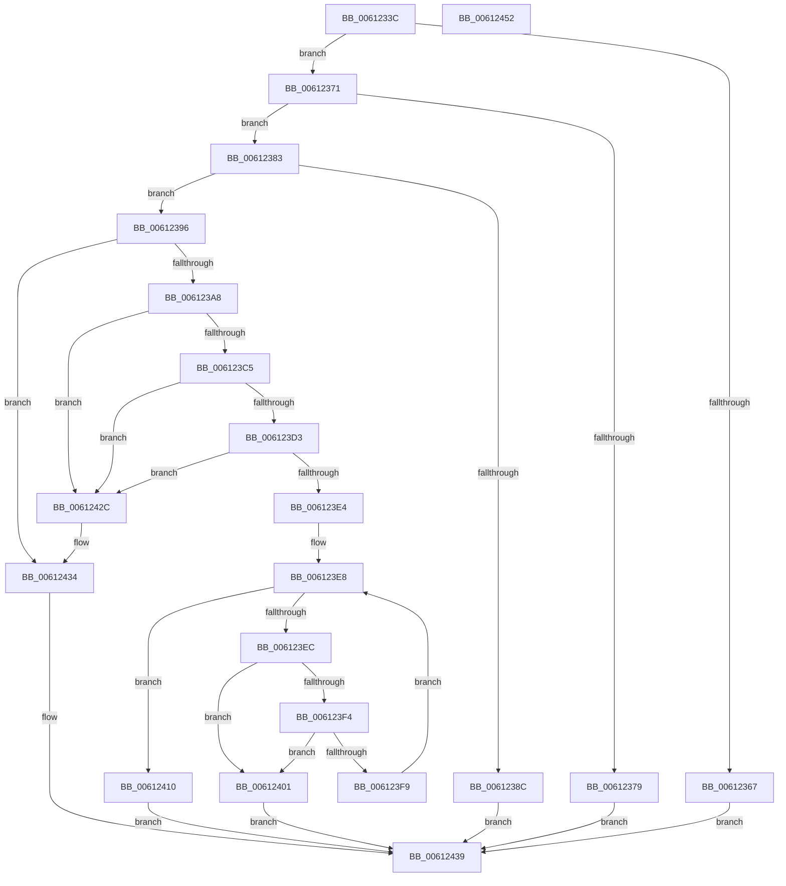

# ViAddVerifierSpecialThunks

- RVA: `0x0061233C`–`0x00612453` (길이 `279` bytes)
- VA: `0x000000014061233C`
- 실행 섹션: `.text`
- PDB 이름 있음: `예`; PDB Function 태그: `아니요`
- unwind 정보 RVA: `0x00060300`
- 디코드: `81`개 명령, `279/279` bytes 표시
- 미해석 바이트: `0` (있으면 어셈블리에 `.byte`로 보존)

> 이 문서는 커널 이미지의 기계어와 PDB 기호를 분석해 생성했습니다. 4번과 5번은 함수 원형과 자료형을 바이너리 사용 방식에서 추정한 C 해석이며 원본 소스 복구 결과는 아닙니다.

## 1. Dependencies

- 직접 호출 지점: **6**; 고유 호출 대상: **4**
- 직접 호출자로 확인된 함수: **1**
- RIP 상대 이미지 참조: **4**

### Outgoing calls
- `0x006123AD` → [MiAcquireLoadLock](../2A/MiAcquireLoadLock_function_002A3950.md) (function, `0x002A3950`)
- `0x006123B8` → [MmFindDataTableEntryByAddress](../2A/MmFindDataTableEntryByAddress_function_002A3C0C.md) (function, `0x002A3C0C`)
- `0x00612404` → [MmReleaseLoadLock](../4D/MmReleaseLoadLock_function_004D36D0.md) (function, `0x004D36D0`)
- `0x00612419` → [VfThunkAddSpecialDriverThunks](../../pagevrfy/BA/VfThunkAddSpecialDriverThunks_function_00BA6EC4.md) (function, `0x00BA6EC4`)
- `0x00612423` → [MmReleaseLoadLock](../4D/MmReleaseLoadLock_function_004D36D0.md) (function, `0x004D36D0`)
- `0x0061242F` → [MmReleaseLoadLock](../4D/MmReleaseLoadLock_function_004D36D0.md) (function, `0x004D36D0`)

### Direct callers
- [DifRegisterClassDriverPlugin](DifRegisterClassDriverPlugin_function_00611D00.md) at `0x00611D87`

### Static image references
- `0x00612359` → RVA `0x00F04984` (`.data`; read)
- `0x00612371` → RVA `0x00F04ABC` (`.data`; read)
- `0x00612396` → RVA `0x00F049F4` (`.data`; read/write)
- `0x0061239C` → RVA `0x00F04A20` (`.data`; read)

## 2. Other-region calls and transfers

- 다른 실행 섹션으로 향하는 call: **1**
  - `0x00612419` → [VfThunkAddSpecialDriverThunks](../../pagevrfy/BA/VfThunkAddSpecialDriverThunks_function_00BA6EC4.md) (`.text` → `PAGEVRFY`)
- 별도 외부 분기/꼬리 이동을 확인하지 못했습니다.

## 3. Assembly (complete function range)

```asm
0061233C  48 89 5C 24 08                  mov qword ptr [rsp + 8], rbx
00612341  48 89 6C 24 10                  mov qword ptr [rsp + 0x10], rbp
00612346  48 89 74 24 18                  mov qword ptr [rsp + 0x18], rsi
0061234B  57                              push rdi
0061234C  41 56                           push r14
0061234E  41 57                           push r15
00612350  48 83 EC 20                     sub rsp, 0x20
00612354  33 DB                           xor ebx, ebx
00612356  41 8B E8                        mov ebp, r8d
00612359  39 1D 25 26 8F 00               cmp dword ptr [rip + 0x8f2625], ebx
0061235F  4C 8B F2                        mov r14, rdx
00612362  4C 8B F9                        mov r15, rcx
00612365  75 0A                           jne 0x140612371
00612367  B8 BB 00 00 C0                  mov eax, 0xc00000bb
0061236C  E9 C8 00 00 00                  jmp 0x140612439
00612371  39 1D 45 27 8F 00               cmp dword ptr [rip + 0x8f2745], ebx
00612377  74 0A                           je 0x140612383
00612379  B8 75 0C 00 C0                  mov eax, 0xc0000c75
0061237E  E9 B6 00 00 00                  jmp 0x140612439
00612383  8B FD                           mov edi, ebp
00612385  C1 EF 04                        shr edi, 4
00612388  85 FF                           test edi, edi
0061238A  75 0A                           jne 0x140612396
0061238C  B8 F1 00 00 C0                  mov eax, 0xc00000f1
00612391  E9 A3 00 00 00                  jmp 0x140612439
00612396  01 3D 58 26 8F 00               add dword ptr [rip + 0x8f2658], edi
0061239C  39 1D 7E 26 8F 00               cmp dword ptr [rip + 0x8f267e], ebx
006123A2  0F 84 8C 00 00 00               je 0x140612434
006123A8  B9 01 00 00 00                  mov ecx, 1
006123AD  E8 9E 15 C9 FF                  call 0x1402a3950
006123B2  49 8B CF                        mov rcx, r15
006123B5  48 8B F0                        mov rsi, rax
006123B8  E8 4F 18 C9 FF                  call 0x1402a3c0c
006123BD  4C 8B C8                        mov r9, rax
006123C0  48 85 C0                        test rax, rax
006123C3  74 67                           je 0x14061242c
006123C5  48 8B 50 30                     mov rdx, qword ptr [rax + 0x30]
006123C9  48 8B 4C 24 38                  mov rcx, qword ptr [rsp + 0x38]
006123CE  48 3B CA                        cmp rcx, rdx
006123D1  72 59                           jb 0x14061242c
006123D3  44 8B 40 40                     mov r8d, dword ptr [rax + 0x40]
006123D7  48 8B 4C 24 38                  mov rcx, qword ptr [rsp + 0x38]
006123DC  4C 03 C2                        add r8, rdx
006123DF  49 3B C8                        cmp rcx, r8
006123E2  73 48                           jae 0x14061242c
006123E4  49 8D 46 08                     lea rax, [r14 + 8]
006123E8  3B DF                           cmp ebx, edi
006123EA  73 24                           jae 0x140612410
006123EC  48 8B 08                        mov rcx, qword ptr [rax]
006123EF  48 3B CA                        cmp rcx, rdx
006123F2  72 0D                           jb 0x140612401
006123F4  49 3B C8                        cmp rcx, r8
006123F7  73 08                           jae 0x140612401
006123F9  48 83 C0 10                     add rax, 0x10
006123FD  FF C3                           inc ebx
006123FF  EB E7                           jmp 0x1406123e8
00612401  48 8B CE                        mov rcx, rsi
00612404  E8 C7 12 EC FF                  call 0x1404d36d0
00612409  B8 F0 00 00 C0                  mov eax, 0xc00000f0
0061240E  EB 29                           jmp 0x140612439
00612410  44 8B C5                        mov r8d, ebp
00612413  49 8B D6                        mov rdx, r14
00612416  49 8B CF                        mov rcx, r15
00612419  E8 A6 4A 59 00                  call 0x140ba6ec4
0061241E  48 8B CE                        mov rcx, rsi
00612421  8B D8                           mov ebx, eax
00612423  E8 A8 12 EC FF                  call 0x1404d36d0
00612428  8B C3                           mov eax, ebx
0061242A  EB 0D                           jmp 0x140612439
0061242C  48 8B CE                        mov rcx, rsi
0061242F  E8 9C 12 EC FF                  call 0x1404d36d0
00612434  B8 EF 00 00 C0                  mov eax, 0xc00000ef
00612439  48 8B 5C 24 40                  mov rbx, qword ptr [rsp + 0x40]
0061243E  48 8B 6C 24 48                  mov rbp, qword ptr [rsp + 0x48]
00612443  48 8B 74 24 50                  mov rsi, qword ptr [rsp + 0x50]
00612448  48 83 C4 20                     add rsp, 0x20
0061244C  41 5F                           pop r15
0061244E  41 5E                           pop r14
00612450  5F                              pop rdi
00612451  C3                              ret
00612452  CC                              int3
```

## 4. C-style interpretation (structured pseudocode)

```c
__int64 __fastcall ViAddVerifierSpecialThunks(__int64 a1, __int64 a2, int a3)
{
    __int64 result;
    __int64 v_rbx;
    __int64 v_rdi;
    __int64 v_rsp;
    unsigned __int64 v_stack_p0;
    unsigned __int64 v_stack_p10;
    unsigned __int64 v_stack_p18;
    unsigned __int64 v_stack_p8;

    v_stack_p8 = v_rbx;
    v_stack_p10 = v_rbp;
    v_stack_p18 = v_rsi;
    v_rsp = (v_rsp) - (32);
    v_rbx = 0;
    if ((*(unsigned int *)(v_rip + 9381413)) != 0) goto loc_00612371;
    goto loc_00612439;
loc_00612371:
    if ((*(unsigned int *)(v_rip + 9381701)) == 0) goto loc_00612383;
    goto loc_00612439;
loc_00612383:
    v_rdi = (unsigned int)(((unsigned int)((unsigned int)((unsigned int)(a3)))) >> (4));
    if ((unsigned int)(v_rdi) != 0) goto loc_00612396;
    goto loc_00612439;
loc_00612396:
    if ((*(unsigned int *)(v_rip + 9381502)) == 0) goto loc_00612434;
    result = MiAcquireLoadLock(1, a2, a3, a4);
    result = MmFindDataTableEntryByAddress(a1, a2, a3, a4);
    if (result == 0) goto loc_0061242C;
    if (v_stack_p0 < (*(unsigned __int64 *)(result + 48))) goto loc_0061242C;
    a3 = ((unsigned int)(*(unsigned int *)(result + 64))) + (*(unsigned __int64 *)(result + 48));
    if (v_stack_p0 >= a3) goto loc_0061242C;
loc_006123E8:
    if (0 >= ((unsigned int)(v_rdi))) goto loc_00612410;
    if ((*(unsigned __int64 *)(a2 + 8)) < (*(unsigned __int64 *)(result + 48))) goto loc_00612401;
    if ((*(unsigned __int64 *)(a2 + 8)) >= a3) goto loc_00612401;
    result = (a2 + 8) + (16);
    v_rbx = (unsigned int)((v_rbx) + 1);
    goto loc_006123E8;
loc_00612401:
    result = MmReleaseLoadLock(result, *(unsigned __int64 *)(result + 48), a3, result);
    goto loc_00612439;
loc_00612410:
    result = VfThunkAddSpecialDriverThunks(a1, a2, (unsigned int)((unsigned int)((unsigned int)(a3))), result);
    result = MmReleaseLoadLock(result, a2, (unsigned int)((unsigned int)((unsigned int)(a3))), result);
    goto loc_00612439;
loc_0061242C:
    result = MmReleaseLoadLock(result, a2, (unsigned int)((unsigned int)((unsigned int)(a3))), result);
loc_00612434:
loc_00612439:
    v_rsp = (v_rsp) + (32);
    return (unsigned int)(0xC00000EFULL);
}
```

## 5. (Beta) C Style

```c
int64_t ViAddVerifierSpecialThunks(int64_t Arg1, void *Arg2, int32_t Arg3)
{
    uint8_t *arg2 = (uint8_t *)Arg2;

    int64_t result;
    int64_t local_rbx;
    int64_t local_rdi;
    int64_t local_rsp;
    uint64_t v_stack_p0;
    uint64_t v_stack_p10;
    uint64_t v_stack_p18;
    uint64_t v_stack_p8;

    v_stack_p8 = local_rbx;
    v_stack_p10 = local_rbp;
    v_stack_p18 = local_rsi;
    local_rsp = (local_rsp) - (32);
    local_rbx = 0;
    if ((*(uint32_t *)(v_rip + 0x8F2625)) != 0) goto loc_00612371;
    goto loc_00612439;
loc_00612371:
    if ((*(uint32_t *)(v_rip + 0x8F2745)) == 0) goto loc_00612383;
    goto loc_00612439;
loc_00612383:
    local_rdi = (uint32_t)(((uint32_t)((uint32_t)((uint32_t)(Arg3)))) >> (4));
    if ((uint32_t)(local_rdi) != 0) goto loc_00612396;
    goto loc_00612439;
loc_00612396:
    if ((*(uint32_t *)(v_rip + 0x8F267E)) == 0) goto loc_00612434;
    result = MiAcquireLoadLock(1, Arg2, Arg3, a4);
    result = MmFindDataTableEntryByAddress(Arg1, Arg2, Arg3, a4);
    if (result == 0) goto loc_0061242C;
    if (v_stack_p0 < (*(uint64_t *)(result + 0x30))) goto loc_0061242C;
    Arg3 = ((uint32_t)(*(uint32_t *)(result + 0x40))) + (*(uint64_t *)(result + 0x30));
    if (v_stack_p0 >= Arg3) goto loc_0061242C;
loc_006123E8:
    if (0 >= ((uint32_t)(local_rdi))) goto loc_00612410;
    if ((*(uint64_t *)(arg2 + 0x8)) < (*(uint64_t *)(result + 0x30))) goto loc_00612401;
    if ((*(uint64_t *)(arg2 + 0x8)) >= Arg3) goto loc_00612401;
    result = (Arg2 + 8) + (16);
    local_rbx = (uint32_t)((local_rbx) + 1);
    goto loc_006123E8;
loc_00612401:
    result = MmReleaseLoadLock(result, *(uint64_t *)(result + 0x30), Arg3, result);
    goto loc_00612439;
loc_00612410:
    result = VfThunkAddSpecialDriverThunks(Arg1, Arg2, (uint32_t)((uint32_t)((uint32_t)(Arg3))), result);
    result = MmReleaseLoadLock(result, Arg2, (uint32_t)((uint32_t)((uint32_t)(Arg3))), result);
    goto loc_00612439;
loc_0061242C:
    result = MmReleaseLoadLock(result, Arg2, (uint32_t)((uint32_t)((uint32_t)(Arg3))), result);
loc_00612434:
loc_00612439:
    local_rsp = (local_rsp) + (32);
    return (uint32_t)(0xC00000EFULL);
}
```

### 관측된 메모리 오프셋

구조체 형식이 확인되지 않은 접근은 인자 기준의 오프셋으로만 기록했습니다.

| 기준 인자 | 오프셋 표현 | 폭 (bit) | 접근 |
|---|---:|---:|---|
| `Arg2` | `+ 0x0` | `64` | `R` |
| `Arg2` | `+ 0x8` | `64` | `R` |

## 6. Execution-region graph

[열기: 2D/3D 그래프와 함수 탐색 컨트롤 패널](../../../control-panel.html?section=text&rva=0x0061233C&view=graph)

- 2D 그래프는 위에서 아래로 흐르고, 3D 그래프는 빈 공간을 드래그해 회전합니다. Shift+드래그는 이동, 휠은 확대·축소, 함수 노드 선택은 대상 보고서 이동입니다.

### Static fallback


