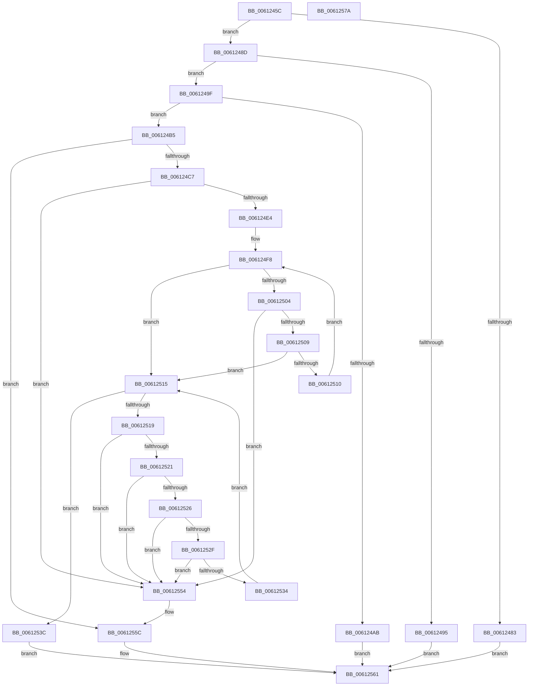

# ViAddVerifierThunks

- RVA: `0x0061245C`–`0x0061257B` (길이 `287` bytes)
- VA: `0x000000014061245C`
- 실행 섹션: `.text`
- PDB 이름 있음: `예`; PDB Function 태그: `아니요`
- unwind 정보 RVA: `0x00060300`
- 디코드: `86`개 명령, `287/287` bytes 표시
- 미해석 바이트: `0` (있으면 어셈블리에 `.byte`로 보존)

> 이 문서는 커널 이미지의 기계어와 PDB 기호를 분석해 생성했습니다. 4번과 5번은 함수 원형과 자료형을 바이너리 사용 방식에서 추정한 C 해석이며 원본 소스 복구 결과는 아닙니다.

## 1. Dependencies

- 직접 호출 지점: **5**; 고유 호출 대상: **4**
- 직접 호출자로 확인된 함수: **1**
- RIP 상대 이미지 참조: **5**

### Outgoing calls
- `0x006124CC` → [MiAcquireLoadLock](../2A/MiAcquireLoadLock_function_002A3950.md) (function, `0x002A3950`)
- `0x006124D7` → [MmFindDataTableEntryByAddress](../2A/MmFindDataTableEntryByAddress_function_002A3C0C.md) (function, `0x002A3C0C`)
- `0x00612541` → [VfThunkAddDriverThunks](../../pagevrfy/BA/VfThunkAddDriverThunks_function_00BA6E2C.md) (function, `0x00BA6E2C`)
- `0x0061254B` → [MmReleaseLoadLock](../4D/MmReleaseLoadLock_function_004D36D0.md) (function, `0x004D36D0`)
- `0x00612557` → [MmReleaseLoadLock](../4D/MmReleaseLoadLock_function_004D36D0.md) (function, `0x004D36D0`)

### Direct callers
- [DifRegisterClassDriverPlugin](DifRegisterClassDriverPlugin_function_00611D00.md) at `0x00611D77`

### Static image references
- `0x00612478` → RVA `0x00F04984` (`.data`; read)
- `0x0061248D` → RVA `0x00F04ABC` (`.data`; read)
- `0x006124B5` → RVA `0x00F049F4` (`.data`; read/write)
- `0x006124BB` → RVA `0x00F04A20` (`.data`; read)
- `0x006124EE` → RVA `0x00EF54C0` (`.data`; read)

## 2. Other-region calls and transfers

- 다른 실행 섹션으로 향하는 call: **1**
  - `0x00612541` → [VfThunkAddDriverThunks](../../pagevrfy/BA/VfThunkAddDriverThunks_function_00BA6E2C.md) (`.text` → `PAGEVRFY`)
- 별도 외부 분기/꼬리 이동을 확인하지 못했습니다.

## 3. Assembly (complete function range)

```asm
0061245C  48 89 5C 24 08                  mov qword ptr [rsp + 8], rbx
00612461  48 89 6C 24 10                  mov qword ptr [rsp + 0x10], rbp
00612466  48 89 74 24 18                  mov qword ptr [rsp + 0x18], rsi
0061246B  57                              push rdi
0061246C  41 56                           push r14
0061246E  41 57                           push r15
00612470  48 83 EC 20                     sub rsp, 0x20
00612474  33 DB                           xor ebx, ebx
00612476  8B EA                           mov ebp, edx
00612478  39 1D 06 25 8F 00               cmp dword ptr [rip + 0x8f2506], ebx
0061247E  4C 8B F1                        mov r14, rcx
00612481  75 0A                           jne 0x14061248d
00612483  B8 BB 00 00 C0                  mov eax, 0xc00000bb
00612488  E9 D4 00 00 00                  jmp 0x140612561
0061248D  39 1D 29 26 8F 00               cmp dword ptr [rip + 0x8f2629], ebx
00612493  74 0A                           je 0x14061249f
00612495  B8 75 0C 00 C0                  mov eax, 0xc0000c75
0061249A  E9 C2 00 00 00                  jmp 0x140612561
0061249F  8B FD                           mov edi, ebp
006124A1  49 8B F6                        mov rsi, r14
006124A4  C1 EF 04                        shr edi, 4
006124A7  85 FF                           test edi, edi
006124A9  75 0A                           jne 0x1406124b5
006124AB  B8 EF 00 00 C0                  mov eax, 0xc00000ef
006124B0  E9 AC 00 00 00                  jmp 0x140612561
006124B5  01 3D 39 25 8F 00               add dword ptr [rip + 0x8f2539], edi
006124BB  39 1D 5F 25 8F 00               cmp dword ptr [rip + 0x8f255f], ebx
006124C1  0F 84 95 00 00 00               je 0x14061255c
006124C7  B9 01 00 00 00                  mov ecx, 1
006124CC  E8 7F 14 C9 FF                  call 0x1402a3950
006124D1  49 8B 0E                        mov rcx, qword ptr [r14]
006124D4  4C 8B F8                        mov r15, rax
006124D7  E8 30 17 C9 FF                  call 0x1402a3c0c
006124DC  4C 8B C0                        mov r8, rax
006124DF  48 85 C0                        test rax, rax
006124E2  74 70                           je 0x140612554
006124E4  4C 8B 50 30                     mov r10, qword ptr [rax + 0x30]
006124E8  8B D3                           mov edx, ebx
006124EA  44 8B 48 40                     mov r9d, dword ptr [rax + 0x40]
006124EE  48 8B 0D CB 2F 8E 00            mov rcx, qword ptr [rip + 0x8e2fcb]
006124F5  4D 03 CA                        add r9, r10
006124F8  48 8D 05 C1 2F 8E 00            lea rax, [rip + 0x8e2fc1]
006124FF  48 3B C8                        cmp rcx, rax
00612502  74 11                           je 0x140612515
00612504  4C 3B C1                        cmp r8, rcx
00612507  74 4B                           je 0x140612554
00612509  FF C2                           inc edx
0061250B  83 FA 02                        cmp edx, 2
0061250E  73 05                           jae 0x140612515
00612510  48 8B 09                        mov rcx, qword ptr [rcx]
00612513  EB E3                           jmp 0x1406124f8
00612515  3B DF                           cmp ebx, edi
00612517  73 23                           jae 0x14061253c
00612519  48 8B 06                        mov rax, qword ptr [rsi]
0061251C  49 3B C2                        cmp rax, r10
0061251F  72 33                           jb 0x140612554
00612521  49 3B C1                        cmp rax, r9
00612524  73 2E                           jae 0x140612554
00612526  48 8B 46 08                     mov rax, qword ptr [rsi + 8]
0061252A  49 3B C2                        cmp rax, r10
0061252D  72 25                           jb 0x140612554
0061252F  49 3B C1                        cmp rax, r9
00612532  73 20                           jae 0x140612554
00612534  48 83 C6 10                     add rsi, 0x10
00612538  FF C3                           inc ebx
0061253A  EB D9                           jmp 0x140612515
0061253C  8B D5                           mov edx, ebp
0061253E  49 8B CE                        mov rcx, r14
00612541  E8 E6 48 59 00                  call 0x140ba6e2c
00612546  49 8B CF                        mov rcx, r15
00612549  8B D8                           mov ebx, eax
0061254B  E8 80 11 EC FF                  call 0x1404d36d0
00612550  8B C3                           mov eax, ebx
00612552  EB 0D                           jmp 0x140612561
00612554  49 8B CF                        mov rcx, r15
00612557  E8 74 11 EC FF                  call 0x1404d36d0
0061255C  B8 F0 00 00 C0                  mov eax, 0xc00000f0
00612561  48 8B 5C 24 40                  mov rbx, qword ptr [rsp + 0x40]
00612566  48 8B 6C 24 48                  mov rbp, qword ptr [rsp + 0x48]
0061256B  48 8B 74 24 50                  mov rsi, qword ptr [rsp + 0x50]
00612570  48 83 C4 20                     add rsp, 0x20
00612574  41 5F                           pop r15
00612576  41 5E                           pop r14
00612578  5F                              pop rdi
00612579  C3                              ret
0061257A  CC                              int3
```

## 4. C-style interpretation (structured pseudocode)

```c
__int64 __fastcall ViAddVerifierThunks(__int64 a1, int a2)
{
    __int64 result;
    __int64 v_rbx;
    __int64 v_rdi;
    __int64 v_rsi;
    __int64 v_rsp;
    unsigned __int64 v_stack_p10;
    unsigned __int64 v_stack_p18;
    unsigned __int64 v_stack_p8;

    v_stack_p8 = v_rbx;
    v_stack_p10 = v_rbp;
    v_stack_p18 = v_rsi;
    v_rsp = (v_rsp) - (32);
    v_rbx = 0;
    if ((*(unsigned int *)(v_rip + 9381126)) != 0) goto loc_0061248D;
    goto loc_00612561;
loc_0061248D:
    if ((*(unsigned int *)(v_rip + 9381417)) == 0) goto loc_0061249F;
    goto loc_00612561;
loc_0061249F:
    v_rdi = (unsigned int)(((unsigned int)((unsigned int)((unsigned int)(a2)))) >> (4));
    if ((unsigned int)(v_rdi) != 0) goto loc_006124B5;
    goto loc_00612561;
loc_006124B5:
    if ((*(unsigned int *)(v_rip + 9381215)) == 0) goto loc_0061255C;
    result = MiAcquireLoadLock(1, a2, a3, a4);
    result = MmFindDataTableEntryByAddress(*(unsigned __int64 *)(a1), a2, a3, a4);
    if (result == 0) goto loc_00612554;
    a4 = ((unsigned int)(*(unsigned int *)(result + 64))) + (*(unsigned __int64 *)(result + 48));
loc_006124F8:
    if ((*(unsigned __int64 *)(v_rip + 9318347)) == (v_rip + 9318337)) goto loc_00612515;
    if (result == (*(unsigned __int64 *)(v_rip + 9318347))) goto loc_00612554;
    a2 = (unsigned int)((0) + 1);
    if (a2 >= 2) goto loc_00612515;
    goto loc_006124F8;
loc_00612515:
    if (0 >= ((unsigned int)(v_rdi))) goto loc_0061253C;
    if ((*(unsigned __int64 *)(a1)) < (*(unsigned __int64 *)(result + 48))) goto loc_00612554;
    if ((*(unsigned __int64 *)(a1)) >= a4) goto loc_00612554;
    if ((*(unsigned __int64 *)(a1 + 8)) < (*(unsigned __int64 *)(result + 48))) goto loc_00612554;
    if ((*(unsigned __int64 *)(a1 + 8)) >= a4) goto loc_00612554;
    v_rsi = (a1) + (16);
    v_rbx = (unsigned int)((v_rbx) + 1);
    goto loc_00612515;
loc_0061253C:
    result = VfThunkAddDriverThunks(a1, (unsigned int)((unsigned int)((unsigned int)(a2))), result, a4);
    result = MmReleaseLoadLock(result, (unsigned int)((unsigned int)((unsigned int)(a2))), result, a4);
    goto loc_00612561;
loc_00612554:
    result = MmReleaseLoadLock(result, (unsigned int)((unsigned int)((unsigned int)(a2))), result, a4);
loc_0061255C:
loc_00612561:
    v_rsp = (v_rsp) + (32);
    return (unsigned int)(0xC00000F0ULL);
}
```

## 5. (Beta) C Style

```c
int64_t ViAddVerifierThunks(void *Arg1, int32_t Arg2)
{
    uint8_t *arg1 = (uint8_t *)Arg1;

    int64_t result;
    int64_t local_rbx;
    int64_t local_rdi;
    int64_t local_rsi;
    int64_t local_rsp;
    uint64_t v_stack_p10;
    uint64_t v_stack_p18;
    uint64_t v_stack_p8;

    v_stack_p8 = local_rbx;
    v_stack_p10 = local_rbp;
    v_stack_p18 = local_rsi;
    local_rsp = (local_rsp) - (32);
    local_rbx = 0;
    if ((*(uint32_t *)(v_rip + 0x8F2506)) != 0) goto loc_0061248D;
    goto loc_00612561;
loc_0061248D:
    if ((*(uint32_t *)(v_rip + 0x8F2629)) == 0) goto loc_0061249F;
    goto loc_00612561;
loc_0061249F:
    local_rdi = (uint32_t)(((uint32_t)((uint32_t)((uint32_t)(Arg2)))) >> (4));
    if ((uint32_t)(local_rdi) != 0) goto loc_006124B5;
    goto loc_00612561;
loc_006124B5:
    if ((*(uint32_t *)(v_rip + 0x8F255F)) == 0) goto loc_0061255C;
    result = MiAcquireLoadLock(1, Arg2, a3, a4);
    result = MmFindDataTableEntryByAddress(*(uint64_t *)(arg1), Arg2, a3, a4);
    if (result == 0) goto loc_00612554;
    a4 = ((uint32_t)(*(uint32_t *)(result + 0x40))) + (*(uint64_t *)(result + 0x30));
loc_006124F8:
    if ((*(uint64_t *)(v_rip + 0x8E2FCB)) == (v_rip + 9318337)) goto loc_00612515;
    if (result == (*(uint64_t *)(v_rip + 0x8E2FCB))) goto loc_00612554;
    Arg2 = (uint32_t)((0) + 1);
    if (Arg2 >= 2) goto loc_00612515;
    goto loc_006124F8;
loc_00612515:
    if (0 >= ((uint32_t)(local_rdi))) goto loc_0061253C;
    if ((*(uint64_t *)(arg1)) < (*(uint64_t *)(result + 0x30))) goto loc_00612554;
    if ((*(uint64_t *)(arg1)) >= a4) goto loc_00612554;
    if ((*(uint64_t *)(arg1 + 0x8)) < (*(uint64_t *)(result + 0x30))) goto loc_00612554;
    if ((*(uint64_t *)(arg1 + 0x8)) >= a4) goto loc_00612554;
    local_rsi = (Arg1) + (16);
    local_rbx = (uint32_t)((local_rbx) + 1);
    goto loc_00612515;
loc_0061253C:
    result = VfThunkAddDriverThunks(Arg1, (uint32_t)((uint32_t)((uint32_t)(Arg2))), result, a4);
    result = MmReleaseLoadLock(result, (uint32_t)((uint32_t)((uint32_t)(Arg2))), result, a4);
    goto loc_00612561;
loc_00612554:
    result = MmReleaseLoadLock(result, (uint32_t)((uint32_t)((uint32_t)(Arg2))), result, a4);
loc_0061255C:
loc_00612561:
    local_rsp = (local_rsp) + (32);
    return (uint32_t)(0xC00000F0ULL);
}
```

### 관측된 메모리 오프셋

구조체 형식이 확인되지 않은 접근은 인자 기준의 오프셋으로만 기록했습니다.

| 기준 인자 | 오프셋 표현 | 폭 (bit) | 접근 |
|---|---:|---:|---|
| `Arg1` | `+ 0x0` | `64` | `R` |
| `Arg1` | `+ 0x8` | `64` | `R` |

## 6. Execution-region graph

[열기: 2D/3D 그래프와 함수 탐색 컨트롤 패널](../../../control-panel.html?section=text&rva=0x0061245C&view=graph)

- 2D 그래프는 위에서 아래로 흐르고, 3D 그래프는 빈 공간을 드래그해 회전합니다. Shift+드래그는 이동, 휠은 확대·축소, 함수 노드 선택은 대상 보고서 이동입니다.

### Static fallback


