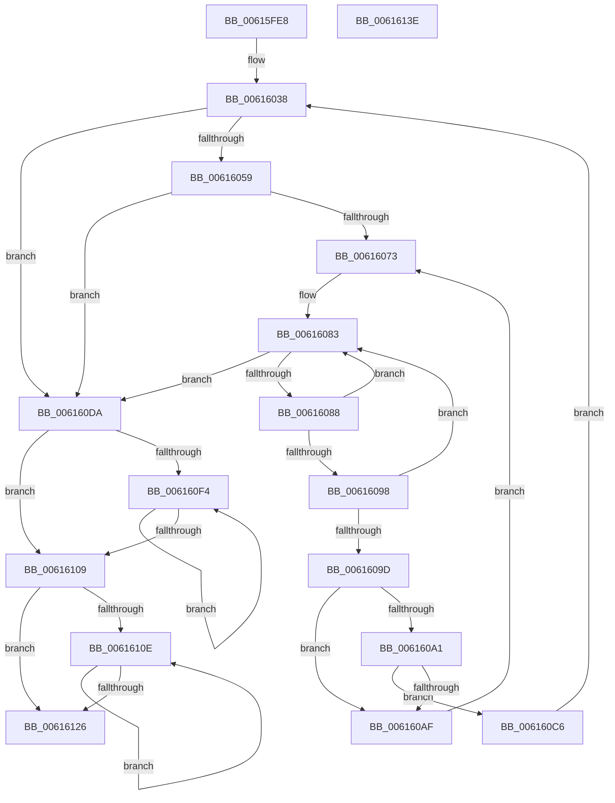

# ViDeadlockRemoveMemoryRangeResources

- RVA: `0x00615FE8`–`0x0061613F` (길이 `343` bytes)
- VA: `0x0000000140615FE8`
- 실행 섹션: `.text`
- PDB 이름 있음: `예`; PDB Function 태그: `아니요`
- unwind 정보 RVA: `0x000D2368`
- 디코드: `102`개 명령, `343/343` bytes 표시
- 미해석 바이트: `0` (있으면 어셈블리에 `.byte`로 보존)

> 이 문서는 커널 이미지의 기계어와 PDB 기호를 분석해 생성했습니다. 4번과 5번은 함수 원형과 자료형을 바이너리 사용 방식에서 추정한 C 해석이며 원본 소스 복구 결과는 아닙니다.

## 1. Dependencies

- 직접 호출 지점: **11**; 고유 호출 대상: **9**
- 직접 호출자로 확인된 함수: **1**
- RIP 상대 이미지 참조: **1**

### Outgoing calls
- `0x00616017` → [ViDeadlockDatabaseHashIndex](../../pagevrfy/BA/ViDeadlockDatabaseHashIndex_function_00BA9140.md) (function, `0x00BA9140`)
- `0x00616023` → [ViRaiseIrqlToDpcLevel](ViRaiseIrqlToDpcLevel_function_006162B0.md) (function, `0x006162B0`)
- `0x0061603A` → [ViDeadlockDetectionLock](../../pagevrfy/BA/ViDeadlockDetectionLock_function_00BA91C4.md) (function, `0x00BA91C4`)
- `0x0061606A` → [VfUtilAddressRangeFit](../../pagevrfy/B9/VfUtilAddressRangeFit_function_00B93138.md) (function, `0x00B93138`)
- `0x006160A6` → [ViDeadlockDetectionTryConvertSharedToExclusive](ViDeadlockDetectionTryConvertSharedToExclusive_function_00615F98.md) (function, `0x00615F98`)
- `0x006160B9` → [ViDeadlockRemoveResource](../../pagevrfy/BA/ViDeadlockRemoveResource_function_00BA9DEC.md) (function, `0x00BA9DEC`)
- `0x006160C8` → [ViDeadlockDetectionUnlock](../../pagevrfy/BA/ViDeadlockDetectionUnlock_function_00BA91FC.md) (function, `0x00BA91FC`)
- `0x006160DC` → [ViDeadlockDetectionUnlock](../../pagevrfy/BA/ViDeadlockDetectionUnlock_function_00BA91FC.md) (function, `0x00BA91FC`)
- `0x006160E5` → [ViLowerIrql](ViLowerIrql_function_00616278.md) (function, `0x00616278`)
- `0x006160FC` → [ViDeadlockFree](../../pagevrfy/BA/ViDeadlockFree_function_00BA9670.md) (function, `0x00BA9670`)
- `0x00616119` → [ViDeadlockFree](../../pagevrfy/BA/ViDeadlockFree_function_00BA9670.md) (function, `0x00BA9670`)

### Direct callers
- [sub_00BBC2F8](../../pagevrfy/BB/Unknown_function_00BBC2F8.md) at `0x00BBC315`

### Static image references
- `0x0061603F` → RVA `0x00FFDA00` (`PAGEVRFD`; read)

## 2. Other-region calls and transfers

- 다른 실행 섹션으로 향하는 call: **8**
  - `0x00616017` → [ViDeadlockDatabaseHashIndex](../../pagevrfy/BA/ViDeadlockDatabaseHashIndex_function_00BA9140.md) (`.text` → `PAGEVRFY`)
  - `0x0061603A` → [ViDeadlockDetectionLock](../../pagevrfy/BA/ViDeadlockDetectionLock_function_00BA91C4.md) (`.text` → `PAGEVRFY`)
  - `0x0061606A` → [VfUtilAddressRangeFit](../../pagevrfy/B9/VfUtilAddressRangeFit_function_00B93138.md) (`.text` → `PAGEVRFY`)
  - `0x006160B9` → [ViDeadlockRemoveResource](../../pagevrfy/BA/ViDeadlockRemoveResource_function_00BA9DEC.md) (`.text` → `PAGEVRFY`)
  - `0x006160C8` → [ViDeadlockDetectionUnlock](../../pagevrfy/BA/ViDeadlockDetectionUnlock_function_00BA91FC.md) (`.text` → `PAGEVRFY`)
  - `0x006160DC` → [ViDeadlockDetectionUnlock](../../pagevrfy/BA/ViDeadlockDetectionUnlock_function_00BA91FC.md) (`.text` → `PAGEVRFY`)
  - `0x006160FC` → [ViDeadlockFree](../../pagevrfy/BA/ViDeadlockFree_function_00BA9670.md) (`.text` → `PAGEVRFY`)
  - `0x00616119` → [ViDeadlockFree](../../pagevrfy/BA/ViDeadlockFree_function_00BA9670.md) (`.text` → `PAGEVRFY`)
- 별도 외부 분기/꼬리 이동을 확인하지 못했습니다.

## 3. Assembly (complete function range)

```asm
00615FE8  48 8B C4                        mov rax, rsp
00615FEB  48 89 58 08                     mov qword ptr [rax + 8], rbx
00615FEF  4C 89 48 20                     mov qword ptr [rax + 0x20], r9
00615FF3  4C 89 40 18                     mov qword ptr [rax + 0x18], r8
00615FF7  48 89 50 10                     mov qword ptr [rax + 0x10], rdx
00615FFB  55                              push rbp
00615FFC  56                              push rsi
00615FFD  57                              push rdi
00615FFE  41 54                           push r12
00616000  41 55                           push r13
00616002  41 56                           push r14
00616004  41 57                           push r15
00616006  48 83 EC 40                     sub rsp, 0x40
0061600A  48 83 60 B0 00                  and qword ptr [rax - 0x50], 0
0061600F  4C 8B F2                        mov r14, rdx
00616012  4C 8B E9                        mov r13, rcx
00616015  33 FF                           xor edi, edi
00616017  E8 24 31 59 00                  call 0x140ba9140
0061601C  48 89 44 24 30                  mov qword ptr [rsp + 0x30], rax
00616021  33 F6                           xor esi, esi
00616023  E8 88 02 00 00                  call 0x1406162b0
00616028  48 8B 6C 24 30                  mov rbp, qword ptr [rsp + 0x30]
0061602D  4C 8B E5                        mov r12, rbp
00616030  88 44 24 20                     mov byte ptr [rsp + 0x20], al
00616034  49 C1 E4 04                     shl r12, 4
00616038  8B CE                           mov ecx, esi
0061603A  E8 85 31 59 00                  call 0x140ba91c4
0061603F  48 8B 15 BA 79 9E 00            mov rdx, qword ptr [rip + 0x9e79ba]
00616046  4C 8B 7A 10                     mov r15, qword ptr [rdx + 0x10]
0061604A  4D 03 FC                        add r15, r12
0061604D  49 8B 1F                        mov rbx, qword ptr [r15]
00616050  49 3B DF                        cmp rbx, r15
00616053  0F 84 81 00 00 00               je 0x1406160da
00616059  48 8D 4D 02                     lea rcx, [rbp + 2]
0061605D  4D 8B C6                        mov r8, r14
00616060  48 C1 E1 04                     shl rcx, 4
00616064  48 03 CA                        add rcx, rdx
00616067  49 8B D5                        mov rdx, r13
0061606A  E8 C9 D0 57 00                  call 0x140b93138
0061606F  85 C0                           test eax, eax
00616071  74 67                           je 0x1406160da
00616073  48 8B 94 24 90 00 00 00         mov rdx, qword ptr [rsp + 0x90]
0061607B  48 8B 8C 24 98 00 00 00         mov rcx, qword ptr [rsp + 0x98]
00616083  49 3B DF                        cmp rbx, r15
00616086  74 52                           je 0x1406160da
00616088  4C 8D 73 D8                     lea r14, [rbx - 0x28]
0061608C  48 8B 1B                        mov rbx, qword ptr [rbx]
0061608F  49 8B 46 08                     mov rax, qword ptr [r14 + 8]
00616093  48 3B C2                        cmp rax, rdx
00616096  72 EB                           jb 0x140616083
00616098  48 3B C1                        cmp rax, rcx
0061609B  73 E6                           jae 0x140616083
0061609D  85 F6                           test esi, esi
0061609F  75 0E                           jne 0x1406160af
006160A1  BE 01 00 00 00                  mov esi, 1
006160A6  E8 ED FE FF FF                  call 0x140615f98
006160AB  85 C0                           test eax, eax
006160AD  74 17                           je 0x1406160c6
006160AF  4C 8D 44 24 28                  lea r8, [rsp + 0x28]
006160B4  33 D2                           xor edx, edx
006160B6  49 8B CE                        mov rcx, r14
006160B9  E8 2E 3D 59 00                  call 0x140ba9dec
006160BE  49 89 3E                        mov qword ptr [r14], rdi
006160C1  49 8B FE                        mov rdi, r14
006160C4  EB AD                           jmp 0x140616073
006160C6  33 C9                           xor ecx, ecx
006160C8  E8 2F 31 59 00                  call 0x140ba91fc
006160CD  4C 8B B4 24 88 00 00 00         mov r14, qword ptr [rsp + 0x88]
006160D5  E9 5E FF FF FF                  jmp 0x140616038
006160DA  8B CE                           mov ecx, esi
006160DC  E8 1B 31 59 00                  call 0x140ba91fc
006160E1  8A 4C 24 20                     mov cl, byte ptr [rsp + 0x20]
006160E5  E8 8E 01 00 00                  call 0x140616278
006160EA  48 8B 4C 24 28                  mov rcx, qword ptr [rsp + 0x28]
006160EF  48 85 C9                        test rcx, rcx
006160F2  74 15                           je 0x140616109
006160F4  48 8B 19                        mov rbx, qword ptr [rcx]
006160F7  BA 02 00 00 00                  mov edx, 2
006160FC  E8 6F 35 59 00                  call 0x140ba9670
00616101  48 8B CB                        mov rcx, rbx
00616104  48 85 DB                        test rbx, rbx
00616107  75 EB                           jne 0x1406160f4
00616109  48 85 FF                        test rdi, rdi
0061610C  74 18                           je 0x140616126
0061610E  48 8B 1F                        mov rbx, qword ptr [rdi]
00616111  BA 01 00 00 00                  mov edx, 1
00616116  48 8B CF                        mov rcx, rdi
00616119  E8 52 35 59 00                  call 0x140ba9670
0061611E  48 8B FB                        mov rdi, rbx
00616121  48 85 DB                        test rbx, rbx
00616124  75 E8                           jne 0x14061610e
00616126  48 8B 9C 24 80 00 00 00         mov rbx, qword ptr [rsp + 0x80]
0061612E  48 83 C4 40                     add rsp, 0x40
00616132  41 5F                           pop r15
00616134  41 5E                           pop r14
00616136  41 5D                           pop r13
00616138  41 5C                           pop r12
0061613A  5F                              pop rdi
0061613B  5E                              pop rsi
0061613C  5D                              pop rbp
0061613D  C3                              ret
0061613E  CC                              int3
```

## 4. C-style interpretation (structured pseudocode)

```c
__int64 __fastcall ViDeadlockRemoveMemoryRangeResources(__int64 a1, __int64 a2, __int64 a3, __int64 a4)
{
    __int64 result;
    __int64 v_r12;
    __int64 v_r15;
    __int64 v_rdi;
    __int64 v_rsi;
    __int64 v_rsp;
    unsigned __int64 v_stack_m48;
    unsigned __int64 v_stack_m50;
    unsigned __int8 v_stack_m58;
    unsigned __int64 v_stack_p10;
    unsigned __int64 v_stack_p18;
    unsigned __int64 v_stack_p20;
    unsigned __int64 v_stack_p8;

    *(unsigned __int64 *)(v_rsp + 8) = v_rbx;
    *(unsigned __int64 *)(v_rsp + 32) = a4;
    *(unsigned __int64 *)(v_rsp + 24) = a3;
    *(unsigned __int64 *)(v_rsp + 16) = a2;
    v_rsp = (v_rsp) - (64);
    v_rdi = 0;
    result = ViDeadlockDatabaseHashIndex(a1, a2, a3, a4);
    v_stack_m48 = result;
    v_rsi = 0;
    result = ViRaiseIrqlToDpcLevel(a1, a2, a3, a4);
    v_stack_m58 = (unsigned __int8)(result);
    v_r12 = (v_stack_m48) << (4);
loc_00616038:
    result = ViDeadlockDetectionLock(0, a2, a3, a4);
    v_r15 = (*(unsigned __int64 *)(*(unsigned __int64 *)(v_rip + 10385850) + 16)) + (v_r12);
    if ((*(unsigned __int64 *)(v_r15)) == v_r15) goto loc_006160DA;
    a1 = (v_stack_m48 + 2) << (4);
    a1 = (a1) + (*(unsigned __int64 *)(v_rip + 10385850));
    result = VfUtilAddressRangeFit(a1, a1, a2, a4);
    if ((unsigned int)(result) == 0) goto loc_006160DA;
loc_00616073:
loc_00616083:
    if ((*(unsigned __int64 *)(v_r15)) == v_r15) goto loc_006160DA;
    if ((*(unsigned __int64 *)(*(unsigned __int64 *)(v_r15) - 40 + 8)) < v_stack_p18) goto loc_00616083;
    if ((*(unsigned __int64 *)(*(unsigned __int64 *)(v_r15) - 40 + 8)) >= v_stack_p20) goto loc_00616083;
    if (0 != 0) goto loc_006160AF;
    result = ViDeadlockDetectionTryConvertSharedToExclusive(v_stack_p20, v_stack_p18, a2, a4);
    if ((unsigned int)(result) == 0) goto loc_006160C6;
loc_006160AF:
    a2 = 0;
    result = ViDeadlockRemoveResource(*(unsigned __int64 *)(v_r15) - 40, a2, v_stack_m50, a4);
    *(unsigned __int64 *)(*(unsigned __int64 *)(v_r15) - 40) = 0;
    goto loc_00616073;
loc_006160C6:
    a1 = 0;
    result = ViDeadlockDetectionUnlock(a1, a2, v_stack_m50, a4);
    goto loc_00616038;
loc_006160DA:
    result = ViDeadlockDetectionUnlock(1, a2, v_stack_m50, a4);
    result = ViLowerIrql(v_stack_m58, a2, v_stack_m50, a4);
    if (v_stack_m50 == 0) goto loc_00616109;
loc_006160F4:
    result = ViDeadlockFree(v_stack_m50, 2, v_stack_m50, a4);
    if (*(unsigned __int64 *)(v_stack_m50) != 0) goto loc_006160F4;
loc_00616109:
    if (*(unsigned __int64 *)(v_r15) - 40 == 0) goto loc_00616126;
loc_0061610E:
    result = ViDeadlockFree(*(unsigned __int64 *)(v_r15) - 40, 1, v_stack_m50, a4);
    if (*(unsigned __int64 *)(*(unsigned __int64 *)(v_r15) - 40) != 0) goto loc_0061610E;
loc_00616126:
    v_rsp = (v_rsp) + (64);
    return result;
}
```

## 5. (Beta) C Style

```c
int64_t ViDeadlockRemoveMemoryRangeResources(int64_t Arg1, int64_t Arg2, int64_t Arg3, int64_t Arg4)
{
    int64_t result;
    int64_t local_r12;
    int64_t local_r15;
    int64_t local_rdi;
    int64_t local_rsi;
    int64_t local_rsp;
    uint64_t v_stack_m48;
    uint64_t v_stack_m50;
    uint8_t v_stack_m58;
    uint64_t v_stack_p10;
    uint64_t v_stack_p18;
    uint64_t v_stack_p20;
    uint64_t v_stack_p8;

    *(uint64_t *)(local_rsp + 0x8) = local_rbx;
    *(uint64_t *)(local_rsp + 0x20) = Arg4;
    *(uint64_t *)(local_rsp + 0x18) = Arg3;
    *(uint64_t *)(local_rsp + 0x10) = Arg2;
    local_rsp = (local_rsp) - (64);
    local_rdi = 0;
    result = ViDeadlockDatabaseHashIndex(Arg1, Arg2, Arg3, Arg4);
    v_stack_m48 = result;
    local_rsi = 0;
    result = ViRaiseIrqlToDpcLevel(Arg1, Arg2, Arg3, Arg4);
    v_stack_m58 = (uint8_t)(result);
    local_r12 = (v_stack_m48) << (4);
loc_00616038:
    result = ViDeadlockDetectionLock(0, Arg2, Arg3, Arg4);
    local_r15 = (*(uint64_t *)(*(uint64_t *)(v_rip + 0x9E79BA) + 0x10)) + (local_r12);
    if ((*(uint64_t *)(local_r15)) == local_r15) goto loc_006160DA;
    Arg1 = (v_stack_m48 + 2) << (4);
    Arg1 = (Arg1) + (*(uint64_t *)(v_rip + 0x9E79BA));
    result = VfUtilAddressRangeFit(Arg1, Arg1, Arg2, Arg4);
    if ((uint32_t)(result) == 0) goto loc_006160DA;
loc_00616073:
loc_00616083:
    if ((*(uint64_t *)(local_r15)) == local_r15) goto loc_006160DA;
    if ((*(uint64_t *)(*(uint64_t *)(local_r15) - 0x28 + 0x8)) < v_stack_p18) goto loc_00616083;
    if ((*(uint64_t *)(*(uint64_t *)(local_r15) - 0x28 + 0x8)) >= v_stack_p20) goto loc_00616083;
    if (0 != 0) goto loc_006160AF;
    result = ViDeadlockDetectionTryConvertSharedToExclusive(v_stack_p20, v_stack_p18, Arg2, Arg4);
    if ((uint32_t)(result) == 0) goto loc_006160C6;
loc_006160AF:
    Arg2 = 0;
    result = ViDeadlockRemoveResource(*(uint64_t *)(local_r15) - 40, Arg2, v_stack_m50, Arg4);
    *(uint64_t *)(*(uint64_t *)(local_r15) - 0x28) = 0;
    goto loc_00616073;
loc_006160C6:
    Arg1 = 0;
    result = ViDeadlockDetectionUnlock(Arg1, Arg2, v_stack_m50, Arg4);
    goto loc_00616038;
loc_006160DA:
    result = ViDeadlockDetectionUnlock(1, Arg2, v_stack_m50, Arg4);
    result = ViLowerIrql(v_stack_m58, Arg2, v_stack_m50, Arg4);
    if (v_stack_m50 == 0) goto loc_00616109;
loc_006160F4:
    result = ViDeadlockFree(v_stack_m50, 2, v_stack_m50, Arg4);
    if (*(uint64_t *)(v_stack_m50) != 0) goto loc_006160F4;
loc_00616109:
    if (*(uint64_t *)(local_r15) - 40 == 0) goto loc_00616126;
loc_0061610E:
    result = ViDeadlockFree(*(uint64_t *)(local_r15) - 40, 1, v_stack_m50, Arg4);
    if (*(uint64_t *)(*(uint64_t *)(local_r15) - 0x28) != 0) goto loc_0061610E;
loc_00616126:
    local_rsp = (local_rsp) + (64);
    return result;
}
```

## 6. Execution-region graph

[열기: 2D/3D 그래프와 함수 탐색 컨트롤 패널](../../../control-panel.html?section=text&rva=0x00615FE8&view=graph)

- 2D 그래프는 위에서 아래로 흐르고, 3D 그래프는 빈 공간을 드래그해 회전합니다. Shift+드래그는 이동, 휠은 확대·축소, 함수 노드 선택은 대상 보고서 이동입니다.

### Static fallback


