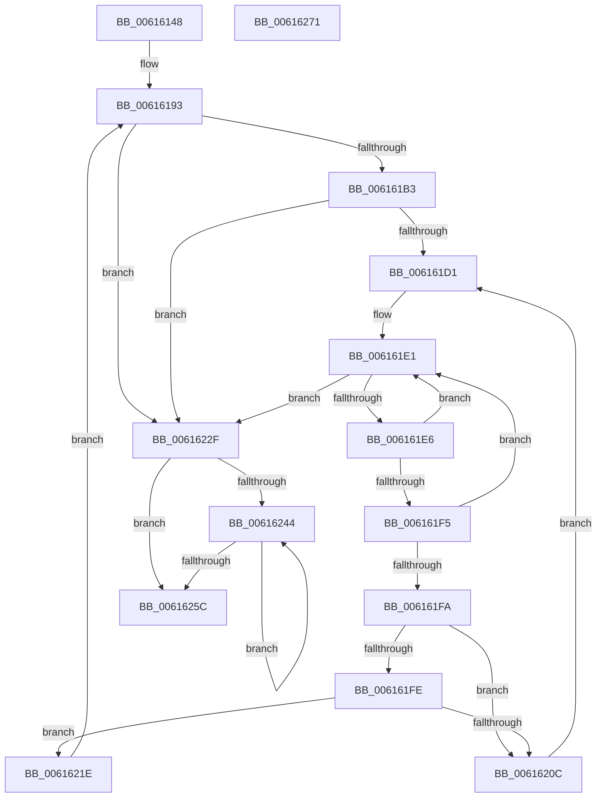

# ViDeadlockRemoveMemoryRangeThreads

- RVA: `0x00616148`–`0x00616272` (길이 `298` bytes)
- VA: `0x0000000140616148`
- 실행 섹션: `.text`
- PDB 이름 있음: `예`; PDB Function 태그: `아니요`
- unwind 정보 RVA: `0x000BD6A0`
- 디코드: `91`개 명령, `298/298` bytes 표시
- 미해석 바이트: `0` (있으면 어셈블리에 `.byte`로 보존)

> 이 문서는 커널 이미지의 기계어와 PDB 기호를 분석해 생성했습니다. 4번과 5번은 함수 원형과 자료형을 바이너리 사용 방식에서 추정한 C 해석이며 원본 소스 복구 결과는 아닙니다.

## 1. Dependencies

- 직접 호출 지점: **10**; 고유 호출 대상: **9**
- 직접 호출자로 확인된 함수: **1**
- RIP 상대 이미지 참조: **1**

### Outgoing calls
- `0x00616172` → [ViDeadlockDatabaseHashIndex](../../pagevrfy/BA/ViDeadlockDatabaseHashIndex_function_00BA9140.md) (function, `0x00BA9140`)
- `0x0061617E` → [ViRaiseIrqlToDpcLevel](ViRaiseIrqlToDpcLevel_function_006162B0.md) (function, `0x006162B0`)
- `0x00616195` → [ViDeadlockDetectionLock](../../pagevrfy/BA/ViDeadlockDetectionLock_function_00BA91C4.md) (function, `0x00BA91C4`)
- `0x006161C8` → [VfUtilAddressRangeFit](../../pagevrfy/B9/VfUtilAddressRangeFit_function_00B93138.md) (function, `0x00B93138`)
- `0x00616203` → [ViDeadlockDetectionTryConvertSharedToExclusive](ViDeadlockDetectionTryConvertSharedToExclusive_function_00615F98.md) (function, `0x00615F98`)
- `0x00616211` → [ViDeadlockRemoveThread](../../pagevrfy/BA/ViDeadlockRemoveThread_function_00BA9F8C.md) (function, `0x00BA9F8C`)
- `0x00616220` → [ViDeadlockDetectionUnlock](../../pagevrfy/BA/ViDeadlockDetectionUnlock_function_00BA91FC.md) (function, `0x00BA91FC`)
- `0x00616231` → [ViDeadlockDetectionUnlock](../../pagevrfy/BA/ViDeadlockDetectionUnlock_function_00BA91FC.md) (function, `0x00BA91FC`)
- `0x0061623A` → [ViLowerIrql](ViLowerIrql_function_00616278.md) (function, `0x00616278`)
- `0x0061624F` → [ViDeadlockFree](../../pagevrfy/BA/ViDeadlockFree_function_00BA9670.md) (function, `0x00BA9670`)

### Direct callers
- [sub_00BBC2F8](../../pagevrfy/BB/Unknown_function_00BBC2F8.md) at `0x00BBC326`

### Static image references
- `0x0061619A` → RVA `0x00FFDA00` (`PAGEVRFD`; read)

## 2. Other-region calls and transfers

- 다른 실행 섹션으로 향하는 call: **7**
  - `0x00616172` → [ViDeadlockDatabaseHashIndex](../../pagevrfy/BA/ViDeadlockDatabaseHashIndex_function_00BA9140.md) (`.text` → `PAGEVRFY`)
  - `0x00616195` → [ViDeadlockDetectionLock](../../pagevrfy/BA/ViDeadlockDetectionLock_function_00BA91C4.md) (`.text` → `PAGEVRFY`)
  - `0x006161C8` → [VfUtilAddressRangeFit](../../pagevrfy/B9/VfUtilAddressRangeFit_function_00B93138.md) (`.text` → `PAGEVRFY`)
  - `0x00616211` → [ViDeadlockRemoveThread](../../pagevrfy/BA/ViDeadlockRemoveThread_function_00BA9F8C.md) (`.text` → `PAGEVRFY`)
  - `0x00616220` → [ViDeadlockDetectionUnlock](../../pagevrfy/BA/ViDeadlockDetectionUnlock_function_00BA91FC.md) (`.text` → `PAGEVRFY`)
  - `0x00616231` → [ViDeadlockDetectionUnlock](../../pagevrfy/BA/ViDeadlockDetectionUnlock_function_00BA91FC.md) (`.text` → `PAGEVRFY`)
  - `0x0061624F` → [ViDeadlockFree](../../pagevrfy/BA/ViDeadlockFree_function_00BA9670.md) (`.text` → `PAGEVRFY`)
- 별도 외부 분기/꼬리 이동을 확인하지 못했습니다.

## 3. Assembly (complete function range)

```asm
00616148  48 8B C4                        mov rax, rsp
0061614B  48 89 58 08                     mov qword ptr [rax + 8], rbx
0061614F  4C 89 48 20                     mov qword ptr [rax + 0x20], r9
00616153  4C 89 40 18                     mov qword ptr [rax + 0x18], r8
00616157  48 89 50 10                     mov qword ptr [rax + 0x10], rdx
0061615B  55                              push rbp
0061615C  56                              push rsi
0061615D  57                              push rdi
0061615E  41 54                           push r12
00616160  41 55                           push r13
00616162  41 56                           push r14
00616164  41 57                           push r15
00616166  48 83 EC 30                     sub rsp, 0x30
0061616A  48 8B F2                        mov rsi, rdx
0061616D  4C 8B E9                        mov r13, rcx
00616170  33 FF                           xor edi, edi
00616172  E8 C9 2F 59 00                  call 0x140ba9140
00616177  48 89 44 24 28                  mov qword ptr [rsp + 0x28], rax
0061617C  33 ED                           xor ebp, ebp
0061617E  E8 2D 01 00 00                  call 0x1406162b0
00616183  4C 8B 64 24 28                  mov r12, qword ptr [rsp + 0x28]
00616188  4D 8B FC                        mov r15, r12
0061618B  88 44 24 20                     mov byte ptr [rsp + 0x20], al
0061618F  49 C1 E7 04                     shl r15, 4
00616193  8B CD                           mov ecx, ebp
00616195  E8 2A 30 59 00                  call 0x140ba91c4
0061619A  48 8B 15 5F 78 9E 00            mov rdx, qword ptr [rip + 0x9e785f]
006161A1  4C 8B B2 10 40 00 00            mov r14, qword ptr [rdx + 0x4010]
006161A8  4D 03 F7                        add r14, r15
006161AB  49 8B 1E                        mov rbx, qword ptr [r14]
006161AE  49 3B DE                        cmp rbx, r14
006161B1  74 7C                           je 0x14061622f
006161B3  49 8D 8C 24 02 04 00 00         lea rcx, [r12 + 0x402]
006161BB  4C 8B C6                        mov r8, rsi
006161BE  48 C1 E1 04                     shl rcx, 4
006161C2  48 03 CA                        add rcx, rdx
006161C5  49 8B D5                        mov rdx, r13
006161C8  E8 6B CF 57 00                  call 0x140b93138
006161CD  85 C0                           test eax, eax
006161CF  74 5E                           je 0x14061622f
006161D1  48 8B 94 24 80 00 00 00         mov rdx, qword ptr [rsp + 0x80]
006161D9  48 8B 8C 24 88 00 00 00         mov rcx, qword ptr [rsp + 0x88]
006161E1  49 3B DE                        cmp rbx, r14
006161E4  74 49                           je 0x14061622f
006161E6  48 8D 73 E8                     lea rsi, [rbx - 0x18]
006161EA  48 8B 1B                        mov rbx, qword ptr [rbx]
006161ED  48 8B 06                        mov rax, qword ptr [rsi]
006161F0  48 3B C2                        cmp rax, rdx
006161F3  72 EC                           jb 0x1406161e1
006161F5  48 3B C1                        cmp rax, rcx
006161F8  73 E7                           jae 0x1406161e1
006161FA  85 ED                           test ebp, ebp
006161FC  75 0E                           jne 0x14061620c
006161FE  BD 01 00 00 00                  mov ebp, 1
00616203  E8 90 FD FF FF                  call 0x140615f98
00616208  85 C0                           test eax, eax
0061620A  74 12                           je 0x14061621e
0061620C  33 D2                           xor edx, edx
0061620E  48 8B CE                        mov rcx, rsi
00616211  E8 76 3D 59 00                  call 0x140ba9f8c
00616216  48 89 3E                        mov qword ptr [rsi], rdi
00616219  48 8B FE                        mov rdi, rsi
0061621C  EB B3                           jmp 0x1406161d1
0061621E  33 C9                           xor ecx, ecx
00616220  E8 D7 2F 59 00                  call 0x140ba91fc
00616225  48 8B 74 24 78                  mov rsi, qword ptr [rsp + 0x78]
0061622A  E9 64 FF FF FF                  jmp 0x140616193
0061622F  8B CD                           mov ecx, ebp
00616231  E8 C6 2F 59 00                  call 0x140ba91fc
00616236  8A 4C 24 20                     mov cl, byte ptr [rsp + 0x20]
0061623A  E8 39 00 00 00                  call 0x140616278
0061623F  48 85 FF                        test rdi, rdi
00616242  74 18                           je 0x14061625c
00616244  48 8B 1F                        mov rbx, qword ptr [rdi]
00616247  BA 03 00 00 00                  mov edx, 3
0061624C  48 8B CF                        mov rcx, rdi
0061624F  E8 1C 34 59 00                  call 0x140ba9670
00616254  48 8B FB                        mov rdi, rbx
00616257  48 85 DB                        test rbx, rbx
0061625A  75 E8                           jne 0x140616244
0061625C  48 8B 5C 24 70                  mov rbx, qword ptr [rsp + 0x70]
00616261  48 83 C4 30                     add rsp, 0x30
00616265  41 5F                           pop r15
00616267  41 5E                           pop r14
00616269  41 5D                           pop r13
0061626B  41 5C                           pop r12
0061626D  5F                              pop rdi
0061626E  5E                              pop rsi
0061626F  5D                              pop rbp
00616270  C3                              ret
00616271  CC                              int3
```

## 4. C-style interpretation (structured pseudocode)

```c
__int64 __fastcall ViDeadlockRemoveMemoryRangeThreads(__int64 a1, __int64 a2, __int64 a3, __int64 a4)
{
    __int64 result;
    __int64 v_r14;
    __int64 v_r15;
    __int64 v_rbp;
    __int64 v_rdi;
    __int64 v_rsp;
    unsigned __int64 v_stack_m40;
    unsigned __int8 v_stack_m48;
    unsigned __int64 v_stack_p10;
    unsigned __int64 v_stack_p18;
    unsigned __int64 v_stack_p20;
    unsigned __int64 v_stack_p8;

    *(unsigned __int64 *)(v_rsp + 8) = v_rbx;
    *(unsigned __int64 *)(v_rsp + 32) = a4;
    *(unsigned __int64 *)(v_rsp + 24) = a3;
    *(unsigned __int64 *)(v_rsp + 16) = a2;
    v_rsp = (v_rsp) - (48);
    v_rdi = 0;
    result = ViDeadlockDatabaseHashIndex(a1, a2, a3, a4);
    v_stack_m40 = result;
    v_rbp = 0;
    result = ViRaiseIrqlToDpcLevel(a1, a2, a3, a4);
    v_stack_m48 = (unsigned __int8)(result);
    v_r15 = (v_stack_m40) << (4);
loc_00616193:
    result = ViDeadlockDetectionLock(0, a2, a3, a4);
    v_r14 = (*(unsigned __int64 *)(*(unsigned __int64 *)(v_rip + 10385503) + 16400)) + (v_r15);
    if ((*(unsigned __int64 *)(v_r14)) == v_r14) goto loc_0061622F;
    a1 = (v_stack_m40 + 1026) << (4);
    a1 = (a1) + (*(unsigned __int64 *)(v_rip + 10385503));
    result = VfUtilAddressRangeFit(a1, a1, a2, a4);
    if ((unsigned int)(result) == 0) goto loc_0061622F;
loc_006161D1:
loc_006161E1:
    if ((*(unsigned __int64 *)(v_r14)) == v_r14) goto loc_0061622F;
    if ((*(unsigned __int64 *)(*(unsigned __int64 *)(v_r14) - 24)) < v_stack_p18) goto loc_006161E1;
    if ((*(unsigned __int64 *)(*(unsigned __int64 *)(v_r14) - 24)) >= v_stack_p20) goto loc_006161E1;
    if (0 != 0) goto loc_0061620C;
    result = ViDeadlockDetectionTryConvertSharedToExclusive(v_stack_p20, v_stack_p18, a2, a4);
    if ((unsigned int)(result) == 0) goto loc_0061621E;
loc_0061620C:
    a2 = 0;
    result = ViDeadlockRemoveThread(*(unsigned __int64 *)(v_r14) - 24, a2, a2, a4);
    *(unsigned __int64 *)(*(unsigned __int64 *)(v_r14) - 24) = 0;
    goto loc_006161D1;
loc_0061621E:
    a1 = 0;
    result = ViDeadlockDetectionUnlock(a1, a2, a2, a4);
    goto loc_00616193;
loc_0061622F:
    result = ViDeadlockDetectionUnlock(1, a2, a2, a4);
    result = ViLowerIrql(v_stack_m48, a2, a2, a4);
    if (*(unsigned __int64 *)(v_r14) - 24 == 0) goto loc_0061625C;
loc_00616244:
    result = ViDeadlockFree(*(unsigned __int64 *)(v_r14) - 24, 3, a2, a4);
    if (*(unsigned __int64 *)(*(unsigned __int64 *)(v_r14) - 24) != 0) goto loc_00616244;
loc_0061625C:
    v_rsp = (v_rsp) + (48);
    return result;
}
```

## 5. (Beta) C Style

```c
int64_t ViDeadlockRemoveMemoryRangeThreads(int64_t Arg1, int64_t Arg2, int64_t Arg3, int64_t Arg4)
{
    int64_t result;
    int64_t local_r14;
    int64_t local_r15;
    int64_t local_rbp;
    int64_t local_rdi;
    int64_t local_rsp;
    uint64_t v_stack_m40;
    uint8_t v_stack_m48;
    uint64_t v_stack_p10;
    uint64_t v_stack_p18;
    uint64_t v_stack_p20;
    uint64_t v_stack_p8;

    *(uint64_t *)(local_rsp + 0x8) = local_rbx;
    *(uint64_t *)(local_rsp + 0x20) = Arg4;
    *(uint64_t *)(local_rsp + 0x18) = Arg3;
    *(uint64_t *)(local_rsp + 0x10) = Arg2;
    local_rsp = (local_rsp) - (48);
    local_rdi = 0;
    result = ViDeadlockDatabaseHashIndex(Arg1, Arg2, Arg3, Arg4);
    v_stack_m40 = result;
    local_rbp = 0;
    result = ViRaiseIrqlToDpcLevel(Arg1, Arg2, Arg3, Arg4);
    v_stack_m48 = (uint8_t)(result);
    local_r15 = (v_stack_m40) << (4);
loc_00616193:
    result = ViDeadlockDetectionLock(0, Arg2, Arg3, Arg4);
    local_r14 = (*(uint64_t *)(*(uint64_t *)(v_rip + 0x9E785F) + 0x4010)) + (local_r15);
    if ((*(uint64_t *)(local_r14)) == local_r14) goto loc_0061622F;
    Arg1 = (v_stack_m40 + 1026) << (4);
    Arg1 = (Arg1) + (*(uint64_t *)(v_rip + 0x9E785F));
    result = VfUtilAddressRangeFit(Arg1, Arg1, Arg2, Arg4);
    if ((uint32_t)(result) == 0) goto loc_0061622F;
loc_006161D1:
loc_006161E1:
    if ((*(uint64_t *)(local_r14)) == local_r14) goto loc_0061622F;
    if ((*(uint64_t *)(*(uint64_t *)(local_r14) - 0x18)) < v_stack_p18) goto loc_006161E1;
    if ((*(uint64_t *)(*(uint64_t *)(local_r14) - 0x18)) >= v_stack_p20) goto loc_006161E1;
    if (0 != 0) goto loc_0061620C;
    result = ViDeadlockDetectionTryConvertSharedToExclusive(v_stack_p20, v_stack_p18, Arg2, Arg4);
    if ((uint32_t)(result) == 0) goto loc_0061621E;
loc_0061620C:
    Arg2 = 0;
    result = ViDeadlockRemoveThread(*(uint64_t *)(local_r14) - 24, Arg2, Arg2, Arg4);
    *(uint64_t *)(*(uint64_t *)(local_r14) - 0x18) = 0;
    goto loc_006161D1;
loc_0061621E:
    Arg1 = 0;
    result = ViDeadlockDetectionUnlock(Arg1, Arg2, Arg2, Arg4);
    goto loc_00616193;
loc_0061622F:
    result = ViDeadlockDetectionUnlock(1, Arg2, Arg2, Arg4);
    result = ViLowerIrql(v_stack_m48, Arg2, Arg2, Arg4);
    if (*(uint64_t *)(local_r14) - 24 == 0) goto loc_0061625C;
loc_00616244:
    result = ViDeadlockFree(*(uint64_t *)(local_r14) - 24, 3, Arg2, Arg4);
    if (*(uint64_t *)(*(uint64_t *)(local_r14) - 0x18) != 0) goto loc_00616244;
loc_0061625C:
    local_rsp = (local_rsp) + (48);
    return result;
}
```

## 6. Execution-region graph

[열기: 2D/3D 그래프와 함수 탐색 컨트롤 패널](../../../control-panel.html?section=text&rva=0x00616148&view=graph)

- 2D 그래프는 위에서 아래로 흐르고, 3D 그래프는 빈 공간을 드래그해 회전합니다. Shift+드래그는 이동, 휠은 확대·축소, 함수 노드 선택은 대상 보고서 이동입니다.

### Static fallback


