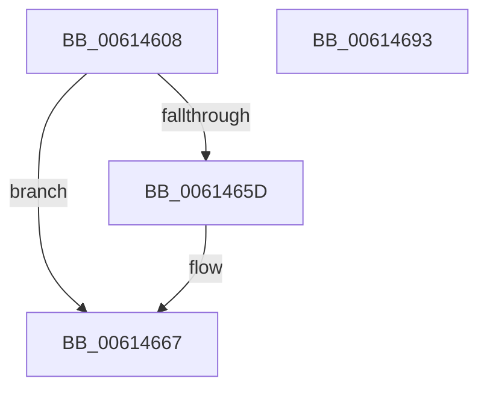

# ViErrorReport10

- RVA: `0x00614608`–`0x00614694` (길이 `140` bytes)
- VA: `0x0000000140614608`
- 실행 섹션: `.text`
- PDB 이름 있음: `예`; PDB Function 태그: `아니요`
- unwind 정보 RVA: `0x000D2580`
- 디코드: `39`개 명령, `140/140` bytes 표시
- 미해석 바이트: `0` (있으면 어셈블리에 `.byte`로 보존)

> 이 문서는 커널 이미지의 기계어와 PDB 기호를 분석해 생성했습니다. 4번과 5번은 함수 원형과 자료형을 바이너리 사용 방식에서 추정한 C 해석이며 원본 소스 복구 결과는 아닙니다.

## 1. Dependencies

- 직접 호출 지점: **5**; 고유 호출 대상: **5**
- 직접 호출자로 확인된 함수: **4**
- RIP 상대 이미지 참조: **2**

### Outgoing calls
- `0x00614631` → [ViErrorDisplayDescription](../../pagevrfy/BA/ViErrorDisplayDescription_function_00BA361C.md) (function, `0x00BA361C`)
- `0x00614654` → [RtlStringCbPrintfA](../53/RtlStringCbPrintfA_function_0053BC0C.md) (function, `0x0053BC0C`)
- `0x00614662` → [VfUtilDbgPrint](VfUtilDbgPrint_function_006122AC.md) (function, `0x006122AC`)
- `0x00614672` → [ViErrorFinishReport](../../pagevrfy/BA/ViErrorFinishReport_function_00BA366C.md) (function, `0x00BA366C`)
- `0x00614682` → [_security_check_cookie](../6A/_security_check_cookie_function_006AC640.md) (function, `0x006AC640`)

### Direct callers
- [IovpCallDriver2](../../pagevrfy/B9/IovpCallDriver2_function_00B9D270.md) at `0x00B9D349`
- [IovpCallDriver2](../../pagevrfy/B9/IovpCallDriver2_function_00B9D270.md) at `0x00B9D39F`
- [VfPnpVerifyIrpStackUpward](../../pagevrfy/BB/VfPnpVerifyIrpStackUpward_function_00BB58E0.md) at `0x00BB5A8F`
- [VfPnpVerifyIrpStackUpward](../../pagevrfy/BB/VfPnpVerifyIrpStackUpward_function_00BB58E0.md) at `0x00BB5AB3`
- [ViPnpVerifyMinorWasProcessedProperly](../../pagevrfy/BB/ViPnpVerifyMinorWasProcessedProperly_function_00BB5BC0.md) at `0x00BB5D19`
- [VfWmiVerifyIrpStackUpward](../../pagevrfy/BB/VfWmiVerifyIrpStackUpward_function_00BB6200.md) at `0x00BB62BE`

### Static image references
- `0x00614614` → RVA `0x00E0A740` (`.data`; read)
- `0x0061463E` → RVA `0x006CE780` (` ?? ::FNODOBFM::`string'`; read)

## 2. Other-region calls and transfers

- 다른 실행 섹션으로 향하는 call: **2**
  - `0x00614631` → [ViErrorDisplayDescription](../../pagevrfy/BA/ViErrorDisplayDescription_function_00BA361C.md) (`.text` → `PAGEVRFY`)
  - `0x00614672` → [ViErrorFinishReport](../../pagevrfy/BA/ViErrorFinishReport_function_00BA366C.md) (`.text` → `PAGEVRFY`)
- 별도 외부 분기/꼬리 이동을 확인하지 못했습니다.

## 3. Assembly (complete function range)

```asm
00614608  40 53                           push rbx
0061460A  55                              push rbp
0061460B  56                              push rsi
0061460C  57                              push rdi
0061460D  48 81 EC B8 00 00 00            sub rsp, 0xb8
00614614  48 8B 05 25 61 7F 00            mov rax, qword ptr [rip + 0x7f6125]
0061461B  48 33 C4                        xor rax, rsp
0061461E  48 89 84 24 A0 00 00 00         mov qword ptr [rsp + 0xa0], rax
00614626  49 8B E9                        mov rbp, r9
00614629  49 8B F0                        mov rsi, r8
0061462C  48 8B FA                        mov rdi, rdx
0061462F  8B D9                           mov ebx, ecx
00614631  E8 E6 EF 58 00                  call 0x140ba361c
00614636  4C 8B CF                        mov r9, rdi
00614639  48 89 6C 24 28                  mov qword ptr [rsp + 0x28], rbp
0061463E  4C 8D 05 3B A1 0B 00            lea r8, [rip + 0xba13b]
00614645  48 89 74 24 20                  mov qword ptr [rsp + 0x20], rsi
0061464A  BA 63 00 00 00                  mov edx, 0x63
0061464F  48 8D 4C 24 30                  lea rcx, [rsp + 0x30]
00614654  E8 B3 75 F2 FF                  call 0x14053bc0c
00614659  85 C0                           test eax, eax
0061465B  78 0A                           js 0x140614667
0061465D  48 8D 4C 24 30                  lea rcx, [rsp + 0x30]
00614662  E8 45 DC FF FF                  call 0x1406122ac
00614667  4C 8B CD                        mov r9, rbp
0061466A  4C 8B C6                        mov r8, rsi
0061466D  48 8B D7                        mov rdx, rdi
00614670  8B CB                           mov ecx, ebx
00614672  E8 F5 EF 58 00                  call 0x140ba366c
00614677  48 8B 8C 24 A0 00 00 00         mov rcx, qword ptr [rsp + 0xa0]
0061467F  48 33 CC                        xor rcx, rsp
00614682  E8 B9 7F 09 00                  call 0x1406ac640
00614687  48 81 C4 B8 00 00 00            add rsp, 0xb8
0061468E  5F                              pop rdi
0061468F  5E                              pop rsi
00614690  5D                              pop rbp
00614691  5B                              pop rbx
00614692  C3                              ret
00614693  CC                              int3
```

## 4. C-style interpretation (structured pseudocode)

```c
__int64 __fastcall ViErrorReport10(int a1, __int64 a2, __int64 a3, __int64 a4)
{
    __int64 result;
    __int64 v_rsp;
    unsigned __int64 v_stack_m38;
    unsigned __int64 v_stack_mA8;
    unsigned __int64 v_stack_mB0;
    unsigned __int64 v_stack_mB8;

    v_rsp = (v_rsp) - (184);
    result = (*(unsigned __int64 *)(v_rip + 8347941)) ^ (v_rsp);
    v_stack_m38 = result;
    result = ViErrorDisplayDescription(a1, a2, a3, a4);
    v_stack_mB0 = a4;
    v_stack_mB8 = a3;
    result = RtlStringCbPrintfA(v_stack_mA8, 99, v_rip + 762171, a2);
    if (!(sign_flag)) {
        a1 = v_stack_mA8;
        result = VfUtilDbgPrint(a1, 99, v_rip + 762171, a2);
    }
    result = ViErrorFinishReport((unsigned int)((unsigned int)((unsigned int)(a1))), a2, a3, a4);
    a1 = (v_stack_m38) ^ (v_rsp);
    result = _security_check_cookie(a1, a2, a3, a4);
    v_rsp = (v_rsp) + (184);
    return result;
}
```

## 5. (Beta) C Style

```c
int64_t ViErrorReport10(int32_t Arg1, int64_t Arg2, int64_t Arg3, int64_t Arg4)
{
    int64_t result;
    int64_t local_rsp;
    uint64_t v_stack_m38;
    uint64_t v_stack_mA8;
    uint64_t v_stack_mB0;
    uint64_t v_stack_mB8;

    local_rsp = (local_rsp) - (184);
    result = (*(uint64_t *)(v_rip + 0x7F6125)) ^ (local_rsp);
    v_stack_m38 = result;
    result = ViErrorDisplayDescription(Arg1, Arg2, Arg3, Arg4);
    v_stack_mB0 = Arg4;
    v_stack_mB8 = Arg3;
    result = RtlStringCbPrintfA(v_stack_mA8, 99, v_rip + 762171, Arg2);
    if (!(sign_flag)) {
        Arg1 = v_stack_mA8;
        result = VfUtilDbgPrint(Arg1, 99, v_rip + 762171, Arg2);
    }
    result = ViErrorFinishReport((uint32_t)((uint32_t)((uint32_t)(Arg1))), Arg2, Arg3, Arg4);
    Arg1 = (v_stack_m38) ^ (local_rsp);
    result = _security_check_cookie(Arg1, Arg2, Arg3, Arg4);
    local_rsp = (local_rsp) + (184);
    return result;
}
```

## 6. Execution-region graph

[열기: 2D/3D 그래프와 함수 탐색 컨트롤 패널](../../../control-panel.html?section=text&rva=0x00614608&view=graph)

- 2D 그래프는 위에서 아래로 흐르고, 3D 그래프는 빈 공간을 드래그해 회전합니다. Shift+드래그는 이동, 휠은 확대·축소, 함수 노드 선택은 대상 보고서 이동입니다.

### Static fallback


