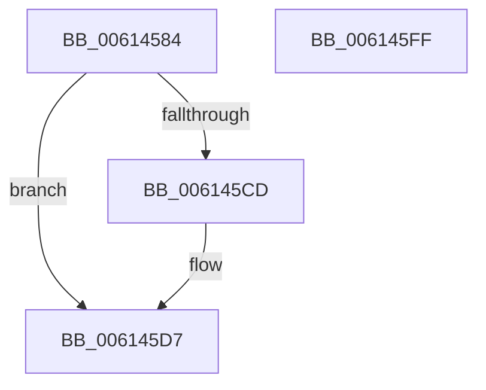

# ViErrorReport1

- RVA: `0x00614584`–`0x00614600` (길이 `124` bytes)
- VA: `0x0000000140614584`
- 실행 섹션: `.text`
- PDB 이름 있음: `예`; PDB Function 태그: `아니요`
- unwind 정보 RVA: `0x000730A8`
- 디코드: `35`개 명령, `124/124` bytes 표시
- 미해석 바이트: `0` (있으면 어셈블리에 `.byte`로 보존)

> 이 문서는 커널 이미지의 기계어와 PDB 기호를 분석해 생성했습니다. 4번과 5번은 함수 원형과 자료형을 바이너리 사용 방식에서 추정한 C 해석이며 원본 소스 복구 결과는 아닙니다.

## 1. Dependencies

- 직접 호출 지점: **5**; 고유 호출 대상: **5**
- 직접 호출자로 확인된 함수: **21**
- RIP 상대 이미지 참조: **2**

### Outgoing calls
- `0x006145A6` → [ViErrorDisplayDescription](../../pagevrfy/BA/ViErrorDisplayDescription_function_00BA361C.md) (function, `0x00BA361C`)
- `0x006145C4` → [RtlStringCbPrintfA](../53/RtlStringCbPrintfA_function_0053BC0C.md) (function, `0x0053BC0C`)
- `0x006145D2` → [VfUtilDbgPrint](VfUtilDbgPrint_function_006122AC.md) (function, `0x006122AC`)
- `0x006145E2` → [ViErrorFinishReport](../../pagevrfy/BA/ViErrorFinishReport_function_00BA366C.md) (function, `0x00BA366C`)
- `0x006145EF` → [_security_check_cookie](../6A/_security_check_cookie_function_006AC640.md) (function, `0x006AC640`)

### Direct callers
- [ViGenericVerifyIrpStackDownward](../../pagevrfy/B9/ViGenericVerifyIrpStackDownward_function_00B93F90.md) at `0x00B940F0`
- [ViGenericVerifyIrpStackDownward](../../pagevrfy/B9/ViGenericVerifyIrpStackDownward_function_00B93F90.md) at `0x00B94117`
- [ViGenericVerifyIrpStackDownward](../../pagevrfy/B9/ViGenericVerifyIrpStackDownward_function_00B93F90.md) at `0x00B94136`
- [ViGenericVerifyIrpStackUpward](../../pagevrfy/B9/ViGenericVerifyIrpStackUpward_function_00B94190.md) at `0x00B941EE`
- [ViGenericVerifyIrpStackUpward](../../pagevrfy/B9/ViGenericVerifyIrpStackUpward_function_00B94190.md) at `0x00B9420D`
- [IovpCallDriver1](../../pagevrfy/B9/IovpCallDriver1_function_00B9CCA4.md) at `0x00B9CE57`
- [IovpCallDriver1](../../pagevrfy/B9/IovpCallDriver1_function_00B9CCA4.md) at `0x00B9CE75`
- [IovpCallDriver2](../../pagevrfy/B9/IovpCallDriver2_function_00B9D270.md) at `0x00B9D46F`
- [IovpExamineIrpStackForwarding](../../pagevrfy/B9/IovpExamineIrpStackForwarding_function_00B9D640.md) at `0x00B9D75B`
- [IovpValidateStatusInformation](../../pagevrfy/B9/IovpValidateStatusInformation_function_00B9D7DC.md) at `0x00B9D84D`
- [VfAfterCallDriver](../../pagevrfy/B9/VfAfterCallDriver_function_00B9DA84.md) at `0x00B9DC26`
- [VfPnpVerifyIrpStackDownward](../../pagevrfy/BB/VfPnpVerifyIrpStackDownward_function_00BB5750.md) at `0x00BB57BF`
- [VfPnpVerifyIrpStackDownward](../../pagevrfy/BB/VfPnpVerifyIrpStackDownward_function_00BB5750.md) at `0x00BB57ED`
- [VfPnpVerifyIrpStackDownward](../../pagevrfy/BB/VfPnpVerifyIrpStackDownward_function_00BB5750.md) at `0x00BB5849`
- [VfPnpVerifyIrpStackUpward](../../pagevrfy/BB/VfPnpVerifyIrpStackUpward_function_00BB58E0.md) at `0x00BB5992`
- [VfPnpVerifyIrpStackUpward](../../pagevrfy/BB/VfPnpVerifyIrpStackUpward_function_00BB58E0.md) at `0x00BB59B3`
- [VfPnpVerifyIrpStackUpward](../../pagevrfy/BB/VfPnpVerifyIrpStackUpward_function_00BB58E0.md) at `0x00BB59C5`
- [VfPnpVerifyIrpStackUpward](../../pagevrfy/BB/VfPnpVerifyIrpStackUpward_function_00BB58E0.md) at `0x00BB5A20`
- [VfPnpVerifyNewRequest](../../pagevrfy/BB/VfPnpVerifyNewRequest_function_00BB5AE0.md) at `0x00BB5B1B`
- [VfPnpVerifyNewRequest](../../pagevrfy/BB/VfPnpVerifyNewRequest_function_00BB5AE0.md) at `0x00BB5B58`
- [VfPnpVerifyNewRequest](../../pagevrfy/BB/VfPnpVerifyNewRequest_function_00BB5AE0.md) at `0x00BB5B70`
- [VfPnpVerifyNewRequest](../../pagevrfy/BB/VfPnpVerifyNewRequest_function_00BB5AE0.md) at `0x00BB5B8A`
- [VfPnpVerifyNewRequest](../../pagevrfy/BB/VfPnpVerifyNewRequest_function_00BB5AE0.md) at `0x00BB5BA1`
- [ViPnpVerifyMinorWasProcessedProperly](../../pagevrfy/BB/ViPnpVerifyMinorWasProcessedProperly_function_00BB5BC0.md) at `0x00BB5C81`
- [ViPnpVerifyMinorWasProcessedProperly](../../pagevrfy/BB/ViPnpVerifyMinorWasProcessedProperly_function_00BB5BC0.md) at `0x00BB5DCE`
- [VfPowerVerifyIrpStackDownward](../../pagevrfy/BB/VfPowerVerifyIrpStackDownward_function_00BB5F50.md) at `0x00BB5F98`
- [VfPowerVerifyIrpStackDownward](../../pagevrfy/BB/VfPowerVerifyIrpStackDownward_function_00BB5F50.md) at `0x00BB5FC6`
- [VfPowerVerifyIrpStackDownward](../../pagevrfy/BB/VfPowerVerifyIrpStackDownward_function_00BB5F50.md) at `0x00BB5FFD`
- [VfPowerVerifyIrpStackDownward](../../pagevrfy/BB/VfPowerVerifyIrpStackDownward_function_00BB5F50.md) at `0x00BB6019`
- [VfPowerVerifyIrpStackUpward](../../pagevrfy/BB/VfPowerVerifyIrpStackUpward_function_00BB6040.md) at `0x00BB6064`
- [VfPowerVerifyNewRequest](../../pagevrfy/BB/VfPowerVerifyNewRequest_function_00BB6080.md) at `0x00BB609F`
- [VfWmiVerifyIrpStackDownward](../../pagevrfy/BB/VfWmiVerifyIrpStackDownward_function_00BB6180.md) at `0x00BB61AA`
- [VfWmiVerifyIrpStackDownward](../../pagevrfy/BB/VfWmiVerifyIrpStackDownward_function_00BB6180.md) at `0x00BB61DD`
- [VfWmiVerifyNewRequest](../../pagevrfy/BB/VfWmiVerifyNewRequest_function_00BB62E0.md) at `0x00BB62FF`
- [VfIoInitializeIrp](../../pagevrfy/BB/VfIoInitializeIrp_function_00BB66D4.md) at `0x00BB672D`
- [sub_00BBBC60](../../pagevrfy/BB/Unknown_function_00BBBC60.md) at `0x00BBBC7F`
- [sub_00BBBC60](../../pagevrfy/BB/Unknown_function_00BBBC60.md) at `0x00BBBC9F`
- [sub_00BBBCB2](../../pagevrfy/BB/Unknown_function_00BBBCB2.md) at `0x00BBBCC5`
- [sub_00BBBD62](../../pagevrfy/BB/Unknown_function_00BBBD62.md) at `0x00BBBDD5`
- [sub_00BBC0C8](../../pagevrfy/BB/Unknown_function_00BBC0C8.md) at `0x00BBC0D3`

### Static image references
- `0x0061458F` → RVA `0x00E0A740` (`.data`; read)
- `0x006145B3` → RVA `0x006CE7C0` (` ?? ::FNODOBFM::`string'`; read)

## 2. Other-region calls and transfers

- 다른 실행 섹션으로 향하는 call: **2**
  - `0x006145A6` → [ViErrorDisplayDescription](../../pagevrfy/BA/ViErrorDisplayDescription_function_00BA361C.md) (`.text` → `PAGEVRFY`)
  - `0x006145E2` → [ViErrorFinishReport](../../pagevrfy/BA/ViErrorFinishReport_function_00BA366C.md) (`.text` → `PAGEVRFY`)
- 별도 외부 분기/꼬리 이동을 확인하지 못했습니다.

## 3. Assembly (complete function range)

```asm
00614584  40 53                           push rbx
00614586  56                              push rsi
00614587  57                              push rdi
00614588  48 81 EC 80 00 00 00            sub rsp, 0x80
0061458F  48 8B 05 AA 61 7F 00            mov rax, qword ptr [rip + 0x7f61aa]
00614596  48 33 C4                        xor rax, rsp
00614599  48 89 44 24 70                  mov qword ptr [rsp + 0x70], rax
0061459E  49 8B F0                        mov rsi, r8
006145A1  48 8B FA                        mov rdi, rdx
006145A4  8B D9                           mov ebx, ecx
006145A6  E8 71 F0 58 00                  call 0x140ba361c
006145AB  4C 8B CF                        mov r9, rdi
006145AE  48 89 74 24 20                  mov qword ptr [rsp + 0x20], rsi
006145B3  4C 8D 05 06 A2 0B 00            lea r8, [rip + 0xba206]
006145BA  BA 40 00 00 00                  mov edx, 0x40
006145BF  48 8D 4C 24 30                  lea rcx, [rsp + 0x30]
006145C4  E8 43 76 F2 FF                  call 0x14053bc0c
006145C9  85 C0                           test eax, eax
006145CB  78 0A                           js 0x1406145d7
006145CD  48 8D 4C 24 30                  lea rcx, [rsp + 0x30]
006145D2  E8 D5 DC FF FF                  call 0x1406122ac
006145D7  45 33 C9                        xor r9d, r9d
006145DA  4C 8B C6                        mov r8, rsi
006145DD  48 8B D7                        mov rdx, rdi
006145E0  8B CB                           mov ecx, ebx
006145E2  E8 85 F0 58 00                  call 0x140ba366c
006145E7  48 8B 4C 24 70                  mov rcx, qword ptr [rsp + 0x70]
006145EC  48 33 CC                        xor rcx, rsp
006145EF  E8 4C 80 09 00                  call 0x1406ac640
006145F4  48 81 C4 80 00 00 00            add rsp, 0x80
006145FB  5F                              pop rdi
006145FC  5E                              pop rsi
006145FD  5B                              pop rbx
006145FE  C3                              ret
006145FF  CC                              int3
```

## 4. C-style interpretation (structured pseudocode)

```c
__int64 __fastcall ViErrorReport1(int a1, __int64 a2, __int64 a3)
{
    __int64 result;
    __int64 v_rsp;
    unsigned __int64 v_stack_m28;
    unsigned __int64 v_stack_m68;
    unsigned __int64 v_stack_m78;

    v_rsp = (v_rsp) - (128);
    result = (*(unsigned __int64 *)(v_rip + 8348074)) ^ (v_rsp);
    v_stack_m28 = result;
    result = ViErrorDisplayDescription(a1, a2, a3, a4);
    v_stack_m78 = a3;
    result = RtlStringCbPrintfA(v_stack_m68, 64, v_rip + 762374, a2);
    if (!(sign_flag)) {
        a1 = v_stack_m68;
        result = VfUtilDbgPrint(a1, 64, v_rip + 762374, a2);
    }
    a4 = 0;
    result = ViErrorFinishReport((unsigned int)((unsigned int)((unsigned int)(a1))), a2, a3, a4);
    a1 = (v_stack_m28) ^ (v_rsp);
    result = _security_check_cookie(a1, a2, a3, a4);
    v_rsp = (v_rsp) + (128);
    return result;
}
```

## 5. (Beta) C Style

```c
int64_t ViErrorReport1(int32_t Arg1, int64_t Arg2, int64_t Arg3)
{
    int64_t result;
    int64_t local_rsp;
    uint64_t v_stack_m28;
    uint64_t v_stack_m68;
    uint64_t v_stack_m78;

    local_rsp = (local_rsp) - (128);
    result = (*(uint64_t *)(v_rip + 0x7F61AA)) ^ (local_rsp);
    v_stack_m28 = result;
    result = ViErrorDisplayDescription(Arg1, Arg2, Arg3, a4);
    v_stack_m78 = Arg3;
    result = RtlStringCbPrintfA(v_stack_m68, 64, v_rip + 762374, Arg2);
    if (!(sign_flag)) {
        Arg1 = v_stack_m68;
        result = VfUtilDbgPrint(Arg1, 64, v_rip + 762374, Arg2);
    }
    a4 = 0;
    result = ViErrorFinishReport((uint32_t)((uint32_t)((uint32_t)(Arg1))), Arg2, Arg3, a4);
    Arg1 = (v_stack_m28) ^ (local_rsp);
    result = _security_check_cookie(Arg1, Arg2, Arg3, a4);
    local_rsp = (local_rsp) + (128);
    return result;
}
```

## 6. Execution-region graph

[열기: 2D/3D 그래프와 함수 탐색 컨트롤 패널](../../../control-panel.html?section=text&rva=0x00614584&view=graph)

- 2D 그래프는 위에서 아래로 흐르고, 3D 그래프는 빈 공간을 드래그해 회전합니다. Shift+드래그는 이동, 휠은 확대·축소, 함수 노드 선택은 대상 보고서 이동입니다.

### Static fallback


