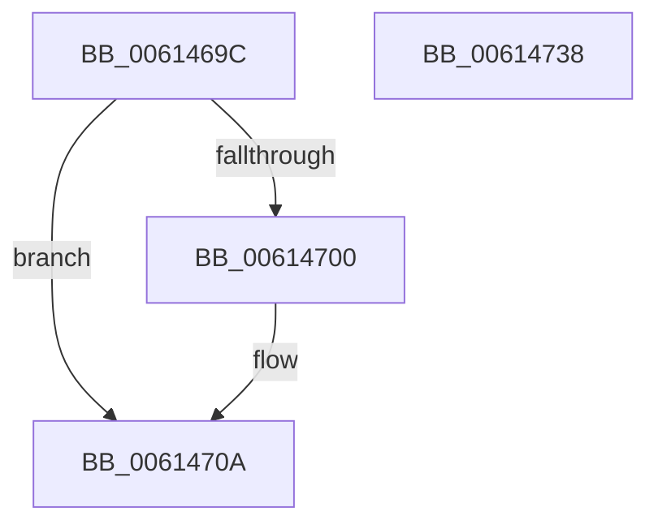

# ViErrorReport4

- RVA: `0x0061469C`–`0x00614739` (길이 `157` bytes)
- VA: `0x000000014061469C`
- 실행 섹션: `.text`
- PDB 이름 있음: `예`; PDB Function 태그: `아니요`
- unwind 정보 RVA: `0x000D2564`
- 디코드: `40`개 명령, `157/157` bytes 표시
- 미해석 바이트: `0` (있으면 어셈블리에 `.byte`로 보존)

> 이 문서는 커널 이미지의 기계어와 PDB 기호를 분석해 생성했습니다. 4번과 5번은 함수 원형과 자료형을 바이너리 사용 방식에서 추정한 C 해석이며 원본 소스 복구 결과는 아닙니다.

## 1. Dependencies

- 직접 호출 지점: **5**; 고유 호출 대상: **5**
- 직접 호출자로 확인된 함수: **1**
- RIP 상대 이미지 참조: **2**

### Outgoing calls
- `0x006146C7` → [ViErrorDisplayDescription](../../pagevrfy/BA/ViErrorDisplayDescription_function_00BA361C.md) (function, `0x00BA361C`)
- `0x006146F7` → [RtlStringCbPrintfA](../53/RtlStringCbPrintfA_function_0053BC0C.md) (function, `0x0053BC0C`)
- `0x00614705` → [VfUtilDbgPrint](VfUtilDbgPrint_function_006122AC.md) (function, `0x006122AC`)
- `0x00614718` → [ViErrorFinishReport](../../pagevrfy/BA/ViErrorFinishReport_function_00BA366C.md) (function, `0x00BA366C`)
- `0x00614728` → [_security_check_cookie](../6A/_security_check_cookie_function_006AC640.md) (function, `0x006AC640`)

### Direct callers
- [IovpCallDriver2](../../pagevrfy/B9/IovpCallDriver2_function_00B9D270.md) at `0x00B9D42C`

### Static image references
- `0x006146A7` → RVA `0x00E0A740` (`.data`; read)
- `0x006146D3` → RVA `0x006CE690` (` ?? ::FNODOBFM::`string'`; read)

## 2. Other-region calls and transfers

- 다른 실행 섹션으로 향하는 call: **2**
  - `0x006146C7` → [ViErrorDisplayDescription](../../pagevrfy/BA/ViErrorDisplayDescription_function_00BA361C.md) (`.text` → `PAGEVRFY`)
  - `0x00614718` → [ViErrorFinishReport](../../pagevrfy/BA/ViErrorFinishReport_function_00BA366C.md) (`.text` → `PAGEVRFY`)
- 별도 외부 분기/꼬리 이동을 확인하지 못했습니다.

## 3. Assembly (complete function range)

```asm
0061469C  40 53                           push rbx
0061469E  56                              push rsi
0061469F  57                              push rdi
006146A0  48 81 EC D0 00 00 00            sub rsp, 0xd0
006146A7  48 8B 05 92 60 7F 00            mov rax, qword ptr [rip + 0x7f6092]
006146AE  48 33 C4                        xor rax, rsp
006146B1  48 89 84 24 C0 00 00 00         mov qword ptr [rsp + 0xc0], rax
006146B9  B9 24 02 00 00                  mov ecx, 0x224
006146BE  49 63 F1                        movsxd rsi, r9d
006146C1  49 8B F8                        mov rdi, r8
006146C4  48 8B DA                        mov rbx, rdx
006146C7  E8 50 EF 58 00                  call 0x140ba361c
006146CC  8B 84 24 10 01 00 00            mov eax, dword ptr [rsp + 0x110]
006146D3  4C 8D 05 B6 9F 0B 00            lea r8, [rip + 0xb9fb6]
006146DA  89 44 24 30                     mov dword ptr [rsp + 0x30], eax
006146DE  48 8D 4C 24 40                  lea rcx, [rsp + 0x40]
006146E3  48 8B 07                        mov rax, qword ptr [rdi]
006146E6  4C 8B CB                        mov r9, rbx
006146E9  89 74 24 28                     mov dword ptr [rsp + 0x28], esi
006146ED  BA 7C 00 00 00                  mov edx, 0x7c
006146F2  48 89 44 24 20                  mov qword ptr [rsp + 0x20], rax
006146F7  E8 10 75 F2 FF                  call 0x14053bc0c
006146FC  85 C0                           test eax, eax
006146FE  78 0A                           js 0x14061470a
00614700  48 8D 4C 24 40                  lea rcx, [rsp + 0x40]
00614705  E8 A2 DB FF FF                  call 0x1406122ac
0061470A  4C 8B 07                        mov r8, qword ptr [rdi]
0061470D  4C 8B CE                        mov r9, rsi
00614710  48 8B D3                        mov rdx, rbx
00614713  B9 24 02 00 00                  mov ecx, 0x224
00614718  E8 4F EF 58 00                  call 0x140ba366c
0061471D  48 8B 8C 24 C0 00 00 00         mov rcx, qword ptr [rsp + 0xc0]
00614725  48 33 CC                        xor rcx, rsp
00614728  E8 13 7F 09 00                  call 0x1406ac640
0061472D  48 81 C4 D0 00 00 00            add rsp, 0xd0
00614734  5F                              pop rdi
00614735  5E                              pop rsi
00614736  5B                              pop rbx
00614737  C3                              ret
00614738  CC                              int3
```

## 4. C-style interpretation (structured pseudocode)

```c
__int64 __fastcall ViErrorReport4(__int64 a1, __int64 a2, __int64 a3, int a4, unsigned int a5)
{
    __int64 result;
    __int64 v_rsp;
    unsigned __int64 v_stack_m28;
    unsigned __int64 v_stack_mA8;
    unsigned int v_stack_mB8;
    unsigned int v_stack_mC0;
    unsigned __int64 v_stack_mC8;

    v_rsp = (v_rsp) - (208);
    result = (*(unsigned __int64 *)(v_rip + 8347794)) ^ (v_rsp);
    v_stack_m28 = result;
    result = ViErrorDisplayDescription(548, a2, a3, a4);
    v_stack_mB8 = (unsigned int)((unsigned int)(a5));
    v_stack_mC0 = (unsigned int)((int)(a4));
    v_stack_mC8 = *(unsigned __int64 *)(a3);
    result = RtlStringCbPrintfA(v_stack_mA8, 124, v_rip + 761782, a2);
    if (!(sign_flag)) {
        a1 = v_stack_mA8;
        result = VfUtilDbgPrint(a1, 124, v_rip + 761782, a2);
    }
    result = ViErrorFinishReport(548, a2, *(unsigned __int64 *)(a3), (int)(a4));
    a1 = (v_stack_m28) ^ (v_rsp);
    result = _security_check_cookie(a1, a2, *(unsigned __int64 *)(a3), (int)(a4));
    v_rsp = (v_rsp) + (208);
    return result;
}
```

## 5. (Beta) C Style

```c
int64_t ViErrorReport4(int64_t Arg1, int64_t Arg2, void *Arg3, int32_t Arg4, uint32_t Arg5)
{
    uint8_t *arg3 = (uint8_t *)Arg3;

    int64_t result;
    int64_t local_rsp;
    uint64_t v_stack_m28;
    uint64_t v_stack_mA8;
    uint32_t v_stack_mB8;
    uint32_t v_stack_mC0;
    uint64_t v_stack_mC8;

    local_rsp = (local_rsp) - (208);
    result = (*(uint64_t *)(v_rip + 0x7F6092)) ^ (local_rsp);
    v_stack_m28 = result;
    result = ViErrorDisplayDescription(548, Arg2, Arg3, Arg4);
    v_stack_mB8 = (uint32_t)((uint32_t)(Arg5));
    v_stack_mC0 = (uint32_t)((int32_t)(Arg4));
    v_stack_mC8 = *(uint64_t *)(arg3);
    result = RtlStringCbPrintfA(v_stack_mA8, 124, v_rip + 761782, Arg2);
    if (!(sign_flag)) {
        Arg1 = v_stack_mA8;
        result = VfUtilDbgPrint(Arg1, 124, v_rip + 761782, Arg2);
    }
    result = ViErrorFinishReport(548, Arg2, *(uint64_t *)(arg3), (int32_t)(Arg4));
    Arg1 = (v_stack_m28) ^ (local_rsp);
    result = _security_check_cookie(Arg1, Arg2, *(uint64_t *)(arg3), (int32_t)(Arg4));
    local_rsp = (local_rsp) + (208);
    return result;
}
```

### 관측된 메모리 오프셋

구조체 형식이 확인되지 않은 접근은 인자 기준의 오프셋으로만 기록했습니다.

| 기준 인자 | 오프셋 표현 | 폭 (bit) | 접근 |
|---|---:|---:|---|
| `Arg3` | `+ 0x0` | `64` | `R` |

## 6. Execution-region graph

[열기: 2D/3D 그래프와 함수 탐색 컨트롤 패널](../../../control-panel.html?section=text&rva=0x0061469C&view=graph)

- 2D 그래프는 위에서 아래로 흐르고, 3D 그래프는 빈 공간을 드래그해 회전합니다. Shift+드래그는 이동, 휠은 확대·축소, 함수 노드 선택은 대상 보고서 이동입니다.

### Static fallback


