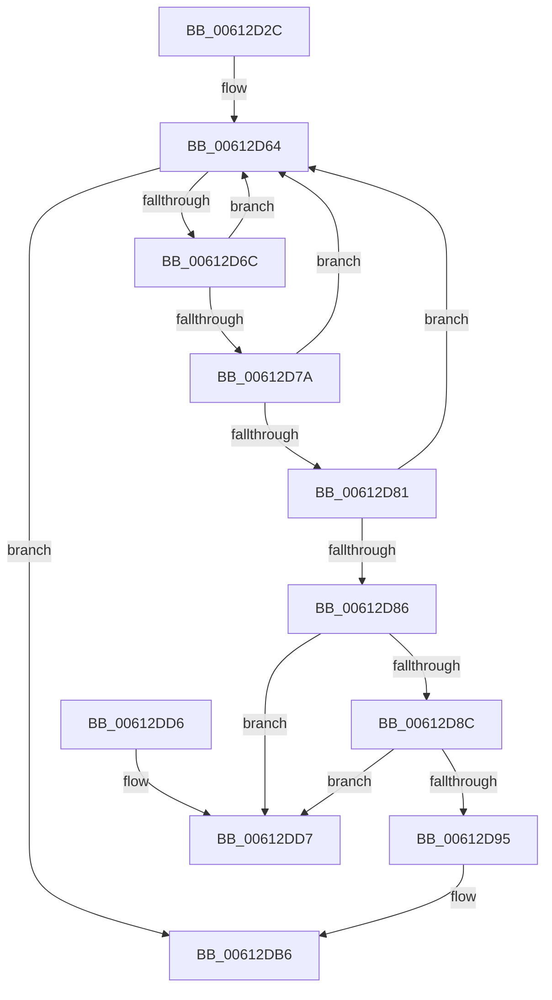

# ViFlushZeroMapRegisterBaseWcbs

- RVA: `0x00612D2C`–`0x00612DD9` (길이 `173` bytes)
- VA: `0x0000000140612D2C`
- 실행 섹션: `.text`
- PDB 이름 있음: `예`; PDB Function 태그: `아니요`
- unwind 정보 RVA: `0x000D2248`
- 디코드: `48`개 명령, `173/173` bytes 표시
- 미해석 바이트: `0` (있으면 어셈블리에 `.byte`로 보존)

> 이 문서는 커널 이미지의 기계어와 PDB 기호를 분석해 생성했습니다. 4번과 5번은 함수 원형과 자료형을 바이너리 사용 방식에서 추정한 C 해석이며 원본 소스 복구 결과는 아닙니다.

## 1. Dependencies

- 직접 호출 지점: **4**; 고유 호출 대상: **4**
- 직접 호출자로 확인된 함수: **1**
- RIP 상대 이미지 참조: **1**

### Outgoing calls
- `0x00612D4D` → [KeAcquireSpinLockRaiseToDpc](../20/KeAcquireSpinLockRaiseToDpc_function_00208470.md) (function, `0x00208470`)
- `0x00612DA2` → [SUBTRACT_MAP_REGISTERS](../../pagevrfy/B9/SUBTRACT_MAP_REGISTERS_function_00B94E10.md) (function, `0x00B94E10`)
- `0x00612DB1` → [ExFreeToNPagedLookasideList](../38/ExFreeToNPagedLookasideList_function_0038D9D0.md) (function, `0x0038D9D0`)
- `0x00612DBC` → [KeReleaseSpinLock](../39/KeReleaseSpinLock_function_00392BA0.md) (function, `0x00392BA0`)

### Direct callers
- [VfPutDmaAdapter](../../pagevrfy/B9/VfPutDmaAdapter_function_00B97680.md) at `0x00B97719`

### Static image references
- `0x00612DAA` → RVA `0x00E28A80` (`.data`; read)

## 2. Other-region calls and transfers

- 다른 실행 섹션으로 향하는 call: **1**
  - `0x00612DA2` → [SUBTRACT_MAP_REGISTERS](../../pagevrfy/B9/SUBTRACT_MAP_REGISTERS_function_00B94E10.md) (`.text` → `PAGEVRFY`)
- 별도 외부 분기/꼬리 이동을 확인하지 못했습니다.

## 3. Assembly (complete function range)

```asm
00612D2C  48 89 5C 24 08                  mov qword ptr [rsp + 8], rbx
00612D31  48 89 6C 24 10                  mov qword ptr [rsp + 0x10], rbp
00612D36  48 89 74 24 18                  mov qword ptr [rsp + 0x18], rsi
00612D3B  57                              push rdi
00612D3C  48 83 EC 20                     sub rsp, 0x20
00612D40  48 8D B1 B0 00 00 00            lea rsi, [rcx + 0xb0]
00612D47  48 8B F9                        mov rdi, rcx
00612D4A  48 8B CE                        mov rcx, rsi
00612D4D  E8 1E 57 BF FF                  call 0x140208470
00612D52  4C 8D 8F A0 00 00 00            lea r9, [rdi + 0xa0]
00612D59  40 8A E8                        mov bpl, al
00612D5C  4D 8B 01                        mov r8, qword ptr [r9]
00612D5F  B9 03 00 00 00                  mov ecx, 3
00612D64  49 8B D0                        mov rdx, r8
00612D67  4D 3B C1                        cmp r8, r9
00612D6A  74 4A                           je 0x140612db6
00612D6C  49 8D 58 B8                     lea rbx, [r8 - 0x48]
00612D70  4D 8B 00                        mov r8, qword ptr [r8]
00612D73  48 83 7B 58 00                  cmp qword ptr [rbx + 0x58], 0
00612D78  75 EA                           jne 0x140612d64
00612D7A  48 83 7B 60 00                  cmp qword ptr [rbx + 0x60], 0
00612D7F  75 E3                           jne 0x140612d64
00612D81  39 4B 34                        cmp dword ptr [rbx + 0x34], ecx
00612D84  75 DE                           jne 0x140612d64
00612D86  49 39 50 08                     cmp qword ptr [r8 + 8], rdx
00612D8A  75 4B                           jne 0x140612dd7
00612D8C  48 8B 42 08                     mov rax, qword ptr [rdx + 8]
00612D90  48 39 10                        cmp qword ptr [rax], rdx
00612D93  75 42                           jne 0x140612dd7
00612D95  4C 89 00                        mov qword ptr [rax], r8
00612D98  48 8B CF                        mov rcx, rdi
00612D9B  49 89 40 08                     mov qword ptr [r8 + 8], rax
00612D9F  8B 53 30                        mov edx, dword ptr [rbx + 0x30]
00612DA2  E8 69 20 58 00                  call 0x140b94e10
00612DA7  48 8B D3                        mov rdx, rbx
00612DAA  48 8D 0D CF 5C 81 00            lea rcx, [rip + 0x815ccf]
00612DB1  E8 1A AC D7 FF                  call 0x14038d9d0
00612DB6  40 8A D5                        mov dl, bpl
00612DB9  48 8B CE                        mov rcx, rsi
00612DBC  E8 DF FD D7 FF                  call 0x140392ba0
00612DC1  48 8B 5C 24 30                  mov rbx, qword ptr [rsp + 0x30]
00612DC6  48 8B 6C 24 38                  mov rbp, qword ptr [rsp + 0x38]
00612DCB  48 8B 74 24 40                  mov rsi, qword ptr [rsp + 0x40]
00612DD0  48 83 C4 20                     add rsp, 0x20
00612DD4  5F                              pop rdi
00612DD5  C3                              ret
00612DD6  CC                              int3
00612DD7  CD 29                           int 0x29
```

## 4. C-style interpretation (structured pseudocode)

```c
__int64 __fastcall ViFlushZeroMapRegisterBaseWcbs(__int64 a1)
{
    __int64 result;
    __int64 v_rsp;
    unsigned __int64 v_stack_p10;
    unsigned __int64 v_stack_p18;
    unsigned __int64 v_stack_p8;

    v_stack_p8 = v_rbx;
    v_stack_p10 = v_rbp;
    v_stack_p18 = v_rsi;
    v_rsp = (v_rsp) - (32);
    result = KeAcquireSpinLockRaiseToDpc(a1 + 176, a2, a3, a4);
loc_00612D64:
    if ((*(unsigned __int64 *)(a1 + 160)) == (a1 + 160)) goto loc_00612DB6;
    if ((*(unsigned __int64 *)(*(unsigned __int64 *)(a1 + 160) - 72 + 88)) != 0) goto loc_00612D64;
    if ((*(unsigned __int64 *)(*(unsigned __int64 *)(a1 + 160) - 72 + 96)) != 0) goto loc_00612D64;
    if ((*(unsigned int *)(*(unsigned __int64 *)(a1 + 160) - 72 + 52)) != 3) goto loc_00612D64;
    if ((*(unsigned __int64 *)(*(unsigned __int64 *)(*(unsigned __int64 *)(a1 + 160)) + 8)) != (*(unsigned __int64 *)(a1 + 160))) goto loc_00612DD7;
    if ((*(unsigned __int64 *)(*(unsigned __int64 *)(*(unsigned __int64 *)(a1 + 160) + 8))) != (*(unsigned __int64 *)(a1 + 160))) goto loc_00612DD7;
    *(unsigned __int64 *)(*(unsigned __int64 *)(*(unsigned __int64 *)(a1 + 160) + 8)) = *(unsigned __int64 *)(*(unsigned __int64 *)(a1 + 160));
    *(unsigned __int64 *)(*(unsigned __int64 *)(*(unsigned __int64 *)(a1 + 160)) + 8) = *(unsigned __int64 *)(*(unsigned __int64 *)(a1 + 160) + 8);
    result = SUBTRACT_MAP_REGISTERS(a1, (unsigned int)(*(unsigned int *)(*(unsigned __int64 *)(a1 + 160) - 72 + 48)), *(unsigned __int64 *)(*(unsigned __int64 *)(a1 + 160)), a1 + 160);
    result = ExFreeToNPagedLookasideList(v_rip + 8477903, *(unsigned __int64 *)(a1 + 160) - 72, *(unsigned __int64 *)(*(unsigned __int64 *)(a1 + 160)), a1 + 160);
loc_00612DB6:
    result = KeReleaseSpinLock(a1 + 176, (unsigned __int8)((unsigned __int8)(result)), *(unsigned __int64 *)(*(unsigned __int64 *)(a1 + 160)), a1 + 160);
    v_rsp = (v_rsp) + (32);
    return result;
loc_00612DD7:
    return result;
}
```

## 5. (Beta) C Style

```c
int64_t ViFlushZeroMapRegisterBaseWcbs(void *Arg1)
{
    uint8_t *arg1 = (uint8_t *)Arg1;

    int64_t result;
    int64_t local_rsp;
    uint64_t v_stack_p10;
    uint64_t v_stack_p18;
    uint64_t v_stack_p8;

    v_stack_p8 = local_rbx;
    v_stack_p10 = local_rbp;
    v_stack_p18 = local_rsi;
    local_rsp = (local_rsp) - (32);
    result = KeAcquireSpinLockRaiseToDpc(Arg1 + 176, a2, a3, a4);
loc_00612D64:
    if ((*(uint64_t *)(arg1 + 0xA0)) == (Arg1 + 160)) goto loc_00612DB6;
    if ((*(uint64_t *)(*(uint64_t *)(arg1 + 0xA0) - 0x48 + 0x58)) != 0) goto loc_00612D64;
    if ((*(uint64_t *)(*(uint64_t *)(arg1 + 0xA0) - 0x48 + 0x60)) != 0) goto loc_00612D64;
    if ((*(uint32_t *)(*(uint64_t *)(arg1 + 0xA0) - 0x48 + 0x34)) != 3) goto loc_00612D64;
    if ((*(uint64_t *)(*(uint64_t *)(*(uint64_t *)(arg1 + 0xA0)) + 0x8)) != (*(uint64_t *)(arg1 + 0xA0))) goto loc_00612DD7;
    if ((*(uint64_t *)(*(uint64_t *)(*(uint64_t *)(arg1 + 0xA0) + 0x8))) != (*(uint64_t *)(arg1 + 0xA0))) goto loc_00612DD7;
    *(uint64_t *)(*(uint64_t *)(*(uint64_t *)(arg1 + 0xA0) + 0x8)) = *(uint64_t *)(*(uint64_t *)(arg1 + 0xA0));
    *(uint64_t *)(*(uint64_t *)(*(uint64_t *)(arg1 + 0xA0)) + 0x8) = *(uint64_t *)(*(uint64_t *)(arg1 + 0xA0) + 0x8);
    result = SUBTRACT_MAP_REGISTERS(Arg1, (uint32_t)(*(uint32_t *)(*(uint64_t *)(arg1 + 0xA0) - 0x48 + 0x30)), *(uint64_t *)(*(uint64_t *)(arg1 + 0xA0)), Arg1 + 160);
    result = ExFreeToNPagedLookasideList(v_rip + 8477903, *(uint64_t *)(arg1 + 0xA0) - 72, *(uint64_t *)(*(uint64_t *)(arg1 + 0xA0)), Arg1 + 160);
loc_00612DB6:
    result = KeReleaseSpinLock(Arg1 + 176, (uint8_t)((uint8_t)(result)), *(uint64_t *)(*(uint64_t *)(arg1 + 0xA0)), Arg1 + 160);
    local_rsp = (local_rsp) + (32);
    return result;
loc_00612DD7:
    return result;
}
```

### 관측된 메모리 오프셋

구조체 형식이 확인되지 않은 접근은 인자 기준의 오프셋으로만 기록했습니다.

| 기준 인자 | 오프셋 표현 | 폭 (bit) | 접근 |
|---|---:|---:|---|
| `Arg1` | `+ 0x0` | `64` | `R` |
| `Arg1` | `+ 0xA0` | `64` | `R` |
| `Arg1` | `+ 0xB0` | `64` | `R` |

## 6. Execution-region graph

[열기: 2D/3D 그래프와 함수 탐색 컨트롤 패널](../../../control-panel.html?section=text&rva=0x00612D2C&view=graph)

- 2D 그래프는 위에서 아래로 흐르고, 3D 그래프는 빈 공간을 드래그해 회전합니다. Shift+드래그는 이동, 휠은 확대·축소, 함수 노드 선택은 대상 보고서 이동입니다.

### Static fallback


