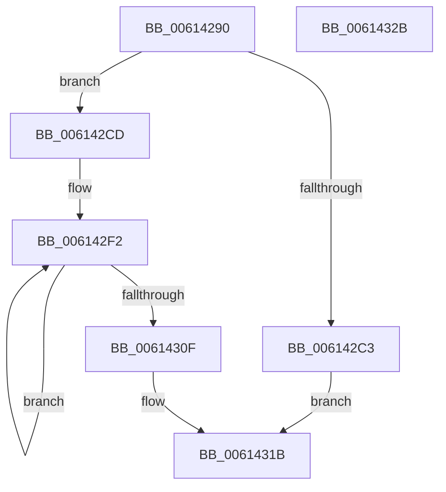

# ViGrowPoolAllocation

- RVA: `0x00614290`–`0x0061432C` (길이 `156` bytes)
- VA: `0x0000000140614290`
- 실행 섹션: `.text`
- PDB 이름 있음: `예`; PDB Function 태그: `아니요`
- unwind 정보 RVA: `0x00060BC4`
- 디코드: `39`개 명령, `156/156` bytes 표시
- 미해석 바이트: `0` (있으면 어셈블리에 `.byte`로 보존)

> 이 문서는 커널 이미지의 기계어와 PDB 기호를 분석해 생성했습니다. 4번과 5번은 함수 원형과 자료형을 바이너리 사용 방식에서 추정한 C 해석이며 원본 소스 복구 결과는 아닙니다.

## 1. Dependencies

- 직접 호출 지점: **5**; 고유 호출 대상: **4**
- 직접 호출자로 확인된 함수: **1**
- RIP 상대 이미지 참조: **0**

### Outgoing calls
- `0x006142B2` → [ExAllocatePool2](../../poolcode/B8/ExAllocatePool2_function_00B820F0.md) (function, `0x00B820F0`)
- `0x006142C6` → [ExpInterlockedPopEntrySList](../6B/ExpInterlockedPopEntrySList_function_006BA570.md) (function, `0x006BA570`)
- `0x006142D0` → [KeZeroSinglePage](../6B/KeZeroSinglePage_function_006BA030.md) (function, `0x006BA030`)
- `0x006142E8` → [ExpInterlockedPushEntrySList](../6B/ExpInterlockedPushEntrySList_function_006BA5B0.md) (function, `0x006BA5B0`)
- `0x00614304` → [ExpInterlockedPushEntrySList](../6B/ExpInterlockedPushEntrySList_function_006BA5B0.md) (function, `0x006BA5B0`)

### Direct callers
- [VfHandlePoolAlloc](../../pagevrfy/BB/VfHandlePoolAlloc_function_00BB8A90.md) at `0x00BB8CBC`

### Static image references
- 디코드된 RIP-relative 메모리 참조가 없습니다.

## 2. Other-region calls and transfers

- 다른 실행 섹션으로 향하는 call: **1**
  - `0x006142B2` → [ExAllocatePool2](../../poolcode/B8/ExAllocatePool2_function_00B820F0.md) (`.text` → `POOLCODE`)
- 별도 외부 분기/꼬리 이동을 확인하지 못했습니다.

## 3. Assembly (complete function range)

```asm
00614290  48 89 5C 24 08                  mov qword ptr [rsp + 8], rbx
00614295  48 89 74 24 10                  mov qword ptr [rsp + 0x10], rsi
0061429A  57                              push rdi
0061429B  48 83 EC 20                     sub rsp, 0x20
0061429F  48 8B F1                        mov rsi, rcx
006142A2  BA 00 10 00 00                  mov edx, 0x1000
006142A7  B9 40 02 00 00                  mov ecx, 0x240
006142AC  41 B8 56 65 70 70               mov r8d, 0x70706556
006142B2  E8 39 DE 56 00                  call 0x140b820f0
006142B7  48 8D 7E 50                     lea rdi, [rsi + 0x50]
006142BB  48 8B D8                        mov rbx, rax
006142BE  48 85 C0                        test rax, rax
006142C1  75 0A                           jne 0x1406142cd
006142C3  48 8B CF                        mov rcx, rdi
006142C6  E8 A5 62 0A 00                  call 0x1406ba570
006142CB  EB 4E                           jmp 0x14061431b
006142CD  48 8B CB                        mov rcx, rbx
006142D0  E8 5B 5D 0A 00                  call 0x1406ba030
006142D5  48 8D 4E 40                     lea rcx, [rsi + 0x40]
006142D9  48 89 73 08                     mov qword ptr [rbx + 8], rsi
006142DD  48 8B D3                        mov rdx, rbx
006142E0  48 C7 43 10 45 13 32 21         mov qword ptr [rbx + 0x10], 0x21321345
006142E8  E8 C3 62 0A 00                  call 0x1406ba5b0
006142ED  BE 7E 00 00 00                  mov esi, 0x7e
006142F2  48 83 C3 20                     add rbx, 0x20
006142F6  48 8B CF                        mov rcx, rdi
006142F9  48 8B D3                        mov rdx, rbx
006142FC  48 C7 43 10 01 00 00 00         mov qword ptr [rbx + 0x10], 1
00614304  E8 A7 62 0A 00                  call 0x1406ba5b0
00614309  48 83 EE 01                     sub rsi, 1
0061430D  75 E3                           jne 0x1406142f2
0061430F  48 C7 43 30 01 00 00 00         mov qword ptr [rbx + 0x30], 1
00614317  48 8D 43 20                     lea rax, [rbx + 0x20]
0061431B  48 8B 5C 24 30                  mov rbx, qword ptr [rsp + 0x30]
00614320  48 8B 74 24 38                  mov rsi, qword ptr [rsp + 0x38]
00614325  48 83 C4 20                     add rsp, 0x20
00614329  5F                              pop rdi
0061432A  C3                              ret
0061432B  CC                              int3
```

## 4. C-style interpretation (structured pseudocode)

```c
__int64 __fastcall ViGrowPoolAllocation(__int64 a1)
{
    __int64 result;
    __int64 v_rbx;
    __int64 v_rsi;
    __int64 v_rsp;
    unsigned __int64 v_stack_p10;
    unsigned __int64 v_stack_p8;

    v_stack_p8 = v_rbx;
    v_stack_p10 = v_rsi;
    v_rsp = (v_rsp) - (32);
    result = ExAllocatePool2(576, (unsigned int)(0x1000ULL), (unsigned int)(0x70706556ULL), a4);
    if (result != 0) goto loc_006142CD;
    result = ExpInterlockedPopEntrySList(a1 + 80, (unsigned int)(0x1000ULL), (unsigned int)(0x70706556ULL), a4);
    goto loc_0061431B;
loc_006142CD:
    result = KeZeroSinglePage(result, (unsigned int)(0x1000ULL), (unsigned int)(0x70706556ULL), a4);
    *(unsigned __int64 *)(result + 8) = a1;
    *(unsigned __int64 *)(result + 16) = 0x21321345ULL;
    result = ExpInterlockedPushEntrySList(a1 + 64, result, (unsigned int)(0x70706556ULL), a4);
loc_006142F2:
    v_rbx = (result) + (32);
    *(unsigned __int64 *)(v_rbx + 16) = 1;
    result = ExpInterlockedPushEntrySList(a1 + 80, v_rbx, (unsigned int)(0x70706556ULL), a4);
    v_rsi = (126) - (1);
    if (condition_is_not_equal) goto loc_006142F2;
    *(unsigned __int64 *)(v_rbx + 48) = 1;
loc_0061431B:
    v_rsp = (v_rsp) + (32);
    return v_rbx + 32;
}
```

## 5. (Beta) C Style

```c
int64_t ViGrowPoolAllocation(void *Arg1)
{
    uint8_t *arg1 = (uint8_t *)Arg1;

    int64_t result;
    int64_t local_rbx;
    int64_t local_rsi;
    int64_t local_rsp;
    uint64_t v_stack_p10;
    uint64_t v_stack_p8;

    v_stack_p8 = local_rbx;
    v_stack_p10 = local_rsi;
    local_rsp = (local_rsp) - (32);
    result = ExAllocatePool2(576, (uint32_t)(0x1000ULL), (uint32_t)(0x70706556ULL), a4);
    if (result != 0) goto loc_006142CD;
    result = ExpInterlockedPopEntrySList(Arg1 + 80, (uint32_t)(0x1000ULL), (uint32_t)(0x70706556ULL), a4);
    goto loc_0061431B;
loc_006142CD:
    result = KeZeroSinglePage(result, (uint32_t)(0x1000ULL), (uint32_t)(0x70706556ULL), a4);
    *(void **)(result + 0x8) = Arg1;
    *(uint64_t *)(result + 0x10) = 0x21321345ULL;
    result = ExpInterlockedPushEntrySList(Arg1 + 64, result, (uint32_t)(0x70706556ULL), a4);
loc_006142F2:
    local_rbx = (result) + (32);
    *(uint64_t *)(local_rbx + 0x10) = 1;
    result = ExpInterlockedPushEntrySList(Arg1 + 80, local_rbx, (uint32_t)(0x70706556ULL), a4);
    local_rsi = (126) - (1);
    if (condition_is_not_equal) goto loc_006142F2;
    *(uint64_t *)(local_rbx + 0x30) = 1;
loc_0061431B:
    local_rsp = (local_rsp) + (32);
    return local_rbx + 32;
}
```

### 관측된 메모리 오프셋

구조체 형식이 확인되지 않은 접근은 인자 기준의 오프셋으로만 기록했습니다.

| 기준 인자 | 오프셋 표현 | 폭 (bit) | 접근 |
|---|---:|---:|---|
| `Arg1` | `+ 0x40` | `64` | `R` |
| `Arg1` | `+ 0x50` | `64` | `R` |

## 6. Execution-region graph

[열기: 2D/3D 그래프와 함수 탐색 컨트롤 패널](../../../control-panel.html?section=text&rva=0x00614290&view=graph)

- 2D 그래프는 위에서 아래로 흐르고, 3D 그래프는 빈 공간을 드래그해 회전합니다. Shift+드래그는 이동, 휠은 확대·축소, 함수 노드 선택은 대상 보고서 이동입니다.

### Static fallback


